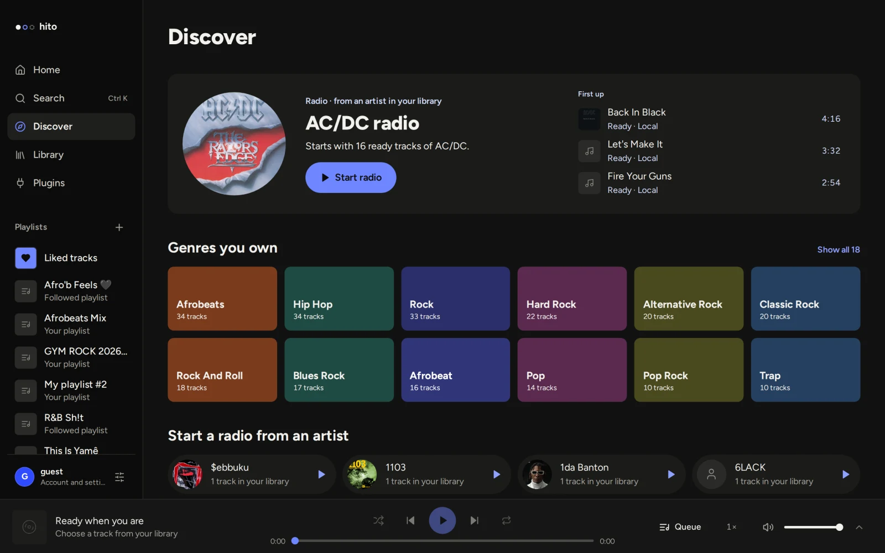
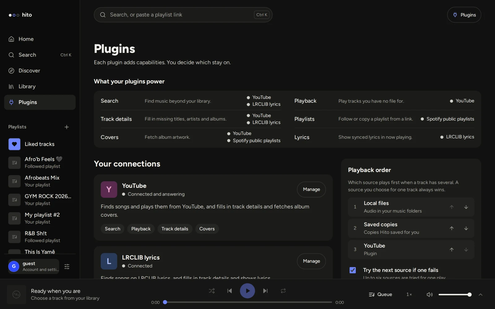
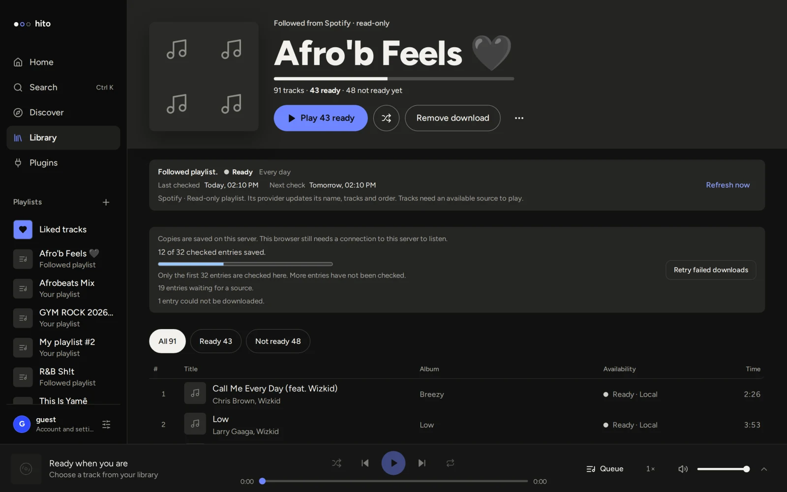
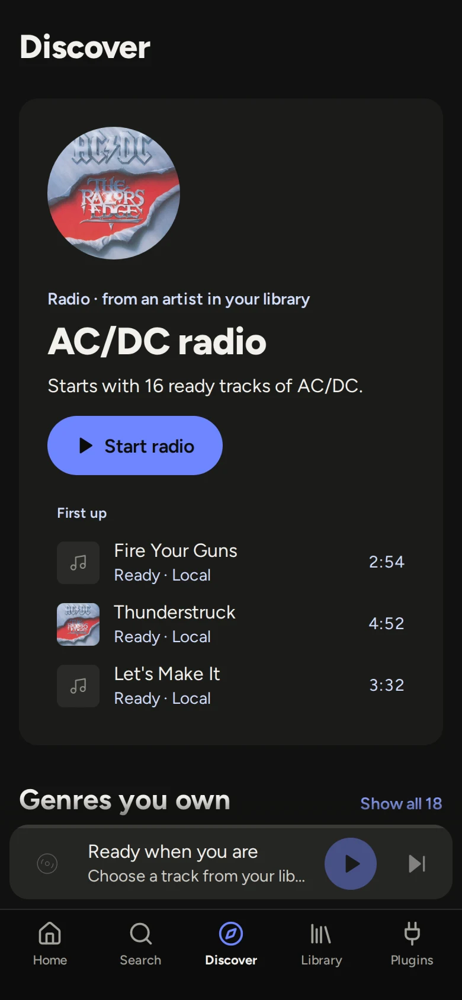

<div align="center">

<picture>
  <source media="(prefers-color-scheme: dark)" srcset=".github/readme/logo-dark.svg">
  
</picture>

**One player for every music source.**

[](LICENSE)

[Run it](#run-it) · [Plugins](#plugins) · [Docs](docs/README.md) · [Contributing](docs/development.md)

<br>



</div>

Hito is a self-hosted music player with an open plugin system. On its own it plays the music in your folders. Plugins add the rest: more places to find audio, playlists from other services, lyrics, covers and track details.

Plugins are opt-in. Use the ones that ship with Hito, use someone else's, write your own, or run none at all. A plugin is a small HTTP service that describes what it can do, so Hito works the same with any of them. You choose which sources play first, and when one fails Hito tries the next.

> [!NOTE]
> Hito is in active development and has no public release yet. It runs well as a local or home-server build in Docker. Desktop apps and installers are still being built. See the [roadmap](docs/roadmap.md).

## Plugins

A plugin can offer any of these capabilities. Hito asks you to approve them before it connects.

| Capability | What it adds |
| --- | --- |
| Search | Find music beyond your library, in Search and Discover. |
| Playback | Play tracks you have no file for. |
| Playlists | Copy or follow a playlist from a link. |
| Track details and covers | Fill in missing titles, artists, albums and artwork. |
| Lyrics | Show lyrics in Now playing. |



Hito never downloads or runs plugin code. It only talks to plugins over HTTP, and tokens you enter are encrypted and private to your account. The [plugin SDK](crates/plugin-sdk) is Apache-2.0, so a plugin can use any license. [Plugin connections](docs/plugins.md) describes the protocol.

### Plugins in this repository

These are reference plugins. None is required.

| Plugin | What it does |
| --- | --- |
| Spotify | Copies a public playlist link into an editable Hito playlist, or follows it hourly or daily. Metadata only. |
| YouTube | Search, playback, track details and covers. |
| LRCLIB | Lyrics. |
| Jamendo | Free-licensed music to search and play. Needs a Jamendo client ID. |
| ListenBrainz | Similar artists. |
| Real-Debrid, All-Debrid, TorBox, Premiumize | Playback from your own debrid account. |
| Folder | Serves a folder as a plugin source. Useful for testing. |

## Also in the box

- **Artist pages from MusicBrainz.** Built in, no plugin needed. Hito matches artists by file tags, ISRCs and provider links, never by name alone.
- **Your own files.** Add music folders and Hito builds albums and artists from their tags. Folders are mounted read-only, and edits you make in Hito stay in Hito.
- **Podcasts and audiobooks.** RSS subscriptions, bookmarks and Continue listening.
- **Private accounts.** The first account is the administrator. Everyone else sees only the libraries they're given.
- **Works on a phone.** Install it from the browser as a web app.

<table>
  <tr>
    <td width="66%"></td>
    <td width="34%"></td>
  </tr>
</table>

## Run it

You need [Docker](https://www.docker.com/products/docker-desktop/) (or [OrbStack](https://orbstack.dev/) on macOS), Git and about 10 GB of free disk. A music folder is optional.

```sh
git clone https://github.com/acidiney/hitoapp.git
cd hitoapp
```

Then start the setup launcher for your system:

| System | Launcher |
| --- | --- |
| macOS | Double-click `Hito Setup.command`. If macOS blocks it, right-click it and choose **Open**. |
| Windows | Right-click `Hito Setup.ps1` and choose **Run with PowerShell**. |
| Linux | Run `./hito-setup`. The folder picker needs Zenity or KDialog. |

The launcher asks for your music folders, builds Hito in Docker (5 to 15 minutes the first time) and opens [localhost:8080](http://localhost:8080). Create the first account. That account is the administrator. Then connect plugins in **Settings → Plugins**, add a music folder from **Library**, or both.

Run the launcher again to add more folders. Your library is kept. To stop Hito, run `docker stop hito-server-1`; `docker start hito-server-1` brings it back.

If something fails, the launcher prints the failed step. Its log is in `~/Library/Application Support/Hito` (macOS), `~/.config/hito` (Linux) or `%LOCALAPPDATA%\Hito` (Windows). [Music folders](docs/music-folders.md) and [operations](docs/operations.md) cover the rest.

### Add plugins

The setup launcher can start the Spotify and YouTube plugins for you if you answer **Start addons** when it asks. To start them yourself:

```sh
docker compose -p hito -f compose.yaml -f deploy/compose/addons.yaml --profile plugins up -d --build
```

Then connect them in **Settings → Plugins**. The [self-hosting guide](docs/self-hosting.md) covers every plugin: what it needs, how to update it and how to remove it.

## How it's built


A Rust server owns the library and a React app draws it. The desktop app embeds the same core and plays audio natively in Rust instead of in the browser. Plugins are separate HTTP services.

| Path | What it is |
| --- | --- |
| [`apps/server`](apps/server) | HTTP API, sign-in, file streaming and background workers |
| [`apps/web`](apps/web) | The React interface, shared by the browser and the desktop app |
| [`apps/desktop`](apps/desktop) | Tauri desktop host with a private local library |
| [`apps/community`](apps/community) | Optional community ranking service |
| [`crates/core`](crates/core) | Accounts, catalog, playlists, indexing and all SQLite access |
| [`crates/audio`](crates/audio), [`crates/playback`](crates/playback) | Native decoding, output and the queue |
| [`crates/plugin-sdk`](crates/plugin-sdk) | The plugin protocol, Apache-2.0 so anyone can build one |
| [`plugins/`](plugins) | The reference plugins listed above |
| [`docs/`](docs/README.md) | Guides and design notes |

[Architecture](docs/architecture.md) goes deeper, and the [API](docs/api.md) is generated from the Rust routes.

## Develop

Everything builds and runs in Docker. The `Makefile` is the entry point:

```sh
make help         # list every target
make test-rust    # Rust tests
make test-web     # web unit tests
make e2e          # browser tests against an isolated server
make verify       # the full check CI runs
```

Read [development](docs/development.md) and [testing](docs/testing.md) before your first change. [AGENTS.md](AGENTS.md) has the code rules for people and coding agents alike.

## License

Hito is [AGPL-3.0-only](LICENSE). The [plugin SDK](crates/plugin-sdk) is [Apache-2.0](crates/plugin-sdk/LICENSE), so plugins can use any license. No provider credentials ship with Hito. See [third-party notices](docs/third-party-notices.md).
