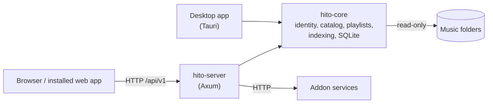

<div align="center">

<picture>
  <source media="(prefers-color-scheme: dark)" srcset=".github/readme/logo-dark.svg">
  
</picture>

**A self-hosted music library for the files you own and the services you use.**

[](https://github.com/acidiney/hitoapp/actions/workflows/verify.yml)
[](LICENSE)

[Run it](#run-it) · [Addons](docs/self-hosting.md) · [Docs](docs/README.md) · [Contributing](docs/development.md)

<br>


</div>

Hito plays the music in your folders. Point it at one or more folders and it builds a library of albums, artists and tracks without moving or changing a single file. Run it on your computer or a home server, open it in any browser, and every person in the house gets their own account, playlists, likes and history.

When your folders don't have a track, addons can fill the gap. Paste a Spotify playlist link and Hito copies it as your own playlist, then finds audio for each track through YouTube or another source you connect.

> [!NOTE]
> Hito is in active development and has no public release yet. It runs well as a local or home-server build in Docker. Desktop apps and installers are still being built.

## What you get

- **Your files stay put.** Music folders are mounted read-only. Tags you edit in Hito are private to your account and never written back to the file.
- **One library, several sources.** Local files, plugin services and imported playlists sit in one list. Each track shows where its audio comes from and whether it's ready to play.
- **Playlists that keep up.** Import a public Spotify playlist once, or follow it so new tracks arrive hourly or daily.
- **Real artist pages.** Hito matches credits to MusicBrainz artists from file tags and ISRCs. It never merges two artists only because their names match.
- **Podcasts and audiobooks.** Subscribe to RSS feeds, keep bookmarks and pick up where you stopped.
- **Accounts that stay private.** The first account is the administrator. Everyone else sees only the libraries they are given, and their own playlists and history.
- **Works on a phone.** Install it from the browser as a web app. Optional lyrics come from LRCLIB.

<table>
  <tr>
    <td width="62%"></td>
    <td width="38%"></td>
  </tr>
  <tr>
    <td colspan="2"></td>
  </tr>
</table>

<sub>Screenshots use a demo library of made-up artists and generated covers.</sub>

## Run it

You need [Docker](https://www.docker.com/products/docker-desktop/) (or [OrbStack](https://orbstack.dev/) on macOS), Git, about 10 GB of free disk and a folder of music.

```sh
git clone https://github.com/acidiney/hitoapp.git
cd hitoapp
```

Then start the setup launcher for your system:

| System | Launcher |
| --- | --- |
| macOS | Double-click `Hito Setup.command`. If macOS blocks it, right-click it and choose **Open**. |
| Windows | Right-click `Hito Setup.ps1` and choose **Run with PowerShell**. |
| Linux | Run `./hito-setup`. The folder picker needs Zenity or KDialog. |

The launcher asks for your music folders, builds Hito in Docker (5 to 15 minutes the first time) and opens [localhost:8080](http://localhost:8080). Create the first account, open **Library**, choose **Add music folder** and press play.

Run the launcher again to add more folders. Your library is kept. To stop Hito, run `docker stop hito-server-1`; `docker start hito-server-1` brings it back.

If something fails, the launcher prints the failed step. Its log is in `~/Library/Application Support/Hito` (macOS), `~/.config/hito` (Linux) or `%LOCALAPPDATA%\Hito` (Windows). [Music folders](docs/music-folders.md) and [operations](docs/operations.md) cover the rest.

### Add addons

Addons are small separate services that run next to Hito. Start the Spotify and YouTube addons with the server:

```sh
docker compose -p hito -f compose.yaml -f deploy/compose/addons.yaml --profile plugins up -d --build
```

Then connect them in **Settings → Plugins**. The [self-hosting guide](docs/self-hosting.md) lists every addon, what it needs and how to remove it.

| Addon | What it does |
| --- | --- |
| Spotify | Copies a public playlist link into an editable Hito playlist. Metadata only, no audio. |
| YouTube | Search, save results and find audio for imported tracks. |
| Jamendo | Free-licensed music. Needs a Jamendo client ID. |
| LRCLIB | Plain and synced lyrics. |
| ListenBrainz | Similar artists. |
| Real-Debrid, All-Debrid, TorBox, Premiumize | Play files from your own debrid account. |
| Folder | Serves a folder as a plugin source. Useful for testing. |

## How it's built



A Rust server owns the library and a React app draws it. The desktop app embeds the same core and plays audio natively in Rust instead of in the browser. Addons are separate HTTP services; Hito never downloads or runs their code.

| Path | What it is |
| --- | --- |
| [`apps/server`](apps/server) | HTTP API, sign-in, file streaming and background workers |
| [`apps/web`](apps/web) | The React interface, shared by the browser and the desktop app |
| [`apps/desktop`](apps/desktop) | Tauri desktop host with a private local library |
| [`apps/community`](apps/community) | Optional community ranking service |
| [`crates/core`](crates/core) | Accounts, catalog, playlists, indexing and all SQLite access |
| [`crates/audio`](crates/audio), [`crates/playback`](crates/playback) | Native decoding, output and the queue |
| [`crates/plugin-sdk`](crates/plugin-sdk) | The addon protocol, Apache-2.0 so anyone can build one |
| [`plugins/`](plugins) | The reference addons listed above |
| [`docs/`](docs/README.md) | Guides and design notes |

[Architecture](docs/architecture.md) goes deeper, and the [API](docs/api.md) is generated from the Rust routes.

## Develop

Everything builds and runs in Docker. The `Makefile` is the entry point:

```sh
make help         # list every target
make test-rust    # Rust tests
make test-web     # web unit tests
make e2e          # browser tests against an isolated server
make verify       # the full check CI runs
```

Read [development](docs/development.md) and [testing](docs/testing.md) before your first change. [AGENTS.md](AGENTS.md) has the code rules for people and coding agents alike.

## License

Hito is [AGPL-3.0-only](LICENSE). The [plugin SDK](crates/plugin-sdk) is [Apache-2.0](crates/plugin-sdk/LICENSE), so addons can use any license. No provider credentials ship with Hito. See [third-party notices](docs/third-party-notices.md).
