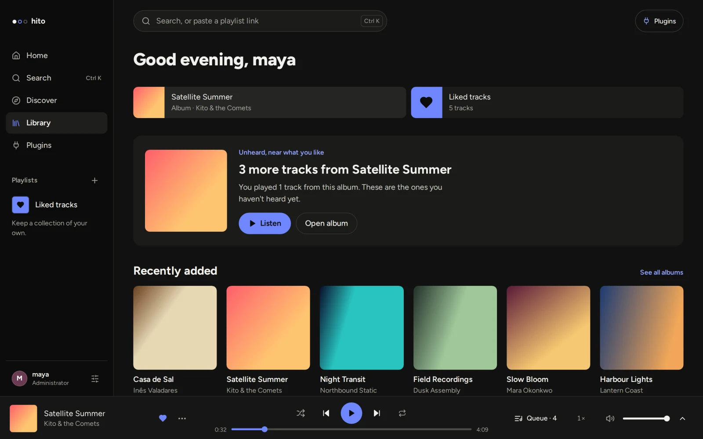
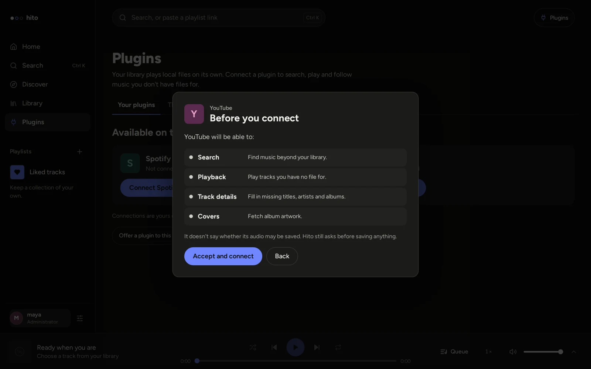
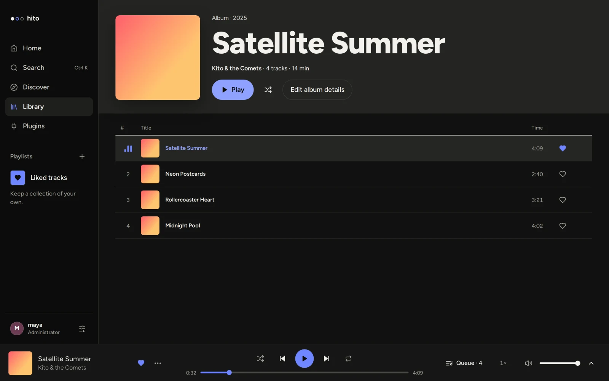
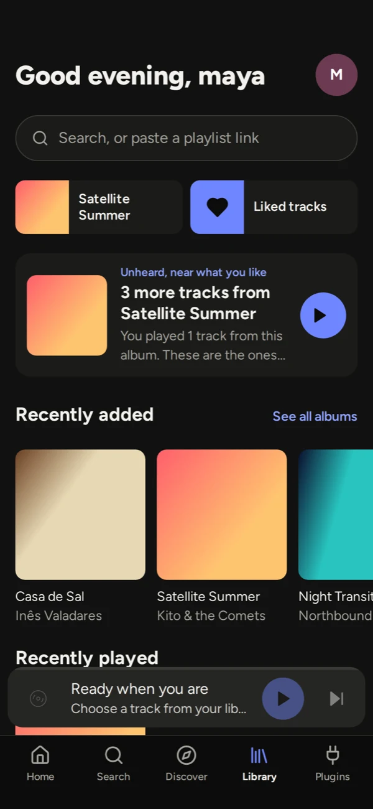
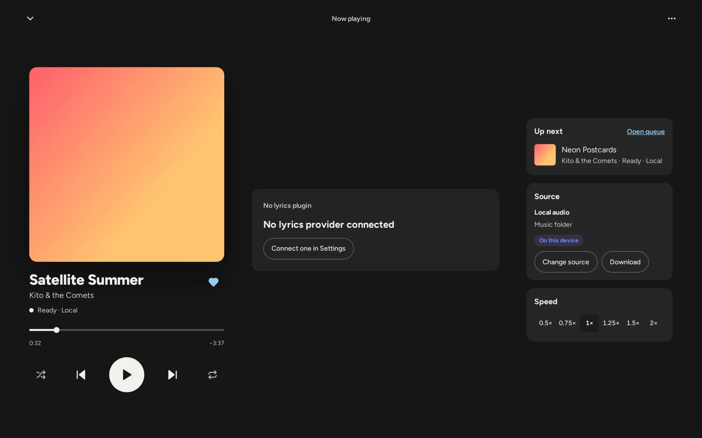

<div align="center">

<picture>
  <source media="(prefers-color-scheme: dark)" srcset=".github/readme/logo-dark.svg">
  
</picture>

**One player for your Spotify playlists, YouTube, debrid accounts and music files. Self-hosted, built on plugins.**

[](LICENSE)

[Run it](#run-it) · [Plugins](#plugins) · [Docs](docs/README.md) · [Contributing](docs/development.md)

<br>



</div>

Your music is spread across a Spotify playlist, YouTube, a debrid account and a folder of files. Hito plays all of it from one library.

Paste a Spotify playlist link and it's yours, ready to play. Hito finds audio for every track on YouTube, your debrid service or your own disk, in the order you prefer, and falls back to the next source when one fails. MusicBrainz fills in the artist pages and LRCLIB brings the lyrics.

Every source is a plugin. Connect the ones you want, skip the rest, or write your own. You host Hito yourself, so the library, the history and every account in the house stay on your machine.

> [!NOTE]
> Hito is in active development and has no public release yet. It runs well as a local or home-server build in Docker. Desktop apps and installers are still being built.

## Plugins

| Plugin | What you get |
| --- | --- |
| **Spotify** | Paste a public playlist link and Hito copies it as your own editable playlist. Follow it and new tracks arrive hourly or daily. No Spotify account needed. |
| **YouTube** | Search for music in Discover, save what you find, and play imported tracks. |
| **MusicBrainz** | Built in. Artist pages, discographies and genres. Hito matches artists by file tags, ISRCs and provider links, never by name alone. |
| **LRCLIB** | Lyrics in Now playing. |
| **Real-Debrid, All-Debrid, TorBox, Premiumize** | Play from your own debrid account. |
| **Jamendo** | Free-licensed music to search, play and browse. |
| **ListenBrainz** | Similar artists on artist pages. |

Plugins are small HTTP services that run next to Hito, usually as Docker containers. Hito never downloads or runs plugin code. Before you connect one, Hito shows exactly what it will be allowed to do, and tokens you enter are encrypted and private to your account. The [plugin SDK](crates/plugin-sdk) is Apache-2.0, so you can [write your own](docs/plugins.md) under any license.

<p align="center"></p>

## Also in the box

- **Your own files.** Add music folders and Hito builds albums and artists from their tags. Folders are mounted read-only, and edits you make in Hito stay in Hito.
- **Podcasts and audiobooks.** RSS subscriptions, bookmarks and Continue listening.
- **Private accounts.** The first account is the administrator. Everyone else sees only the libraries they're given.
- **Works on a phone.** Install it from the browser as a web app.

<table>
  <tr>
    <td width="62%"></td>
    <td width="38%"></td>
  </tr>
  <tr>
    <td colspan="2"></td>
  </tr>
</table>

<sub>Screenshots use a demo library of made-up artists and generated covers.</sub>

## Run it

You need [Docker](https://www.docker.com/products/docker-desktop/) (or [OrbStack](https://orbstack.dev/) on macOS), Git and about 10 GB of free disk. A music folder is optional.

```sh
git clone https://github.com/acidiney/hitoapp.git
cd hitoapp
```

Then start the setup launcher for your system:

| System | Launcher |
| --- | --- |
| macOS | Double-click `Hito Setup.command`. If macOS blocks it, right-click it and choose **Open**. |
| Windows | Right-click `Hito Setup.ps1` and choose **Run with PowerShell**. |
| Linux | Run `./hito-setup`. The folder picker needs Zenity or KDialog. |

The launcher asks for your music folders, builds Hito in Docker (5 to 15 minutes the first time) and opens [localhost:8080](http://localhost:8080). Create the first account. That account is the administrator. Then connect plugins in **Settings → Plugins**, add a music folder from **Library**, or both.

Run the launcher again to add more folders. Your library is kept. To stop Hito, run `docker stop hito-server-1`; `docker start hito-server-1` brings it back.

If something fails, the launcher prints the failed step. Its log is in `~/Library/Application Support/Hito` (macOS), `~/.config/hito` (Linux) or `%LOCALAPPDATA%\Hito` (Windows). [Music folders](docs/music-folders.md) and [operations](docs/operations.md) cover the rest.

### Add plugins

The setup launcher can start the Spotify and YouTube plugins for you if you answer **Start addons** when it asks. To start them yourself:

```sh
docker compose -p hito -f compose.yaml -f deploy/compose/addons.yaml --profile plugins up -d --build
```

Then connect them in **Settings → Plugins**. The [self-hosting guide](docs/self-hosting.md) covers every plugin: what it needs, how to update it and how to remove it.

## How it's built


A Rust server owns the library and a React app draws it. The desktop app embeds the same core and plays audio natively in Rust instead of in the browser. Plugins are separate HTTP services.

| Path | What it is |
| --- | --- |
| [`apps/server`](apps/server) | HTTP API, sign-in, file streaming and background workers |
| [`apps/web`](apps/web) | The React interface, shared by the browser and the desktop app |
| [`apps/desktop`](apps/desktop) | Tauri desktop host with a private local library |
| [`apps/community`](apps/community) | Optional community ranking service |
| [`crates/core`](crates/core) | Accounts, catalog, playlists, indexing and all SQLite access |
| [`crates/audio`](crates/audio), [`crates/playback`](crates/playback) | Native decoding, output and the queue |
| [`crates/plugin-sdk`](crates/plugin-sdk) | The plugin protocol, Apache-2.0 so anyone can build one |
| [`plugins/`](plugins) | The reference plugins listed above |
| [`docs/`](docs/README.md) | Guides and design notes |

[Architecture](docs/architecture.md) goes deeper, and the [API](docs/api.md) is generated from the Rust routes.

## Develop

Everything builds and runs in Docker. The `Makefile` is the entry point:

```sh
make help         # list every target
make test-rust    # Rust tests
make test-web     # web unit tests
make e2e          # browser tests against an isolated server
make verify       # the full check CI runs
```

Read [development](docs/development.md) and [testing](docs/testing.md) before your first change. [AGENTS.md](AGENTS.md) has the code rules for people and coding agents alike.

## License

Hito is [AGPL-3.0-only](LICENSE). The [plugin SDK](crates/plugin-sdk) is [Apache-2.0](crates/plugin-sdk/LICENSE), so plugins can use any license. No provider credentials ship with Hito. See [third-party notices](docs/third-party-notices.md).
