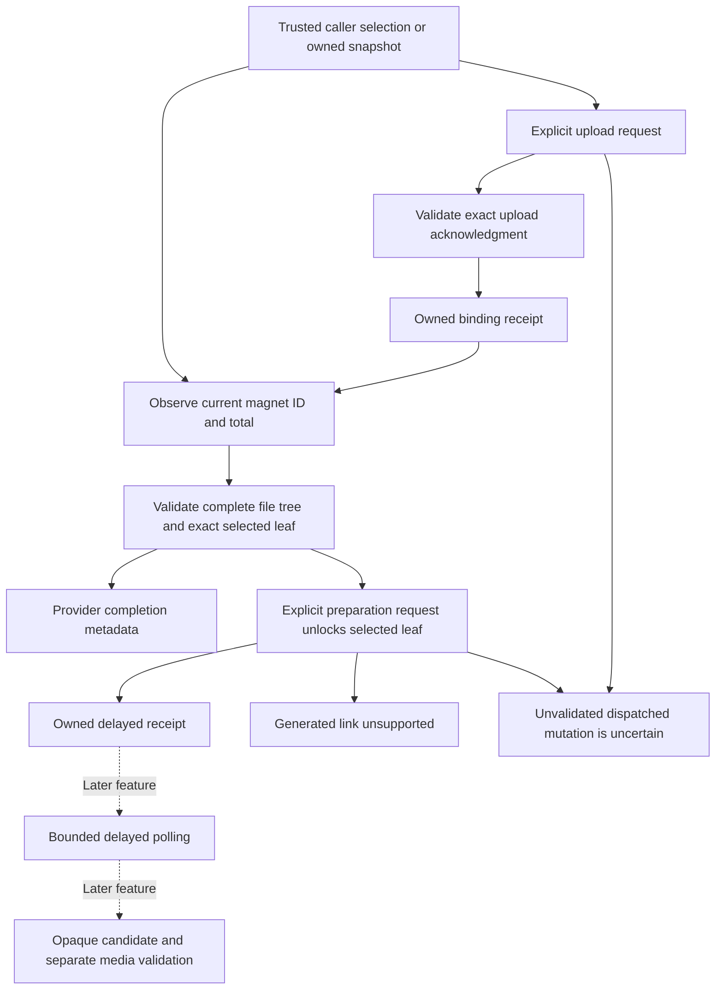

# AllDebrid protocol adapter

This crate is a protocol library. It is not yet a Hito plugin service or a complete playable-source adapter. No live provider account, signed-media transfer, packaged provider flow, or public release is qualified by this packet.

## Binding and operations

`MagnetFileBinding` is trusted caller configuration. Its info hash is retained from that configuration or a validated upload acknowledgment. Current status responses do not supply that hash, so observation does not independently verify it or establish recording identity.

`observe` checks the exact provider magnet ID and total size. On provider completion it reads the full bounded file tree, rejects ambiguous canonical paths, checks total leaf size, and matches the selected path and size. Provider completion does not mean playable audio.

`submit_magnet` sends one validated lowercase 40-character hash. A receipt requires one acknowledgment whose echoed input, hash, positive ID, and total size match the request. The receipt also retains the caller's selected path and size for subsequent observation. The provider's `ready` field never grants playable status.

`prepare_bound_file` re-observes the current ID, total, tree, and selected leaf before requesting one unlock for that exact private leaf link. The current implementation accepts a positive delayed ID with the expected selected-file size. A direct generated-link acknowledgment is an explicit `GeneratedLinkUnsupported` result. Its link is never treated as an original-source echo, returned publicly, or fetched. The owned TLS fixture qualifies this pending-only acknowledgment path.

The delayed receipt advertises five seconds before polling. This packet has no polling method, so it does not establish actual polling intervals or delayed-link completion.

## Uncertainty and ownership

A dispatched upload without a validated acknowledgment returns `SubmissionUnknown`; an unacknowledged unlock returns `UnlockUnknown`. Explicit HTTP 401/403 responses retain their rejection status. Dispatch tracking is conservative. These outcomes do not authorize automatic repetition. A validated generated-link acknowledgment remains a known unsupported result rather than an uncertain mutation.

Cancellation before dispatch records cancellation. Cancellation after attempted mutation dispatch records the matching uncertainty outcome. Core's existing durable preparation lifecycle must own operation authority and unknown-submission recovery when this library is integrated; this crate owns no SQLite, account state, or transactions.

Receipt deserialization accepts only trusted owned snapshots and validates their bounded fields. Private constructors and serialization are not cryptographic proof of a provider acknowledgment or authority to another account. A later plugin integration must protect persisted receipts and preserve current account, installation, session, and provider authority.

## Transport and logs

Provider control requests use the fixed HTTPS API origin, a separately supplied Bearer credential, and form bodies. Redirects, proxies, automatic retries, query credentials, polling loops, and media fetches are disabled or absent. Client clones share two operation slots and a 250 ms request-start gap. Each operation has a 12-second total deadline; response bodies are capped at 64 KiB. File trees allow at most 512 nodes and depth 16.

Structured workflow logs contain generated correlation IDs, static operation/outcome values, counts, and timings. They must not contain credentials, bodies, hashes, paths, titles, or links. A bounded log oracle wraps the existing real protocol workflows and checks exact completion events, unique UUID correlations, allowed field sets, counts, timings, and raw or escaped private canaries. All five protocol tests pass with this oracle active, covering 11 workflow completions.

## Evidence and remaining work

Five owned TLS protocol tests currently pass: processing/completion with changed-file rejection; duplicate-path rejection and recovery; upload acknowledgment with owned receipt reopening; a received upload whose acknowledgment is lost, followed by one explicitly requested independent read; and fresh selected-file re-observation followed by one delayed unlock acknowledgment without polling or media. Strict package Clippy and formatting pass for that five-test packet. Upload and preparation each had an actual behavioral RED at `UnsupportedState` before implementation. The captured-log additions pass in the same five real protocol tests, with strict package Clippy and formatting also passing. Root's independent final packet repeat and fresh review remain required.

Tests run offline in Docker with no external network. The test-support constructor accepts only an owned loopback TLS destination and CA while preserving the fixed production Host and SNI. It is not an environment endpoint override.

Next slices include delayed polling, acknowledgment-loss/cancellation controls for unlock, bounded opaque generated candidates, media destination and stream validation, a provider plugin, and end-to-end preparation/source delivery. Upload and unlock live compatibility remains open.

The [official AllDebrid documentation](https://docs.alldebrid.com/) explicitly supports raw hashes for magnet upload and documents delayed polling at five seconds or more. The documentation's generated-link sample and table descriptions conflict about `link`; this adapter does not use it as an original-source echo. The files endpoint's version examples also conflict; the current fixture uses the documented endpoint index's `/v4/magnet/files`. Live compatibility has not resolved those documentation inconsistencies.
