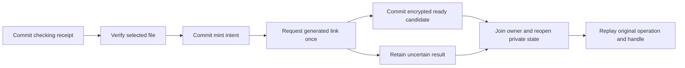

# TorBox curated HTTP service

The TorBox service exposes an operator-curated collection of exact TorBox torrent-file bindings through Hito's HTTP plugin protocol. A private executable is qualified for explicit state modes, authenticated metadata HTTP and joined shutdown/reopen. Container packaging, application installation and live-account acceptance remain unfinished. Only the client's canonical PCM16 WAV profile is qualified.

The service owns authentication, structured metadata and a private SQLite preparation journal. The TorBox client owns provider credentials, file verification, generated links and shared audio transport. Hito owns accounts, library records and rendering. Plugins supply no UI or core database access.

`Service::open` requires an explicit state directory, separate private 32-byte key file and `CreateNew` or `OpenExisting` mode. A single cooperative owner holds the private directory claim until `Service::close` joins its bounded journal worker. Stop and join the HTTP listener before closing the service. Reopening authenticates the journal and restores receipts against their exact provider authority and file bindings.



An uncertain dispatched mint is never retried automatically. Repeated preparation and status reads retain the original receipt. Catalog changes retire incompatible bindings without erasing their operation claims. Every explicit audio GET freshly verifies the selected file and current operation. Ready candidates survive completed playback, media/control admission rejection and temporary provider failures. Definitive changed bindings retire them. HEAD opens no media; signed addresses and credentials stay private.

The catalog admits at most 128 recordings and 49,152 encoded metadata bytes. HTTP bodies and queries are limited to 4,096 bytes, headers to 32 fields and 8,192 bytes, concurrent work to 16 and response opening to 14 seconds. The existing client's two media permits remain owned through body completion.

The journal retains at most 1,024 lifetime receipts and reserves bounded candidate storage before minting. Database, WAL and SHM limits are 16 MiB, 17 MiB and 64 KiB, with a combined 40 MiB logical and allocated-file ceiling. Capacity rejection precedes provider work and preserves existing ready or uncertain receipts. There is no receipt eviction policy yet. Authentication covers stored rows and their complete receipt set; startup rejects selective receipt deletion. Concurrent external database writers are unsupported. These checks do not establish freshness after restoring an entire valid backup or general protection against live external tampering.

Twenty-one directed service cases pass, including joined owner replacement, lost acknowledgements, catalog changes, private state ownership, authenticated receipt deletion, escaped maximum-length filenames and physical SQLite exhaustion. Both physical-capacity cases preserve their existing receipt across joined replacement; the uncertain operation is not reminted. Scoped strict checks and independent source reviews pass within the single-owner contract. The earlier 32-case client/service checkpoint separately qualifies original-byte WAV delivery, native decoding through EOF and admission recovery. These library fixtures do not establish power-loss durability, live-provider compatibility or a playback benchmark.

An independent combined-source Docker run also passes the three restart/filename cases below, with all 170 checked source inputs unchanged and no test containers left behind.

## Private executable

The Unix executable reads operator-provided files. It does not generate a journal key, infer a state mode or fall back from opening to creating state. The listener defaults to `127.0.0.1:8100`; unknown or repeated flags are rejected.

```sh
hito-plugin-torbox \
  --listen 127.0.0.1:8100 \
  --provider-token-file /absolute/private/provider-token \
  --service-token-file /absolute/private/service-token \
  --catalog-file /absolute/private/catalog.json \
  --state-key-file /absolute/private/state-key \
  --state-directory /absolute/private/journal \
  --state-mode create-new
```

Use `open-existing` on subsequent starts with the same state and key. Missing state is rejected without creating its directory or database. `create-new` must not replace an existing journal. State ownership and key validation remain in the journal.

Provider and service tokens must differ. Their files and the catalog must be absolute paths to owned regular files with one hard link and mode `0400` or `0600`; the leaf cannot be a symlink. Token files contain 1–4,096 ASCII bytes in `0x21`–`0x7e` and may end in one LF or CRLF. The catalog file is bounded to 1 MiB before parsing. Its top-level fields are `media_origins` and `recordings`; each recording contains the existing typed `recording`, `source_id`, `label` and `binding` values. The service's catalog and binding validation still applies. The journal requires a separate private `0600` file containing exactly 32 key bytes that are not all zero, outside its private `0700` state directory. Keep that key with the journal when moving or restoring it.

SIGINT and SIGTERM stop acceptance, cancel and join owned HTTP connections, then join `Service::close`. The executable owns at most 16 HTTP connections and applies a 14-second header-read bound. Structured JSON logs retain safe workflow outcomes and correlation IDs; `RUST_LOG` selects levels within the permitted service/client/audio namespaces. Credentials, input contents and private paths are not diagnostics.

One new owned process workflow passes: explicit missing-state rejection, creation, six metadata responses per running child including three authentication denials, a real `100 Continue` body-poll witness cancelled by SIGTERM, joined state closure and reopening the same journal. Exact operator input bytes and metadata remain unchanged. Both all-target strict Clippy modes pass, followed by the three existing HTTP contract, Ready-restart and uncertain-mint-restart cases. This is one new process case plus three directed library regressions, not a repeat of every service case. It does not qualify Ready/audio delivery across executable restart, container restart, application provisioning or live TorBox calls.

An independent combined-source Docker run also passes that executable workflow in 0.13 seconds after compilation. All 182 checked source inputs remain unchanged and no test containers remain. Its complete invocation takes 8.148 seconds; this is fixture timing, not a playback benchmark.

Run a focused restart check through Docker Compose, with the repository's compiler and storage guards:

```sh
docker compose --profile tools run --rm --no-deps -T \
  -e CARGO_TARGET_DIR=/build/torbox-service-check rust \
  cargo test --locked --offline -j2 -p hito-plugin-torbox --features test-support \
  --test restart_durability --test restart_uncertain --test binding_filename \
  -- --test-threads=1
```

Use a separate target directory for each checkout. Other directed cases are in the package's `tests/` directory. The physical-capacity cases each take several minutes.

The service does not submit torrents or magnets, discover a provider library, infer recording identity from provider completion, or promise arbitrary codecs or seeking. Ready/audio recovery across executable restart, container packaging and restart, broader lifecycle faults, long-term receipt retention, application provisioning, broader media support and live TorBox acceptance remain release work. See [adapter evidence and limits](../../docs/debrid-adapters.md#torbox-curated-wav-service-library).
