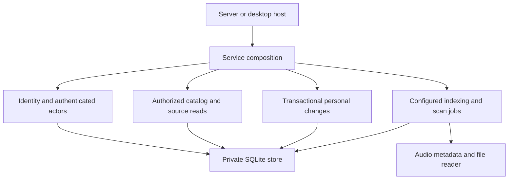

# Architecture decisions

## Capability services own application behavior

Identity, catalog, collection state, and indexing are separate concrete services, composed at startup. This keeps each service's rules and resource lifecycles together without a shared forwarding facade.

SQLite stays private to the core. Public tests use temporary real SQLite databases, not mocked repositories. Collection acceptance owns the complete write transaction. Individual action handlers receive that transaction and cannot commit it independently.

The filesystem and SQLite are concrete local dependencies. Ports will be introduced with real external provider, synchronization transport, and native playback adapters. Empty interfaces for future features are not part of this refactor.

## Backend ownership differs from client identity

A backend host owns local files. A synchronization client originates operations. A browser can play a server-owned file through the authenticated relay; its client device ID must not become authority to read a filesystem path. Availability binds the configured backend host identity rather than embedding a server-specific string in queries.

## Contracts come from Rust

Annotated routes and Rust wire types generate OpenAPI. The same OpenAPI generates TypeScript. The server publishes that contract, and CI checks regeneration. Plugin protocol types remain separately versioned and Apache-2.0 licensed.

Typed Inertia props describe each page. HTTP handlers own transport details; they do not contain library rules. Authentication uses one extractor that returns an authenticated actor and checks the expected account header.

## React owns focused workflows

Catalog, likes, playlists, history, settings, and login are separate pages. Shared track rendering accepts typed data and actions. Scan polling owns cancellation. Mutation hooks preserve errors, so failures cannot trigger success navigation or discard form input.

Playback commands and position subscriptions live outside page rendering. Navigation preserves the player, and account changes dispose it and clear private history. The existing application uses browser audio. Rust's native Player supplies authenticated commands and separate structural/position observations; its shared React adapter remains unfinished.

## Recording identity is independent of tags

A recording is a performance, a source supplies it, and a file locator describes local storage. Whole-file checksums change when tags change. The indexer stores exact file checksums separately from stable recording UUIDs and versioned decoded-audio evidence. An unambiguous verified audio match can preserve references after retagging; a reused path or similar title cannot. Historical ambiguous matches remain separate.

Bounded FFmpeg inspection reads a private owned input copy, with explicit cancellation, output limits, and child reaping. Source metadata observations survive independently of the selected display owner. SQLite identity resolution and metadata selection commit together. [Recording identity](recording-identity.md) documents the algorithm, upgrade witnesses, conservative exceptions, and tested formats.

## Source refresh has separate snapshot ownership

Catalog owns saved source refresh. The private plugin operation supplies current connection authority and bounded source transport. Adoption shares transactional source replacement, but only adoption accepts recording metadata. Immutable provider identity stays in `provider_items`; `provider_source_state` holds the accepted observation and generation. Generation comparisons fence overlapping responses across service instances. Historical bindings remain available for stable identity reuse without entering current playback listings.

`PlaybackSources` owns a recording's cached candidates, one refreshed snapshot, and cancellation. The browser playback controller owns media events, seek position, queue transitions, and retries. Track details use a separate account/recording-scoped availability hook so a recheck cannot reset metadata drafts or interrupt healthy playback. Cached source reads and artwork never trigger provider HTTP.

## Native coordination owns playback effects

Rust's `Player` owns authenticated command admission, a private reference-only queue, native source/session lifetimes, and observed progress checkpoints. Its concrete effect modules retain admitted provider and collection writes through commit or rollback. Core Catalog and Collection still own source authority, SQLite, and transactions. Sampling coalesces frequent position observations; a bounded FIFO writer preserves terminal checkpoint order and retry identity. [Native coordination](native-coordinator.md) records the bounds, authenticated HTTP and desktop ownership, and remaining shared UI work.

## Logs follow workflow boundaries

Structured events and spans make requests, core operations, background jobs, and playback transitions observable. Logs share request IDs across HTTP and browser events. Frequent work uses lower levels. Safe error categories preserve operational evidence without serializing credentials, bodies, paths, or signed audio locations.
