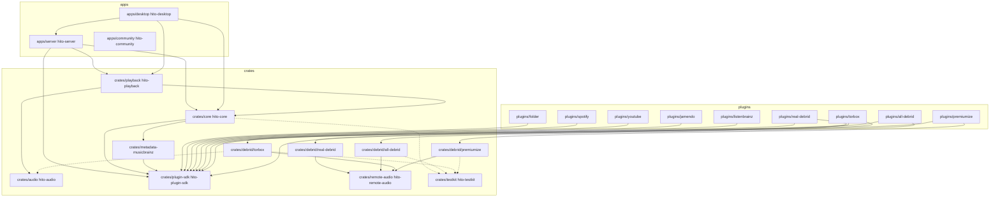
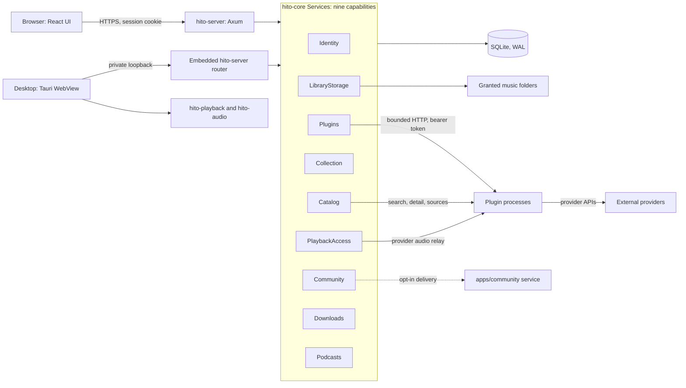
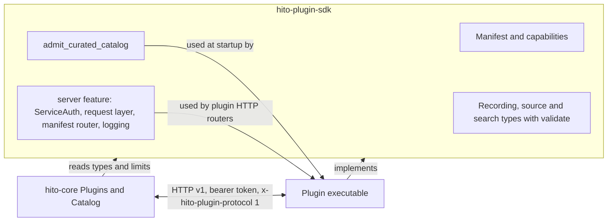
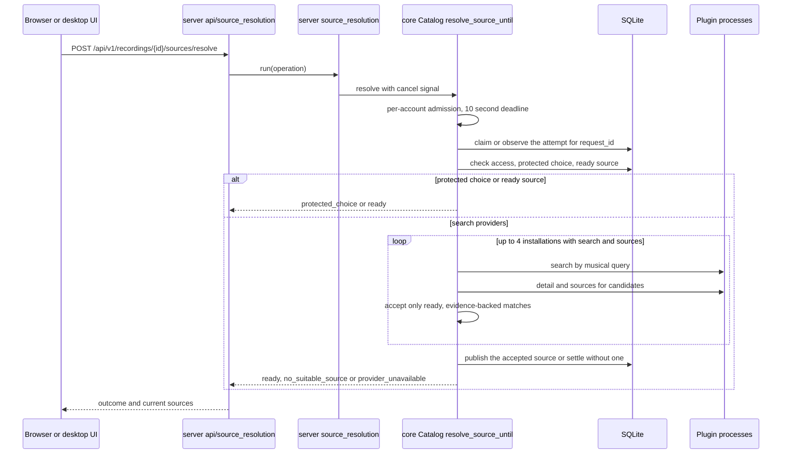
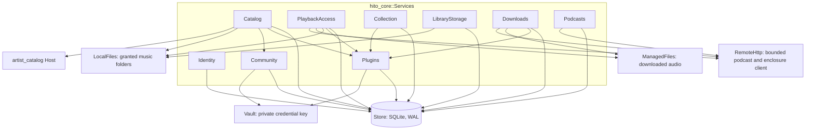
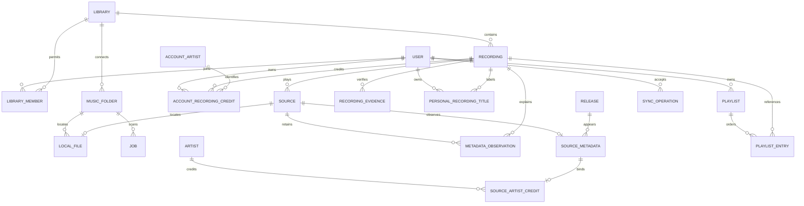
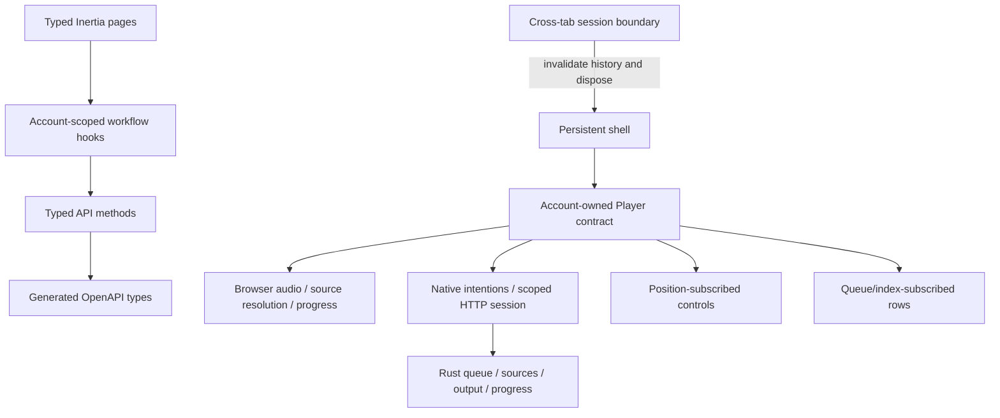
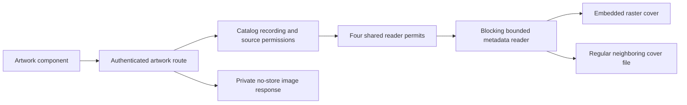
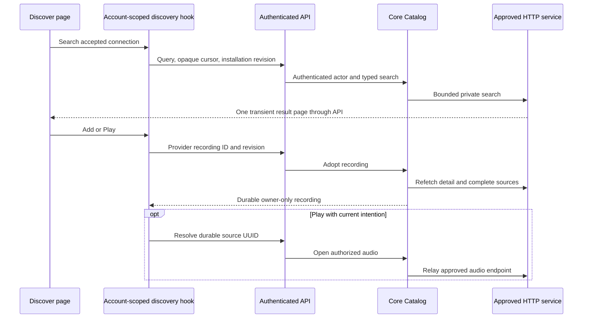

# Architecture

Hito keeps library rules in `hito-core`. Startup opens nine concrete capability services: identity, catalog, playback access, collection, community, library storage, plugins, downloads and podcasts. HTTP adapters authenticate requests once and call those services. The core owns SQLite transactions, permissions, indexing and synchronization, so the desktop backend reuses them without HTTP.

Each statement here is one of four kinds, and the text says which:

- **Current behavior**: in the code at this revision.
- **Tested evidence**: a named test or a recorded run covers it. [Status](status.md) holds the records.
- **Planned behavior**: described in the [release plan](release-plan.md), not built.
- **External dependency**: owned by a provider, a library or the host. Hito cannot fix it.

Nothing here describes a public release. The VPS install is a development deployment ([details](vps-deployment.md)).

## Repository and crate dependencies

Current behavior. The diagram is read from each `Cargo.toml` in the workspace. Solid arrows are normal path dependencies. Dotted arrows are optional dependencies that only the `test-support` feature turns on. Arrows point from the dependent crate to the crate it uses. Package names keep the `hito-` prefix, so `crates/core` is `hito-core`.

Five packages have no Hito dependencies: `hito-audio`, `hito-remote-audio`, `hito-plugin-sdk`, `hito-community` and `hito-testkit`. `apps/community` is a separate executable and shares no code with the server. Plugins never depend on `hito-core`. They talk to it over HTTP using SDK types. The ListenBrainz and Jamendo plugins use the SDK and nothing else from Hito.

`hito-testkit` is a dev-dependency of `hito-server`, `hito-playback`, the four debrid crates and the folder, Spotify, YouTube and four debrid plugins. `hito-audio` is a dev-dependency of `hito-desktop` (with `test-support`), the debrid crates and the YouTube and debrid plugins. `hito-core`, `hito-audio`, the TorBox, All-Debrid and Premiumize crates and the TorBox and Premiumize plugins list themselves as a dev-dependency with `test-support` on, so plain `cargo test --workspace` works while normal builds never enable the feature. See [testing](testing.md) for how tests use these helpers.

The web app in `apps/web` is not a Cargo member. Its TypeScript models come from the server's generated OpenAPI file, `docs/openapi.json`.

## Runtime topology

Current behavior. One server process hosts the HTTP adapter and the core services. Plugins are separate processes reached over HTTP. The desktop host embeds the same server router and core behind a private loopback address.

Rules that follow from the diagram:

- Only core touches SQLite, SQL, migrations and the filesystem. The server maps typed requests to capability calls and applies transport policy.
- Plugins hold provider network access. Core holds only the personal token for each installation, encrypted in a vault beside the database.
- External providers are external dependencies. Their availability, rate limits and blocking policies are outside Hito. [YouTube on servers](plugin-youtube.md#server-side-limitation) is the clearest case.
- The `Community` capability keeps consent, an outbox and reporter credentials in the core database. The community service (`apps/community`) is a separate executable. Delivery to it is optional and off unless the server is configured with its origin and token ([community service](community-service.md)).

The [desktop host](desktop.md) uses the native player contract. Ordinary web sessions use browser audio. The [native playback owner](native-playback.md) retains a core grant, bridges authorized local and provider input, and supervises the [audio engine](native-audio.md) through revocation and joined cleanup. The synchronization client remains unfinished.

## Plugin protocol and the SDK

Current behavior. `hito-plugin-sdk` is the only code core and plugins share. It defines the manifest, capability request and response types, size limits and validation. It is Apache-2.0 and has no database or application dependency.

Core does not enable the SDK `server` feature. Only plugin executables do, so core links no HTTP server code from the SDK. The feature holds the code every plugin router needs in the same form: the bearer and protocol check, the per-request span and log event, the manifest route with its body limit, and JSON logging setup. See [plugins](plugins.md#shared-plugin-http-server).

Core reviews the manifest before use, pins its digest, then calls the capabilities the manifest declares: search, recording detail, sources, preparation, audio and others. Core validates every response with the SDK types before it stores or relays anything. A recording-detail response is limited to 32,768 bytes. See [plugins](plugins.md) for the protocol, review flow and recovery.

### Curated catalog admission

The Real-Debrid, All-Debrid, TorBox and Premiumize plugins serve an operator-supplied list of recordings. Each builds its catalog at startup through `admit_curated_catalog` in `crates/plugin-sdk/src/curated.rs`. The function:

- accepts 1 to 128 entries and sorts them by recording ID;
- validates each recording and its source ID and label;
- rejects duplicate recording IDs and duplicate source IDs;
- rejects any recording whose JSON exceeds 32,768 bytes;
- rejects a catalog whose recordings together exceed 49,152 bytes.

The byte count covers the public recording JSON only. Private source, label and binding bytes are not counted. Each plugin then validates its own private bindings. A failed admission stops startup before a listener opens, and the plugin logs a safe rejection reason: the error variant name only, never recording content. The startup sequence is in [plugins](plugins.md#curated-catalog-admission-at-startup). Tested evidence: `crates/plugin-sdk/tests/curated_catalog.rs` and each plugin's contract tests.

## Playback source resolution

Current behavior. A listener asks Hito to find audio for a saved recording that has no ready source. The UI sends one request with a client-chosen `request_id`.

What each piece owns:

- `apps/server/src/source_resolution.rs` owns task lifetime. On the hosted server it runs the work in a joined task set, so shutdown waits for it. Embedded routers run it inline. A client disconnect sends the cancel signal.
- `Catalog` owns the algorithm and the persisted attempt. A repeated `request_id` observes the first attempt instead of searching again. Every publication rechecks the account's access to the recording.
- Outcomes are `ready`, `no_suitable_source`, `provider_unavailable`, `protected_choice` and `cancelled`. `provider_unavailable` records that a provider call failed or was busy, so a blocked extraction does not read as "nothing matched".
- Resolution only attaches a source. Audio plays later through a separate relay that checks live authority again. See [plugins](plugins.md#audio-relay) and [automatic sources](automatic-sources.md).

## Core composition

Current behavior. `hito_core::open` builds one `Store` (the private SQLite handle) and then the nine capabilities that make up `Services`. Each capability is a plain struct holding the pieces it owns. `Services` has no forwarding methods: the server and desktop host call a capability directly. The store field of `Services` is private and is used only for the health check.

What each capability owns:

- `Identity`: accounts, sessions and the opaque authenticated actor.
- `Catalog`: authorized reads, provider search and adoption, source resolution, artwork and the artist catalog.
- `PlaybackAccess`: opening audio. It picks one of four origins (provider relay, podcast enclosure, managed download, local file) and checks live authority first.
- `Collection`: the single transaction that accepts a batch of personal operations and appends events.
- `Community`: per-account consent, the report outbox, reporter credentials and optional ranking reads.
- `LibraryStorage`: music folders, grants, scans, leases and reconciliation.
- `Plugins`: offered service addresses, personal installations, credential encryption and manifest checks.
- `Downloads`: persistent and playlist downloads into managed storage.
- `Podcasts`: subscriptions, episodes and episode progress.

Planned behavior and gaps are in [status](status.md). The desktop host and the server build their routers on this same `Services` value.

## Data ownership

A library controls access to recordings and sources. Accounts own playlists, likes, listening history, and personal recording and album title/artist fields, and plugin installations. Library membership is checked on reads, streaming, and writes. Provider matching and further preferences remain planned. A recording represents a performance and has a stable UUID. Exact tagged-file checksums and versioned decoded-audio evidence are separate. See [recording identity](recording-identity.md) for conservative matching, legacy upgrades, metadata ownership, and inspection limits.

## Catalog appearances

Artist and album pages use authorized `Catalog` reads. Exact library credit IDs are distinct from canonical person identities. Album membership follows source observations, including alternate releases and repeated positions; selected recording display metadata does not erase those appearances. The metadata writer updates indexed source-credit bindings in its existing transaction. Album artwork selects only sources on the requested release. Effective account recording credits also expose recordings without a release or source. They update within provider adoption, personal artist edits, membership provisioning, and selected local metadata changes, including folder failover. Artist details return bounded independent recording and album pages through the existing Catalog boundary. See [catalog browsing](catalog-browsing.md) for paging, search, upgrades, and current limits.

## Metadata

Recording titles enter through the same collection transaction as other personal operations. Sparse account rows replace shared search matches and keep effective title/artist search consistent with displayed titles. Immutable source observations preserve supported tags separately from filename/default fallbacks. The recording retains its selected observation when audio becomes unavailable. [Metadata ownership](metadata.md) describes precedence, snapshots, cursors, queue behavior, and the remaining correction work.

## Boundary tests

SQLite is a local dependency. Integration tests use a real temporary SQLite database and the public HTTP or capability interface. They assert behavior, including denied access and repeated operations, without inspecting internal tables. Third-party provider fixtures sit at the external HTTP boundary. Browser tests use deterministic generated WAV files rather than a live catalog. [Testing](testing.md) describes the layers and shared helpers.

## Module rules

Add a module when it owns a rule or resource lifecycle. Avoid layers that merely forward the same parameters. Keep database schemas and transaction ordering inside the core. Keep provider-specific response types inside adapters. Plugin SDK types describe a language-neutral wire contract and carry no application database dependency.

`Collection` owns one immediate transaction for validating and accepting a batch, changing personal state, and appending events. Action modules cannot commit independently. `LibraryStorage` owns folder connections, grant binding, scan acceptance, leases, and reconciliation. Scan enqueue selects its row inside the same immediate transaction. Every publication requires the current attempt token and connected folder generation. The configured backend `HostDeviceId` owns local availability. A synchronization batch's client device ID never grants filesystem access.

Trusted startup configuration grants directories. The browser selects typed relative components within those grants. Core opens owned directory/file handles with cap-std; the server streams the authorized handle without reopening its path. Per-grant operation and walk permits remain held through abandoned filesystem calls. Enumeration reports successful completion separately from interruption, so an incomplete walk cannot mark previously verified files missing. See [music folders](music-folders.md) for deadlines, recovery, host setup, and verification limits.

## Browser ownership

The web app is `apps/web/src/{app,shared,features,test}`. `app` holds the shell, entry point and the page registry, which collects `features/*/pages/*.tsx` with `import.meta.glob` and rejects duplicate page names. Each feature folder (`catalog`, `playback`, `plugins` and so on) has its own `api`, `hooks`, `components`, `pages`, `tests` and `fixtures` where it needs them. `shared` holds the typed `requestJson` client and cross-feature UI. `test` holds the shared vitest setup.

The shell survives page navigation; audio belongs to the authenticated account. Generated application props select browser or native playback. Native mode creates no browser audio or duplicate progress writer. Its separate client owns command ordering and scoped observations while Rust retains queue/output ownership. Workflow hooks cancel stale requests. Queue and catalog rows do not subscribe to playback position ticks. Visible queue metadata is paged, canceled, and checked against its captured view before publication. A cross-tab session change disposes the application, cancels work, clears encrypted history, and loads current server state. Before mounting the interface, the browser checks that the server's current account matches its initial page data. See [native UI ownership and bounds](native-coordinator.md#shared-ui-integration).

Rust routes and wire types generate `docs/openapi.json`; that schema generates the web's TypeScript models. Page schemas describe complete responses while Inertia partial requests omit unrequested fields before querying. CI compares regeneration with the checked-in files.

Inertia page component names are a `PageComponent` enum in the server, and the OpenAPI contract publishes them. The web page registry test checks the registry against the generated contract, so the Rust enum is the single source of truth.

Inertia page assembly lives in `apps/server/src/inertia/pages/`, one module per screen group. The server decides only which props a partial reload asks for. Data decisions are named reads on the owning core capability, and each enforces the actor's session and library membership itself: `Podcasts::subscription` reads one subscription by identity (another account's reads as not found), `Podcasts::episodes_with_progress` returns an episode page with saved progress for exactly that page, `Plugins::connections` returns the offered services and the account's installations, and `Catalog::liked_recordings` lists the caller's likes. `Connections` names two different service rules: `connected_services()` (services with an installation, used by the playlist index) and `offered_services()` (every offered service, used by Discover). Whether the two should differ is an open product question.

## Artwork and composition

The library page composes a recording spotlight, personal playlist shortcuts, and switchable grid/list results. The persistent shell owns the listening sidebar and player. Expanded playback uses a native modal dialog with an independent queue and transport controls; loading and failure status remain visible inside it. Closing restores the actual opener, or the queue button if that opener became disabled or hidden. Settings tabs mount only the selected account or library workflow.

Artwork stays behind the core's filesystem authorization. The private reader modules own metadata read budgets, safe regular-file opens, and raster signatures. Reader permits remain held inside blocking work even if the HTTP future is canceled. Missing artwork uses a neutral UI fallback. There is no third-party image request or generated catalog content.

## Plugin connections

`Plugins` owns administrator-offered service addresses, personal installations, credential encryption, bounded HTTP manifest checks, and revision fencing. The concrete client and vault stay private to core. Manifest review does not write until accepted and refetched. `Catalog` owns transient provider search, durable adoption into owner-only libraries, and saved-recording source refresh. Its private plugin operations keep approved endpoints and credentials out of the HTTP/UI adapters. Source refresh requests only availability, preserves accepted metadata, and publishes a bounded generation after current authority checks. Cached source reads never contact providers. Audio uses a separate media client with live authority checks, opened through `PlaybackAccess`. See [implemented protocol and recovery](plugins.md).

## Provider discovery

The page composes typed props and view components. `useDiscovery` owns search, cursor history, adoption, and cancellation. It retains one result page and immutable completed-adoption feedback for the current account, installation, and revision. Search does not save content. Add does not start audio. A new authority clears private results and saved feedback; returning to the old authority cannot revive it.

Playback owns a separate selection counter. A provider Play captures its intention before adoption, then checks it before replacing the queue. A later queue selection, Next, Previous, toggle, or clear supersedes it. Position ticks and seeking preserve a pending selection. Account playback disposal cancels source resolution. The discovery page does not subscribe to playback positions. Inertia partial discovery requests load connection data only when requested, and never expose credentials or service addresses.
