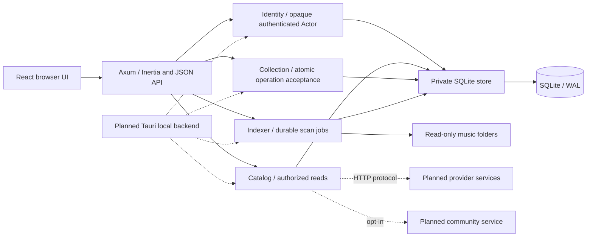
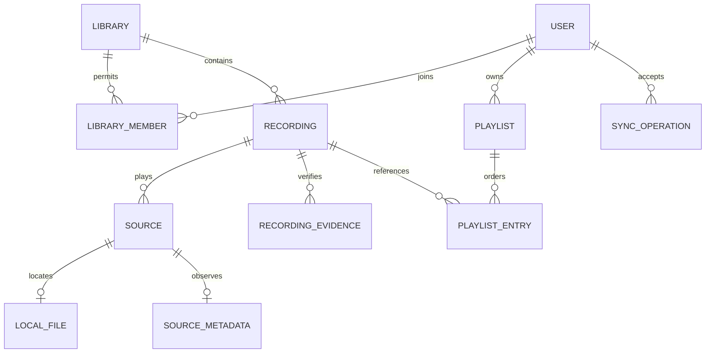
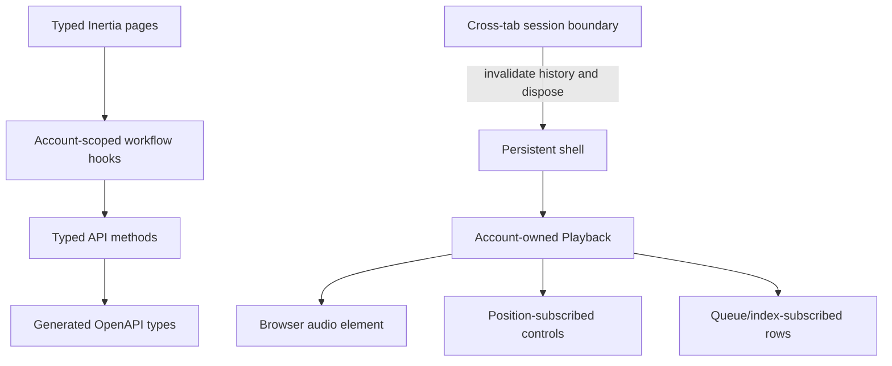
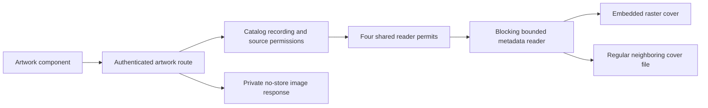

# Architecture

Hito keeps library rules in `hito-core`. Startup opens concrete identity, catalog, collection, and indexing services. HTTP adapters authenticate requests once and invoke those services. The core owns SQLite transactions, permissions, indexing, and synchronization so a desktop backend can reuse them without HTTP.

The solid lines describe the initial implementation. Dashed connections are planned boundaries. `docs/status.md` records which portions exist and which are verified.

## Data ownership

A library controls access to recordings and sources. Accounts own playlists, likes, and listening history. Library membership is checked on reads, streaming, and writes. Personal metadata overrides and preferences remain planned. A recording represents a performance and has a stable UUID. Exact tagged-file checksums and versioned decoded-audio evidence are separate. See [recording identity](recording-identity.md) for conservative matching, legacy upgrades, metadata ownership, and inspection limits.

## Boundary tests

SQLite is a local dependency. Integration tests use a real temporary SQLite database and the public HTTP interface. They assert behavior, including denied access and repeated operations, without inspecting internal tables. Third-party provider fixtures belong at the external HTTP boundary. Browser tests use deterministic generated WAV files rather than a live catalog.

## Module rules

Add a module when it owns a rule or resource lifecycle. Avoid layers that merely forward the same parameters. Keep database schemas and transaction ordering inside the core. Keep provider-specific response types inside adapters. Plugin SDK types describe a language-neutral wire contract and carry no application database dependency.

`Collection` owns one immediate transaction for validating and accepting a batch, changing personal state, and appending events. Action modules cannot commit independently. `Indexer` selects or creates a scan in an immediate transaction so a fast worker cannot finish it between enqueue and selection. The configured backend `HostDeviceId` owns local availability. A synchronization batch's client device ID never grants filesystem access.

## Browser ownership

The shell survives page navigation; audio belongs to the authenticated account. Workflow hooks cancel stale requests. Queue and catalog rows do not subscribe to playback position ticks. A cross-tab session change disposes the application, cancels work, clears encrypted history, and loads current server state. Before mounting the interface, the browser checks that the server's current account matches its initial page data.

Rust routes and wire types generate `docs/openapi.json`; that schema generates the web's TypeScript models. Page schemas describe complete responses while Inertia partial requests omit unrequested fields before querying. CI compares regeneration with the checked-in files.

## Artwork and composition

The library page composes a recording spotlight, personal playlist shortcuts, and switchable grid/list results. The persistent shell owns the listening sidebar and player. Expanded playback uses a native modal dialog with an independent queue and transport controls; loading and failure status remain visible inside it. Closing restores the actual opener, or the queue button if that opener became disabled or hidden. Settings tabs mount only the selected account or library workflow.

Artwork stays behind the core's filesystem authorization. The private reader modules own metadata read budgets, safe regular-file opens, and raster signatures. Reader permits remain held inside blocking work even if the HTTP future is canceled. Missing artwork uses a neutral UI fallback. There is no third-party image request or generated catalog content.
