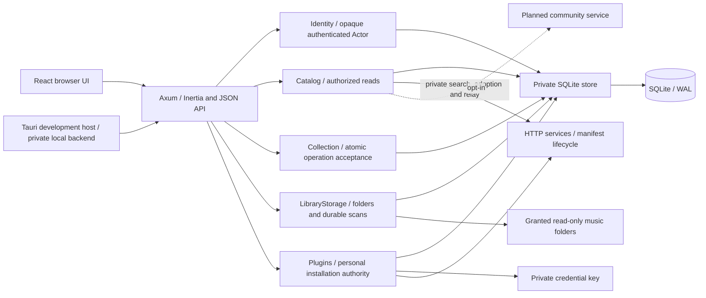
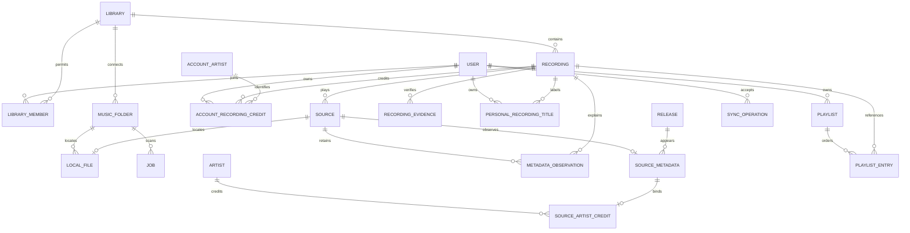
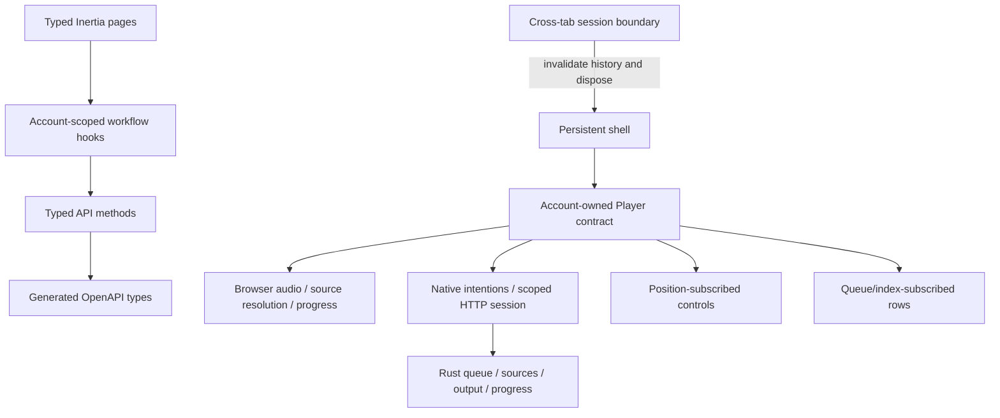
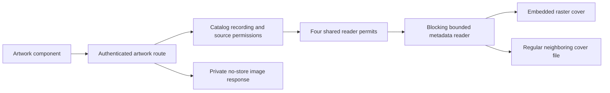
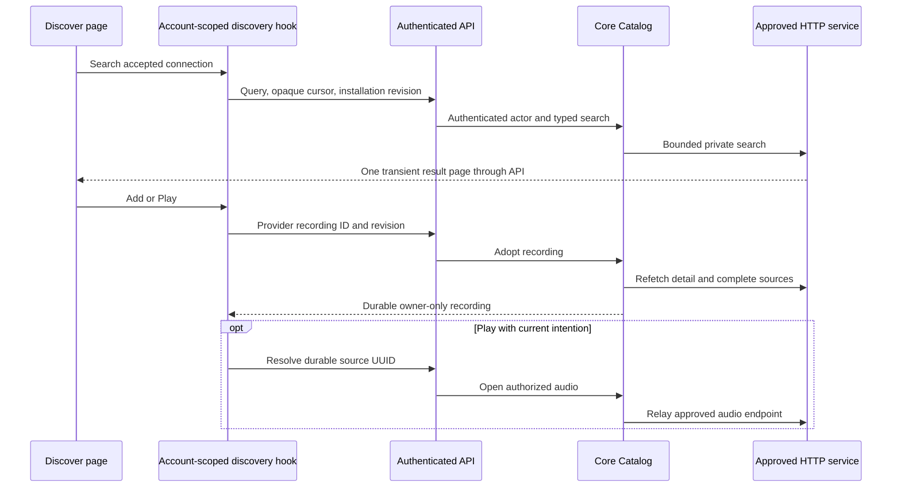

# Architecture

Hito keeps library rules in `hito-core`. Startup opens concrete identity, catalog, collection, library-storage, and plugin services. HTTP adapters authenticate requests once and invoke those services. The core owns SQLite transactions, permissions, indexing, and synchronization so a desktop backend can reuse them without HTTP.

The solid lines describe the initial implementation. Dashed connections are planned boundaries. `docs/status.md` records which portions exist and which are verified.

The [desktop host](desktop.md) embeds the same core and HTTP adapters with a standalone database and private loopback access. Its shared UI uses the native player contract; ordinary web sessions use browser audio. The [native playback owner](native-playback.md) retains a core grant, bridges authorized local/provider input, and supervises the [audio engine](native-audio.md) through revocation and joined cleanup. The authenticated native API exposes Rust-owned commands, paged queues, and separate structural/position observations. The desktop retains playback cleanup alongside HTTP/indexing before releasing its library claim. The synchronization client remains unfinished.

## Data ownership

A library controls access to recordings and sources. Accounts own playlists, likes, listening history, and personal recording and album title/artist fields, and plugin installations. Library membership is checked on reads, streaming, and writes. Provider matching and further preferences remain planned. A recording represents a performance and has a stable UUID. Exact tagged-file checksums and versioned decoded-audio evidence are separate. See [recording identity](recording-identity.md) for conservative matching, legacy upgrades, metadata ownership, and inspection limits.

## Catalog appearances

Artist and album pages use authorized `Catalog` reads. Exact library credit IDs are distinct from canonical person identities. Album membership follows source observations, including alternate releases and repeated positions; selected recording display metadata does not erase those appearances. The metadata writer updates indexed source-credit bindings in its existing transaction. Album artwork selects only sources on the requested release. Effective account recording credits also expose recordings without a release or source. They update within provider adoption, personal artist edits, membership provisioning, and selected local metadata changes, including folder failover. Artist details return bounded independent recording and album pages through the existing Catalog boundary. See [catalog browsing](catalog-browsing.md) for paging, search, upgrades, and current limits.

## Metadata

Recording titles enter through the same collection transaction as other personal operations. Sparse account rows replace shared search matches and keep effective title/artist search consistent with displayed titles. Immutable source observations preserve supported tags separately from filename/default fallbacks. The recording retains its selected observation when audio becomes unavailable. [Metadata ownership](metadata.md) describes precedence, snapshots, cursors, queue behavior, and the remaining correction work.

## Boundary tests

SQLite is a local dependency. Integration tests use a real temporary SQLite database and the public HTTP interface. They assert behavior, including denied access and repeated operations, without inspecting internal tables. Third-party provider fixtures belong at the external HTTP boundary. Browser tests use deterministic generated WAV files rather than a live catalog.

## Module rules

Add a module when it owns a rule or resource lifecycle. Avoid layers that merely forward the same parameters. Keep database schemas and transaction ordering inside the core. Keep provider-specific response types inside adapters. Plugin SDK types describe a language-neutral wire contract and carry no application database dependency.

`Collection` owns one immediate transaction for validating and accepting a batch, changing personal state, and appending events. Action modules cannot commit independently. `LibraryStorage` owns folder connections, grant binding, scan acceptance, leases, and reconciliation. Scan enqueue selects its row inside the same immediate transaction. Every publication requires the current attempt token and connected folder generation. The configured backend `HostDeviceId` owns local availability. A synchronization batch's client device ID never grants filesystem access.

Trusted startup configuration grants directories. The browser selects typed relative components within those grants. Core opens owned directory/file handles with cap-std; the server streams the authorized handle without reopening its path. Per-grant operation and walk permits remain held through abandoned filesystem calls. Enumeration reports successful completion separately from interruption, so an incomplete walk cannot mark previously verified files missing. See [music folders](music-folders.md) for deadlines, recovery, host setup, and verification limits.

## Browser ownership

The shell survives page navigation; audio belongs to the authenticated account. Generated application props select browser or native playback. Native mode creates no browser audio or duplicate progress writer. Its separate client owns command ordering and scoped observations while Rust retains queue/output ownership. Workflow hooks cancel stale requests. Queue and catalog rows do not subscribe to playback position ticks. Visible queue metadata is paged, canceled, and checked against its captured view before publication. A cross-tab session change disposes the application, cancels work, clears encrypted history, and loads current server state. Before mounting the interface, the browser checks that the server's current account matches its initial page data. See [native UI ownership and bounds](native-coordinator.md#shared-ui-integration).

Rust routes and wire types generate `docs/openapi.json`; that schema generates the web's TypeScript models. Page schemas describe complete responses while Inertia partial requests omit unrequested fields before querying. CI compares regeneration with the checked-in files.

## Artwork and composition

The library page composes a recording spotlight, personal playlist shortcuts, and switchable grid/list results. The persistent shell owns the listening sidebar and player. Expanded playback uses a native modal dialog with an independent queue and transport controls; loading and failure status remain visible inside it. Closing restores the actual opener, or the queue button if that opener became disabled or hidden. Settings tabs mount only the selected account or library workflow.

Artwork stays behind the core's filesystem authorization. The private reader modules own metadata read budgets, safe regular-file opens, and raster signatures. Reader permits remain held inside blocking work even if the HTTP future is canceled. Missing artwork uses a neutral UI fallback. There is no third-party image request or generated catalog content.

## Plugin connections

`Plugins` owns administrator-offered service addresses, personal installations, credential encryption, bounded HTTP manifest checks, and revision fencing. The concrete client and vault stay private to core. Manifest review does not write until accepted and refetched. `Catalog` owns transient provider search, durable adoption into owner-only libraries, and saved-recording source refresh. Its private plugin operations keep approved endpoints and credentials out of the HTTP/UI adapters. Source refresh requests only availability, preserves accepted metadata, and publishes a bounded generation after current authority checks. Cached source reads never contact providers. Audio uses a separate media client with live authority checks. See [implemented protocol and recovery](plugins.md).

## Provider discovery

The page composes typed props and view components. `useDiscovery` owns search, cursor history, adoption, and cancellation. It retains one result page and immutable completed-adoption feedback for the current account, installation, and revision. Search does not save content. Add does not start audio. A new authority clears private results and saved feedback; returning to the old authority cannot revive it.

Playback owns a separate selection counter. A provider Play captures its intention before adoption, then checks it before replacing the queue. A later queue selection, Next, Previous, toggle, or clear supersedes it. Position ticks and seeking preserve a pending selection. Account playback disposal cancels source resolution. The discovery page does not subscribe to playback positions. Inertia partial discovery requests load connection data only when requested, and never expose credentials or service addresses.
