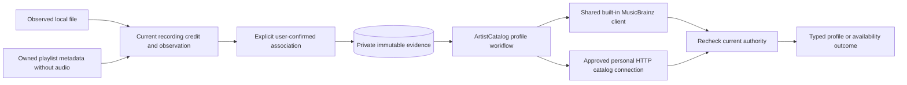
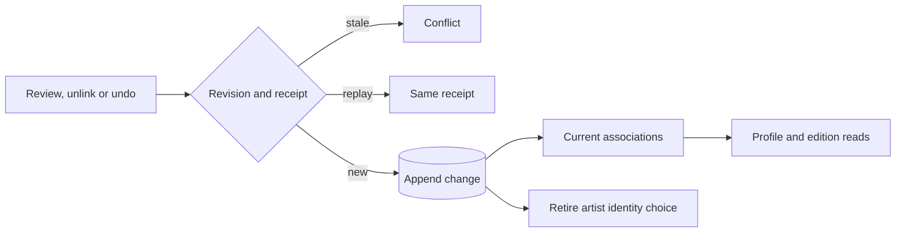
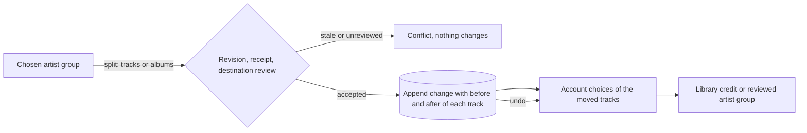
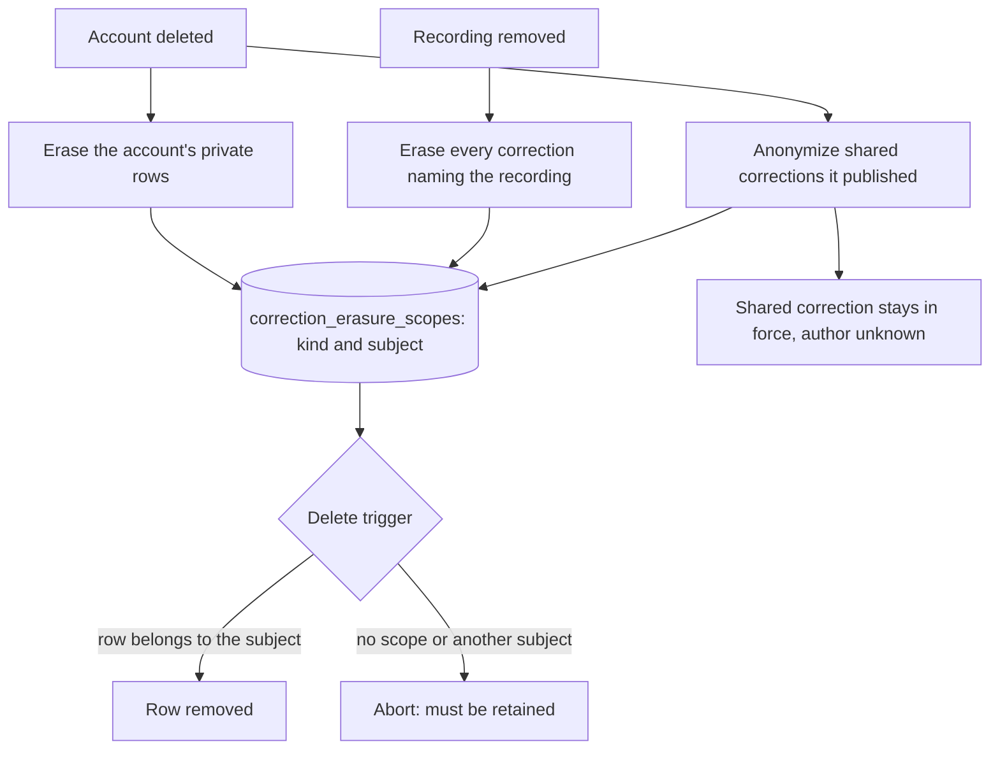

# Reviewed artist profiles in core

The core `ArtistCatalog` capability (a separate service from `Catalog`, see [architecture](architecture.md#core-composition)) supports account metadata settings, reviewed recording-credit associations and provider artist-profile reads. This is a source foundation. Server routes, settings controls, artist-page rendering, provider-backed matching (see [artist matching](artist-matching.md) for the file-tag matching that exists), caching and discography traversal are still unfinished. The running server does not use this host yet.

## Identity and provenance

An account artist is an exact library-scoped credit label, not proof of a canonical person or group. Equal names can describe different performers. A review therefore associates one recording's current credit and immutable metadata observation with an artist identifier in one selected provider connection. It does not merge artists, recordings, sources or releases.

Local observations retain their source identity and current source-metadata state. An imported playlist observation can have no audio source. In that case, review requires its exact current, non-retired primary provider binding, original installation, provider recording ID and owning account. A profile lookup never adopts audio or creates a download.

The association keeps `user_confirmed` provenance. A valid external profile confirms its provider identifier, not the identity of a local performer. Raw MusicBrainz tags and equal names do not create associations automatically. Reviewing an edited credit produces distinct evidence while retaining earlier reviews. Repeating an unchanged review returns the same association.

Evidence is immutable. At most 32 associations per recording can be linked at once, and at most 128 rows (linked or unlinked) are retained per account and recording. Replacement selection and administrator promotion still need separate workflows. Historical evidence can remain readable even when its credit is no longer current, but it cannot authorize a current profile response.

## Unlinking and undo

An account can unlink one of its own reviewed associations and can undo its latest association change for a recording. Neither workflow contacts a provider, changes the recording, its credit, sources, playlists or any personal edit, or touches another account.

Association rows never change. Each link, unlink and undo appends a row to a private change history with a per-recording revision. An association is current when it has no history or its latest history row is a link. Unlinked associations disappear from the list, cannot authorize profile, discography or edition reads (they answer not found without a provider request), and cannot anchor an album edition choice. A saved artist identity choice that used the association returns to needs-review, and stays there if the unlink is undone.

Reviewing the same provider artist again after an unlink links the same retained evidence again. Repeating a review that is already current is not a change and creates no history.

Undo reverses only the latest change: undoing a new link removes it, undoing an unlink restores it, and undoing the undo repeats the change. Undo with nothing in the history is rejected, and so is any change beyond 1,024 history revisions for one recording. Restoring or relinking needs room under the 32 linked associations.

An explicit unlink wins over bulk work: applying a chosen artist to every recording with the same credit skips recordings whose matching association was unlinked and counts them with the other skipped recordings. Only a direct review of that artist links it again. A saved artist identity choice that used an unlinked association reads as unselected, and the panel refreshes it after each change.

Both commands carry a request ID and the revision the client last read. A repeated request with the same contents returns its stored receipt; the same ID with different contents, or an old revision, is a conflict. Receipts are retained like the artist identity and album edition receipts. The workflows are `GET /api/v1/recordings/{id}/artist-association-changes`, `POST /api/v1/recordings/{id}/artist-associations/unlink` and `POST /api/v1/recordings/{id}/artist-associations/undo`, using the shared account and JSON extractors. Logs record the operation, a safe outcome, the revision number and timing only.

Migration 0057 adds the history and receipt tables. It runs on the local development server and is not part of a release. In the artist information panel each saved review has an unlink button. When it opens, the panel reads the change state from the server, so undo is offered for the latest change even from an earlier visit, and a rejected or stale request reloads that state. Splitting merged artists, sharing corrections with every account and retag reconciliation follow below.

## Splitting a merged artist

Two library credits that share a chosen artist (an identity group) appear as one artist. When that merge is wrong, the account can split it again. A split moves some of the group's current tracks to a different identity and changes nothing else: recordings, sources, playlist entries, likes, progress and personal edits keep their identifiers and values. Only the account's artist choice for each moved track changes.

A split names tracks, albums or both. An album stands for the group's tracks that appear on it; tracks of that album held by other artists stay where they are. One split moves at most 100 tracks and has one destination:

- **Library credit.** Each track returns to the library credit it was tagged with and the credit reappears in the Artists list, exactly as if the choice had been reset.
- **Another reviewed artist.** Each track must already have a current, linked review of that exact provider artist (the same provider connection and identifier) and the provider must still be selected and approved. The split creates the destination group when it does not exist yet. It never creates an artist identity from a name, and the destination artist must be reviewed first with the existing artist information panel.

If any selected track cannot move, the whole split is rejected and nothing changes. Moves make no provider request.

Each accepted split or undo appends a row to the group's change history with a per-group revision, and stores the choice each track had before and after. Undo restores the "before" choice of the latest change, including the original ordering used for the group's label. It is refused when any track changed since, for example after a reset or another split. As with association links, undoing an undo repeats the change, and only the latest change can be undone. Requests carry a request ID and the revision the client last read and share the account's artist identity receipt namespace. Routes are `GET /api/v1/artist-identity-groups/{id}/changes`, `POST /api/v1/artist-identity-groups/{id}/split` and `POST /api/v1/artist-identity-groups/{id}/undo`. On a chosen artist page the **Correct this artist** panel lists the tracks and albums of the current page, a destination and the latest change with Undo. It reads nothing until it is opened. Destinations are searched by name on the server (the search text is a request parameter and is never logged) and paged 20 at a time.

## Sharing corrections with every account

An administrator can promote their own correction so it applies to all accounts: the latest built-in MusicBrainz unlink of a recording, or the latest split of a built-in MusicBrainz artist group. A promotion records the affected recordings (each with the recording, its metadata observation and the provider artist) as a numbered shared correction with its own receipt and state history. A shared correction says "this recording is not that artist" and hides the matching reviewed association from every account that has one; the choices that used it read as needing review, as after a personal unlink. It does not move anyone's tracks to a destination: a split's destination is personal because other accounts have not reviewed it.

Promotion works only for the built-in provider. HTTP provider connections belong to one account, so their identifiers cannot mean the same artist to another account. This is the conservative choice and is rejected with a clear error. Only administrators can promote, list or withdraw shared corrections, and non-administrators cannot see them. Promoting what is already shared is a conflict.

**Personal choices still win.** A shared correction hides an association only if the account's latest decision about it was made before the promotion. A review, relink or undo the account makes afterwards is a deliberate personal decision and stays in force, including after the correction is withdrawn and restored. A relink made before the promotion is overridden by it; the account can review the artist again to take the association back. The order of decisions comes from a stable sequence table (`recording_artist_association_change_order`) filled by a trigger when a change is appended and backfilled for existing rows in the stored row order. It does not depend on SQLite's internal row numbers, so VACUUM, dump and restore cannot change which decision wins, and not on clocks either. An administrator's own earlier unlink stays in force when the shared correction is withdrawn. Retired subjects (see below) do not hide anything.

Accounts are told when this happens: the recording's change state reports how many of the account's saved reviews a shared correction hides ("hidden by a correction an administrator shared"), without naming the administrator.

**Undo while shared.** The conservative rule is to refuse: an unlink or split that an applied shared correction was made from cannot be undone until the correction is withdrawn, because the personal undo would otherwise leave the account's choice pointing at a review the shared correction hides. The error names the step to take. An undo is also refused when a review it would restore was unlinked or hidden since, so tracks never vanish from every group.

**Managing shared corrections.** Administrators see every shared correction, not only the latest change, in Settings under **Accounts**. The list is paged (25 by default, at most 100) and newest first, and shows only identifiers, the kind (unlink or split), how many recordings it covers, how many of those no longer match, and whether it is applied. No titles, artist names, paths or account identifiers are listed or logged. Each row has **Withdraw** or **Restore**; any administrator may withdraw or restore another administrator's correction because the correction belongs to the server, not to the person who promoted it. Restoring applies the same checks as promoting: at least one recording must still match and none may already be covered by another applied correction.

Withdrawing a correction is its undo: it appends a new state, and undoing the withdrawal shares it again. Routes are `GET /api/v1/artist-corrections?offset=&limit=`, `POST /api/v1/artist-corrections/promote` and `POST /api/v1/artist-corrections/{id}/undo`. The saved-review panel and the chosen artist page offer **Apply for everyone** and **Withdraw** only to administrators and only when the server reports the latest change as shareable or shared.

## Reconciliation after retags

When a rescan or a personal edit changes the credit of a recording, existing corrections are checked in the same transaction that refreshes the account credits:

- A personal choice that used the old credit is retired, as before.
- A personal unlink whose association belongs to a credit the recording no longer has is marked **retired**. It keeps hiding that association, because Hito never relinks something the user rejected, and the recording's change state lists it as no longer applying.
- A split item is marked retired when the recording's credit is no longer the credit the split was made for. Retired items are skipped by undo; a change with no remaining items cannot be undone. The group page says how many tracks no longer apply.
- A shared correction subject is marked retired when the recording's raw artist tag differs from the tag when it was shared (`tags_changed`), or when the recording's metadata observation was replaced while the artist is unchanged (`observation_changed`). Such a rewrite leaves nobody with an association on the new observation, so carrying the subject forward would change nothing; retiring it shows the administrator an honest "no longer matches" instead of an applied no-op. A retired subject stops hiding associations and no longer blocks a fresh share or a restore of the same recording. Personal unlinks, which belong to one account's own rejection, keep hiding their association when retired.

Corrections whose credit is unchanged stay active. Retirement is final: returning to the earlier tags does not revive a retired correction, matching the rule for chosen artists. Reconciliation never creates artists, groups or associations, so a retag cannot produce duplicate identities. Corrections refer to recording credits, never to albums: a split that selected an album was already expanded to its tracks, and group album lists are derived from the tracks. A retag that changes only album or album-artist tags therefore leaves corrections active. As before, a changed metadata observation retires the account's artist choices, which then need review.

Migration 0059 adds the split history, retirement, ordering and shared correction tables. It runs on the local development server and is not part of a release.

## Deletion and retention

The correction history is append-only: triggers refuse updates and deletes so that no code path can quietly rewrite a decision. Account and recording deletion are the two reasons data has to leave anyway. This section defines what leaves, what stays and the one narrow way to remove it. Current behavior and tested evidence are marked. Account deletion is built (see [account deletion](architecture.md#account-deletion)), and so is removal of library recordings whose files stay missing (see [missing tracks](music-folders.md#missing-tracks)).

**Account deletion.** `Identity::delete_account` runs these same erase steps (`ArtistCatalog::erase_account_corrections` remains the standalone administrator entry point) inside its larger transaction. They remove everything an account decided privately: its artist associations and their match provenance, unlink and undo history with its ordering rows and retirements, split history and items, artist identity choices and groups, remembered album editions, match dismissals and checks, and all of its request receipts (association, identity, album edition and shared correction). Another account's rows, choices and reads are not touched. It is repeatable, and an unknown account is not found. No private decision therefore outlives the account.

**Shared corrections of a deleted administrator stay in force.** A shared correction belongs to the server, not to the person who promoted it, and it holds only recording and provider artist identifiers, never the administrator's private reviews. Removing it with its author would silently bring back artist links that every other account had been told were wrong. The erase therefore clears only the author of the correction and of its state changes, and the pointer to the administrator's own unlink or split. The correction keeps hiding the same associations, still counts for personal precedence, and the Settings list shows it as not promoted by you. Any other administrator can withdraw and restore it as before. The wire contract is unchanged because it only ever reported "promoted by me".

**Recording removal.** A library recording is deleted only by the missing-track rules in [music folders](music-folders.md#missing-tracks): every source is a local file that has been unavailable for 30 days (or the administrator asks to remove missing tracks now) and no account references the recording (personal artist decisions count as references, so only automatic matches and observations are erased). Removing a folder, losing a file or a provider dropping an item still only makes sources unavailable; the retention window starts then and corrections stay in force until the purge. Corrections are keyed by recording identifier, not by file path or content, so a file that returns as the same recording within the window follows the existing [reconciliation](#reconciliation-after-retags) rule, and a file that comes back after the purge is a new recording that never inherits or revives anything. The purge transaction calls `erase_recording_corrections` before it removes the recording row. That removes associations and provenance, histories, items, choices, remembered editions, shared correction subjects and the stored ISRC, artist page and MusicBrainz identifier observations for that recording only. The correction for an unlink keeps existing as an empty shell (zero recordings) so the numbering and the administrator list stay stable. Retiring and purging rows later was rejected for the corrections themselves: they have foreign keys to the recording and would block its deletion, and nothing can read corrections of a recording that no longer exists. The retention window is therefore the delay before the recording and its corrections go together, not a second life for the corrections. Erasing a recording does not rewrite receipts or split headers: stored request receipts and the headers of split changes may still mention the erased recording's identifier until the owning account is erased. Evidence: ten core integration cases, two in-crate cases, HTTP, DOM and worker cases.

**The narrow deletion path.** Migration 0065 adds `correction_erasure_scopes`. A transaction that erases inserts one row (`account` with a user identifier, or `recording` with a recording identifier), deletes, and removes the row before it commits. The delete triggers of the retained tables (including the receipt, change, provenance and observation tables) now allow a delete only when a scope row matches that row's account or recording, so a stray or foreign scope cannot remove anything else. The updates that shared corrections allow are limited to turning an author or source pointer into null for a matching scope; every other update stays refused. Triggers are never dropped or disabled at run time. The scope row is written inside a savepoint that is released on success and rolled back on any failure, so even a caller on a plain connection cannot leave a scope behind or keep a half-finished erase. Opening the database also clears any scope row found, with a warning that names no subject, so the table is empty outside an erase. Migration 0065 also rebuilds `shared_artist_corrections` and `shared_artist_correction_states` so these author columns may be null, keeping each row, number and the numbering high-water mark.

**Order guarantee.** Erasing rows leaves gaps in the ordering table `recording_artist_association_change_order`, never a renumbering, so which decision wins is unchanged for the remaining accounts, including after VACUUM.

### Evidence and open work for deletion

- Core: `artist_correction_erasure` (4 cases: erasing a regular account with every table kind populated and a second account untouched, ordinary deletes and updates still refused with no scope or a foreign scope, a deleted administrator's shared correction staying in force and withdrawable by another administrator across VACUUM, and recording erasure that spares other recordings) and `artist_correction_erasure_upgrade` (2 cases: a populated 0064 database keeps every shared correction, subject, state and the numbering high-water mark through the rebuild with foreign keys enforced, plus the exact empty-library schema).
- Account deletion is built and calls the account erase steps ([account deletion](architecture.md#account-deletion)). A recording-deleting workflow is not built, so nothing calls the recording erase steps. Other account-owned data (library access, playlists, likes, sessions and so on) is outside this definition. Whether to share corrections for provider connections that several accounts install, and whether a split can create a new identity, remain open. Migrations 0057 to 0069 run on the local development server, and none of this is a public release.

## Settings and provider access

Unconfigured accounts default to enabled enrichment with the built-in MusicBrainz provider. Reading defaults and constructing the host make no network request. Settings retain an ordered list of at most eight providers with optimistic revision checks. Compatible personal HTTP connections can replace the default; disabling enrichment makes authorized profile reads return `disabled` without provider requests. Automatic selection by priority remains unfinished.

One shared MusicBrainz client belongs to the `ArtistCatalog` of each composed `Services` instance. It retains its fixed production origin and shared pacing. HTTP providers must already have the account's approved `catalog` capability. The separate catalog descriptor negotiates artist-profile support. An absent descriptor returns `unsupported` for this extension while preserving the approved connection. Providers return structured data; Hito owns rendering.

Provider artist IDs are opaque and scoped to their connection. They are serialized in JSON, never appended as untrusted URL paths or forwarded to a replacement provider. Retained imported metadata does not require its original service to be online. The selected catalog connection still requires current authorization.

## Cancellation and authority

Profile requests have one 15-second overall budget, including database reads, admission, descriptor negotiation, provider pacing and profile retrieval. Separate metadata admission allows four global requests and one per account. Catalog HTTP exchanges use that admission and leave general playback-source control capacity available. Provider I/O happens outside database transactions. Explicit cancellation drops the owned request future and returns `cancelled`.

The host captures and rechecks the session, access-grant identity, current credit and personal artist operation, immutable observation, metadata binding identity/revision, settings revision, association and selected installation/service authority. A grant revoked and recreated during a request cannot authorize its earlier response. A late response is withheld when the captured authority has changed.

Application events contain generated correlation IDs, operation names, safe outcomes, counts and elapsed times. Artist names, paths, credentials, provider identifiers, bodies and URLs do not belong in those logs.

## Verification and remaining work

Nine owned SQLite and HTTP cases cover reviewed local credits, namesake separation, disabled-state request suppression, grant revoke/regrant during held I/O, edited-credit review and duplicate replay, imported metadata without audio, cross-account denials, explicit cancellation, descriptor compatibility and playback independence. The held-profile case refreshes another provider's ready source for the same account and reads its owned WAV byte for byte before releasing the profile. The profile and both servers join shutdown before result assertions. Six historical upgrade cases preserve earlier rows, rowids, checksums and schema expectations; the measured migration-0046 endpoint remains distinct from latest migration 0047. Controlled protocol checks do not establish live MusicBrainz availability or public-release performance.

Remaining work includes generated HTTP routes, user-facing review and settings flows, candidate discovery and preview, safe automatic candidates, metadata-only observation replacement during held requests, further session/provider revocation and response-limit cases, built-in host protocol acceptance, bounded caching, discography and edition tracks, optional similar artists, live integration and an audited deployment of migration 0047. Playback remains independent of metadata-provider availability.

### Evidence for splits, sharing and reconciliation

Source checks run in isolated Docker projects on one development machine, against real temporary SQLite databases and owned deterministic fixtures. They are development evidence, not a release.

- Core: `artist_identity_split` (5 cases: moves, exact undo and redo, album selection, atomic rejections, undo refused after an unlink), `artist_correction_promotion` (3: sharing an unlink and a split, personal precedence, undo refused while shared, precedence after rows are renumbered and the database is vacuumed), `artist_correction_reconcile` (5: retag retirement, retired subjects neither hide nor block, observation replacement, paged list, hidden-review notice) and the 0059 upgrade case, including the backfilled ordering. A SQLite work-budget case browses chosen artists with 2,000 shared correction subjects and stays within 25 percent of the plain browse; a deliberately unindexed variant of the precedence lookup fails it.
- HTTP: one real-router case covers the six routes, authentication, account isolation, strict bodies and queries, replay and the administrator-only list.
- Frontend: 21 DOM cases cover the artist panel (including server-side destination search), the saved-review panel and the administrator list; the full run is 817 cases.
- Browser: one default-suite Chromium case splits a merged artist and undoes it with no provider request, and opens the administrator list in Settings. Withdraw and Restore are exercised in DOM and core cases only, because creating a built-in MusicBrainz association in a browser needs the live MusicBrainz service.
- Full core and server batch: 363 test binaries, 730 cases, 0 failures; formatting, strict all-target Clippy and contract regeneration have no diff.

