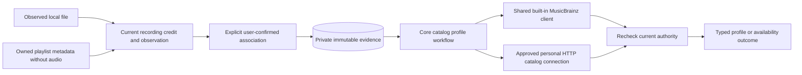
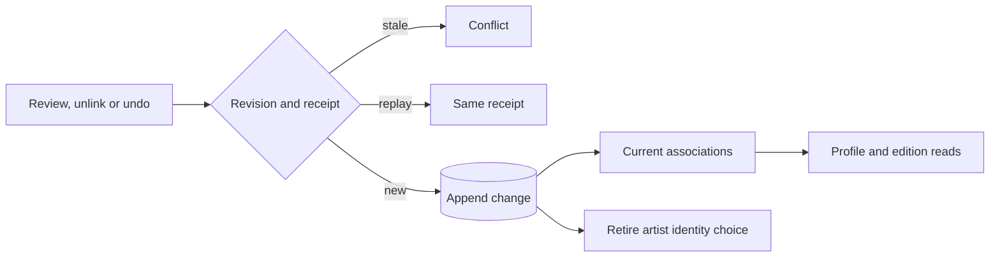

# Reviewed artist profiles in core

The core catalog supports account metadata settings, reviewed recording-credit associations and provider artist-profile reads. This is a source foundation. Server routes, settings controls, artist-page rendering, automatic matching, caching and discography traversal are still unfinished. The running server does not use this host yet.

## Identity and provenance

An account artist is an exact library-scoped credit label, not proof of a canonical person or group. Equal names can describe different performers. A review therefore associates one recording's current credit and immutable metadata observation with an artist identifier in one selected provider connection. It does not merge artists, recordings, sources or releases.

Local observations retain their source identity and current source-metadata state. An imported playlist observation can have no audio source. In that case, review requires its exact current, non-retired primary provider binding, original installation, provider recording ID and owning account. A profile lookup never adopts audio or creates a download.

The association keeps `user_confirmed` provenance. A valid external profile confirms its provider identifier, not the identity of a local performer. Raw MusicBrainz tags and equal names do not create associations automatically. Reviewing an edited credit produces distinct evidence while retaining earlier reviews. Repeating an unchanged review returns the same association.

There are at most 32 retained associations per account and recording. Evidence is immutable and an unlinked association still occupies one of the 32 slots. Replacement selection and administrator promotion still need separate workflows. Historical evidence can remain readable even when its credit is no longer current, but it cannot authorize a current profile response.

## Unlinking and undo

An account can unlink one of its own reviewed associations and can undo its latest association change for a recording. Neither workflow contacts a provider, changes the recording, its credit, sources, playlists or any personal edit, or touches another account.

Association rows never change. Each link, unlink and undo appends a row to a private change history with a per-recording revision. An association is current when it has no history or its latest history row is a link. Unlinked associations disappear from the list, cannot authorize profile, discography or edition reads (they answer not found without a provider request), and cannot anchor an album edition choice. A saved artist identity choice that used the association returns to needs-review, and stays there if the unlink is undone.

Reviewing the same provider artist again after an unlink links the same retained evidence again. Repeating a review that is already current is not a change and creates no history.

Undo reverses only the latest change: undoing a new link removes it, undoing an unlink restores it, and undoing the undo repeats the change. Undo with nothing in the history is rejected.

Both commands carry a request ID and the revision the client last read. A repeated request with the same contents returns its stored receipt; the same ID with different contents, or an old revision, is a conflict. Receipts are retained like the artist identity and album edition receipts. The workflows are `GET /api/v1/recordings/{id}/artist-association-changes`, `POST /api/v1/recordings/{id}/artist-associations/unlink` and `POST /api/v1/recordings/{id}/artist-associations/undo`, using the shared account and JSON extractors. Logs record the operation, a safe outcome, the revision number and timing only.

Migration 0057 adds the history and receipt tables. It is not deployed. In the artist information panel each saved review has an unlink button, and an undo button appears after a change made in that view. Reopening the page does not offer to undo an earlier visit's change yet, because the panel does not read the change history when it opens. Unlinking does not yet cover merge splitting or reconciliation after raw release retags.

## Settings and provider access

Unconfigured accounts default to enabled enrichment with the built-in MusicBrainz provider. Reading defaults and constructing the host make no network request. Settings retain an ordered list of at most eight providers with optimistic revision checks. Compatible personal HTTP connections can replace the default; disabling enrichment makes authorized profile reads return `disabled` without provider requests. Automatic selection by priority remains unfinished.

One shared MusicBrainz client belongs to each composed `Services` instance. It retains its fixed production origin and shared pacing. HTTP providers must already have the account's approved `catalog` capability. The separate catalog descriptor negotiates artist-profile support. An absent descriptor returns `unsupported` for this extension while preserving the approved connection. Providers return structured data; Hito owns rendering.

Provider artist IDs are opaque and scoped to their connection. They are serialized in JSON, never appended as untrusted URL paths or forwarded to a replacement provider. Retained imported metadata does not require its original service to be online. The selected catalog connection still requires current authorization.

## Cancellation and authority

Profile requests have one 15-second overall budget, including database reads, admission, descriptor negotiation, provider pacing and profile retrieval. Separate metadata admission allows four global requests and one per account. Catalog HTTP exchanges use that admission and leave general playback-source control capacity available. Provider I/O happens outside database transactions. Explicit cancellation drops the owned request future and returns `cancelled`.

The host captures and rechecks the session, access-grant identity, current credit and personal artist operation, immutable observation, metadata binding identity/revision, settings revision, association and selected installation/service authority. A grant revoked and recreated during a request cannot authorize its earlier response. A late response is withheld when the captured authority has changed.

Application events contain generated correlation IDs, operation names, safe outcomes, counts and elapsed times. Artist names, paths, credentials, provider identifiers, bodies and URLs do not belong in those logs.

## Verification and remaining work

Nine owned SQLite and HTTP cases cover reviewed local credits, namesake separation, disabled-state request suppression, grant revoke/regrant during held I/O, edited-credit review and duplicate replay, imported metadata without audio, cross-account denials, explicit cancellation, descriptor compatibility and playback independence. The held-profile case refreshes another provider's ready source for the same account and reads its owned WAV byte for byte before releasing the profile. The profile and both servers join shutdown before result assertions. Six historical upgrade cases preserve earlier rows, rowids, checksums and schema expectations; the measured migration-0046 endpoint remains distinct from latest migration 0047. See [status](status.md) for broad regression evidence. Controlled protocol checks do not establish live MusicBrainz availability or public-release performance.

Remaining work includes generated HTTP routes, user-facing review and settings flows, candidate discovery and preview, safe automatic candidates, metadata-only observation replacement during held requests, further session/provider revocation and response-limit cases, built-in host protocol acceptance, bounded caching, discography and edition tracks, optional similar artists, live integration and an audited deployment of migration 0047. Playback remains independent of metadata-provider availability.
