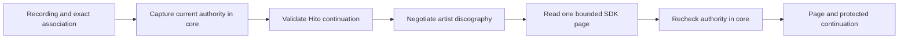
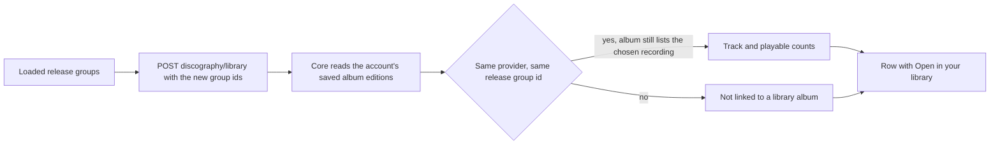
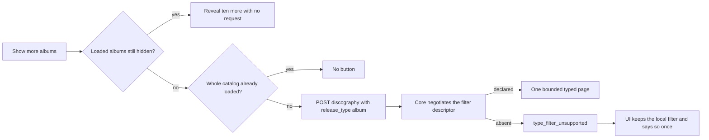
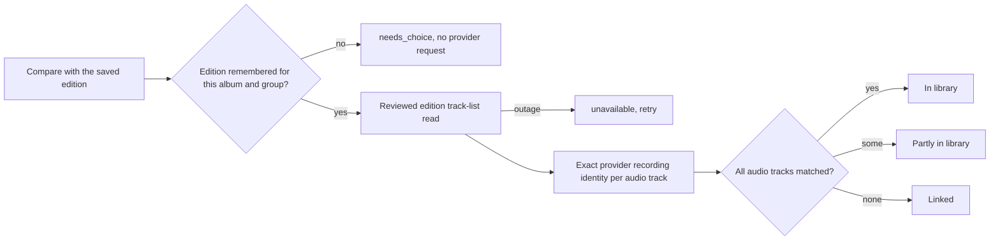
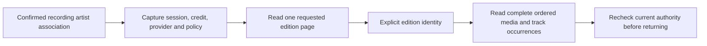

# Reviewed artist discography

Core, authenticated HTTP routes and shared recording-detail and chosen-artist controls can read release groups, list their editions and show a selected edition's complete track list. The provider and provider artist identity come from an explicitly confirmed recording-credit association. Callers supply a page limit and optional Hito continuation, rather than a separate provider identity. Chosen-artist pages group the catalog by release type and mark exactly linked library albums ([below](#types-and-library-availability)). Packaged chosen-page acceptance, live catalogs and normal-server publication remain unfinished.

## Ownership

`ArtistCatalog::recording_artist_discography_until` owns current-session and recording access checks, retained association identity, metadata policy, provider connection and the returned page. SQLite transactions finish before provider HTTP. Reads do not associate artists, adopt releases or recordings, merge namesakes, append collection events, prepare sources or open audio.

The built-in MusicBrainz adapter and approved personal HTTP catalogs use the shared SDK contract. An HTTP provider must independently declare `ArtistDiscography`; profile support alone is insufficient. Release-group identities, ordered credits and unknown snapshots/revisions remain unchanged. A release group does not select an edition or supply its tracks. Same-title groups remain separate.

## Continuation and bounds

The app-owned request accepts a limit from one to 50 and an optional ASCII continuation of at most 8,192 bytes. Core authenticates the continuation with a process-owned XChaCha20-Poly1305 key and domain-specific associated data. The envelope retains provider cursor, snapshot and limit plus a bounded fingerprint of the originating session, account, full current credit, exact association, policy revision and connection/service revisions. Tampering fails validation; a changed authority or limit requires starting again. Both fail before provider negotiation or page requests.

The key is shared by cloned capability handles. Restarting the process invalidates previous continuations. Logging out and signing in again also requires starting pagination again, even for the same account. This is a pagination lifecycle rule; the continuation never replaces fresh authorization.

Serialization, Base64 decoding and authority hashing have fixed bounds. HTTP plugin pages have a 256 KiB wire limit; SDK output has at most 50 items and 256 KiB. The built-in adapter separately caps its raw MusicBrainz browse response at 1 MiB before projection. A call reads one page and never crawls later pages automatically. MusicBrainz browse is live, with no invented immutable snapshot.

The existing metadata admission owner permits four workflows globally and one per account, independently of playback-source capacity. One 15-second deadline covers local authority checks, negotiation and the page request. Cancellation drops the inline request future. Workflow logs contain generated correlation IDs, safe outcomes, item counts and elapsed times, without cursors, session material, names or provider addresses.

## Verification and remaining work

`POST /api/v1/recordings/{id}/artist-associations/{association}/discography` uses the shared account and JSON extractors, the core cancellation boundary and private, no-store responses. It accepts `ReadArtistDiscography` and returns `ArtistDiscographyAvailability`. The route performs no SQL or detached provider work. OpenAPI and TypeScript are generated from the actual Rust route and wire types.

Two public core cases use temporary SQLite and an owned HTTP catalog. They verify explicit confirmation, profile-only rejection, exact two-page SDK data, Unicode identities, unknowns, limit rejection, altered-token rejection and a changed policy revision rejected before another provider request. The first preserves original audio, private pins, duplicate playlist entries, likes, progress, sources, downloads and retained evidence. The second logs session A out, authenticates a new valid session B of the same account, and requires the old continuation to conflict without provider I/O.

The initial case first failed because the public capability and types were absent. The session case then exposed missing originating-session continuity; adding the existing session binding to the authenticated fingerprint resolves it. Both cases and 14 existing artist-profile/discovery cases pass together. Strict all-target core Clippy and formatting pass. Independent security, correctness and performance reviews pass, including a second correctness review of the session rule. After integration, both new cases, strict all-target workspace Clippy and formatting pass again.

The HTTP integration case first failed with a missing-route 404. It now passes with all 73 API-module cases, strict all-target server Clippy and formatting. It checks two pages, exact identities and unknowns, account isolation, origin and request guards, invalid limits and fields, altered continuations and changed authority. Private collection events, sources and downloads stay unchanged. An independent route review passes. After integration, the new case passes again with strict server Clippy, formatting and an identical Rust OpenAPI export. The generated change adds one route and six schemas; existing OpenAPI values remain unchanged, TypeScript generation reproduces and both frontend type configurations pass.

This is directed source qualification, not a complete release gate. Discography-specific core held-request cancellation, deadlines, admission recovery, concurrent authority changes, maximum continuations and hostile response boundaries need further coverage. Full artist pages, selected-edition traversal, local/playable availability, canonical identity corrections and deployment remain open. [Live MusicBrainz acceptance](builtin-musicbrainz.md#live-integration-gate) remains failed after HTTP 503 responses.

## Shared browsing controls

A reviewed artist profile in Recording Details offers Browse discography. Rendering and loading the profile do not request a discography. Each explicit browse, next-page or retry action uses the same authenticated association route with a limit of 20. Only the Hito continuation is submitted; the SDK provider cursor is not a client pagination credential.

The component renders release groups as read-only text, preserving distinct provider identities even when titles match. Ordered credited names and join phrases, partial dates and unknown fields stay honest. Groups do not become local albums, selected editions or playable items. The controls import no metadata, start no audio and create no downloads.

Known rows remain visible during a later read or transient failure. Try again repeats the same page explicitly. A complete HTTP 409 instead offers Restart discography; it sends a null continuation and replaces the old rows only after accepting a fresh page. No retry runs automatically. Browsing stops after 50 successful pages, at most 1,000 distinct groups, with a visible limit notice.

Each browser request has a 20-second deadline through headers and success or error JSON. Account, recording, exact association, provider/profile replacement and unmount abort the attempt and fence late results. The workflow clears its timer and listener after completion. Native fetch receives the cancellation signal; a promise race alone would not prove drainage for a substitute transport that ignored cancellation.

Twenty-two React boundary cases cover explicit two-page browsing, exact identity and unknowns, retained rows, stale-continuation restart, stalled success/error bodies, scope changes, unmount, late headers/JSON, authority errors and unavailable outcomes. The first browse, restart and deadline cases each failed before their implementation. All 345 frontend cases in the feature snapshot pass with both type configurations and the production build. After integration with bookmark controls, all 363 cases across 128 files, types and build pass. Fresh independent correctness, security and performance reviews pass.

This qualifies the shared recording-detail workflow in source. The 50-page boundary, 1,000-row rendering performance, full artist-page navigation and deployment remain separate work. Packaged recording-detail browsing is qualified below; the later chosen-page source qualification is separate.

## Chosen-artist pages

An explicitly chosen artist page offers Browse full discography. The workflow reads the anchor recording's saved association, checks its account, recording, artist and exact provider identity, then reads that reviewed profile. A matching response opens the existing catalog controls and requests the first page of 20 release groups. Library track and catalog pagination remain independent. Later pages and retries require an explicit action.

The shared Recording Details control retains its original explicit-browse default. Both contexts use the same bounded, read-only catalog route and rendering. Same-title groups keep distinct identities. Neither workflow imports metadata, resolves sources, opens audio or creates downloads. Shared edition controls are qualified below; local/playable availability remains unfinished.

The chosen-page loader has a 20-second deadline across association and profile headers and bodies. Account, group, anchor or provider changes and unmount abort the request and fence late results. Disabled, unsupported, unavailable and cancelled outcomes remain visible and retryable. Logs record generated correlation IDs, safe outcomes and elapsed times. The page retains the identity snapshot it received; a choice reset elsewhere requires a reload, rather than an unimplemented cross-tab update guarantee.

Thirty-two new DOM cases cover initial browsing, namesakes, mismatched identities, provider outcomes, explicit retries, Strict Mode, held headers and JSON, deadlines and retired requests. All 91 related cases across 17 files pass, with both TypeScript configurations, formatting and the production build. Independent source review passes. An independent Docker repeat passes all 91 cases in 15.019 seconds, with all 2,388 source input hashes unchanged and no remaining owned containers.

One full frontend run was stopped at its 120-second watchdog after 157 passing file results, with no failed results observed. It is not a full-suite pass. The chosen-page source is integrated; its packaged browser acceptance and deployment remain open. Earlier packaged Recording Details evidence below does not qualify this new page.

## Types and library availability

The chosen-artist page splits the loaded release groups into Albums, EPs, Singles and Other releases (broadcasts, other types and groups with no type). Each section shows ten releases and offers a local "Show more" action. A "... only" filter narrows the page to one type. Sections are built from the pages already loaded plus the pages read for one type ([below](#provider-side-type-paging)). "Load more releases" still pages the whole catalog in provider order. Recording Details keeps its flat list and makes no availability request.

Availability is a library-only read, separate from the provider read, so it still works when a catalog is down and never contacts a provider.

A release group is linked to a library album only when the account saved an edition of that exact provider release group for that album (see [remembered edition](catalog-browsing.md#remembered-edition)). Provider kind, connection and group identifier must all be equal. Titles, artist names and dates are never compared, so two same-title groups stay separate and an album the user never linked reads "Not linked to a library album". This is not "not in your library": the library may hold the music without a saved link. Choosing an edition on the album page creates the link.

The saved choice also has to be usable now: its own reviewed association must still be linked, readable under the account's metadata settings and unchanged, and the album must still list the recording the choice was made from. Otherwise the album page asks for a new choice and this read ignores the link as well. The request's association must be readable too, or the read answers not found. For each linked album the answer carries its track count and how many tracks have a playable source on this host, using the same playable rule as the album page. A request names one to 50 distinct identities of at most 256 bytes. At most three albums are reported for one group, newest saved choice first.

Bounds: the read fetches at most eight saved choices per requested group (400 rows for 50 groups), ordered by group and recency, and applies every readability and listing check to all of them before keeping the newest three that pass, so stale newer choices cannot hide a valid older one. Readability is checked once per distinct recording and association pair, so at most 400 pairs, each a few indexed queries, in one read transaction. Access to the albums uses the same account and library filter as the album page. A work-budget case with 50 groups of three albums on 150 separate associations measures about 206,000 SQLite VM steps against a 600,000 budget.

The browser keeps the answers for the life of the loaded page: a release group is checked once, and a link saved or cleared on an album afterwards shows after the page is reloaded. Changing the account or chosen artist discards them.

Cost: one transaction and a scan of the account's saved choices (no index on the release group; a migration was avoided), plus one pass over the linked albums' tracks. A work-budget test measures 13,700 SQLite VM steps with 100 saved choices and 93,200 with 3,000, and fails when growth exceeds 60 steps per added choice. The route is `POST /api/v1/recordings/{id}/artist-associations/{association}/discography/library`, returns `private, no-store` and answers 423 to a locked session. The browser requests only identities it has not checked, never retries by itself and shows "Library availability could not be checked" with "Check library again" when the read fails, leaving the catalog visible.

Evidence: core workflows for an exact link, same-group lookalikes, invalid requests, another account (including one with its own readable association), an unlinked request association, an unlinked choice association, a choice whose album no longer lists its recording, a deselected provider and three stale newer choices; a playable-audio workflow with owned WAV files; one HTTP workflow including the locked-session answer; two work-budget tests; and five DOM cases pass. Limits: the library read itself stays library-only; the "partly in library" level needs the edition's track list and is a separate, explicit read ([below](#comparing-a-linked-album-with-its-edition)); credit pages without a chosen artist show no catalog (the credit page links to the chosen page); live MusicBrainz returns HTTP 503, so the live gate still fails.

## Provider-side type paging

A provider may page one release type at a time. The SDK adds an optional `release_type` (`album`, `ep`, `single` or `other`) to the discography request and a separate `GET v1/catalog/discography/capabilities` descriptor that declares `release_type_filter` ([contract](plugin-catalog.md#provider-side-release-type-filter)). A request without a type keeps its exact earlier wire bytes, and a provider that does not declare the descriptor keeps today's behaviour.

Core negotiates the descriptor only when a type is requested, after the existing discography negotiation, so whole-catalog reads add no request. A provider without it answers `type_filter_unsupported` and no typed page is requested. The built-in adapter always supports it. The sealed continuation carries the type, so a token from one type cannot continue another type or the whole catalog; core rejects a mismatch before any provider request. A typed page may only hold groups of that type, and the SDK validator rejects a page that does not. `other` is the provider's "other" type for MusicBrainz (`type=other`), so it does not include broadcasts or groups without a type. The page's Other section merges the loaded broadcasts and untyped groups with what that type read adds.

The built-in MusicBrainz client sends `release-group?artist=<id>&type=album|ep|single|other` with the same limit, pacing and 1 MiB body cap as the whole-catalog browse, one request per read. Its typed cursor (`mb-release-groups-typed-v1`) binds artist, type, limit and offset; the whole-catalog cursor keeps its earlier form and neither can continue the other.

In the browser each section pages independently. "Show more albums" first reveals albums that are already loaded, then (only while the whole catalog is not fully loaded and the provider has not said it cannot) reads the next 20 albums, merging by exact release group identity so duplicates never appear. A typed read failure keeps every known row and offers "Try again" for that type only. A retired continuation offers "Restart albums". Unmounting, an account change or a changed artist cancels the held request; each request has the same 20-second deadline. Nothing starts automatically, and the library availability read only asks about groups it has not checked.

Evidence: three SDK cases (descriptor negotiation, unchanged wire bytes, per-type page validation) plus one generated-schema case; three MusicBrainz client cases against the owned fake (typed paging with exactly one request per read and the expected query, cursor isolation in both directions, other-type rejection and an HTTP 503); four core cases with an owned HTTP catalog (negotiated typed paging with continuation fencing, unfiltered reads that never negotiate, a provider without the filter, a typed outage that leaves the whole catalog readable) and one core case against the built-in client and a fake MusicBrainz; one HTTP workflow; six DOM cases. Limits: only MusicBrainz and providers that declare the descriptor page by type, live MusicBrainz still returns HTTP 503, and the Other section's provider read covers only the provider's other type.

## Comparing a linked album with its edition

A linked release group can show how much of its remembered edition the account holds. The comparison is a separate, explicit read: the discography page never fetches editions by itself. Each linked album offers "Compare with the saved edition". That action reads the edition the account remembered for the album ([remembered edition](catalog-browsing.md#remembered-edition)) through the same reviewed provider read as the album page and classifies the result.

`POST /api/v1/albums/{id}/edition/library-level` takes the release group and answers `compared` with a `level` (`in_library`, `partly` or `linked`), `matched_tracks` and `edition_tracks`, or one of `needs_choice`, `disabled`, `unsupported`, `unavailable` or `cancelled`. Only the audio tracks of the edition count: pregaps and data tracks are not tracks, and an audio track without a provider recording identity can never match, so such an edition cannot read In library. A track matches only through an active, current provider binding of the same installation, which is the rule of the album page. Titles are never compared, personal titles stay as the user set them, and nothing is imported, saved, played or downloaded. A request for a release group other than the remembered one answers `needs_choice` without provider traffic. An album that is linked but has no matching track reads "Linked" with zero tracks (the built-in provider has no library recording bindings, so its editions read Linked).

The browser shows `In library`, `Partly in library` or `Linked` with "n of m tracks" using the same availability marker as release cards (library, available and catalog states). One comparison costs one edition track-list read and one query pair over at most 4,096 provider identities, the same as opening the album page; a comparison is never started by loading or paging the discography, so there is no per-group query to budget. The result lives only in the open page, and "Try again" repeats only that album's comparison. A missing remembered edition asks the user to choose one on the album page.

Evidence: four core cases through the public capability with owned fixtures (an edition that is missing, other groups and invalid identities, exact classification as the library changes including a retired binding and an unchanged album, an outage, unsupported editions and disabled metadata, and cancellation) plus two unit cases for Linked and audio-less editions; one HTTP workflow with the guards and the generated contract; six DOM cases. Limits: the comparison does not run for many albums at once, the Linked state cannot distinguish "none held" from "identities not yet bound", and live provider acceptance is still open.

## Packaged browsing acceptance

The package from `1c59c48` passes an actual Chromium and WebKit workflow against a fresh isolated database and owned HTTP catalog. An earlier web bundle using the identical Rust binary first fails at the missing Browse discography control. The candidate explicitly searches namesakes, previews the second candidate, confirms that exact identity and opens its saved profile before browsing.

Two pages retain distinct same-title release groups, ordered credits, partial dates and unknown values. Requests use a null continuation first and then the protected Hito continuation, never the provider cursor. Reload makes no automatic discography request; another explicit Browse starts again. Sixteen exact provider calls cover negotiation, search, previews/profile and the three catalog reads. No release is adopted and no audio, source change or Download starts.

The final workflow takes 6.0 seconds in Chromium and 7.9 seconds in WebKit. Exact A,B,A playlist entries, personal pins, likes, progress, metadata observations, source records, provider preferences, approved connections, original WAV hashes and download absence remain unchanged. Correlated frontend workflows and retrospective console canaries pass within fixed request, response and diagnostic bounds. Known synthetic canaries are absent from retained structured backend logs; that check does not prove privacy for every possible value.

Independent review found unbounded shared preparation reads. The acknowledgement and progress helpers now cap bodies before JSON parsing and dispose responses. An owned API regression first reproduces the oversized progress false pass, then verifies rejection and an unchanged valid response. The focused second review, both frontend type configurations and fresh browser reruns pass. Default behavior of the shared provider fixture remains unchanged unless discography is explicitly enabled.

This qualifies the shared reviewed-profile workflow. It does not qualify live MusicBrainz, full artist navigation, selected editions, local/playable availability, browser rendering at the catalog cap or release performance targets. The isolated server is stopped and the normal server is unchanged.

## Edition reads in core

The core catalog can list editions for an explicitly selected provider release group and read the complete track list of an explicitly selected edition. Both operations retain the recording's confirmed artist association. The built-in MusicBrainz adapter and approved HTTP catalog plugins use the same SDK types; a plugin independently declares each edition operation. Missing support returns Unsupported without guessing an album or importing metadata.

The shared reviewed-read owner retains separate metadata admission, finishes its SQLite transaction before provider I/O and rechecks authority after each external read. Edition continuations are encrypted and bound to the exact association, session, credit, policy, provider connection, release group and page limit. Discography continuations retain their existing format. Each workflow has a total 15-second deadline and explicit cancellation. Response limits are 4 KiB for operation negotiation and 256 KiB for catalog data.

The two new public core workflows pass, together with both existing discography cases and strict all-target core checks. An independent Docker repeat passes both new workflows on unchanged source. Fixtures verify two-page edition listing, explicit selection, multiple discs, repeated recording occurrences, stale policy rejection and cancellation followed by a successful retry before the held provider work finishes. State, original associations and explicit-download absence are preserved. Structured completion logs and their span-close events retain correlations while excluding the tested private values.

This qualifies the core read capability. Shared browsing controls, local playable matching and packaged/live acceptance remain unfinished. No new edition UI is deployed.

## Edition HTTP API

Two authenticated POST routes under `/api/v1/recordings/{id}/artist-associations/{association}` expose `/release-group-editions` and `/edition-track-list`. Opaque provider identities stay in typed JSON bodies. The shared account extractor and core reviewed-read owner enforce access; responses use `private, no-store`. The HTTP layer introduces no SQL, provider-specific behavior, imports, playback or downloads.

The new public Router workflow and existing discography regression pass, with strict all-target server checks. The new workflow also passes an independent Docker repeat. It reviews a real imported recording, pages two edition results, selects one exact version and verifies ordered repeated track occurrences. Anonymous requests fail before provider work, and private library/collection/download state remains unchanged.

Actual Rust export and offline TypeScript generation add two paths and ten reachable schemas while preserving the previous 103 paths and 247 schemas. An independent run of the qualified export reproduces the final OpenAPI bytes. Shared controls are qualified below; packaged/live acceptance remains open. Neither the normal server nor VPS was updated.

## Shared edition controls

Each release group offers Browse editions. Closed controls hold no request workflows; the first explicit action mounts the listing and detail owners and requests 20 summaries. Load more editions submits only the Hito continuation. Same-title editions retain separate identities. Choosing one requests its complete ordered media and track occurrences, including pregaps, data tracks and repeated recordings. Unknown metadata stays explicit, and the UI states that audio availability has not been checked. These controls do not adopt metadata, change library records, play audio or create downloads.

Listing stops after 50 requested pages, at most 1,000 summaries. Detail responses are bounded to 256 media and 4,096 occurrences. Each request has a 20-second deadline through headers and success/error bodies. Account, recording, reviewed association, provider/profile, release-group and selected-edition changes abort retired requests and fence late results. A replacement context requires a fresh explicit action. Failed later pages retain known rows and offer an explicit restart with a null continuation; a complete 409 requires that restart. Track-list failures have an explicit retry and no pagination token.

Sixteen DOM cases pass for selection, order, cancellation, late replies, deadlines, invalid statuses, retries, continuation recovery, StrictMode and the page limit. An invalid-status regression first exposed unsafe completion logging and missing recovery; the API adapter now validates the closed status set before either workflow consumes it. A resource regression first measured four controllers for one closed group and 42 for twenty. Deferring workflow ownership changes both counts to two. This measures controller allocation, not heap size or catalog-cap rendering latency.

Both TypeScript configurations, the production build and all 607 frontend tests across 191 files pass. The two-round source review resolves the eager-allocation finding. An independent combined-source Docker run passes 33 edition, existing discography and chosen-artist cases across eight files in 4.681 seconds, with all 16 checked source/contract inputs unchanged and no test containers remaining. Packaged Recording Details browsing is qualified below. Full catalog rendering performance, chosen-artist route acceptance, playable matching, live providers and deployment remain separate gates. The normal server and VPS are unchanged.

## Packaged edition browsing

The actual release image passes one complete edition workflow in Chromium and WebKit, including an independent repeat in each engine. Each starts with a fresh tmpfs database and owned WAV files, performs normal account setup and plugin approval, reviews the namesake artist and explicitly browses two discography pages. Browse editions reads two distinct same-title versions. Selecting the bonus edition renders exactly two ordered discs and four ordered occurrences, preserving the pregap, data track, repeated recording identity and unknown metadata. Reload leaves edition controls closed and makes no further edition requests.

The case requires the exact 23-call provider transcript, paired frontend workflow completions, no unexpected writes or audio/download requests, unchanged private account state and original files, and no tested private console values. Source and Playwright dependency receipts remain equal. Runtime image, binary and asset hashes match across all runs, with read-only source/music/modules, no host ports and an isolated server network. Cleanup leaves no owned containers. Captured backend logs do not establish additional backend-canary coverage.

The first run completed its UI assertions but failed a count oracle: its exact accepted transcript contained 23 calls while a second constant expected 22. The corrected constant preserves that complete transcript and every privacy/state assertion. A separate Chromium control also passes the default discography branch with its exact 17-call transcript and unchanged 20-call cap. Both original failure and corrected runs are retained.

The runtime image is `sha256:31c6c350e554e3dafeb1f808732b33bd1d06a968a54701f61ad8a59365f1d818`, built from `347939fbd72f7b58b5fa4943f999d67f5efbfa77` with 2,345 inputs hashing to `4ccb7b1630f3cca5c08a73c04c9bc030e4ca677802e3fb369fef3b009a0adbbb`. The executed gate is `3fb5cf61cf90aabf8bff658ddc44599268b03085`, with input digest `22e6618b00ec6db6750661f03409fa8871fdc8970ff7d8a4cbb6c3cdddde3ecd`. Its only change from the runtime checkout is the test-count constant; no application bundle was rebuilt for that correction. Integration preserves all seven gate files and all executable/bundle inputs. The later TorBox README change records that separate package's qualification.

Merge [the edition overlay](../scripts/artist-editions/compose.e2e.yaml) after the [existing isolated browser configuration](../scripts/artist-identity-groups/compose.e2e.yaml). Supply the immutable image and browser pins, exact gate source, and fresh music/evidence directories described in the [browser reproduction guide](../scripts/artist-identity-groups/README.md). Run the `artist-groups-node` preparation, wait for `artist-groups-server`, then run `artist-groups-browser` with the edition overlay. Stop and remove only that disposable project's containers in a finally path. This checkpoint covers Recording Details with owned providers; live catalogs, the chosen-artist route, audio matching, catalog-cap performance and deployment remain open.
