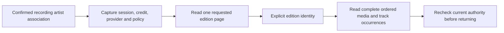

# Reviewed artist discography

Core, an authenticated HTTP route and shared recording-detail and chosen-artist controls can read release-group pages for an explicitly confirmed recording-credit association. The provider and provider artist identity come from that retained association. Callers supply a page limit and optional Hito continuation, rather than a separate provider identity. Selected-edition traversal, playable availability and normal-server publication remain unfinished.

## Ownership

`Catalog::recording_artist_discography_until` owns current-session and recording access checks, retained association identity, metadata policy, provider connection and the returned page. SQLite transactions finish before provider HTTP. Reads do not associate artists, adopt releases or recordings, merge namesakes, append collection events, prepare sources or open audio.

The built-in MusicBrainz adapter and approved personal HTTP catalogs use the shared SDK contract. An HTTP provider must independently declare `ArtistDiscography`; profile support alone is insufficient. Release-group identities, ordered credits and unknown snapshots/revisions remain unchanged. A release group does not select an edition or supply its tracks. Same-title groups remain separate.

## Continuation and bounds

The app-owned request accepts a limit from one to 50 and an optional ASCII continuation of at most 8,192 bytes. Core authenticates the continuation with a process-owned XChaCha20-Poly1305 key and domain-specific associated data. The envelope retains provider cursor, snapshot and limit plus a bounded fingerprint of the originating session, account, full current credit, exact association, policy revision and connection/service revisions. Tampering fails validation; a changed authority or limit requires starting again. Both fail before provider negotiation or page requests.

The key is shared by cloned capability handles. Restarting the process invalidates previous continuations. Logging out and signing in again also requires starting pagination again, even for the same account. This is a pagination lifecycle rule; the continuation never replaces fresh authorization.

Serialization, Base64 decoding and authority hashing have fixed bounds. HTTP plugin pages have a 256 KiB wire limit; SDK output has at most 50 items and 256 KiB. The built-in adapter separately caps its raw MusicBrainz browse response at 1 MiB before projection. A call reads one page and never crawls later pages automatically. MusicBrainz browse is live, with no invented immutable snapshot.

The existing metadata admission owner permits four workflows globally and one per account, independently of playback-source capacity. One 15-second deadline covers local authority checks, negotiation and the page request. Cancellation drops the inline request future. Workflow logs contain generated correlation IDs, safe outcomes, item counts and elapsed times, without cursors, session material, names or provider addresses.

## Verification and remaining work

`POST /api/v1/recordings/{id}/artist-associations/{association}/discography` uses the shared account and JSON extractors, the core cancellation boundary and private, no-store responses. It accepts `ReadArtistDiscography` and returns `ArtistDiscographyAvailability`. The route performs no SQL or detached provider work. OpenAPI and TypeScript are generated from the actual Rust route and wire types.

Two public core cases use temporary SQLite and an owned HTTP catalog. They verify explicit confirmation, profile-only rejection, exact two-page SDK data, Unicode identities, unknowns, limit rejection, altered-token rejection and a changed policy revision rejected before another provider request. The first preserves original audio, private pins, duplicate playlist entries, likes, progress, sources, downloads and retained evidence. The second logs session A out, authenticates a new valid session B of the same account, and requires the old continuation to conflict without provider I/O.

The initial case first failed because the public capability and types were absent. The session case then exposed missing originating-session continuity; adding the existing session binding to the authenticated fingerprint resolves it. Both cases and 14 existing artist-profile/discovery cases pass together. Strict all-target core Clippy and formatting pass. Independent security, correctness and performance reviews pass, including a second correctness review of the session rule. After integration, both new cases, strict all-target workspace Clippy and formatting pass again.

The HTTP integration case first failed with a missing-route 404. It now passes with all 73 API-module cases, strict all-target server Clippy and formatting. It checks two pages, exact identities and unknowns, account isolation, origin and request guards, invalid limits and fields, altered continuations and changed authority. Private collection events, sources and downloads stay unchanged. An independent route review passes. After integration, the new case passes again with strict server Clippy, formatting and an identical Rust OpenAPI export. The generated change adds one route and six schemas; existing OpenAPI values remain unchanged, TypeScript generation reproduces and both frontend type configurations pass.

This is directed source qualification, not a complete release gate. Discography-specific core held-request cancellation, deadlines, admission recovery, concurrent authority changes, maximum continuations and hostile response boundaries need further coverage. Full artist pages, selected-edition traversal, local/playable availability, canonical identity corrections and deployment remain open. [Live MusicBrainz acceptance](builtin-musicbrainz.md#live-integration-gate) remains failed after HTTP 503 responses.

## Shared browsing controls

A reviewed artist profile in Recording Details offers Browse discography. Rendering and loading the profile do not request a discography. Each explicit browse, next-page or retry action uses the same authenticated association route with a limit of 20. Only the Hito continuation is submitted; the SDK provider cursor is not a client pagination credential.

The component renders release groups as read-only text, preserving distinct provider identities even when titles match. Ordered credited names and join phrases, partial dates and unknown fields stay honest. Groups do not become local albums, selected editions or playable items. The controls import no metadata, start no audio and create no downloads.

Known rows remain visible during a later read or transient failure. Try again repeats the same page explicitly. A complete HTTP 409 instead offers Restart discography; it sends a null continuation and replaces the old rows only after accepting a fresh page. No retry runs automatically. Browsing stops after 50 successful pages, at most 1,000 distinct groups, with a visible limit notice.

Each browser request has a 20-second deadline through headers and success or error JSON. Account, recording, exact association, provider/profile replacement and unmount abort the attempt and fence late results. The workflow clears its timer and listener after completion. Native fetch receives the cancellation signal; a promise race alone would not prove drainage for a substitute transport that ignored cancellation.

Twenty-two React boundary cases cover explicit two-page browsing, exact identity and unknowns, retained rows, stale-continuation restart, stalled success/error bodies, scope changes, unmount, late headers/JSON, authority errors and unavailable outcomes. The first browse, restart and deadline cases each failed before their implementation. All 345 frontend cases in the feature snapshot pass with both type configurations and the production build. After integration with bookmark controls, all 363 cases across 128 files, types and build pass. Fresh independent correctness, security and performance reviews pass.

This qualifies the shared recording-detail workflow in source. The 50-page boundary, 1,000-row rendering performance, full artist-page navigation and deployment remain separate work. Packaged recording-detail browsing is qualified below; the later chosen-page source qualification is separate.

## Chosen-artist pages

An explicitly chosen artist page offers Browse full discography. The workflow reads the anchor recording's saved association, checks its account, recording, artist and exact provider identity, then reads that reviewed profile. A matching response opens the existing catalog controls and requests the first page of 20 release groups. Library track and catalog pagination remain independent. Later pages and retries require an explicit action.

The shared Recording Details control retains its original explicit-browse default. Both contexts use the same bounded, read-only catalog route and rendering. Same-title groups keep distinct identities. Neither workflow imports metadata, resolves sources, opens audio or creates downloads. Selected editions, their complete track lists and local/playable availability remain unfinished.

The chosen-page loader has a 20-second deadline across association and profile headers and bodies. Account, group, anchor or provider changes and unmount abort the request and fence late results. Disabled, unsupported, unavailable and cancelled outcomes remain visible and retryable. Logs record generated correlation IDs, safe outcomes and elapsed times. The page retains the identity snapshot it received; a choice reset elsewhere requires a reload, rather than an unimplemented cross-tab update guarantee.

Thirty-two new DOM cases cover initial browsing, namesakes, mismatched identities, provider outcomes, explicit retries, Strict Mode, held headers and JSON, deadlines and retired requests. All 91 related cases across 17 files pass, with both TypeScript configurations, formatting and the production build. Independent source review passes. An independent Docker repeat passes all 91 cases in 15.019 seconds, with all 2,388 source input hashes unchanged and no remaining owned containers.

One full frontend run was stopped at its 120-second watchdog after 157 passing file results, with no failed results observed. It is not a full-suite pass. The chosen-page source is integrated; its packaged browser acceptance and deployment remain open. Earlier packaged Recording Details evidence below does not qualify this new page.

## Packaged browsing acceptance

The package from `1c59c48` passes an actual Chromium and WebKit workflow against a fresh isolated database and owned HTTP catalog. An earlier web bundle using the identical Rust binary first fails at the missing Browse discography control. The candidate explicitly searches namesakes, previews the second candidate, confirms that exact identity and opens its saved profile before browsing.

Two pages retain distinct same-title release groups, ordered credits, partial dates and unknown values. Requests use a null continuation first and then the protected Hito continuation, never the provider cursor. Reload makes no automatic discography request; another explicit Browse starts again. Sixteen exact provider calls cover negotiation, search, previews/profile and the three catalog reads. No release is adopted and no audio, source change or Download starts.

The final workflow takes 6.0 seconds in Chromium and 7.9 seconds in WebKit. Exact A,B,A playlist entries, personal pins, likes, progress, metadata observations, source records, provider preferences, approved connections, original WAV hashes and download absence remain unchanged. Correlated frontend workflows and retrospective console canaries pass within fixed request, response and diagnostic bounds. Known synthetic canaries are absent from retained structured backend logs; that check does not prove privacy for every possible value.

Independent review found unbounded shared preparation reads. The acknowledgement and progress helpers now cap bodies before JSON parsing and dispose responses. An owned API regression first reproduces the oversized progress false pass, then verifies rejection and an unchanged valid response. The focused second review, both frontend type configurations and fresh browser reruns pass. Default behavior of the shared provider fixture remains unchanged unless discography is explicitly enabled.

This qualifies the shared reviewed-profile workflow. It does not qualify live MusicBrainz, full artist navigation, selected editions, local/playable availability, browser rendering at the catalog cap or release performance targets. The isolated server is stopped and the normal server is unchanged.

## Edition reads in core

The core catalog can list editions for an explicitly selected provider release group and read the complete track list of an explicitly selected edition. Both operations retain the recording's confirmed artist association. The built-in MusicBrainz adapter and approved HTTP catalog plugins use the same SDK types; a plugin independently declares each edition operation. Missing support returns Unsupported without guessing an album or importing metadata.

The shared reviewed-read owner retains separate metadata admission, finishes its SQLite transaction before provider I/O and rechecks authority after each external read. Edition continuations are encrypted and bound to the exact association, session, credit, policy, provider connection, release group and page limit. Discography continuations retain their existing format. Each workflow has a total 15-second deadline and explicit cancellation. Response limits are 4 KiB for operation negotiation and 256 KiB for catalog data.

The two new public core workflows pass, together with both existing discography cases and strict all-target core checks. An independent Docker repeat passes both new workflows on unchanged source. Fixtures verify two-page edition listing, explicit selection, multiple discs, repeated recording occurrences, stale policy rejection and cancellation followed by a successful retry before the held provider work finishes. State, original associations and explicit-download absence are preserved. Structured completion logs and their span-close events retain correlations while excluding the tested private values.

This qualifies the core read capability. Authenticated edition HTTP routes, generated application contracts, shared browsing controls, local playable matching and packaged/live acceptance remain unfinished. No new edition UI is deployed.
