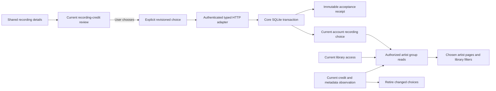

# Reviewed artist identity groups

Hito can retain an explicit performer identity choice for each recording and account. Choices group local and imported recordings only when the user has reviewed the same exact artist identity through the same provider installation. Equal artist names do not establish identity.

Core, authenticated HTTP routes, shared recording-detail controls and chosen-artist pages are implemented. The Artists index retains every existing library-credit card alongside the chosen groups. Recording and source identities remain unchanged. Replacing duplicate legacy cards, automatic matching, packaged browser acceptance and deployment remain unfinished.

## Ownership

Core owns the transaction, identity keys, receipts, authorization and pagination. HTTP authenticates and maps typed requests and results. Providers supply structured artist identities through the existing review contract. Group reads, accepted-request replay and reset do not contact a provider.

A group key contains the account, provider kind, HTTP installation identity when applicable, and exact provider artist identifier. Two installations returning the same identifier remain separate. An explicitly chosen group does not merge recordings, playable sources, releases, playlists or album-artist credits.

## Current choice and replay

An unselected recording begins at revision zero. Choose and Reset require the expected current revision and a nonempty request identifier. An accepted command advances the revision and stores an immutable receipt. Request identifiers share one account-wide namespace across recordings and both commands.

Replaying the same typed request returns its original receipt without applying it again. Reusing that identifier with a changed recording, command or payload conflicts. A replayed old Choose cannot restore a choice after Reset, and an old Reset cannot clear a later Choose.

Fresh choices require a current reviewed association, recording credit, metadata observation, provider authority and library grant. Provider removal or disabled enrichment does not erase a previously accepted personal choice. Existing reads, Reset and exact accepted replay remain available locally, subject to current session and library access.

A private title edit preserves the choice. A new artist operation or selected metadata observation retires it and advances its revision. Temporary loss of library access hides the choice and all group counts without deleting it. An unchanged grant restoration reveals it again. Identity changes while access is absent still retire it; changing A to B and back to A does not silently reactivate the old choice.

## Group browsing

Each group has independently paged libraries, recordings and release appearances. Pages default to 60 entries and are capped at 200. Counts and labels use only currently accessible, eligible members after an optional library filter. Releases are read in a bounded batch rather than one query per release.

The display name comes from the earliest accepted currently eligible member's account credit. It includes the recording, credit and reviewed association that supplied the label. Durable transaction acceptance order decides the label; wall-clock seconds and recording identifiers do not. Resetting and choosing again gives that member a new place in the order.

Search uses the existing catalog Unicode and prefix policy. It matches only the group's current display credit. A hidden member, an inaccessible library and a different member label cannot introduce a search match.

The Artists index shows **Chosen artists** separately from **Library credits**. Opening a chosen group uses `/artist-groups/{id}`. Its library filters and independently paged recordings and releases use the same authorized core projection as the JSON API. Changing the library resets the group's page offsets; changing one page preserves the other offsets. Group links retain the selected library and page size, without carrying unrelated index search or offsets.

Recording Details links a current choice to its group only after reading that group's authorized saved credit. Pending requests, failed reads, Reset and changed recording ownership remove the link. Group pages reuse the existing album and track components, retain original recording identifiers and unavailable markers, and start playback only through explicit controls. Existing artwork retrieval remains available. Browsing does not add provider catalog, discography, source preparation or download workflows.

The Inertia adapter adds typed group summaries to `ArtistIndexPage` and serves `ArtistIdentityGroupPage`. Full pages, HTML bootstrap and matching partial requests share access filtering and private, no-store responses. Partial requests evaluate group reads only when their requested props require them.

## HTTP and recording details

The authenticated routes are generated into OpenAPI and the shared TypeScript contract from the actual Rust router.

| Method | Path | Operation |
| --- | --- | --- |
| GET | `/api/v1/recordings/{id}/artist-identity` | Read the current choice |
| PUT | `/api/v1/recordings/{id}/artist-identity` | Choose an exact reviewed association |
| POST | `/api/v1/recordings/{id}/artist-identity/reset` | Reset the choice |
| GET | `/api/v1/artist-identity-groups` | Browse authorized groups |
| GET | `/api/v1/artist-identity-groups/{id}` | Read independently paged members |

Opening Artist information in Recording Details reads the local choice. Saving an artist review does not choose an identity. After viewing the saved review, the user can select **Choose this reviewed artist**. The control obtains a fresh review context and submits one revisioned request.

An uncertain result retains the exact request identifier and body for an explicit Retry. After a valid acknowledgement, the UI rereads the current choice instead of displaying a historical receipt as current state. A revision conflict requires a fresh read before another choice. Reset remains available for selected and retired choices when metadata providers are disabled or removed.

The group label uses the authorized saved credit from a group-detail read limited to one entry. It does not substitute the provider's profile name. Account, recording, artist-operation and metadata-observation changes retire pending work. The workflow has a total 15-second deadline and does not subscribe to playback position updates.

## Verification and limits

Directed owned workflows cover local files and actual protocol imports, namesakes, separate installations, unchanged private state and originals, concurrent writes, replay, offline provider removal, grant restoration, artist/title edits, independent pagination and Unicode search.

The HTTP slice passes six new real-router workflows and six related artist cases, formatting and strict all-target server Clippy. The new cases cover access and grant changes, immutable receipts, provider removal, query and body validation, the shared 262,144-byte body limit, browser origin protection and correlated private-safe logs. Actual OpenAPI and TypeScript regeneration reproduces byte for byte while preserving all 99 prior paths, 114 operations and 233 schemas. Independent specialist reviews and a separate repeat of all six new workflows pass.

The shared UI passes 43 DOM cases across 13 files, both TypeScript configurations and formatting. Independent correctness, security and performance reviews and a separate 43-case repeat pass. Tests cover explicit selection, lost acknowledgements, Reset, conflicts, invalid receipts, current-state rereads and owner retirement. The deadline case verifies held headers and a late unread body; it does not prove termination of an already active body reader. These are DOM protocol fixtures and separate HTTP tests, not packaged browser acceptance or a normal-server deployment.

Group-page adapters pass five new real-router cases and sixteen related HTTP cases, including full and partial access checks, grant and identity changes, pagination, HTML escaping and safe correlated logs. Strict all-target server Clippy, formatting and actual contract regeneration pass. Regeneration preserves the preceding 103 paths and 119 operations, adds the group-page props and extends the artist-index props. Independent reviews and an independent repeat of all five new cases pass.

The combined browsing UI passes 65 DOM cases across sixteen files, including sixteen new group navigation cases, both TypeScript configurations and its production build. Independent correctness, security and performance reviews pass. A separate 65-case repeat and the integrated 65-case run pass; the integrated production assets match the reviewed UI build byte for byte. These checks qualify source integration. Packaged browser workflows and normal deployment remain open.

A deterministic SQLite work check exercises a public artist edit with 32 and 100,000 unrelated retained choices under inherited, absent and fresh statistics. It preserves unrelated rows and foreign-key integrity. This is a query-work regression, not the release latency or simultaneous-listener benchmark.

The integrated core source passes 253 integration targets with 377 passing cases and all 17 library tests. One usual filesystem fault case remains ignored. Formatting, strict all-target core Clippy and the affected migration fixtures pass; doctests contain no cases. Independent public-capability repeats and source reviews pass. Existing historical upgrade checks preserve their exact schema, rows, rowids, sequences and checksums while separately verifying migration 0054.

The first public SQLite work regression used 1,400,400 virtual-machine steps with 100,000 unrelated retained choices, against 23,400 in the small fixture. The final unchanged test uses 24,100 steps in the small fixture and 400 with 100,000 choices under inherited, absent and fresh statistics, below its unchanged small-fixture-plus-20,000 budget. Other regressions reproduce and verify correction of a concurrent writer deadlock, retirement after an identity changes while access is revoked, Unicode search and same-second display-label ordering.

The full core suite does not have a single passing invocation. Its unchanged 100,000-provider-binding upgrade test exceeds its 15-second development deadline. The candidate reopened in 17.84 seconds in isolation; the clean pre-change baseline reopened in 17.74 seconds, with an independent baseline repeat taking 17.88 seconds. That existing upgrade-performance failure remains open with its original assertion. These measurements do not establish the release playback latency targets.
