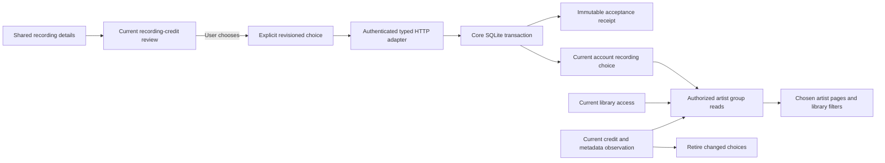

# Reviewed artist identity groups

Hito can retain an explicit performer identity choice for each recording and account. Choices group local and imported recordings only when the user has reviewed the same exact artist identity through the same provider installation. Equal artist names do not establish identity.

Core, authenticated HTTP routes, shared recording-detail controls and chosen-artist pages are implemented. The Artists index lists a library-credit card only while some of its content is not covered by a chosen group. Recording and source identities remain unchanged. Packaged Chromium acceptance passes; WebKit, automatic matching and deployment remain unfinished.

## Ownership

Core owns the transaction, identity keys, receipts, authorization and pagination. HTTP authenticates and maps typed requests and results. Providers supply structured artist identities through the existing review contract. Group reads, accepted-request replay and reset do not contact a provider.

A group key contains the account, provider kind, HTTP installation identity when applicable, and exact provider artist identifier. Two installations returning the same identifier remain separate. An explicitly chosen group does not merge recordings, playable sources, releases, playlists or album-artist credits.

## Current choice and replay

An unselected recording begins at revision zero. Choose and Reset require the expected current revision and a nonempty request identifier. An accepted command advances the revision and stores an immutable receipt. Request identifiers share one account-wide namespace across recordings and both commands.

Replaying the same typed request returns its original receipt without applying it again. Reusing that identifier with a changed recording, command or payload conflicts. A replayed old Choose cannot restore a choice after Reset, and an old Reset cannot clear a later Choose.

Fresh choices require a current reviewed association, recording credit, metadata observation, provider authority and library grant. Provider removal or disabled enrichment does not erase a previously accepted personal choice. Existing reads, Reset and exact accepted replay remain available locally, subject to current session and library access.

A private title edit preserves the choice. A new artist operation or selected metadata observation retires it and advances its revision. Temporary loss of library access hides the choice and all group counts without deleting it. An unchanged grant restoration reveals it again. Identity changes while access is absent still retire it; changing A to B and back to A does not silently reactivate the old choice.

## Group browsing

Each group has independently paged libraries, recordings and release appearances. Pages default to 60 entries and are capped at 200. Counts and labels use only currently accessible, eligible members after an optional library filter. Releases are read in a bounded batch rather than one query per release.

The display name comes from the earliest accepted currently eligible member's account credit. It includes the recording, credit and reviewed association that supplied the label. Durable transaction acceptance order decides the label; wall-clock seconds and recording identifiers do not. Resetting and choosing again gives that member a new place in the order.

Search uses the existing catalog Unicode and prefix policy. It matches the credit label of any current member, so a credit that left the Library credits list stays findable through its group. A hidden member or an inaccessible library cannot introduce a search match. The group still displays its earliest accepted label.

The Artists index shows **Chosen artists** separately from **Library credits**. A library credit leaves the credits list when it has a current chosen recording, every recording it holds is a current chosen recording, and every release it holds contains a current chosen recording of that same credit. A chosen track by another credit on the same album does not cover it. This is the only way two cards for one artist merge. Equal names alone never do: a credit that still holds an unreviewed recording stays listed, and two namesakes chosen under different provider artists stay in separate groups. Resetting or retiring a choice returns the credit to the list. Losing access to its library hides the credit with that library. The credit page `/artists/{id}` stays readable by identifier and album links still use it. The `/api/v1/artists` list and its total follow the same rule. Opening a chosen group uses `/artist-groups/{id}`. Its library filters and independently paged recordings and releases use the same authorized core projection as the JSON API. Changing the library resets the group's page offsets; changing one page preserves the other offsets. Group links retain the selected library and page size, without carrying unrelated index search or offsets.

Recording Details links a current choice to its group only after reading that group's authorized saved credit. Pending requests, failed reads, Reset and changed recording ownership remove the link. Group pages reuse the existing album and track components, retain original recording identifiers and unavailable markers, and start playback only through explicit controls. Existing artwork retrieval remains available. Browsing does not add provider catalog, discography, source preparation or download workflows.

The Inertia adapter adds typed group summaries to `ArtistIndexPage` and serves `ArtistIdentityGroupPage`. Full pages, HTML bootstrap and matching partial requests share access filtering and private, no-store responses. Partial requests evaluate group reads only when their requested props require them.

## HTTP and recording details

The authenticated routes are generated into OpenAPI and the shared TypeScript contract from the actual Rust router.

| Method | Path | Operation |
| --- | --- | --- |
| GET | `/api/v1/recordings/{id}/artist-identity` | Read the current choice |
| PUT | `/api/v1/recordings/{id}/artist-identity` | Choose an exact reviewed association |
| POST | `/api/v1/recordings/{id}/artist-identity/reset` | Reset the choice |
| GET | `/api/v1/artist-identity-groups` | Browse authorized groups |
| GET | `/api/v1/artist-identity-groups/{id}` | Read independently paged members |
| POST | `/api/v1/artists/{id}/artist-identity` | Apply a chosen artist to the recordings of a library credit |

Opening Artist information in Recording Details reads the local choice. Saving an artist review does not choose an identity. After viewing the saved review, the user can select **Choose this reviewed artist**. The control obtains a fresh review context and submits one revisioned request.

An uncertain result retains the exact request identifier and body for an explicit Retry. After a valid acknowledgement, the UI rereads the current choice instead of displaying a historical receipt as current state. A revision conflict requires a fresh read before another choice. Reset remains available for selected and retired choices when metadata providers are disabled or removed.

The group label uses the authorized saved credit from a group-detail read limited to one entry. It does not substitute the provider's profile name. Account, recording, artist-operation and metadata-observation changes retire pending work. The workflow has a total 15-second deadline and does not subscribe to playback position updates.

## Applying one identity to a whole credit

Choosing a performer track by track is slow when a credit holds many recordings. On a library credit page, **Find reviewed artists for this credit** lists the account's chosen artists whose members carry the same credit label. Equal names only suggest candidates; the user picks one, and a confirmation step names the artist, the credit and the rule below before anything is written.

**Use this identity for all tracks with this credit** sends one request with a request identifier, the chosen group and an optional cursor. The group already fixes the provider installation and exact provider artist identifier the user reviewed. For each current recording of that credit, in recording-identifier order, core applies the per-recording rules inside one immediate transaction:

- The account must still be able to read the credit, the group must still have a current chosen recording the account can read, and the provider must still be selected, approved and unchanged. Otherwise the request fails with a conflict and writes nothing.
- A recording whose credit, observation or library grant cannot be captured is skipped as unavailable.
- A recording with a current choice for the same group is counted as unchanged.
- A recording with a current choice for a different group is left alone and counted as skipped.
- Any other recording, including one that was never chosen, was reset, or was retired for review, gets a confirmed association for its own credit and observation, then a new choice at the next revision.

One accepted request is limited to 100 recordings, matching the 100-operation collection batch limit. It stores one immutable receipt with the counts and a `next_after` cursor, and every choice it writes shares that receipt's acceptance order. When more recordings remain, the response carries `next_after`; the client sends the next request with that cursor and a new request identifier. Skipped recordings sit before the cursor, so the walk always ends. Replaying a request identifier with the same body returns the stored receipt; a changed body conflicts, and request identifiers share the account namespace with Choose and Reset. Each recording can be reset on its own afterwards, and a credit leaves the Artists index under the rule above once all its recordings and releases are covered.

The web control repeats batches until the cursor ends and then shows how many tracks now use the artist, how many already did, how many kept a different artist, and how many could not be changed. A lost acknowledgement keeps the exact request for an explicit Retry. Logs hold counts and timings only.

## Verification and limits

Directed owned workflows cover local files and actual protocol imports, namesakes, separate installations, unchanged private state and originals, concurrent writes, replay, offline provider removal, grant restoration, artist/title edits, independent pagination and Unicode search.

The HTTP slice passes six new real-router workflows and six related artist cases, formatting and strict all-target server Clippy. The new cases cover access and grant changes, immutable receipts, provider removal, query and body validation, the shared 262,144-byte body limit, browser origin protection and correlated private-safe logs. Actual OpenAPI and TypeScript regeneration reproduces byte for byte while preserving all 99 prior paths, 114 operations and 233 schemas. Independent specialist reviews and a separate repeat of all six new workflows pass.

The shared UI passes 43 DOM cases across 13 files, both TypeScript configurations and formatting. Independent correctness, security and performance reviews and a separate 43-case repeat pass. Tests cover explicit selection, lost acknowledgements, Reset, conflicts, invalid receipts, current-state rereads and owner retirement. The deadline case verifies held headers and a late unread body; it does not prove termination of an already active body reader. These are DOM protocol fixtures and separate HTTP tests, not packaged browser acceptance or a normal-server deployment.

Group-page adapters pass five new real-router cases and sixteen related HTTP cases, including full and partial access checks, grant and identity changes, pagination, HTML escaping and safe correlated logs. Strict all-target server Clippy, formatting and actual contract regeneration pass. Regeneration preserves the preceding 103 paths and 119 operations, adds the group-page props and extends the artist-index props. Independent reviews and an independent repeat of all five new cases pass.

The combined browsing UI passes 65 DOM cases across sixteen files, including sixteen new group navigation cases, both TypeScript configurations and its production build. Independent correctness, security and performance reviews pass. A separate 65-case repeat and the integrated 65-case run pass; the integrated production assets match the reviewed UI build byte for byte. These checks qualify source integration.

The packaged Chromium workflow and an independent final repeat now pass. They exercise actual UI review, namesake separation, identical request bytes and UUID after a lost acknowledgement, current-state rereads, pagination, library filters and Reset. Public snapshots preserve recordings, sources, metadata, playlists, likes, progress, activity, provider preferences and original files without playback or downloads. Eleven actual HTTP observer cases and four targeted rejection controls verify the gate's assertions. Final correctness, security and performance reviews pass. WebKit remains unqualified after a renderer crash; a 2 GiB diagnostic also failed and did not establish memory pressure as the cause. The maintained browser limit remains 1 GiB. See [the frozen runtime, exact evidence and remaining limits](../scripts/artist-identity-groups/README.md).

A deterministic SQLite work check exercises a public artist edit with 32 and 100,000 unrelated retained choices under inherited, absent and fresh statistics. It preserves unrelated rows and foreign-key integrity. This is a query-work regression, not the release latency or simultaneous-listener benchmark.

The integrated core source passes 253 integration targets with 377 passing cases and all 17 library tests. One usual filesystem fault case remains ignored. Formatting, strict all-target core Clippy and the affected migration fixtures pass; doctests contain no cases. Independent public-capability repeats and source reviews pass. Existing historical upgrade checks preserve their exact schema, rows, rowids, sequences and checksums while separately verifying migration 0054.

The first public SQLite work regression used 1,400,400 virtual-machine steps with 100,000 unrelated retained choices, against 23,400 in the small fixture. The final unchanged test uses 24,100 steps in the small fixture and 400 with 100,000 choices under inherited, absent and fresh statistics, below its unchanged small-fixture-plus-20,000 budget. Other regressions reproduce and verify correction of a concurrent writer deadlock, retirement after an identity changes while access is revoked, Unicode search and same-second display-label ordering.

The earlier full core run did not pass its unchanged 100,000-provider-binding upgrade test. The candidate reopened in 17.84 seconds; clean pre-change baseline runs took 17.74 and 17.88 seconds, above the 15-second development deadline.

A test-only diagnostic reopened in 17.72 seconds with the same deadline. Stored migration timings attributed about 78% to migrations 0026 and 0036. A subsequent rollback-only diagnostic preserved rows, rowids, schema, receipts, FTS storage and foreign-key integrity. Its statement timings did not establish a missing-index or quadratic-query defect, and its split execution and snapshots are not a canonical startup benchmark.

The test profile now compiles only bundled `libsqlite3-sys` at optimization level 2. Actual native compiler output verifies `-O2`; Hito, SQLx and the Rust test remain at level 0 with debug assertions and overflow checks enabled. Development and release profiles, application source, SQLite settings, historical SQL, migration checksums and test assertions remain unchanged. Production already uses the release profile.

Two isolated diagnostic runs reopened in 11.14 and 10.72 seconds. A fresh compilation of the original test, without diagnostic helpers, reopened in 11.09 seconds and passed the unchanged 15-second limit and every subsequent preservation assertion. Source and executable hashes remained exact. Independent configuration review passed. These checks resolve this development smoke-test failure; the complete core suite has not been rerun with the new profile. They do not establish release playback latency or simultaneous-listener targets.
