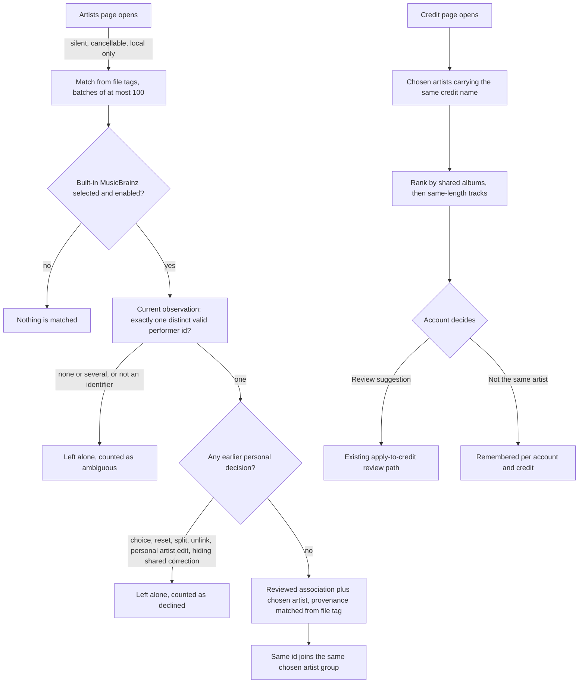
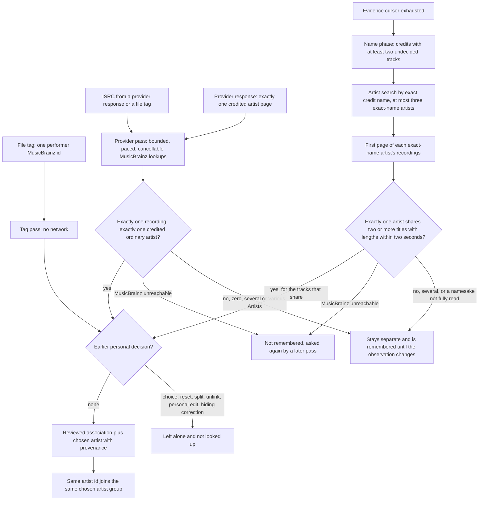

# Artist matching

Hito can now group recordings under one reviewed artist without a user clicking through every track, but only when the data itself names that artist. Everything else stays a suggestion that the account accepts or dismisses. Equal names alone never merge artists: the one automatic use of a name is a MusicBrainz search that must be corroborated by the artist's own recordings.

This page separates what runs today from what is planned. Current behavior is implemented in core, the authenticated API and the shared web app. It is not deployed to the normal local server. Matching from provider evidence (ISRC, artist pages and name searches corroborated by recordings) is covered by owned protocol fakes only: the built-in MusicBrainz service has not been reached for this feature, and live acceptance remains blocked; see [what is verified](#verification) and [open work](#open-work).

## Two kinds of evidence

| Evidence | Example | Effect |
| --- | --- | --- |
| Verified | One MusicBrainz performer artist identifier embedded in a local file's own tags | Applied automatically as a reviewed association and a chosen artist |
| Verified through MusicBrainz | An ISRC stated by a provider or a file tag that MusicBrainz maps to exactly one recording credited to exactly one artist | Applied automatically with the same rules; provenance `matched_isrc` |
| Verified through MusicBrainz | A lone credited artist page of an imported track that MusicBrainz links to exactly one artist | Applied automatically with the same rules; provenance `matched_provider_url` |
| Corroborated through MusicBrainz | A credit name that exactly one MusicBrainz artist carries, whose own recordings share at least two titles and lengths with the credit's undecided library tracks | Applied automatically to the corroborated tracks only, with the same rules; provenance `matched_name_discography` |
| Uncertain | The same credit name, a shared album title, a track with the same title and length | Ranked suggestion only; nothing changes until the account confirms |

## Evidence sources and the match decision

The provider pass (`POST /api/v1/artist-matching/provider-evidence`, core `match_artists_from_provider_evidence`) never runs on its own: the account starts it with the **Find matches on MusicBrainz** button (see [consent](#consent-for-provider-lookups)). The ISRC decides first; the artist page is consulted only when the ISRC names no single artist. Everything below the decision node is shared code, so both passes obey the same personal-decision rules.

## Verified matching from file tags

`POST /api/v1/artist-matching` (core `match_artists_from_tags`) examines recordings of libraries the account can read, in recording-identifier order, at most 100 per request. Each request carries a request identifier and an optional cursor. A request that matched something stores an immutable receipt and replays exactly, including the stored `next_after` cursor, so a replay never shows newer progress; the same identifier with different contents conflicts. A request that matched nothing stores nothing, so the Artists page cannot grow the receipt table.

A recording qualifies only when all of these hold:

- Its current observation comes from a file and retains performer artist tag assertions (see [tag evidence](metadata.md#musicbrainz-artist-tag-evidence-in-verified-source)).
- Those assertions contain exactly one distinct value, and that value is a single MusicBrainz identifier. A value with a delimiter (several artists in one tag), a malformed value, two different identifiers, or only album-artist assertions is not evidence. Ambiguous assertions are counted and ignored.
- The account has no choice row for the recording. A reset, a split back to the credit, a retired choice and an existing different choice all leave a row, so none of them is overridden. The one exception is a stale automatic match: a choice written by an earlier pass (its receipt order equals the provenance row's) that is retired or points at an observation that is no longer current, which no later account decision has replaced. After a retag, such a recording is matched again from its new tags; any reset, split, choice or edit made by the account has a different receipt order and stays untouched.
- The recording's artist has no personal edit. A personal artist edit means the tag no longer describes the credit.
- The account has not unlinked that association, and no applied, unretired administrator correction names that recording, observation and artist. The correction check does not depend on the account having an association, so a silent pass by another account cannot undo an administrator's "this id is wrong here".
- The account's metadata enrichment is enabled and includes the built-in provider. Disabling enrichment stops matching. The pass reads no network: it needs no MusicBrainz request, so provider outages cannot affect it.

Candidates are selected with a read, so scanning untagged or ambiguous files never holds the write lock. Only the apply batch runs in one immediate transaction that re-validates every decision above. A match runs the same steps as the bulk apply: it retains a reviewed association for the recording's own credit and observation, creates the account's chosen-artist group for the built-in provider and identifier if it does not exist, and stores the choice at its next revision with the receipt's acceptance order. The association keeps `user_confirmed` evidence only when the account had already reviewed that artist; a new association carries the provenance row `file_tag_artist_id`, returned by the association API as evidence `matched_file_tag_artist_id`. The shared UI does not display it yet. Provenance rows are immutable.

Two differently spelled credits with the same identifier therefore land in one group, and a credit leaves the Library credits list once the group covers it (see [group browsing](artist-identity-groups.md#group-browsing)). Two different identifiers sharing a name stay in two groups. Recordings, sources, playlist entries, likes, progress and personal edits keep their identifiers and values; matching writes only associations, choices, a group and a receipt.

Recordings that were examined and not matched (an ambiguous or valueless tag, a personal artist edit, an unlinked association or a hiding correction) are remembered in `artist_match_checks` with the observation and personal artist operation that were checked. They are not examined again until the observation or the personal artist edit changes, so a second pass over an unchanged library reads no candidates and takes no write lock. A recording that could not be read at that moment (its credit was not current) is not remembered. A later withdrawn shared correction or relinked association is therefore not noticed until the observation changes. A request is bounded by the standard 15-second budget and answers a conflict if it is exceeded; the work is resumable by cursor.

## Matching from provider evidence

Recordings carry two kinds of provider evidence. Both are stored as immutable rows beside the observation that stated them, so a later observation can never inherit an older answer.

- ISRC. A provider states it on a recording (`ProviderRecording.isrc`; see the [plugin contract](plugin-catalog.md#recording-evidence)); a local file states it in a tag, retained since inspection version 4 as `InspectedTags.isrc` (ID3 `TSRC`, Vorbis `ISRC` and MP4 `----:com.apple.iTunes:ISRC`, read through FFprobe as `TSRC`, `ISRC` and `ISRC`; the raw value is kept like any other tag). The code is normalized (case and the hyphenated display form) and stored in `recording_isrc_observations` with its origin, `file_tag` or `provider_response`. A malformed code is ignored and never fails an import or scan.
- Artist pages. A provider may list the canonical pages of every credited performer (`ProviderRecording.artist_urls`). Only an allowlisted shape is accepted: `https://open.spotify.com/artist/` followed by exactly 22 base62 characters. The allowlist is a small typed list in the plugin SDK (`artist_page_provider`), enforced when a plugin response is validated, when pages are stored, when the MusicBrainz client validates a request, and again before each lookup, so rows from earlier versions with any other address are never looked up. Another provider is added by adding one shape. Accepted pages are stored in `recording_artist_url_observations`. Only a recording that lists exactly one page is a candidate, because two pages would not say which artist a one-artist group should receive.

A candidate is a recording of a library the account can read whose current observation has such evidence, which the account has not yet decided about and which no earlier provider pass settled for the same observation and personal artist operation. Candidates are read in recording-identifier order. The pass then asks the built-in MusicBrainz client:

- `GET /ws/2/isrc/<ISRC>?inc=artist-credits` and requires exactly one returned recording whose credit names exactly one distinct artist. A 404 is an empty answer.
- `GET /ws/2/url?resource=<page>&inc=artist-rels` and requires exactly one related artist. A 404 is an empty answer.

The special-purpose artists Various Artists, [unknown], [no artist] and [anonymous] never count as the one artist. Names, titles and durations are never compared in this phase; the code or the page is the evidence. A recording with several credited artists, several recordings sharing a code, a code MusicBrainz does not know, or a page linked to several artists is *uncertain*: nothing changes, it stays separate, and it is not examined again until its observation changes. MusicBrainz may add data later; Hito does not poll for that yet.

Bounds. One request examines at most 100 recordings but performs at most eight MusicBrainz lookups and checks the nine-second window and the three-consecutive-failure limit before each lookup, not only between recordings; a lookup still running 13 seconds after the pass started is abandoned as unavailable, so the pass ends inside the 15-second request budget. When the window closes during the first recording of a batch, its remaining lookup counts as unavailable (retried later); when it closes during a later recording, that recording waits for the next batch. The pass returns a cursor so the web app (or any client) continues. Every lookup goes through the shared one-request-per-second MusicBrainz gate, and the request is admitted through the same per-account and global slots as other metadata work. Dropping the request (a closed page) cancels the lookup in flight and writes nothing. A code asked in the same request is asked once; a code shared by recordings in different requests can be asked twice. MusicBrainz outages, timeouts, oversized or invalid answers are *unavailable*: they are counted, not remembered, and retried by a later pass. Disabled enrichment (or a selection without the built-in provider) makes the pass do nothing and ask nothing.

What is sent by the evidence phase. Only the normalized ISRC or the canonical artist page address, with the Hito user agent. No account, title, credit name, path, library or token leaves the host; the name phase below is the only step that sends a name. A deployment that must not contact MusicBrainz turns metadata enrichment off for the account, which stops the pass before any lookup.

## Matching by name with corroboration

A credit name is never evidence by itself. After the ISRC and artist page candidates are exhausted, the same explicit pass continues into a *name phase*: the cursor `next_after` becomes `name:` (then `name:<credit identifier>`), so the web app walks it with the same loop and the same cancellation. Nothing else asks MusicBrainz for a name: page load, the tag pass and suggestions never do.

Which credits. A credit (the account's artist row in a library) is examined only when at least two of its recordings are undecided: no personal choice, reset, split, unlink, personal artist edit or hiding correction, a current observation, and no earlier name check for the same observation and personal artist operation. Fewer than two tracks can never corroborate, so their name is never sent. Credits are read in identifier order, at most eight per request.

How the name is compared. A name is normalized by collapsing runs of whitespace to one space, trimming, and lower-casing (Unicode lower case). Punctuation and diacritics stay significant ("Beyoncé" is not "Beyonce"; "Nova-Quartet" is not "Nova Quartet"). The same normalization compares track titles.

Steps and bounds.

1. `GET /ws/2/artist?query="<credit name>"&limit=10` through the existing artist search. Only artists whose normalized name equals the credit's count, minus the special-purpose artists. The search must be complete: if MusicBrainz reports more results than the ten returned (a further page exists), the credit is uncertain, because its ranking is not exact-name first and a namesake may sit beyond the page. More than three exact-name artists is also uncertain. Search answers are cached within the request.
2. For each exact-name artist, `GET /ws/2/recording?artist=<id>&limit=100&offset=0`: titles and lengths of the first hundred recordings, and MusicBrainz's total. A page that does not reach the total is *not fully read*.
3. A library track corroborates when a listed recording has the same normalized title and both lengths are known and differ by at most two seconds (2,000 ms, inclusive). A length below one second (including 0, which stands for an unknown duration) is unknown on either side and never matches. An artist is *corroborated* when the matched tracks cover at least two distinct normalized titles; several tracks titled alike (two "Intro" recordings) count once.
4. The credit is accepted only when exactly one exact-name artist is corroborated and no other exact-name artist was left not fully read without corroborating. Two corroborated artists, or one corroborated artist beside a namesake that cannot be excluded, stay uncertain. Release-group titles alone are not used because they carry no length; the rule "two recordings, or one release with at least three tracks" is therefore implemented as the stricter two-recording rule.
5. Only the library tracks that individually matched receive the artist (provenance `matched_name_discography`, through the shared apply step, so all personal-decision rules hold). The credit's other tracks stay uncertain and are remembered in `artist_name_checks` until their observation changes.

A request makes at most eight MusicBrainz requests, checks the nine-second window and three-consecutive-failure limit before each one, abandons a lookup running 13 seconds after the pass started, and stops before a later credit that could exceed the eight-request cap (a credit needs at most four: one search and three recordings pages). When the budget closes during the first credit of a batch its lookups count as unavailable and are retried by a later pass; otherwise the remaining credits wait for the next cursor. Requests share the one-per-second MusicBrainz gate and the admission slots. A closed page cancels the lookup in flight and nothing is written. A 404 from the search is an empty answer; outages, timeouts and invalid answers are *unavailable*: counted, not remembered, retried by a later pass. The receipt counts per recording, so a recording that the evidence phase counted as uncertain is counted again when the name phase also finds it uncertain; the page therefore labels the figure "uncertain answers" rather than distinct recordings.

What is sent. The credit name only, in the search query, and the MusicBrainz artist identifier in the recordings browse, with the Hito user agent. Titles and lengths are compared locally. Names, titles, queries and identifiers are never logged; the workflow logs counts, outcomes and timings. A deployment that must not send names turns metadata enrichment off for the account (the pass then does nothing) or never presses the button.

Limits. Prolific artists are partly read (one page of one hundred recordings). A partly read artist that corroborates is accepted only when every other exact-name artist was fully read without corroborating; a partly read namesake that does not corroborate keeps the credit uncertain. A search with more than ten results is never conclusive. Equal-name artists without enough library overlap are never matched.

## Consent for provider lookups

The tag pass reads local files only, so the Artists page still runs it silently. The provider pass sends ISRC codes, provider artist links and, in its name phase, credit names to a third party, so Hito never starts it by itself. The Artists page shows a **Find matches on MusicBrainz** button with the line "Sends ISRC codes, provider artist links and the artist names of tracks it cannot place otherwise from your library to MusicBrainz." Clicking it is the account's consent for that run. The button is disabled while the account's metadata settings are loading or disable MusicBrainz (enrichment off, or the built-in provider not selected), and the server enforces the same rule. After a run the page shows the receipt counts (matched, uncertain answers, unavailable) and says when to run it again to continue. Leaving the page cancels a run.

Applying. Recordings are re-validated inside one immediate transaction exactly like the tag pass: the current observation must still be the one examined, a personal choice, reset, split, unlink, personal artist edit or hiding shared correction leaves it alone (and is never looked up in the first place), and a stale automatic match whose observation changed may be matched again. A match writes a reviewed association for the recording's own credit and the chosen artist; a new association gets a row in `artist_association_provider_matches` with `isrc` or `provider_url`, returned by the association API as `matched_isrc` or `matched_provider_url`. Exact retries replay the stored receipt without another lookup, only a request that matched something stores a receipt, and the receipt counts `matched`, `uncertain`, `declined` and `unavailable`.

The reported example follows this path: the local C4 Pedro file carries one MusicBrainz artist id, so the tag pass groups it. An imported Spotify-style track with an ISRC that MusicBrainz maps to a recording credited only to that artist is matched by the provider pass and joins the same group without a click. The current public Spotify playlist response states no ISRC, so a real Spotify import supplies this evidence only through its credited artist page; see [the Spotify plugin](plugin-spotify.md#artist-pages-and-isrc).

## Suggestions for uncertain cases

`GET /api/v1/artists/{id}/match-suggestions` lists chosen artists whose members carry this credit's name (compared without case or spacing). Each item states what supports it:

- `shared_albums`: distinct release titles of the credit's undecided tracks that also appear on the chosen artist's tracks.
- `same_length_tracks`: undecided tracks with a chosen track of the same title (ASCII case folding) whose length differs by at most three seconds.
- `undecided_tracks`: tracks of the credit with no current choice that accepting would update.

Items rank by `10 × shared_albums + same_length_tracks`, then group identifier. A chosen artist with no undecided track is not listed. A name-only item is shown as "same name only" because the manual **Find reviewed artists for this credit** list already offers it. Candidate groups come from one query on member credit names (`lower(trim(name))`, so only ASCII case folding and no internal-space collapsing; a missed Unicode namesake is only a missed suggestion). The credit's undecided tracks are read once, and group summaries are read only for suggestions that survive. `undecided_tracks` excludes tracks the apply would keep (a different choice, or an unlinked review of the same artist). Reading suggestions writes nothing and contacts no provider; it is bounded to 50 groups, 500 credit tracks and 500 tracks per group, inside the standard 15-second budget, and a work-budget test measures 20 namesake groups at about 126,000 SQLite steps (the first version used about 206,000). Exceeding the budget answers a conflict.

Accepting uses the existing confirmation and `POST /api/v1/artists/{id}/artist-identity` batches, so all the rules of [applying one identity to a credit](artist-identity-groups.md#applying-one-identity-to-a-whole-credit) apply: a different existing choice is kept, an unlinked association is respected. `POST /api/v1/artists/{id}/match-suggestions/dismiss` remembers "not the same artist" for this credit and chosen artist, per account, and returns the refreshed list. Dismissals are not deleted by Hito; restoring one has no control yet (the manual list still shows the artist).

## Web behavior

The Artists page starts one silent tag pass per account at most every ten minutes across tabs of one browser (the pause is kept in local storage and starts with the pass, so a cancelled or failing pass is not retried by every tab). It walks the cursor, stops after 200 batches or 60 seconds, is cancelled when the page is left, ignores failures, and refreshes the artist lists only if something matched. It sends no provider request. The provider pass runs only from the button described above, walks its cursor (at most 200 batches or two minutes), stops when a batch reports an unavailable provider and refreshes the lists once if something matched. The walk continues from the evidence cursor into the `name:` cursor and ends when the server returns no cursor; a cursor that does not advance ends it. The saved artist reviews of a recording say how an automatic match was made (file tag identifier, ISRC, provider artist page or name corroborated by recordings); reviews the account confirmed itself carry no such note. The credit page loads suggestions without blocking the rest of the page; a failed read shows nothing and leaves the manual flow untouched. Neither workflow subscribes to playback position.

## Logging

Every request logs an operation, a safe outcome, counts and elapsed time. Identifiers, credit names, titles, paths, tag values, ISRCs, artist page addresses, MusicBrainz identifiers and response bodies are never logged. The MusicBrainz client logs one completion event per lookup with a static outcome, the item count and its elapsed time.

## Verification

Public core cases use real temporary SQLite and owned deterministic WAV files tagged through lofty:

- Two credits sharing one embedded identifier group, a namesake with another identifier stays separate, and an untagged equal-name file, a two-identifier file and an imported playlist track are untouched. Recordings, sources, details and activity are byte-for-byte unchanged.
- Exact replay, conflicting reuse, a second pass that changes nothing, and resumable one-recording batches.
- A personal reset and a personal unlink are not overridden, an unlink made before any choice is respected, and disabled enrichment matches nothing.
- Suggestions rank by evidence, include name-only items last, never change a choice, can be dismissed per credit and chosen artist, and end once accepted through the existing path.
- Another account's pass cannot undo an administrator's shared correction; a retagged automatic match is matched again while a reset or split one is not; personal artist edits, splits and retired choices are left alone; two concurrent passes match each recording once; a second pass reads no candidates and writes nothing; and work-budget cases bound the pass and the suggestions.
- Migration 0060 upgrades from 0059 with exact schema comparison, immutable provenance, a per-account dismissal key and no implied matches.

Provider evidence and name corroboration are covered at three boundaries:

- Protocol: the MusicBrainz client against an owned loopback server for exact request targets and headers, 404 as empty, 503 as a typed failure without retry, wrong or malformed identifiers, over-long answers and log redaction; the plugin SDK for ISRC normalization and canonical artist page validation with old payloads keeping their exact bytes; the folder and Spotify plugins for what they publish; and FFmpeg-backed inspection of ISRC tags in FLAC, Ogg, MP3, M4A and WAV.
- Core, with real temporary SQLite, deterministic WAV tags and an owned loopback MusicBrainz: a tagged local track and an imported track with an ISRC (written with hyphens and lower case) join one group without a click; ambiguous, multi-artist, unknown, Various Artists and outage answers do not; a file-tag ISRC matches; a lone artist page matches and falls through from an unknown ISRC; two pages are never looked up; a reset recording is never looked up or overridden; disabled enrichment asks nothing; outages are retried while settled answers are not asked again; exact replay does not ask again; a cursor walk examines every recording; and a pass dropped while the fake is slow writes nothing and can be repeated. Migrations 0061 and 0062 upgrade with exact schema comparison, immutable rows and no implied evidence.
- Name corroboration: the MusicBrainz client's recordings browse against the owned loopback server (request target, lengths, incomplete totals, 404 as empty, 503 without retry, invalid answers, log redaction); thirteen core cases through the public capability with real temporary SQLite and the owned fake (a unique corroborated match, two corroborated namesakes, a non-corroborating namesake, a namesake not fully read, below-threshold and length-tolerance edges, an unknown name and settled answers not asked again, outage retried later, cancellation writing nothing, disabled enrichment and the silent tag pass sending no name, personal reset left alone and a one-track credit sending nothing, exact replay, and the eight-request cap with a resumable cursor); unit cases for name normalization, the truncated-search rule, the per-lookup window and the failure limit; migration 0063 with exact schema comparison.
- HTTP and web: the reported scenario through the real router (statuses, validation, replay, conflict, 401 and 423 while locked, the `matched_isrc` association), and DOM cases for the explicit provider action (no provider request on page load, a click walks the cursor and shows the counts, one refresh, no retry on an unavailable provider, disabled when MusicBrainz is off, cancelled on leaving) and the provenance text. Further core cases cover an address outside the allowlist (never looked up, even when stored by an earlier version) and the per-lookup time window and deadline.

Not verified: MusicBrainz itself. Every response in these tests is an owned fake that follows the documented JSON shapes; a live `isrc`, `url`, artist search or recordings browse has not succeeded (the 2026-10-18 live attempts for the existing adapter received HTTP 503, see [the adapter](builtin-musicbrainz.md#live-integration-gate)), and the live gate does not yet cover these lookups. The Spotify artist page field relies on the `uri` of each artist in the undocumented public response, which the plugin's owned fixtures include but a live import has not confirmed. Work budgets for the candidate query were not measured (the tag pass has a measured budget).

HTTP cases use the real router for statuses, validation, replay, access, a second account without library access, two members of one shared library (separate matches, choices and dismissals) and 423 for all three routes while the session is locked. Web cases cover evidence text, confirmation before apply, dismissal, failed reads and the silent tag pass (batching, refresh only on a match, no repeat within the pause, cancellation).

## Open work

- A persistent cache of MusicBrainz answers shared across accounts, re-checking of "unknown" answers when MusicBrainz gains data, and a work-budget measurement of the provider candidate query on a large library.
- Providers that expose ISRCs or artist pages. The folder plugin publishes ISRC tags. The public Spotify response states no ISRC. No other bundled plugin has an ISRC field in its source API that Hito could verify; none was invented. Existing imported copies receive artist pages only when their metadata is refreshed from the provider.
- Name matching is implemented against owned fakes only. Still open: live acceptance, a persistent cache of search and recordings answers shared across accounts, release-based corroboration (release groups carry no track lengths), reading beyond one page of an artist's recordings or search results, and a work-budget measurement of the name candidate query on a large library. Automatic timer-driven lookups are deliberately not planned: every outbound lookup follows the explicit button.
- Release and recording matching. File tags do not yet retain release or recording MusicBrainz identifiers.
- A control to restore a dismissed suggestion (the data model supports it: dismissals are plain rows).
- Live MusicBrainz acceptance remains blocked by upstream HTTP 503 responses; see [the adapter](builtin-musicbrainz.md#live-integration-gate).
