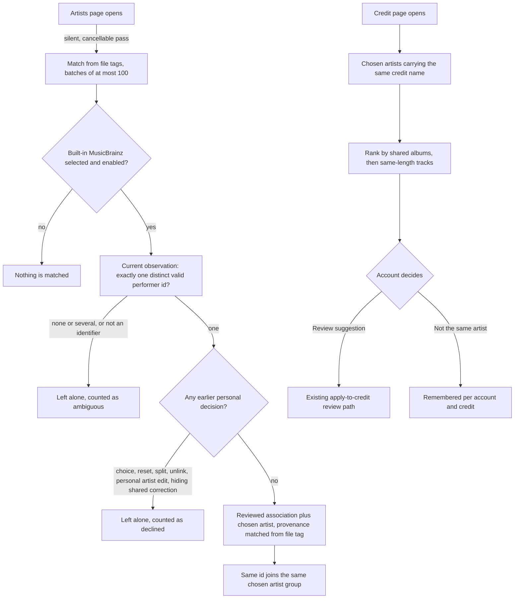

# Artist matching

Hito can now group recordings under one reviewed artist without a user clicking through every track, but only when the data itself names that artist. Everything else stays a suggestion that the account accepts or dismisses. Equal names alone never merge artists.

This page separates what runs today from what is planned. Current behavior is implemented in core, the authenticated API and the shared web app. It is not deployed to the normal local server. Provider-backed lookups are not implemented yet; see [open work](#open-work).

## Two kinds of evidence

| Evidence | Example | Effect |
| --- | --- | --- |
| Verified | One MusicBrainz performer artist identifier embedded in a local file's own tags | Applied automatically as a reviewed association and a chosen artist |
| Uncertain | The same credit name, a shared album title, a track with the same title and length | Ranked suggestion only; nothing changes until the account confirms |

## Verified matching from file tags

`POST /api/v1/artist-matching` (core `match_artists_from_tags`) examines recordings of libraries the account can read, in recording-identifier order, at most 100 per request. Each request carries a request identifier and an optional cursor. A request that matched something stores an immutable receipt and replays exactly; the same identifier with different contents conflicts. A request that matched nothing stores nothing, so the Artists page cannot grow the receipt table.

A recording qualifies only when all of these hold:

- Its current observation comes from a file and retains performer artist tag assertions (see [tag evidence](metadata.md#musicbrainz-artist-tag-evidence-in-verified-source)).
- Those assertions contain exactly one distinct value, and that value is a single MusicBrainz identifier. A value with a delimiter (several artists in one tag), a malformed value, two different identifiers, or only album-artist assertions is not evidence. Ambiguous assertions are counted and ignored.
- The account has no choice row for the recording. A reset, a split back to the credit, a retired choice and an existing different choice all leave a row, so none of them is overridden.
- The recording's artist has no personal edit. A personal artist edit means the tag no longer describes the credit.
- The account has not unlinked that association, and no applied administrator correction hides it.
- The account's metadata enrichment is enabled and includes the built-in provider. Disabling enrichment stops matching. The pass reads no network: it needs no MusicBrainz request, so provider outages cannot affect it.

A match runs inside one immediate transaction through the same internal steps as the bulk apply: it retains a reviewed association for the recording's own credit and observation, creates the account's chosen-artist group for the built-in provider and identifier if it does not exist, and stores the choice at revision 1 with the receipt's acceptance order. The association keeps `user_confirmed` evidence only when the account had already reviewed that artist; a new association carries the provenance row `file_tag_artist_id`, returned by the association API as evidence `matched_file_tag_artist_id`. The shared UI does not display it yet. Provenance rows are immutable.

Two differently spelled credits with the same identifier therefore land in one group, and a credit leaves the Library credits list once the group covers it (see [group browsing](artist-identity-groups.md#group-browsing)). Two different identifiers sharing a name stay in two groups. Recordings, sources, playlist entries, likes, progress and personal edits keep their identifiers and values; matching writes only associations, choices, a group and a receipt.

## Suggestions for uncertain cases

`GET /api/v1/artists/{id}/match-suggestions` lists chosen artists whose members carry this credit's name (compared without case or spacing). Each item states what supports it:

- `shared_albums`: distinct release titles of the credit's undecided tracks that also appear on the chosen artist's tracks.
- `same_length_tracks`: undecided tracks with a chosen track of the same title (ASCII case folding) whose length differs by at most three seconds.
- `undecided_tracks`: tracks of the credit with no current choice that accepting would update.

Items rank by `10 × shared_albums + same_length_tracks`, then group identifier. A chosen artist with no undecided track is not listed. A name-only item is shown as "same name only" because the manual **Find reviewed artists for this credit** list already offers it. Reading suggestions writes nothing and contacts no provider; it is bounded to 50 groups, 1,000 credit tracks and 2,000 tracks per group, inside the standard 15-second budget.

Accepting uses the existing confirmation and `POST /api/v1/artists/{id}/artist-identity` batches, so all the rules of [applying one identity to a credit](artist-identity-groups.md#applying-one-identity-to-a-whole-credit) apply: a different existing choice is kept, an unlinked association is respected. `POST /api/v1/artists/{id}/match-suggestions/dismiss` remembers "not the same artist" for this credit and chosen artist, per account, and returns the refreshed list. Dismissals are not deleted by Hito; restoring one has no control yet (the manual list still shows the artist).

## Web behavior

The Artists page starts one silent pass per account at most every ten minutes per browser session. It walks the cursor, stops after 200 batches or 60 seconds, is cancelled when the page is left, ignores failures, and refreshes the artist lists only if something matched. The credit page loads suggestions without blocking the rest of the page; a failed read shows nothing and leaves the manual flow untouched. Neither workflow subscribes to playback position.

## Logging

Every request logs an operation, a safe outcome, counts and elapsed time. Identifiers, credit names, titles, paths and tag values are never logged.

## Verification

Public core cases use real temporary SQLite and owned deterministic WAV files tagged through lofty:

- Two credits sharing one embedded identifier group, a namesake with another identifier stays separate, and an untagged equal-name file, a two-identifier file and an imported playlist track are untouched. Recordings, sources, details and activity are byte-for-byte unchanged.
- Exact replay, conflicting reuse, a second pass that changes nothing, and resumable one-recording batches.
- A personal reset and a personal unlink are not overridden, an unlink made before any choice is respected, and disabled enrichment matches nothing.
- Suggestions rank by evidence, include name-only items last, never change a choice, can be dismissed per credit and chosen artist, and end once accepted through the existing path.
- Migration 0060 upgrades from 0059 with exact schema comparison, immutable provenance, a per-account dismissal key and no implied matches.

HTTP cases use the real router for statuses, validation, replay, access and a second account. Web cases cover evidence text, confirmation before apply, dismissal, failed reads and the silent pass (batching, refresh only on a match, no repeat within the pause, cancellation).

## Open work

- Provider-backed identities. Imported playlist metadata carries a title, a credit name, a duration and an optional release, but no ISRC, no provider artist identifier and no MusicBrainz identifier, so nothing verified can link an imported recording to a local one today. ISRC needs a plugin-contract extension and producer changes, a file-tag ISRC observation (this needs a new inspection version) and an ISRC lookup in the built-in MusicBrainz client. Provider-structured identifiers that resolve to one MusicBrainz entity need the same contract work.
- Background provider lookups for uncertain cases (name search with discography corroboration), through the existing provider contracts with admission limits, cancellation, per-provider pacing and offline tolerance. The pass above makes no provider request.
- Release and recording matching. File tags do not yet retain release or recording MusicBrainz identifiers.
- A control to restore a dismissed suggestion, and a visible note for the matched provenance in the saved artist reviews.
- Live MusicBrainz acceptance remains blocked by upstream HTTP 503 responses; see [the adapter](builtin-musicbrainz.md#live-integration-gate).
