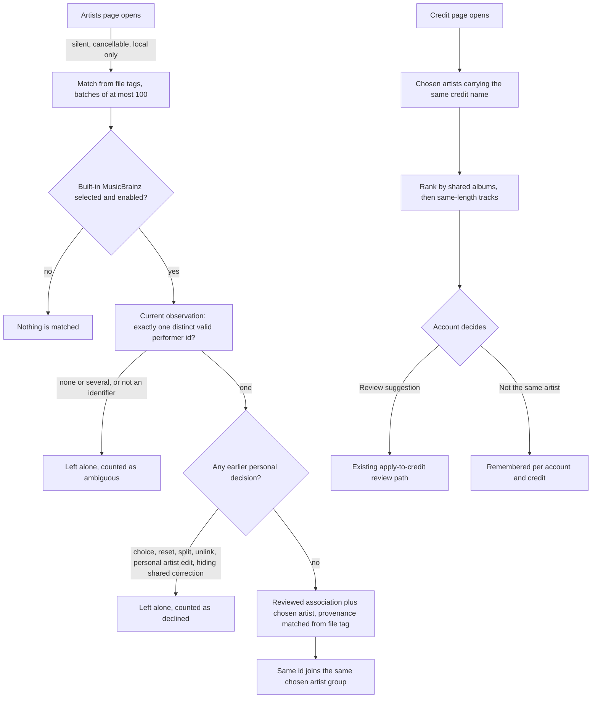
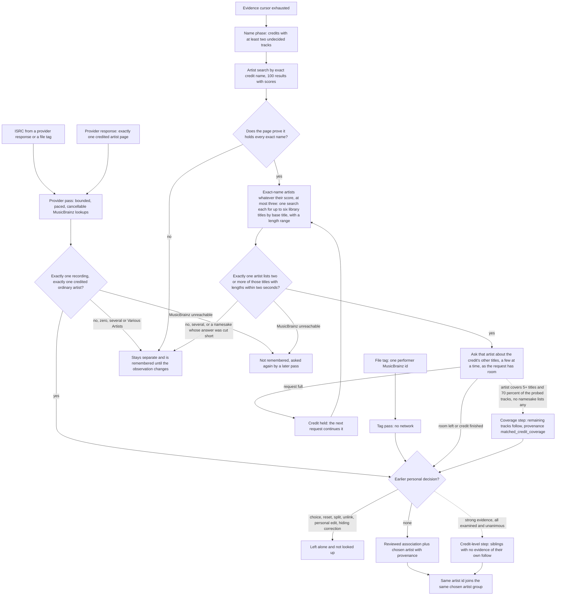
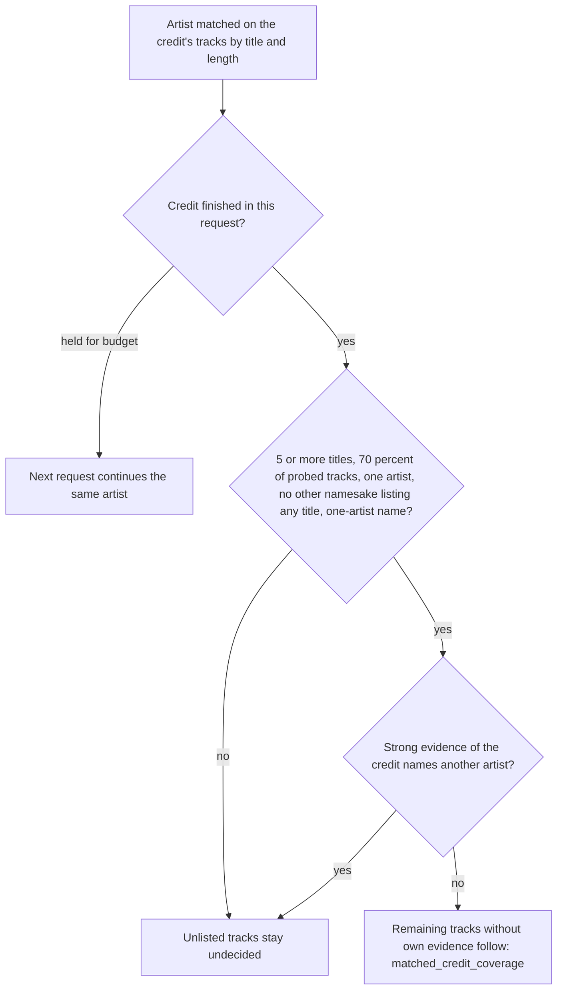
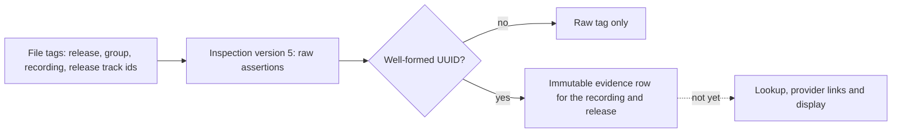
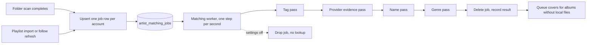
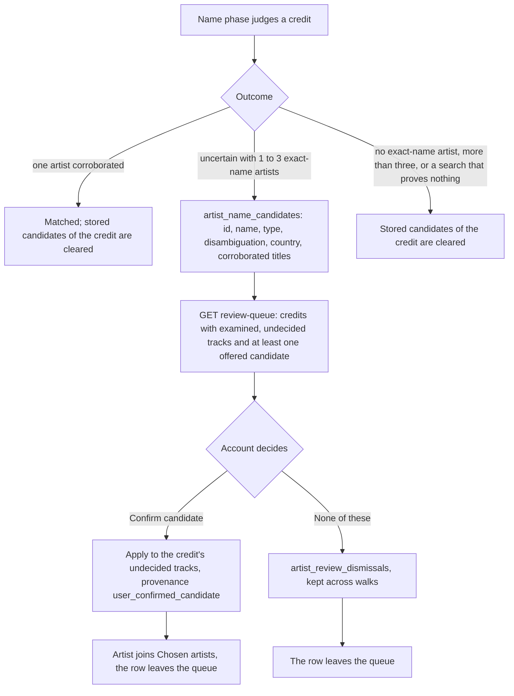

# Artist matching

Hito can now group recordings under one reviewed artist without a user clicking through every track, but only when the data itself names that artist. Everything else stays a suggestion that the account accepts or dismisses. Since the move to automatic matching below, a background job does the walking. Equal names alone never merge artists: the one automatic use of a name is a MusicBrainz search that must be corroborated by the artist's own recordings.

This page separates what runs today from what is planned. Current behavior is implemented in core, the authenticated API and the shared web app. It runs on the local development server (migrations through 0074 deployed; 0075, the review queue, is source only until it is deployed), which is not a public release. Matching from provider evidence (ISRC, artist pages and name searches corroborated by recordings) is covered by owned protocol fakes only: live acceptance remains blocked by upstream HTTP 503 answers; see [what is verified](#verification) and [open work](#open-work).

## Two kinds of evidence

| Evidence | Example | Effect |
| --- | --- | --- |
| Verified | One MusicBrainz performer artist identifier embedded in a local file's own tags | Applied automatically as a reviewed association and a chosen artist |
| Verified through MusicBrainz | An ISRC stated by a provider or a file tag that MusicBrainz maps to exactly one recording credited to exactly one artist | Applied automatically with the same rules; provenance `matched_isrc` |
| Verified through MusicBrainz | A lone credited artist page of an imported track that MusicBrainz links to exactly one artist | Applied automatically with the same rules; provenance `matched_provider_url` |
| Corroborated through MusicBrainz | A credit name that exactly one MusicBrainz artist carries, whose own recordings share at least two titles and lengths with the credit's undecided library tracks | Applied automatically to the corroborated tracks only, with the same rules; provenance `matched_name_discography` |
| Credit-level by coverage | One exact-name artist matched on at least five distinct titles that lists at least 70 percent of the credit's probed tracks, with no other namesake listing any of them and no strong evidence of the credit naming another artist | The credit's other undecided tracks that carry no evidence of their own receive the artist; provenance `matched_credit_coverage` ("Matched from 85 of 106 tracks of this artist.") |
| Credit-level | Tag, ISRC or artist page matches for a credit whose own-evidence tracks are all examined and agree | The credit's other undecided tracks that carry no evidence of their own receive the same artist; provenance `matched_credit_evidence` |
| Confirmed by the account | One of the artists the walk found under the credit's name, confirmed in the [review queue](#review-queue-for-credits-the-walk-could-not-identify) | The credit's undecided tracks receive the artist; provenance `user_confirmed_candidate` ("You confirmed this artist from the candidates Hito found.") |
| Uncertain | The same credit name, a shared album title, a track with the same title and length | Ranked suggestion only; nothing changes until the account confirms |

## Evidence sources and the match decision

The provider pass (`POST /api/v1/artist-matching/provider-evidence`, core `match_artists_from_provider_evidence`) is started by the Artists page when it opens, but only while the account's metadata settings select the built-in MusicBrainz provider (see [consent](#consent-for-provider-lookups)). The ISRC decides first; the artist page is consulted only when the ISRC names no single artist. Everything below the decision node is shared code, so both passes obey the same personal-decision rules.

## Verified matching from file tags

`POST /api/v1/artist-matching` (core `match_artists_from_tags`) examines recordings of libraries the account can read, in recording-identifier order, at most 100 per request. Each request carries a request identifier and an optional cursor. A request that matched something stores an immutable receipt and replays exactly, including the stored `next_after` cursor, so a replay never shows newer progress; the same identifier with different contents conflicts. A request that matched nothing stores nothing, so the Artists page cannot grow the receipt table.

A recording qualifies only when all of these hold:

- Its current observation comes from a file and retains performer artist tag assertions (see [tag evidence](metadata.md#musicbrainz-artist-tag-evidence-in-verified-source)).
- Those assertions contain exactly one distinct value, and that value is a single MusicBrainz identifier. A value with a delimiter (several artists in one tag), a malformed value, two different identifiers, or only album-artist assertions is not evidence. Ambiguous assertions are counted and ignored.
- The account has no choice row for the recording. A reset, a split back to the credit, a retired choice and an existing different choice all leave a row, so none of them is overridden. The one exception is a stale automatic match: a choice written by an earlier pass (its receipt order equals the provenance row's) that is retired or points at an observation that is no longer current, which no later account decision has replaced. After a retag, such a recording is matched again from its new tags; any reset, split, choice or edit made by the account has a different receipt order and stays untouched.
- The recording's artist has no personal edit. A personal artist edit means the tag no longer describes the credit.
- The account has not unlinked that association, and no applied, unretired administrator correction names that recording, observation and artist. The correction check does not depend on the account having an association, so a silent pass by another account cannot undo an administrator's "this id is wrong here".
- The account's metadata enrichment is enabled and includes the built-in provider. Disabling enrichment stops matching. The pass reads no network: it needs no MusicBrainz request, so provider outages cannot affect it.

Candidates are selected with a read, so scanning untagged or ambiguous files never holds the write lock. Only the apply batch runs in one immediate transaction that re-validates every decision above. A match runs the same steps as the bulk apply: it retains a reviewed association for the recording's own credit and observation, creates the account's chosen-artist group for the built-in provider and identifier if it does not exist, and stores the choice at its next revision with the receipt's acceptance order. The association keeps `user_confirmed` evidence only when the account had already reviewed that artist; a new association carries the provenance row `file_tag_artist_id`, returned by the association API as evidence `matched_file_tag_artist_id`. The shared UI does not display it yet. Provenance rows are immutable.

Two differently spelled credits with the same identifier therefore land in one group, and a credit leaves the Library credits list once the group covers it (see [group browsing](artist-identity-groups.md#group-browsing)). Two different identifiers sharing a name stay in two groups. Recordings, sources, playlist entries, likes, progress and personal edits keep their identifiers and values; matching writes only associations, choices, a group and a receipt.

Recordings that were examined and not matched (an ambiguous or valueless tag, a personal artist edit, an unlinked association or a hiding correction) are remembered in `artist_match_checks` with the observation and personal artist operation that were checked. They are not examined again until the observation or the personal artist edit changes, so a second pass over an unchanged library reads no candidates and takes no write lock. A recording that could not be read at that moment (its credit was not current) is not remembered. A later withdrawn shared correction or relinked association is therefore not noticed until the observation changes. A request is bounded by the standard 15-second budget and answers a conflict if it is exceeded; the work is resumable by cursor.

## Matching from provider evidence

Recordings carry two kinds of provider evidence. Both are stored as immutable rows beside the observation that stated them, so a later observation can never inherit an older answer.

- ISRC. A provider states it on a recording (`ProviderRecording.isrc`; see the [plugin contract](plugin-catalog.md#recording-evidence)); a local file states it in a tag, retained since inspection version 4 as `InspectedTags.isrc` (ID3 `TSRC`, Vorbis `ISRC` and MP4 `----:com.apple.iTunes:ISRC`, read through FFprobe as `TSRC`, `ISRC` and `ISRC`; the raw value is kept like any other tag). The code is normalized (case and the hyphenated display form) and stored in `recording_isrc_observations` with its origin, `file_tag` or `provider_response`. A malformed code is ignored and never fails an import or scan.
- Artist pages. A provider may list the canonical pages of every credited performer (`ProviderRecording.artist_urls`). Only an allowlisted shape is accepted: `https://open.spotify.com/artist/` followed by exactly 22 base62 characters. The allowlist is a small typed list in the plugin SDK (`artist_page_provider`), enforced when a plugin response is validated, when pages are stored, when the MusicBrainz client validates a request, and again before each lookup, so rows from earlier versions with any other address are never looked up. Another provider is added by adding one shape. Accepted pages are stored in `recording_artist_url_observations`. Only a recording that lists exactly one page is a candidate, because two pages would not say which artist a one-artist group should receive.

A candidate is a recording of a library the account can read whose current observation has such evidence, which the account has not yet decided about and which no earlier provider pass settled for the same observation and personal artist operation. Candidates are read in recording-identifier order. The pass then asks the built-in MusicBrainz client:

- `GET /ws/2/isrc/<ISRC>?inc=artist-credits` and requires exactly one returned recording whose credit names exactly one distinct artist. A 404 is an empty answer.
- `GET /ws/2/url?resource=<page>&inc=artist-rels` and requires exactly one related artist. A 404 is an empty answer.

The special-purpose artists Various Artists, [unknown], [no artist] and [anonymous] never count as the one artist. Names, titles and durations are never compared in this phase; the code or the page is the evidence. A recording with several credited artists, several recordings sharing a code, a code MusicBrainz does not know, or a page linked to several artists is *uncertain*: nothing changes, it stays separate, and it is not examined again until its observation changes. MusicBrainz may add data later; Hito does not poll for that yet.

Bounds. One request examines at most 100 recordings but performs at most eight MusicBrainz lookups and checks the nine-second window and the three-consecutive-failure limit before each lookup, not only between recordings; a lookup still running 13 seconds after the pass started is abandoned as unavailable, so the pass ends inside the 15-second request budget. When the window closes during the first recording of a batch, its remaining lookup counts as unavailable (retried later); when it closes during a later recording, that recording waits for the next batch. The pass returns a cursor so the web app (or any client) continues. Every lookup goes through the shared one-request-per-second MusicBrainz gate, and the request is admitted through the same per-account and global slots as other metadata work. Dropping the request (a closed page) cancels the lookup in flight and writes nothing. A code asked in the same request is asked once; a code shared by recordings in different requests can be asked twice. MusicBrainz outages, timeouts, oversized or invalid answers are *unavailable*: they are counted, not remembered, and retried by a later pass. Disabled enrichment (or a selection without the built-in provider) makes the pass do nothing and ask nothing.

What is sent by the evidence phase. Only the normalized ISRC or the canonical artist page address, with the Hito user agent. No account, title, credit name, path, library or token leaves the host; the name phase below is the only step that sends a name. A deployment that must not contact MusicBrainz turns metadata enrichment off for the account, which stops the pass before any lookup.

## Matching by name with corroboration

A credit name is never evidence by itself. After the ISRC and artist page candidates are exhausted, the same pass continues into a *name phase*: the cursor `next_after` becomes `name:` (then `name:<credit identifier>`). The background job and the manual **Match again** action walk it with the same cursor and the same cancellation. Nothing else asks MusicBrainz for a name: page load, the tag pass and suggestions never do.

Which credits. A credit (the account's artist row in a library) is examined only when at least two of its recordings are undecided (one is enough when an earlier request matched other tracks of the credit to an artist by name; its title is then sent too): no personal choice, reset, split, unlink, personal artist edit or hiding correction, a current observation, and no earlier name check for the same observation and personal artist operation. Fewer than two tracks can never corroborate on their own, so their name is not sent. Credits are read in identifier order, at most eight per request.

How the name is compared. A name is normalized by collapsing runs of whitespace to one space, trimming, and lower-casing (Unicode lower case). Punctuation and diacritics stay significant ("Beyoncé" is not "Beyonce"; "Nova-Quartet" is not "Nova Quartet"). Track titles are compared differently, see the next paragraph.

How titles are compared. Only for comparison, never stored or displayed, a title is folded (case, diacritics, apostrophes, punctuation and spacing) and stripped of trailing version qualifiers and featured artists, in brackets or after a dash: live (also "live at/in/from …"), acoustic, remaster or remastered (any year), any remix ("<name> remix"), radio edit or edit, "… version", mono or stereo, demo, instrumental, explicit or clean, deluxe or bonus track, and "feat.", "ft." or "featuring" parts, but only inside brackets or after a dash ("Song (feat. X)", "Song - feat. X"); a bare "feat." in the middle of a title ("Trip to Ft. Lauderdale") and the word "with" are never read as a featured artist, because the credit of the recording is not known at that point, so "Song (With You)" keeps its words. A part that is not such a qualifier stays in the title: "(I Can't Get No) Satisfaction", "Mr. Brightside - Part 2" and "Perfect Duet" keep their words, so "Perfect" never matches "Perfect Duet" and "Photograph" never matches "Photographs". The remaining base and the set of qualifier kinds decide:

| Library title | Matches a MusicBrainz recording | Length tolerance |
| --- | --- | --- |
| Plain ("Perfect", "Perfect (feat. X)") | The same base, also plain | 2 seconds |
| Qualified, not a remix ("Shape of You (Acoustic)", "Perfect - Live") | The same base with the same qualifier kinds, or the plain base | 10 seconds for the same kinds, 2 seconds for the plain base |
| Remix of a base | Only a remix of the same base, whoever remixed it, never the original | 10 seconds |

Qualifiers of the other kind never match ("Perfect - Live" is not "Perfect (Acoustic)", and a plain "Perfect" is not "Perfect - Live"). Songs are counted by base: "Perfect", "Perfect - Live" and "Perfect (Acoustic)" are one title when two distinct titles must corroborate.

Steps and bounds.

1. `GET /ws/2/artist?query="<credit name>"&limit=100` (`artist_name_search` in the MusicBrainz client). Only artists whose normalized name equals the credit's count, minus the special-purpose artists, **whatever their score**: the live search for "Ed Sheeran" returned three exact-name artists scoring 100, 73 and 72, and a lower-scored exact name is as much a namesake as the first. The search is *conclusive* when the page holds the whole result set, or when it ends on a result that is no exact name and scores below 100 (scores must not rise down the page; a response that breaks that is invalid). A page that ends at score 100, or on an exact name, with more results behind it may hide another exact-name artist, so the credit is uncertain. Many partial-name results ("Ed Sheeran & Justin Bieber", tributes) do not make a search inconclusive. More than three exact-name artists is also uncertain. Search answers are cached within the request.
2. The deciding sample (titles that are empty or longer than 512 bytes are never asked about and stay undecided; a request MusicBrainz rejects as invalid counts as uncertain, not unavailable, so the walk does not retry it forever): the credit's undecided tracks that have a known length (at least one second), one candidate per distinct base title (the plain title of a song preferred to its versions), in recording-identifier order, at most six. With fewer than two distinct titles the credit is uncertain without any request unless an earlier request already matched the credit to an artist (see rule 3 below). For each exact-name artist one request, `GET /ws/2/recording?query=arid:<mbid> AND ((recording:"<base title>" AND dur:[<length-2000> TO <length+2000>]) OR …)&limit=40`, asks which of the sample titles the artist has (a qualified title asks with its base title and a range of 10 seconds each way). Titles are Lucene-escaped, so they cannot change the query. An artist with thousands of recordings answers a query that names six titles and their lengths; no list of recordings is paged. One credit therefore costs a search plus at most three of these requests, four in all.
3. A library track corroborates when a returned recording matches its title by the rules above and both lengths are known and differ by at most the tolerance those rules give (2,000 ms for plain titles, inclusive). The local comparison, not MusicBrainz's matching, decides: variants in the answer that the rules do not accept are ignored. A length below one second (including 0, which stands for an unknown duration) is unknown on either side and never matches. An answer that holds fewer recordings than MusicBrainz states and did not corroborate (the page crowded out by variants) is *not fully read*.
4. The credit is accepted only when exactly one exact-name artist is corroborated (two distinct titles) and no other exact-name artist was left not fully read without corroborating. Two corroborated artists, or one corroborated artist beside a namesake that cannot be excluded, stay uncertain. Release-group titles alone are not used because they carry no length.
5. The sample tracks that matched receive the artist (provenance `matched_name_discography`, through the shared apply step, so all personal-decision rules hold). The credit's other tracks follow only when the artist itself lists them: the same kind of request, six titles at a time, asks that artist about the remaining titles while the request has lookups and time left. A track follows only when the artist lists its title and a length within two seconds; a track the artist does not list, or whose length is unknown, stays undecided. The old rule that let a sole artist with a complete list carry the unlisted half of a credit is gone, because a title search cannot show that a list is complete. Tracks that remain uncertain are remembered in `artist_name_checks` until their observation changes.

Rule version. `artist_name_checks` records the rule that settled each check (column `rule`, migration 0072). The current rule is 5. Rule 5 (migration 0075) changes no decision: it keeps the exact-name artists of every credit that stays uncertain as candidates for the [review queue](#review-queue-for-credits-the-walk-could-not-identify), so migration 0075 queues a walk for each account that had any check and every uncertain credit is examined once more. Rule 3 (migration 0073) added version titles, continuation of an artist matched in an earlier request and coverage of the credit; rule 4 (migration 0074) counts distinct titles for the share, asks every other namesake about the tail and lets choices and strong evidence for another artist refuse a match. Name matches record their rule (`artist_association_name_matches.rule`): matches from before migration 0073 are rule 2 and, like any match below rule 3, count neither toward an artist's coverage nor toward continuation. Rule 2 was corroboration by library title with lower-scored namesakes. A check of another rule does not hide a recording, so every recording that an earlier rule had settled as uncertain, including the 21 "Ed Sheeran" tracks that rule 2 left undecided on the live library, is examined again; each migration queues a walk (or sets the rerun flag of a walk under way) for each account that had any check. Rule 1 was the paging rule, and rule 0 of migration 0071 treated any search with more results than one page as uncertain, which left prolific credits such as a 106-track "Ed Sheeran" unmatched. A future change of the rule raises the number instead of deleting rows.

A request makes at most eight MusicBrainz requests, checks the nine-second window and three-consecutive-failure limit before each one, abandons a lookup running 13 seconds after the pass started, and starts a further credit only when four requests remain (the cheapest decision: a search and three sample searches). A credit whose artist is found but whose other titles do not all fit is *held*: the settled tracks are written, the rest stay undecided and unremembered, and the cursor stays on the credit before it with a hold count after a `~` (`name:<credit>~01`, so that the cursor still moves forward; the web walk stops only when the cursor does not advance). The next request examines the credit's remaining tracks again. At most 40 holds in a row apply to one credit. Budget refusal is therefore never *unavailable*: a credit refused after other credits of the request waits for the next request, a held credit continues, and only an outage counts as unavailable. When the budget closes during the first credit of a request (the service took more than nine seconds for its lookups), or when lookups fail, the credit counts as unavailable and a later walk asks again. Requests share the one-per-second MusicBrainz gate and the admission slots. A closed page cancels the lookup in flight and nothing is written. A 404 from the search is an empty answer; outages, timeouts and invalid answers are *unavailable*: counted, not remembered, retried by a later walk. The receipt counts per recording, so a recording that the evidence phase counted as uncertain is counted again when the name phase also finds it uncertain; the page therefore labels the figure "uncertain answers" rather than distinct recordings. Debug logs say why a lookup failed or a credit waited as a fixed word (`status_503`, `status_5xx`, `status_429`, `transport`, `deadline`, `invalid_answer`, `window_closed`, `failure_limit`), never an identifier, name or title.

What is sent. The credit name in the search, then, for each exact-name artist, its MusicBrainz artist identifier together with up to six library titles and each title's length range (the track length plus or minus two seconds) per request. Library titles are therefore sent to MusicBrainz for credits with at least two undecided tracks of known length (one is enough when an earlier request already matched the credit to an artist by name, because that artist then continues and its coverage of the credit is decided), only while the account's setting for automatic artist lookup is on and the built-in provider is selected. Earlier versions sent the credit name and an artist identifier only. Album names, paths, account names and audio are never sent. Names, titles, queries and identifiers are never logged; the workflow logs counts, outcomes and timings. A deployment that must not share titles turns the setting off in Settings, Privacy.

Limits. A page that holds fewer matches than MusicBrainz states and does not corroborate (many variants of one title with the same length) makes that artist not fully read, so the credit stays uncertain. Sampling is deterministic but arbitrary: a credit whose sample of six titles holds fewer than two titles of the real artist (a mixed credit) stays uncertain for that artist until its observations change. Equal-name artists without enough library overlap are never matched. The search can still miss an exact-name artist that ranks beyond a full page of better-scoring results; a page that ends on a lower-scored non-exact result is trusted.

### Credit-level matching

One identified track can identify its credit, but only where that cannot hand tracks to the wrong artist. There are two paths.

**Strong evidence (file tag identifier, ISRC, provider artist page).** After the individual matches of a settlement are planned, `credit.rs` looks at each credit the settlement touched. The credit's other undecided tracks that carry no evidence of their own receive the artist only when all of these hold:

- Every track of the credit that has strong evidence of its own has been examined (no unexamined candidate remains).
- None of those tracks was examined without a clear answer (uncertain, ambiguous, unavailable), so 2 ISRC matches beside 30 uncertain ISRC tracks identify nobody else.
- All strong automatic matches of the credit name the same artist. Different artists on different tracks stop the extension.
- Personal choices do not vote, name matches do not vote, and each recording counts once (a stale automatic match matched again in the same settlement is counted only as the new match).
- The credit name lists one artist. Hito does not parse credits, so names are folded (full-width forms, ideographic comma) and rejected when they contain `&`, `,`, `;`, `/`, `+`, `|`, `×` or the words `and`, `und`, `et`, `y`, `with`, `vs`, `x`, `feat`, `ft`, `featuring`, `presents`, `pres`, `meets`, including inside brackets ("(feat. B)"); other bracketed parts such as "(Live)" are ignored. Whole words only, so "VSOP" is fine. This is deliberately conservative: "Simon and Garfunkel" is never extended.

A track with its own evidence is never followed; its own lookup decides it. The step runs in the same immediate transaction through the same apply step, so a personal choice, reset, split, unlink, personal artist edit or hiding correction still leaves a track alone. At most 1,000 siblings follow per settlement. Provenance is `artist_association_credit_matches` (migration 0071): the originating evidence and the number of the credit's tracks that supplied it. The association API returns evidence `matched_credit_evidence` with `credit_evidence { kind, tracks }`; saved reviews say, for example, "Matched automatically from 3 tracks' ISRC in this credit."

**Name plus discography.** A name match is weaker evidence, so it does not extend by majority and name matches never vote in the strong-evidence path. In the name phase a credit's other tracks receive the artist only when the artist's own recordings list the track's title with a length within two seconds, found by asking about the credit's titles a few at a time (see the steps above). Otherwise the track stays undecided. With "Nova" by two artists merged under one credit name, the second artist's tracks are not in the first one's recordings and stay undecided. These matches carry the ordinary `matched_name_discography` provenance.

Two credits that merely share a name remain separate credits with separate evidence; a name alone is never evidence.

**Coverage.** A name match corroborates only the tracks the artist lists, and a prolific credit can hold a tail of tracks the artist does not list (recordings missing from MusicBrainz, unusual versions). The credit's remaining undecided tracks follow the artist, with provenance `matched_credit_coverage` stored in `artist_association_coverage_matches` (migration 0073: matched and probed track counts, immutable), only when all of these hold in the request that finishes the credit:

- Exactly one exact-name artist is the credit's artist: the one corroborated now, or the one every earlier name match of the credit names (an artist matched in an earlier request *continues* without new corroboration, so a credit held across requests keeps its artist; a continuing artist needs no new hit but must be listed by the search).
- That artist has been matched on at least five distinct base titles (matches of rule 3 or later, earlier and current together) and those titles are at least 70 percent of the distinct base titles that were probed. Both thresholds count songs, not tracks, so editions of one song do not inflate the share. Probed tracks are the matched ones, those asked about and not found (now or in earlier requests, remembered under the current rule) and the others reached in this request, including tracks without a length; the listener sees the track counts ("85 of 106 tracks").
- No other namesake listed any title of the sample, none lists any of the titles that earlier requests matched, and none lists any of a sample of the tail (up to six distinct base titles of the tracks that would follow). That is up to two more lookups per other namesake; with a single exact-name artist there are none.
- The credit name lists one artist (same rule as above), and the request is not held for budget; a lookup that does not fit holds the credit for the next request.
- At settlement, in the same transaction, no track of the credit has strong evidence (file tag, ISRC, artist page) matched to another artist and no current choice in the credit, whether the account's own or any pass's, names another artist. The strong-evidence part also refuses every name match of the credit at settlement, so evidence that arrives after an artist was matched blocks the continuation.

A track with its own ISRC, artist page or tagged identifier is never followed, and the tracks asked about earlier and found nowhere (remembered, so otherwise never asked again) follow too when the rule is met. A personal choice, reset, split, unlink, personal edit or hiding correction still leaves a track alone. Matching never splits a credit: it gives one artist the remainder or nothing. Credits with fewer than five matched titles, or where the artist covers less than 70 percent, keep their unlisted tracks undecided as before.

## Release and recording identifiers from tags

File tags can also name the release, release group, recording and release track a file belongs to. Since inspection version 5 these are kept as raw assertions, and each well-formed one becomes an immutable evidence row (`recording_musicbrainz_observations`, migration 0064) for that recording and release. See [the tag details](metadata.md#release-and-recording-musicbrainz-identifiers-in-verified-source).

Nothing is merged or applied from these rows: releases with the same identifier stay separate, no recording is grouped by them, and personal edits are untouched. They are the verified starting point for later release and recording matching.

## Automatic matching and consent

Product direction: the app does this by itself. A listener who has not turned it off never presses a button. The tag pass reads local files only. The provider pass sends ISRC codes, provider artist links and, in its name phase, credit names to MusicBrainz, so the account's consent is a saved setting: **Look up artists on MusicBrainz automatically** (Settings, Privacy; `automatic_artist_lookup`, default on, stored per account in `account_metadata_automation`, changed through `PUT /api/v1/metadata/automation` and read in `GET /api/v1/metadata/settings`). It applies only while metadata enrichment is enabled and the built-in MusicBrainz provider is selected. Off means no automatic job and no automatic lookup. The manual walk (`POST /api/v1/artist-matching` and `/provider-evidence`) is unchanged and still works, because the listener asks for it explicitly.

How the job works (current behavior, covered by owned fakes):

- A trigger is an upsert of the account's row in `artist_matching_jobs` inside the transaction that adds the recordings: scan completion (every account with access to the scanned library), playlist import and follow create/refresh. The row is skipped when the account's settings forbid automatic matching. Repeated triggers share one row (single flight per account). A trigger that arrives while the walk is under way sets a rerun flag, so one more walk follows. When the server starts, the matching worker also queues one first walk for each account that can read a library, allows automatic matching, has no job row and has never finished a walk, so a library that predates the worker is not left at "No run yet". Accounts with a job or a finished walk are left alone, so a restart never repeats work or sets a rerun flag.
- The server runs one worker. Each second it claims the oldest due row with a 90 second lease, runs exactly one batch (the tag pass, then the evidence and name passes through the same cursor the web app used), stores the phase and cursor, and releases the row. The batch uses the same bounds, admission slots, per-recording remembered checks and the one request per second MusicBrainz limiter as a manual run. The cursor is in SQLite, so a restart resumes and an expired lease is simply claimed again.
- A shutdown drops the step in flight (cancelling any lookup), clears the lease and keeps the position. A busy admission slot retries in two seconds. An internal failure backs off (one to sixty minutes, six attempts) and then abandons the row. A walk whose lookups were unavailable, in any of its batches, is repeated later: attempts count walks and not batches (the first version counted batches, so a long outage used up its six attempts inside one walk and the job ended as finished; this is how the 2026-10-31 live walk ended with unavailable batches). The delay starts at two minutes, doubles and is capped at one hour, for up to eight walks; a new scan or import makes a waiting job due at once. Every rescheduled walk logs one INFO event, `automatic_matching_walk_rescheduled` (attempt, maximum, delay in seconds, matches so far), and an abandoned one `automatic_matching_walk_abandoned`; a job that ends as `complete` therefore had a walk with no unavailable lookup, which can be a later walk after earlier ones were rescheduled (the delays of two, four and eight minutes put several walks into one stretch of log lines). Unavailable lookups of either phase are never remembered, so the rescheduled walk asks them again.
- The worker acts as the account without a browser session (an unattended actor limited to core). It still goes through the same policy read, so a disabled provider, a removed account or the setting turned off drops the row without any request.
- `GET /api/v1/artist-matching/status` reports `enabled`, `state` (`idle`, `queued` or `running`), `matched_so_far`, `last_finished_at` and `last_matched`, so the Artists page can show a status line instead of running its own pass.

**On by default after an upgrade.** Accounts that never saved the choice, including every existing account, have it on. Once the walk reaches the provider passes, MusicBrainz receives the ISRC codes of tracks that have one, the artist page links of imported tracks, and, for tracks it cannot place otherwise, the credit names of those tracks (never titles of albums, paths, account names or audio). Turning the choice off in Settings, Privacy stops all of this; the Privacy description says so. The background walk uses its own admission slots, separate from the ones an account's profile, preview and review requests use, so it never makes those requests busy.

Logs carry the phase, a safe outcome and elapsed time only; never an account, a name, a title, an identifier or a search term.

Applying. Recordings are re-validated inside one immediate transaction exactly like the tag pass: the current observation must still be the one examined, a personal choice, reset, split, unlink, personal artist edit or hiding shared correction leaves it alone (and is never looked up in the first place), and a stale automatic match whose observation changed may be matched again. A match writes a reviewed association for the recording's own credit and the chosen artist; a new association gets a row in `artist_association_provider_matches` with `isrc` or `provider_url`, returned by the association API as `matched_isrc` or `matched_provider_url`. Exact retries replay the stored receipt without another lookup, only a request that matched something stores a receipt, and the receipt counts `matched`, `uncertain`, `declined` and `unavailable`.

The reported example follows this path: the local C4 Pedro file carries one MusicBrainz artist id, so the tag pass groups it. An imported Spotify-style track with an ISRC that MusicBrainz maps to a recording credited only to that artist is matched by the provider pass and joins the same group without a click. The current public Spotify playlist response states no ISRC, so a real Spotify import supplies this evidence only through its credited artist page; see [the Spotify plugin](plugin-spotify.md#artist-pages-and-isrc).

## MusicBrainz genres

The last pass of the automatic walk reads the official MusicBrainz genres of the identities the account's library names, so that Discover "By genre" is not empty for imported music (current behavior, covered by owned fakes only; the live service has not answered these requests). It sends only MusicBrainz identifiers, under the same consent (`automatic_artist_lookup`), the same one request per second limiter and the same background admission slots as the other passes.

- Candidates, in this order: the MusicBrainz artists of the account's chosen artist groups (special-purpose artists such as Various Artists are skipped), then the release groups and recordings named by retained file tag identities of recordings that have no file `GENRE` tag. Each is looked up with `artist/<id>`, `release-group/<id>` or `recording/<id>` and `inc=genres`; only the `genres` list is read, never `tags`.
- Batches are bounded like the other passes: at most eight lookups, a nine second window, a thirteen second deadline and a stop after three consecutive failures. The position is stored in the job cursor as `genres:<rank><identifier>`, so a restart or shutdown resumes there. A shutdown drops the lookup in flight and writes nothing.
- Answers are cached by identifier in `musicbrainz_genre_lookups` and `musicbrainz_genres` (migration 0069; at most eight genres per identity, names normalized as for file tags). A cached answer, including an empty one, is not asked again for 30 days. An unreadable answer is cached as empty and asked again after seven days. An outage caches nothing, marks the step unavailable and repeats the walk later with the existing backoff; a stale answer is replaced when it is asked again.
- Starting the server queues a walk for an account that finished earlier walks when any of its identities has no lookup younger than 30 days, which is how a library that predates the pass gets its genres.
- The cache is public reference data without an account column. Account erasure removes the lookups no remaining account's groups or retained tag identities name.
- Logs carry one event per step with the outcome, the number of lookups, the number unavailable and the elapsed time. No identifier, genre name, title or credit appears. The client logs a static outcome, a count and the elapsed time per request.

The genre pass does not change what a match is: `matching_matched` counts only artist matches.

## Review queue for credits the walk could not identify

Product direction: when Hito cannot decide, asking the account must be one step, not a manual search. The name phase already knows who the candidates are, because it searched MusicBrainz for the credit's exact name. This slice keeps that knowledge and lets the account decide with one click. Current behavior, covered by owned fakes only; migration 0075 is source only until it is deployed.

What is stored. When a credit ends *uncertain* after its exact-name artists were all asked about (several namesakes without corroboration, a namesake whose answer was cut short, or ambiguity between corroborated artists), the walk writes up to three rows to `artist_name_candidates` for that credit in the same transaction as its name checks: the MusicBrainz artist identifier, name, type, disambiguation, country (as the search stated them, clipped to 200 characters) and the number of distinct titles of the deciding sample that the artist's recordings list. A later walk replaces the credit's rows; a matched credit or a credit without exact-name artists clears them. No request is added: the data comes from the searches the walk makes anyway, and reading the queue contacts no provider.

What the queue lists (`GET /api/v1/artist-matching/review-queue?offset=&limit=`, core `artist_review_queue`, 1 to 50 per page, default 20, largest credit first). A credit is listed when its examined tracks are still undecided and at least one stored candidate is not dismissed. An examined, undecided track is one with a current name check of the current rule, no choice of the account (a stale automatic match counts as undecided; a choice, reset, split or retired personal choice does not), and no personal artist edit. Each item carries the credit name, the number of such tracks and at most three candidates, those already among the account's chosen artists first, then by corroborated titles, then in search order. A credit with no exact-name artist, with more than three, or whose tracks are all decided is not listed.

Actions. Both are per account, check the session (a locked session is 423, a missing one 401) and answer 404 for a credit or candidate that is not the account's own or is not offered.

- **Confirm** (`POST /api/v1/artist-matching/review-queue/{credit}/confirm`, `{request_id, provider_artist_id}`, core `confirm_artist_review_candidate`). In one immediate transaction it runs the shared apply step for the credit's examined, undecided tracks (at most 200 per request), so every personal decision still wins: a choice, reset, split, unlink, personal artist edit or hiding correction leaves a track alone and it is counted in `kept`. Applied tracks get a reviewed association and a chosen artist (the group is created if it does not exist) with provenance `user_confirmed_candidate`, a table that is not replaceable by later automatic matching. The request is revisioned like the other matching commands: an exact retry replays the stored receipt, the same identifier with another candidate is a conflict, and `remaining` and `next_after` say how many tracks the request did not reach and where to continue (the optional `after` of the next request), so a run of declined tracks never stalls the credit. When nothing is left to reach and tracks that cannot take the artist remain undecided, the credit's candidates are dismissed so that the row does not stay.
- **Not this artist / None of these** (`POST .../dismiss`, `{provider_artist_id?}`, core `dismiss_artist_review_candidates`). One candidate, or every candidate of the credit when omitted, is recorded in `artist_review_dismissals`; it is idempotent and `dismissed` counts the new rows. A later walk replaces candidates but keeps dismissals.
- **Dismissed suggestions** (`GET /api/v1/artist-matching/review-queue/dismissed?offset=&limit=`, core `dismissed_artist_reviews`; `POST .../{credit}/restore`, `{provider_artist_id?}`, core `restore_artist_review_candidates`). The read lists the credits whose examined tracks are still undecided and that have a stored candidate the account dismissed (same paging, ordering and wire type as the queue, each item carrying only its dismissed candidates). Restore deletes the account's own `artist_review_dismissals` rows for the credit (one candidate, or all of them when omitted), so the credit returns to the queue; it is idempotent (`restored` counts the rows removed, zero when nothing was dismissed) and contacts no provider. A credit that is not the account's own answers 404. Dismissals also come from a confirmation that left undecided tracks behind; restoring those works the same way. Dismissals of the older per-credit suggestions (`artist_match_dismissals`) keep their own **Restore** in the Choose the artist panel (`POST /api/v1/artists/{id}/match-suggestions/restore`). Both dismissal tables are removed with the account.

Account deletion removes the candidates, the dismissals and the confirmation provenance with the account's other private artist rows, and removing the last recording of a credit (missing-track removal) removes that credit's candidates and dismissals. The queue is read with one pass over the examined tracks (count and page together); a work-budget case measures 60 credits of 40 checked tracks at about 155,000 SQLite steps.

## Suggestions for uncertain cases

`GET /api/v1/artists/{id}/match-suggestions` lists chosen artists whose members carry this credit's name (compared without case or spacing). Each item states what supports it:

- `shared_albums`: distinct release titles of the credit's undecided tracks that also appear on the chosen artist's tracks.
- `same_length_tracks`: undecided tracks with a chosen track of the same title (ASCII case folding) whose length differs by at most three seconds.
- `undecided_tracks`: tracks of the credit with no current choice that accepting would update.

Items rank by `10 × shared_albums + same_length_tracks`, then group identifier. A chosen artist with no undecided track is not listed. A name-only item is shown as "same name only" because the manual **Choose the artist** list already offers it. Candidate groups come from one query on member credit names (`lower(trim(name))`, so only ASCII case folding and no internal-space collapsing; a missed Unicode namesake is only a missed suggestion). The credit's undecided tracks are read once, and group summaries are read only for suggestions that survive. The same read also returns `chosen` (the chosen artists the credit's tracks already use, with how many of those tracks Hito matched itself) and `undecided_tracks`, which the credit page shows. `undecided_tracks` on an item excludes tracks the apply would keep (a different choice, or an unlinked review of the same artist). Reading suggestions writes nothing and contacts no provider; it is bounded to 50 groups, 500 credit tracks and 500 tracks per group, inside the standard 15-second budget, and a work-budget test measures 20 namesake groups at about 126,000 SQLite steps (the first version used about 206,000). Exceeding the budget answers a conflict.

Accepting uses the existing confirmation and `POST /api/v1/artists/{id}/artist-identity` batches, so all the rules of [applying one identity to a credit](artist-identity-groups.md#applying-one-identity-to-a-whole-credit) apply: a different existing choice is kept, an unlinked association is respected. `POST /api/v1/artists/{id}/match-suggestions/dismiss` remembers "not the same artist" for this credit and chosen artist, per account, and returns the refreshed list.

Restoring. The read also returns `dismissed_items`: the dismissed suggestions that could still apply to undecided tracks, each with the same evidence as a listed suggestion (`dismissed` is their count). `POST /api/v1/artists/{id}/match-suggestions/restore` with the same `{group_id}` body deletes that one dismissal row for this account, credit and chosen artist and returns the refreshed list, so the suggestion is offered again. Restoring is idempotent: restoring a suggestion that was not dismissed, or restoring twice, changes nothing. A restore never applies a choice. It does not use a request receipt or revision, like the dismissal it undoes, because it deletes one row that only hides a suggestion. An unknown credit or chosen artist, or one of another account, is a 404; a locked session is a 423. The credit page shows a collapsed "Dismissed suggestions" disclosure with a **Restore** button per row, also when every suggestion is dismissed.

## Web behavior

The server runs the matching walk, so the Artists page starts no pass when it opens and keeps no timer in local storage. It reads `GET /api/v1/artist-matching/status` and shows one muted line:

- while a walk is `queued` or `running`: "Matching artists… N matched" (the walk's `matched_so_far`);
- when idle: "N matched · last run 5 minutes ago" (`last_matched` and `last_finished_at`), or "No run yet." before the first walk finishes;
- nothing at all when the account's settings do not allow automatic matching, or when the status cannot be read.

The line also says that artists are looked up on MusicBrainz and links to Settings, Privacy, where the choice lives (see [automatic lookups](metadata-preferences.md#automatic-lookups)). The status is read again every three seconds while a walk is queued or running and every fifteen seconds otherwise. Polling pauses while the tab is hidden, reads once when it is shown again, stops when the page is left and does not run while matching is off. When a walk ends, the artist lists are refreshed once.

**Match again** (shown only while no walk is active) runs the manual provider pass: it walks the cursor of `POST /api/v1/artist-matching/provider-evidence` (at most 200 batches or two minutes), from the evidence phase into the `name:` phase, stops when a batch reports an unavailable provider or a cursor does not advance, refreshes the lists once if something matched, reads the status again and is cancelled when the page is left. It never starts by itself. The browser no longer calls the tag pass `POST /api/v1/artist-matching`. The saved artist reviews of a recording say how an automatic match was made (file tag identifier, ISRC, provider artist page or name corroborated by recordings); reviews the account confirmed itself carry no such note. The Artists page also shows a collapsed **Needs your confirmation (N)** section when the review queue is not empty (see [the review queue](#review-queue-for-credits-the-walk-could-not-identify)); it is read from the stored queue and starts no lookup. The credit page no longer asks the listener to find reviewed artists. When only dismissed candidates remain, the Artists page shows a collapsed **Dismissed suggestions (N)** section instead, with a **Restore** button per candidate and **Restore all** for a credit with several. The credit page's Artist identity section shows, under each chosen artist, a plain line of how the tracks were matched ("Matched from: 12 tracks: an artist identifier in the file's tags; 3 tracks: a candidate you confirmed", from the `evidence` counts of the suggestions read; hidden when the account chose every track itself). It shows one of three states from the suggestions read and the matching status: "Artist: <name> · matched automatically" (or "chosen by you", or "N of M tracks matched automatically") with **Open artist**; "Hito is identifying this artist…" while a walk is queued or running (the page reads the suggestions again when the walk ends); or "Not identified yet" with a secondary **Choose the artist** button. The button opens a panel with the earlier manual flow (suggestions, the reviewed-artist list, confirmation and the batch apply), the same principle as the Change artist panel on Recording Details. A credit that is matched but still has undecided tracks keeps the button for those tracks. A failed read shows nothing and leaves the manual flow untouched. Neither workflow subscribes to playback position.

## Logging

Every request logs an operation, a safe outcome, counts and elapsed time. Identifiers, credit names, titles, paths, tag values, ISRCs, artist page addresses, MusicBrainz identifiers and response bodies are never logged. The MusicBrainz client logs one completion event per lookup with a static outcome, the item count and its elapsed time.

## Verification

Public core cases use real temporary SQLite and owned deterministic WAV files tagged through lofty:

- Two credits sharing one embedded identifier group, a namesake with another identifier stays separate, and an untagged equal-name file, a two-identifier file and an imported playlist track are untouched. Recordings, sources, details and activity are byte-for-byte unchanged.
- Exact replay, conflicting reuse, a second pass that changes nothing, and resumable one-recording batches.
- A personal reset and a personal unlink are not overridden, an unlink made before any choice is respected, and disabled enrichment matches nothing.
- Suggestions rank by evidence, include name-only items last, never change a choice, can be dismissed per credit and chosen artist, and end once accepted through the existing path.
- Another account's pass cannot undo an administrator's shared correction; a retagged automatic match is matched again while a reset or split one is not; personal artist edits, splits and retired choices are left alone; two concurrent passes match each recording once; a second pass reads no candidates and writes nothing; and work-budget cases bound the pass and the suggestions.
- Release and recording identifiers: five tag dialects (the matrix), an identity case with real temporary SQLite (well-formed, malformed, upper-case, shared across two releases, no merge, a second scan adds nothing, a personal title edit survives) and migration 0064 with exact-schema upgrade coverage and immutability.
- Migration 0060 upgrades from 0059 with exact schema comparison, immutable provenance, a per-account dismissal key and no implied matches.

Provider evidence and name corroboration are covered at three boundaries:

- Protocol: the MusicBrainz client against an owned loopback server for exact request targets and headers, 404 as empty, 503 as a typed failure without retry, wrong or malformed identifiers, over-long answers and log redaction; the plugin SDK for ISRC normalization and canonical artist page validation with old payloads keeping their exact bytes; the folder and Spotify plugins for what they publish; and FFmpeg-backed inspection of ISRC tags in FLAC, Ogg, MP3, M4A and WAV.
- Core, with real temporary SQLite, deterministic WAV tags and an owned loopback MusicBrainz: a tagged local track and an imported track with an ISRC (written with hyphens and lower case) join one group without a click; ambiguous, multi-artist, unknown, Various Artists and outage answers do not; a file-tag ISRC matches; a lone artist page matches and falls through from an unknown ISRC; two pages are never looked up; a reset recording is never looked up or overridden; disabled enrichment asks nothing; outages are retried while settled answers are not asked again; exact replay does not ask again; a cursor walk examines every recording; and a pass dropped while the fake is slow writes nothing and can be repeated. Migrations 0061 and 0062 upgrade with exact schema comparison, immutable rows and no implied evidence.
- Name corroboration: the MusicBrainz client's recording search for library titles against the owned loopback server (request target with escaped titles and length ranges, incomplete totals, 404 as empty, 503 without retry, invalid answers, invalid requests sending nothing, log redaction); core cases through the public capability with real temporary SQLite and the owned fake, whose recording answer filters by title phrase and length range like the real search (a unique corroborated match, two corroborated namesakes, a non-corroborating namesake, a namesake whose answer was cut short, below-threshold and length-tolerance edges, an unknown name and settled answers not asked again, outage retried later, cancellation writing nothing, disabled enrichment and the silent tag pass sending no name, personal reset left alone and a one-track credit sending nothing, exact replay, the eight-request cap with a resumable cursor, an Ed Sheeran-like credit of 50 tracks with three exact namesakes scoring 100, 73 and 72 and a main artist with thousands of recordings that matches over two requests with a held cursor and leaves the five unlisted tracks undecided, a corroborating lower-scored namesake, an outage while following keeping the sample matches and counting the rest unavailable, name checks of an earlier rule asked again, and the fixed-word failure reason in debug logs); unit cases for name normalization, exact names of any score, the page-end rule, sampling, the per-lookup window and the failure limit, and the held cursor ordering; migration 0063 with exact schema comparison; migration 0072 with exact column comparison and its upgrade case.
- Titles and coverage: table-driven cases for the title rules (qualifiers, featured artists, remixes, kinds that differ, the 2- and 10-second limits, "Perfect" against "Perfect Duet", "Photograph" against "Photographs"); core cases through the public capability for version titles, remixes against originals and the wider length (`artist_match_name_versions.rs`); coverage cases (`artist_match_coverage.rs`): 5 of 6 titles cover the sixth with its provenance, a 100-track credit (80 listed) walked in several requests covers its 20 remaining tracks, 3 of 6 and 4 of 5 follow nothing, a namesake that lists one title keeps the rest out, a namesake that lists a title matched in an earlier request keeps the rest out, a multi-artist name follows nothing, two tracks with strong evidence naming two other artists keep the rest out, and name checks of rule 2 are asked again; migration 0073 with exact-schema, immutability and rerun cases. The live-sized 106-track case could not be built with the owned playlist provider, which returns at most 100 items in one page, so the multi-request case uses 100 tracks.
- Walk attempts: a 24-credit outage (seven unavailable batches) leaves the job scheduled with one attempt and a later start instead of finishing it. A walk whose early batches are unavailable and whose last batch is clean and complete is still rescheduled with one attempt and the retry event (`artist_match_automatic.rs`).
- Score rule, paging and credit-level matching: an Ed Sheeran-like search (exact artist plus 99 partial-name results, total 4,000) is conclusive and matches; a page of 100 score-100 results with more behind it is not; recordings found on the third page; a 700-recording artist stops after five pages; one ISRC-matched track plus 20 siblings matches all 21 with `matched_credit_evidence` and a single MusicBrainz request; siblings with their own conflicting evidence are decided by it; no majority extends nothing; a reset sibling is left alone; a credit listing several artists extends nothing; the credit read reports the chosen artist; migration 0071 expires name checks and queues walks. The assertion-level failing logs of the first versions were recorded in the session scratchpad (`red-name-fix-search.log`, `red-name-fix-credit.log`).
- HTTP and web: the reported scenario through the real router (statuses, validation, replay, conflict, 401 and 423 while locked, the `matched_isrc` association), and DOM cases for the explicit provider action (no provider request on page load, a click walks the cursor and shows the counts, one refresh, no retry on an unavailable provider, disabled when MusicBrainz is off, cancelled on leaving) and the provenance text. Further core cases cover an address outside the allowlist (never looked up, even when stored by an earlier version) and the per-lookup time window and deadline.

Review queue: core cases through the public capability with real temporary SQLite and the owned fake (`artist_review_queue.rs`): namesakes without corroboration are queued with their stored disambiguation, country and type and the better corroborated first, reading asks MusicBrainz nothing, a matched credit and a credit without an exact-name artist are not queued, paging and the total, one confirmation applying every undecided track with provenance `user_confirmed_candidate` and creating the chosen artist, exact replay and a conflicting reuse, a personal reset winning, candidates that are not offered or not the account's own answering 404, and dismissal of one candidate and of the rest surviving a later walk; migration 0075 (`artist_review_queue_upgrade.rs`) with exact schema comparison, immutable confirmation provenance and the rerun of accounts with name checks; the account erasure case covers the three new tables; restoring: core cases for listing, restoring one and all, idempotence, 404 and no provider request, an HTTP case (listing, validation, 404, replay, 423), DOM cases for the section, one and all, a failed restore and an unreadable list, and provenance counts (`evidence`) on the credit page in a core case for credit evidence and for a confirmed candidate plus DOM cases for the wording; HTTP cases for statuses, validation, replay, a second account, 401 and 423; DOM cases (`artist-review-queue.test.ts`) and a browser spec with the API stubbed in Chromium, because the isolated browser server cannot reach a MusicBrainz fake.

Not verified: MusicBrainz itself. Every response in these tests is an owned fake that follows the documented JSON shapes; a live `isrc` or `url` lookup has not succeeded (the 2026-10-18 live attempts for the existing adapter received HTTP 503, see [the adapter](builtin-musicbrainz.md#live-integration-gate)), and the live gate does not yet cover these lookups. The Spotify artist page field relies on the `uri` of each artist in the undocumented public response, which the plugin's owned fixtures include but a live import has not confirmed. Three manual requests to the public service on 2026-10-31 (17:21 to 17:24 UTC) confirmed the shapes the name rule relies on, and are the only live evidence: the artist search for the quoted name "Ed Sheeran" answered `count` 6 with three exact-name artists scoring 100, 81 and 80, and the field query `artist:"Ed Sheeran"` answered three exact names scoring 100, 73 and 72 (one request answered HTTP 503, "The MusicBrainz web server is currently busy", so busy answers are real); the recording search `arid:<id> AND recording:"Shape of You" AND dur:[231000 TO 236000]` answered `count`, `offset` and `recordings` with `id`, `title`, `length` and `score`, including variants such as "(instrumental)" and "(Stormzy remix)" that the local comparison ignores, and a four-title query for the same artist returned 21 matches at about 24 KB per result, which is why the client allows 2 MiB for this call and asks for 40 results. These were three manual requests, not a live acceptance run. Work budgets for the candidate query were not measured (the tag pass has a measured budget).

HTTP cases use the real router for statuses, validation, replay, access, a second account without library access, two members of one shared library (separate matches, choices and dismissals) and 423 for all three routes while the session is locked. Web cases cover evidence text, confirmation before apply, dismissal, the dismissed-suggestions disclosure and restore, failed reads, and the status line (idle, queued and running text, polling every few seconds, no polling while hidden, after leaving or while disabled, one refresh when a walk ends, no pass started on open, and the manual Match again walk with its cancellation).

## Open work

- Automatic matching is covered by owned fakes only; an earlier manual live run is recorded as matching sixteen recordings, but the adapter's live gate has only seen HTTP 503, so live behavior stays unverified. The automatic job runs on the local development server and has not been measured against the live service. A per-account job runs one batch per second at most, so a very large library takes a long time by design.
- Account deletion erases the account's `account_metadata_automation`, `artist_matching_jobs` and `cover_art_lookups` rows with its other private rows ([account deletion](architecture.md#account-deletion)).
- A persistent cache of MusicBrainz artist answers beyond genres, shared across accounts (genres are cached, see above), re-checking of "unknown" answers when MusicBrainz gains data, and a work-budget measurement of the provider candidate query on a large library.
- Artist page evidence for existing Spotify imports. A followed playlist stores the pages on its next refresh (the follow refresh re-observes every recording, and the changed digest adds an observation that carries the pages). A one-shot imported copy only receives them if the playlist is imported again: the existing **Find missing albums** repair covers recordings without a release only, and the plugin offers no per-track lookup. No new Spotify API call was added. Credit-level matching reduces the need, because one ISRC, page or corroborated title identifies every sibling without evidence.
- Providers that expose ISRCs or artist pages. The folder plugin publishes ISRC tags. The public Spotify response states no ISRC. No other bundled plugin has an ISRC field in its source API that Hito could verify; none was invented. Existing imported copies receive artist pages only when their metadata is refreshed from the provider.
- Name matching is implemented against owned fakes only. Still open: live acceptance of the title search over a whole library, a persistent cache of search and recording answers shared across accounts, release-based corroboration (release groups carry no track lengths), a smarter sample than the first six distinct titles in identifier order, and a work-budget measurement of the name candidate query on a large library. Coverage compares other namesakes on the request's sample and on up to six earlier matched titles, not on every track; a credit with fewer than five matched titles never gains coverage. 
- Genre lookups have not run against the live service, and a library with thousands of tagged recordings makes one recording lookup per recording at one request per second, which can take hours; recording-level genres for files that carry a recording identifier but no genre tag are the slowest part.
- Release and recording matching beyond retention. Local files now retain release and recording MusicBrainz identifiers as evidence (see below), but nothing yet looks them up at MusicBrainz, links a release or recording to a provider entity, shows the identifiers on album or recording pages, or reads an ID3 `UFID` recording identifier.
- Review queue: not observed on the live library (the live walk has to run once under rule 5 before any credit is listed), no real-backend browser run (the isolated browser server has no MusicBrainz fake, so the browser spec stubs the API), only credits with one to three exact-name artists are queued (credits that name several artists, more than three namesakes and credits MusicBrainz does not list stay as they are), and suggestions for chosen artists of other providers are not part of the queue.
- Live MusicBrainz acceptance remains blocked by upstream HTTP 503 responses; see [the adapter](builtin-musicbrainz.md#live-integration-gate).
