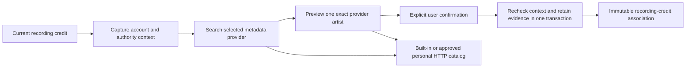

# Artist discovery and explicit review

The core can search and preview artist candidates for a current recording credit, then retain an explicit user confirmation. Same-name candidates keep their provider identifiers. Search and preview do not associate artists, rewrite metadata, merge recordings or fetch audio. Authenticated HTTP routes and recording-detail review controls are verified in source. This feature is not deployed on the normal server.

## Ownership and request flow

`Catalog` owns four public workflows: `begin_artist_review`, `search_artist_candidates_until`, `preview_artist_candidate_until` and `confirm_artist_review`. SQLite, permission checks and association writes remain private to core. The existing association API reuses the same private retention code.

The context captures the account, recording, library, local artist and current credited name. It also captures the accepted personal artist operation, source and observation, library-access grant, primary provider binding revision for an import without audio, metadata policy and exact personal connection/service revisions. Reads recheck these facts around provider requests. Confirmation rechecks them inside the same `BEGIN IMMEDIATE` transaction that writes or retrieves the association.

Changing a personal artist from A to B and back to A does not restore an earlier context. The accepted operation identity still changes. A stale search or confirmation fails until the caller captures the current credit again.

## Providers, cancellation and evidence

Search negotiates a separate discovery descriptor. Preview uses the existing profile descriptor, so an older provider can retain profile support without implementing search. HTTP providers receive only SDK request fields, never the local review context. Search pages have at most 20 candidates and an encoded 64 KiB limit; descriptors have a 4 KiB limit. Exact query and snapshot continuation remain validated.

Metadata operations use independent admission, with four global requests and one per account, and a 15-second aggregate budget. They do not consume playback-source control admission. Canceling a search or preview drops its owned request future and response body. Confirmation performs no provider HTTP and holds only a short local write transaction.

Confirmation records `user_confirmed` evidence for the selected recording credit and provider identifier. Repeating the same current confirmation returns the same association. This does not establish a canonical artist selection, guarantee provider availability, merge same-name artists or revise other recordings. Historical associations remain evidence and must not become an implicit current selection.

Workflow events record generated correlation IDs, outcomes, counts and timings. They omit search terms, credited names, private observations, credentials, paths and provider addresses.

## Verified source and remaining work

The full core run passes 331 distinct cases, with the usual filesystem fault-injection case ignored. The 332 successful executions include one nested child execution. Strict all-target core Clippy and formatting pass. Independent security, correctness and performance reviews pass.

Five new public capability cases cover metadata-only A,B,A imports, distinct same-name candidates, nonmutating preview, selection of the second provider identifier, isolated confirmation and idempotent replay. Separate search and confirmation tests reject an A-to-B-to-A stale context. A held search body retires before the provider releases it; the same account refreshes and reads another ready WAV source while search remains pending, then retries successfully. Exact private pins, duplicate playlist entries, likes, progress, metadata, sources and download absence remain preserved. Nine existing profile/association cases pass again after the retention refactor.

## HTTP and recording-detail review

Six authenticated routes expose review context, search, preview, confirmation, retained associations and one exact association profile. They use the shared account extractor and generated request types. Responses are private and not cacheable. Core retains authority, provider admission and transaction ownership.

The shared recording page loads provider preferences and retained associations only after the user opens artist information. Search keeps same-name candidates separate. Preview makes no association; confirmation is explicit. The workflow preserves an unsaved metadata draft and fences late results after account, recording or credited-artist changes. A fresh server context must match the artist evidence actually rendered on the page before it can be confirmed. Uncertain confirmation can be retried without replacing accepted evidence.

Three public HTTP cases cover the workflow, account/origin/context boundaries and a real client disconnect while the upstream response is held. That disconnect retires the upstream request before its release, and a subsequent request succeeds. All 151 server cases, strict all-target workspace Clippy and formatting pass on the combined source. Generated OpenAPI and TypeScript reproduce. All 308 frontend cases, both TypeScript configurations and the production build pass. Independent security, correctness and performance reviews pass after correcting the rendered-credit mismatch with two regressions.

## Packaged browser verification

Image `sha256:79a1e5848641acbed2d3c6ba6cbdd1e173c888c08a5b27744b441053d0a484b1`, built from `a3f6ed8`, passes the complete workflow in fresh disposable Chromium and WebKit sessions. The browser offers an owned HTTP catalog by address, approves its personal connection, replaces the built-in metadata selection, searches two namesakes, previews the second opaque identifier and explicitly confirms it. Reload preserves the retained review. An unsaved track-title draft survives search, preview and confirmation.

The workflow preserves original WAV hashes, duplicate playlist occurrences, personal metadata, likes, progress, source pins, metadata preferences and plugin connections. It verifies ten exact provider protocol requests and seven correlated frontend workflow completions. Audio remains paused without a source; no source writes, persistent downloads, foreign browser requests or private console values are observed. Separate private backend-log checks also pass. Both TypeScript configurations pass for these browser fixtures, and an independent review of the gate passes.

The first observer incorrectly counted the recording page's two existing read-only download-status requests as downloads. A diagnostic run established their exact authenticated GET envelopes and bounded 404 absence replies. The final gate accepts only those two requests and replies; other download requests still fail. The response-size assertions inspect collected bodies and do not qualify streaming memory bounds.

This package uses an owned catalog fixture. Live MusicBrainz acceptance, normal-server publication, discography and selected-edition track traversal, canonical matching, duplicate-artist correction and artist artwork remain separate work.
