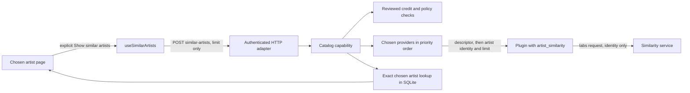

# Similar artists

Chosen-artist pages can show an optional "Similar artists" section. It is basic catalog discovery: it sends only an artist identity, never listening history, and it adopts, imports or merges nothing. This is current source behavior, covered by local tests. The server code runs on the local development server. The ListenBrainz plugin is not deployed; its response shape was checked once against the live service (see below).

## Ownership and data flow



The built-in MusicBrainz provider never answers. Its catalog relationships are not similarity recommendations, and its adapter reports the operation as unsupported.

## Plugin contract

An HTTP plugin that declares the `catalog` capability may also serve an independent, versioned descriptor, as editions do:

| Path | Purpose |
| --- | --- |
| `GET v1/catalog/similarity/capabilities` | `{"similarity_version":1,"operations":["artist_similarity"],"artist_identity":"musicbrainz_artist"}` |
| `POST v1/catalog/similarity/artists` | Request `{"artist_id","limit"}`, response `{"artist_id","items":[{"artist":{"id","name"},"score"}]}` |

The descriptor names the identity namespace. Version 1 supports only `musicbrainz_artist`, so only canonical MusicBrainz artist identifiers cross the boundary. A missing, malformed, other-version or other-namespace descriptor means "not supported". Existing catalog and edition descriptors are unchanged.

Limits: one to 25 results, identities up to 256 bytes, names up to 2,048 bytes without control or invisible formatting characters (bidirectional overrides and marks, zero-width space, word joiner, byte-order mark and invisible operators; the joiners U+200C and U+200D stay valid for scripts and emoji; the check is the shared provider-text validator, so every contract that uses it applies it), a finite score from 0 to one billion (relative, comparable only inside one response), no repeated identity, never the requested artist, and at most 32 KiB of encoded response. Core also requires canonical MusicBrainz identifiers in the response. Scores are not shown in the interface.

## Core behavior

- The artist must be a chosen artist whose reviewed credit is unchanged and whose identity is the built-in MusicBrainz provider. Artists chosen through other providers get the status `unsupported`: their identifiers are private to that provider and are never given to a different service.
- Only plugins in the account's metadata provider list are considered, in the saved priority order. Up to eight are probed for the descriptor, and only plugins that declare the operation count toward at most three answer attempts, so non-capable providers never hide a capable one. A missing descriptor (404 or 501) or an invalid one means unsupported. A descriptor probe that fails (connection error or other status) makes the answer `unavailable`, never `unsupported`. A provider that is unavailable or returns an invalid answer falls through to the next. The first valid answer wins; answers are not merged.
- Statuses: `available`, `disabled` (provider use is off), `unsupported` (no chosen capable plugin), `unavailable` (capable plugins failed) and `cancelled`.
- A locked (PIN) session is refused with 423 before any plugin is contacted.
- The existing reviewed-read admission applies (global and per-account slots), with a 15 second budget, cancellation, and re-checks of the credit, policy revision and plugin approval after each provider call.
- Every returned artist carries `chosen_artist_id` when the account has a current chosen artist with exactly that MusicBrainz identity. The lookup queries the account's identity groups by exact identity and checks the current-choice predicate only for matches, so its work does not grow with the number of chosen artists (a SQLite work-budget case compares 20 and 300 chosen artists: 500 VM steps each). Names are never compared. A namesake with another identity is not linked.
- Logs record outcome, count and elapsed time at debug level only. They exclude names, identifiers, titles and service addresses.

## Interface

The section appears only on chosen artists with a MusicBrainz identity. Nothing is requested until the user chooses Show similar artists. States: looking, empty, unsupported (with a link to Settings, Metadata), disabled, cancelled, and unavailable or timed out (alert with Try again after 20 seconds). A failure leaves the rest of the page, including the discography, libraries and tracks, unaffected. Chosen artists link to their pages; others show "Not one of your chosen artists".

## Radio

Discover's "Radio from…" uses the same similarity read to mix other artists into a library radio; see [catalog browsing](catalog-browsing.md#genres-and-artist-radio). `POST /api/v1/artist-identity-groups/{id}/radio` (no body) calls the read above with a limit of 25 for the chosen artist's reviewed credit, keeps only the similar artists that are chosen artists of the account (`chosen_artist_id`, exact identity), and returns up to 50 library tracks plus how many distinct similar artists put at least one track into the queue (`similar_artists`; an artist cut off by the bound is not counted). Disabled, unsupported, unavailable and failed answers, and artists chosen through a plugin, give the artist's own tracks only; a locked session is refused with 423 before anything is contacted. Playback goes through the normal queue; the radio itself requests no audio.

## ListenBrainz evaluation

Source: the public pages for the [similar-artists viewer](https://labs.api.listenbrainz.org/similar-artists) and the ListenBrainz API documentation.

- What it is: a labs service that, for a MusicBrainz artist identifier and a named algorithm, lists similar artists. The six published algorithm names are all session-based and encode a look-back window in days, session length, contribution and threshold settings and a result limit. The viewer links to a JSON form.
- Identity: MusicBrainz artist identifiers, which fits the descriptor namespace above.
- Not documented publicly: the JSON request form, the response schema, versioning and stability. The plugin assumes a GET with `artist_mbids` and `algorithm` returning a list of objects with `artist_mbid`, `name` and `score`. That shape is from the viewer's published parameter names and community usage, not from a reference page. The plugin drops anything that does not match, so a change fails closed as an invalid response. Verified against the live service on 2026-11-09 (see below).
- Data source: the results come from aggregate listening sessions of ListenBrainz users and update weekly. Hito sends none of its own listening data. The service is a "labs" endpoint, so it may change or disappear without notice, which is why the page works without it.
- Authentication and limits: the general API documentation asks for at most one call per second per client, returns HTTP 429 beyond that, requires HTTPS and a User-Agent that identifies the application with a contact. A token is optional for the general API and raises limits; nothing says the labs viewer needs one, and the plugin sends none. The plugin spaces calls one second apart.
- Terms: not verified for the labs endpoint. Public deployment must review MetaBrainz terms and attribution before enabling it by default.

### The plugin

`plugins/listenbrainz` is a small service (manifest `catalog`, descriptor above, one POST route). It validates the request, calls the labs origin with the fixed algorithm `session_based_days_9000_session_300_contribution_5_threshold_15_limit_50_skip_30`, bounds the body to 256 KiB, requires an `application/json` answer, filters invalid or repeated rows, and answers 503 for upstream failure and 502 for an invalid answer. A labs 404 (an artist the service does not know) is an empty answer. A 429 backs the plugin off for its `Retry-After` seconds (default 10, at most 300) and later requests fail fast as unavailable without contacting the service. Request starts are spaced one second apart; a start that would wait more than two seconds is refused rather than queued.

Operation: every route requires the service bearer and the Hito protocol header, compared in constant time, so the plugin cannot be used as an open proxy. The operator must supply a contact, which goes into the User-Agent as the upstream requires. The service refuses to start without it.

```
hito-plugin-listenbrainz --contact ops@example.org --service-token-file /run/secrets/listenbrainz-token [--listen 127.0.0.1:8095] [--endpoint https://...]
```

Offer that address as a plugin service with the same token as the bearer, install it, and add it to Settings, Metadata. It binds loopback by default and has no container packaging or Compose profile yet. Its eight protocol cases and two limiter cases (one with a paused clock) use a local fake and never contact the network.

## Evidence and limits

Evidence: eight SDK cases, eight core cases (exact links and namesakes, no contact without a chosen capable plugin, priority and fall-through across invalid answers, limits, cancellation, other accounts, failing probes and a capable fourth provider), one HTTP workflow including the locked-session answer, one SQLite work-budget case, ten DOM cases, ten plugin cases, and regenerated OpenAPI and TypeScript.

Not done: a browser case that shows the section (the offline browser server cannot create a MusicBrainz-identified chosen artist without live MusicBrainz, so the browser case only checks that the section stays hidden and silent for plugin-identified artists), plugin-identified artists, merging several providers, score display, live ListenBrainz verification, plugin packaging and deployment.

## Live verification (2026-11-09)

The ignored `plugins/listenbrainz/tests/live.rs` case starts the real plugin router against `https://labs.api.listenbrainz.org/` (one request, 0.6 seconds, production one-second pacing, the project page as operator contact) and asks for five similar artists of a literal public MusicBrainz artist. It passed: the labs `similar-artists/json` GET with `artist_mbids` and `algorithm` returned a JSON list the plugin maps without changes (canonical `artist_mbid`, `name`, numeric `score`, no repeats, never the seed). The parser needed no fix, so the earlier "assumed shape" is now observed for the current service. Run with `HITO_LISTENBRAINZ_LIVE=1 HITO_LISTENBRAINZ_CONTACT=<contact> cargo test -p hito-plugin-listenbrainz --test live -- --ignored`.

The viewer page (read 2026-11-09) states no terms, licence, attribution, rate limit or stability promise; it only lists the algorithm choices, an artist field and a link to the JSON form. The ListenBrainz data-update page lists artist similarity as updating every Sunday. Terms and attribution for the labs endpoint therefore remain unverified and must be reviewed with MetaBrainz before a public default. Plugin packaging exists in `deploy/compose/listenbrainz.yaml` but was not built here.
