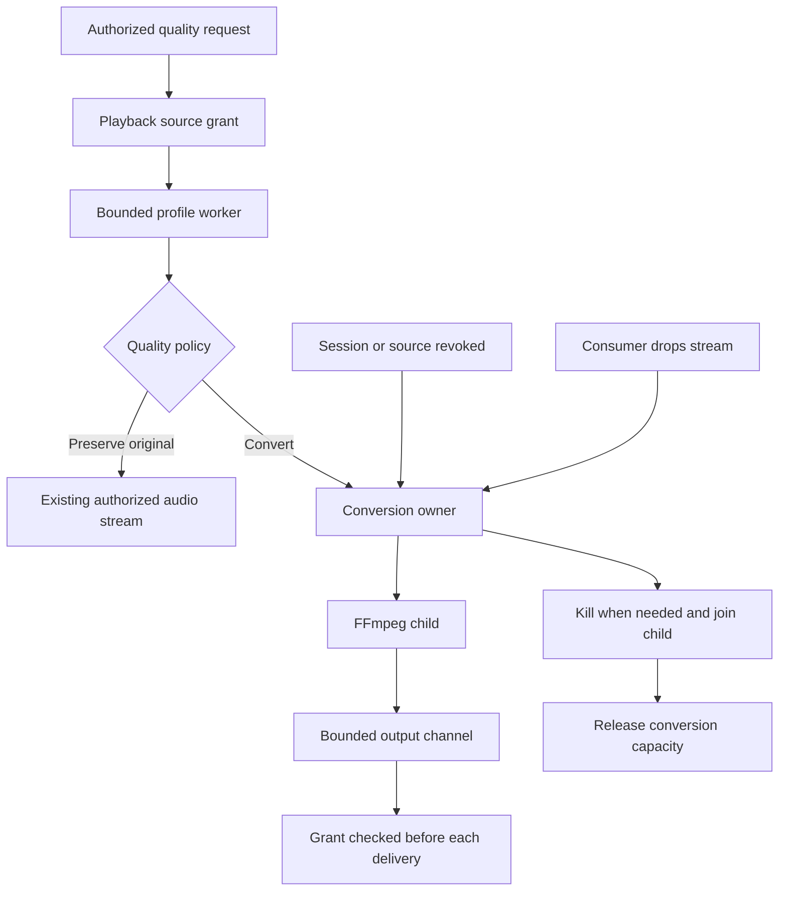
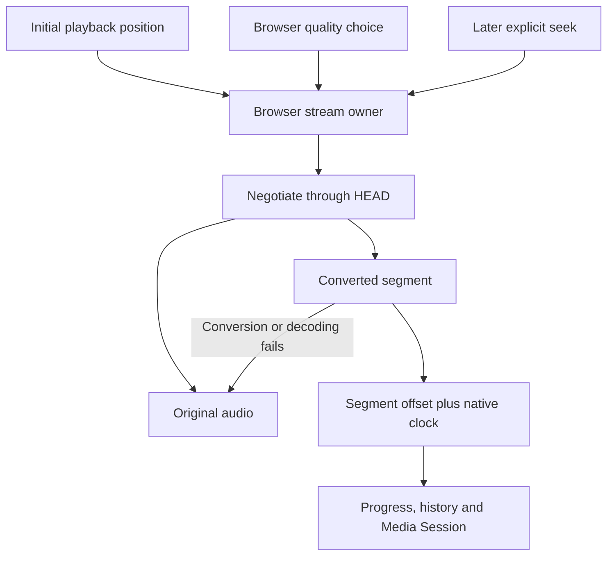

# Audio conversion

The local development server offers per-browser streaming quality for suitable local and server-managed files. Core, HTTP and controlled Chromium/WebKit workflows are qualified in Docker. Provider conversion, native quality controls and platform release acceptance remain unfinished.

## Quality policy

`PlaybackAccess::open_quality_audio` accepts a `QualityRequest` with one of these choices:

| Choice                | Result when conversion is suitable              |
| --------------------- | ----------------------------------------------- |
| Original, the default | Original bytes and existing byte-range behavior |
| High                  | ADTS AAC with a target of 256 kbit/s            |
| Data saver            | ADTS AAC with a target of 128 kbit/s            |

The bitrate is an encoder target. It is not a promise of an exact output byte count.

Known lossless audio is eligible for conversion. A known lossy codec is converted only when its audio-stream bitrate exceeds the target. A missing bitrate, unknown codec, or inconclusive profile preserves the original. The container bitrate is not used to guess the audio bitrate.

Remote provider streams remain original. This avoids starting a second unqualified network reader inside FFmpeg. Local originals and server-managed copies are opened through existing playback authority and private filesystem ownership. Conversion writes no persistent audio copy and changes no Download intent, library record, or original file.

## Process ownership

The owner watches source revocation and consumer closure even when the consumer does not request another chunk. It retains admission until its child has terminated. Reading the prefetched first chunk requires the same authority check as every later chunk. A failed encoder exit is an error, including when the process already emitted audio.

The probe has a ten-second deadline and a 16 KiB output bound. Conversion startup waits at most ten seconds for initial output. Later output reads have a fifteen-second bound, and normal EOF must be followed by successful child exit within two seconds. Output uses a channel of two 32 KiB chunks, providing backpressure rather than buffering the whole recording. The command requests one decoder thread and one encoder thread and retains the existing file/pipe protocol and input-format restrictions.

`CoreConfig::conversion_parallelism` defaults to two concurrent conversions and is clamped to one through eight. One account can hold at most three, subject to that host bound. These limits are independent of scan workers; setting scan parallelism does not alter playback admission. Scan and conversion processes can run at the same time, so their configured capacities add together.

Safe debug spans retain account and playback-grant correlation through asynchronous cleanup. Events report selected quality, outcome, bytes, and elapsed time without recording media names, paths, source URLs, or seek positions.

## HTTP contract

The authenticated `GET` and `HEAD /api/v1/sources/{id}/audio` routes accept optional `quality` and `start_ms` query parameters. The defaults are `original` and zero. Both parameters and the quality enum are generated into OpenAPI and TypeScript from the Rust routes and query types.

Use HEAD to negotiate the effective quality. `X-Hito-Stream-Quality` is `original`, `high` or `saver`. When conversion is suitable, `X-Hito-Stream-Start-Ms` gives the requested segment start; the content type is `audio/aac`. Converted HEAD has no body and starts no encoder. An original result describes the original bytes instead.

A GET at a non-original quality URL is strict. It returns converted AAC or a safe 409 response, including when a converter fails to start after HEAD succeeded. It never silently substitutes original bytes at a segment URL. After a 409, a client can explicitly retry the same source at its unparameterized original URL and apply the absolute seek after metadata arrives.

Original GETs retain byte ranges and the existing If-Range restart behavior. Converted GETs return 200 without a byte-range or content-length promise. Every successful audio response is private and not stored by shared caches. Unknown or malformed query parameters return 400, an offset beyond seven days returns 422, and a nonzero offset with Original returns 422. Session and library permissions apply before either representation opens.

## Time offsets and delivery

A converted request can start at a time offset up to seven days. The resulting stream represents the remaining segment, not the whole recording. A HEAD request probes eligibility and describes conversion without starting an encoder.

The core may return `QualityAudio::Original` after an inconclusive profile or a converter startup failure. Its reason tells the caller why. An original result does not apply the conversion time offset. The HTTP contract above makes the effective representation explicit.

## Browser ownership

Settings → Playback → Streaming quality offers Original, High and Data saver. Original is the default. The choice belongs to this browser and origin, survives reload, and takes effect on a subsequent source open. Changing it preserves the current stream and invalidates prepared audio with an older choice. If browser storage refuses writes, the selection still works for the current session. Native settings hide this browser-only control.

The stream owner applies the initial position once. A later explicit seek received during negotiation or metadata loading remains pending. Converted seeks open another segment while preserving the full recording timeline, absolute progress and play/pause intent. A known recording duration remains the full duration; an unknown duration is learned only from a segment starting at zero.

A failed converted representation gets one explicit retry at the same source's original URL. Original audio receives the absolute seek after metadata. If that also fails, normal bounded recording-source recovery applies. Cancellation retires obsolete negotiation and media work. Player construction installs no listeners; committed activation and cleanup support React Strict Mode replay.

## Evidence and remaining work

On 10 November 2026, Docker checks passed 51 public playback cases, including 19 conversion cases, one conversion-log privacy case, two inspection-command lifecycle regressions, and three admission-limit unit cases. New failing cases reproduced prefetched audio after logout, successful EOF after encoder failure, guessed conversion of an uncertain profile, and scan settings silently limiting conversion capacity. Those cases passed after the corrections. Scoped strict Clippy for core and the three affected test targets passed; workspace formatting is clean. Additional cases verify revocation during probing and child retirement without consumer polling.

Fixtures use temporary SQLite, deterministic owned audio, real FFmpeg/ffprobe and controlled failing tool wrappers. They cover both bitrate classes, time offsets, low-bitrate preservation, authentication, capacity, child cancellation, and safe logs. The HTTP layer also passed thirteen new Router cases and two unchanged original-audio regressions. An independent Docker run repeated all thirteen new cases. They cover both bitrate classes, HEAD, strict fallback, validation, revoked and cancelled streams, remote passthrough, a server-managed download, original ranges, private logs and retained request correlation. Scoped server Clippy passed. Actual OpenAPI export changed only the audio route and the new quality schema; the generated optional query fields and inclusive offset maximum were verified before TypeScript generation.

The final browser change passed 1,865 tests across 379 files, both TypeScript configurations, scoped ESLint and the production build. Eight new cases reproduced and corrected duplicate converted opens after resume: the playback owner had reapplied an initial seek already handled by the stream owner. The directed regression set passed 64 cases, and independent source review approved the fix.

The release image from source `e80faf8d` passed these separate, fresh-server workflows with owned 90-second WAV fixtures:

| Engine              | Qualified behavior                                                                                                                            | Case duration |
| ------------------- | --------------------------------------------------------------------------------------------------------------------------------------------- | ------------- |
| WebKit 26           | Actual High and Data saver AAC decoding, forward/reverse segment seeks, pause/resume, uninterrupted navigation and checkpoint reload          | 21.1 seconds  |
| Pinned Chromium 141 | Exactly three expected AAC codec failures, each followed by same-source Original playback, range verification, seeking, navigation and reload | 18.4 seconds  |

WebKit retained the 90-second timeline when its native segment clock restarted. Its restored segment opened once, delivered a complete 429,785-byte AAC body and advanced to an absolute position of about 28.1 seconds from a 26-second start. Chromium's Original responses matched the owned WAV bytes through independent full-body and browser-range replays. Both workflows checked actual media clock advancement, played ranges and readiness, no unexpected media or JavaScript errors, and no source-refresh, resolution or Download mutations. Download intent was absent before and after playback.

A separate actual decode probe established that the pinned Chromium test binary lacks AAC support, while WebKit decodes it. This is an explicit engine matrix, not a runtime skip and not a claim about production Google Chrome. Native browser responses can remain open while playback buffers; Original byte checks use independent completed HTTP reads rather than waiting for the track to finish.

The normal local server now uses this verified image after a stopped whole-volume backup and a restored-clone startup, SQLite integrity and retained-data audit. This is a development deployment. Physical Safari/phone behavior, provider conversion, native quality settings, Windows/macOS conversion, packaging, live sources and release performance remain under the [release plan](release-plan.md).
