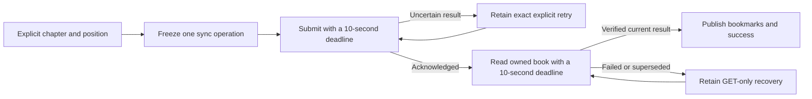

# Audiobooks in development

Audiobook grouping, private bookmarks, authenticated list/read routes, shared pages, explicit playlist grouping and bookmark create/remove controls are qualified in source. The audiobook playback workflow remains unfinished. Migration 0048 is not deployed on the normal server. The full release scope remains in [release-plan.md](release-plan.md).

## Ownership and identities

An audiobook annotates an existing editable playlist owned by the account. Its identity is the backing playlist ID. It retains that playlist's name, order and chapter occurrence IDs, including two occurrences of the same recording. Grouping creates no recordings, sources or alternate chapter ordering.

`Collection::audiobook` reads the owned live playlist, its authorized chapter projection and private bookmarks in one transaction. Core owns the SQL, permissions and synchronization transaction. There is no audiobook forwarding service, provider request, playback engine or download owner.

A bookmark retains its account, book, bookmark ID, exact chapter entry ID, recording ID, position in milliseconds and label. It belongs to a particular occurrence rather than a matching title or recording elsewhere in the book. Another account's access to the same shared-library recording does not grant access to the book or bookmark. A live followed playlist is read-only and cannot be grouped; an owned editable copy is eligible.

Existing per-account, per-recording listening progress remains the sole owner of saved positions and playback speed. Grouping and bookmark changes preserve that state, personal title/artist overrides, likes, metadata observations, sources, other playlists and original audio. They start no audio or persistent download.

## Synchronization and deletion

The existing collection operation format carries these actions:

| Action | Fields |
| --- | --- |
| `audiobook_create` | `playlist_id` |
| `audiobook_bookmark_create` | `audiobook_id`, `bookmark_id`, `entry_id`, `recording_id`, `position_ms`, `label` |
| `audiobook_bookmark_remove` | `audiobook_id`, `bookmark_id` |

Exact operation replay returns its original acknowledgement without another event. A fresh accepted operation retains its original synchronization payload even when deletion makes it a visible no-op. Reusing a bookmark identity for a different live position conflicts.

Bookmark removal retains a tombstone in the same authoritative row. Removing an unknown marker records only its account, book and marker identity; it invents no chapter or recording. Later creation cannot resurrect that marker or move its identity to another book. Removing one marker preserves the others. Foreign book operations return `NotFound`; same-account cross-book identity conflicts do not become cross-account existence checks.

Deleting the backing playlist wins over delayed audiobook operations. Grouping, bookmark creation and removal on an owned deleted playlist are acknowledged no-ops, including in the same batch as deletion. They cannot roll back unrelated valid work in that batch or recreate the book. Public playlist and audiobook reads still return `NotFound`. Missing and foreign playlists remain denied. Bookmark input bounds still apply before accepting a deleted-book no-op.

## Bounds and migration

The chapter projection rejects books exceeding 10,000 live occurrences rather than silently truncating them. A book supports at most 256 active bookmarks. Positions are nonnegative integer milliseconds. Labels must contain text after trimming and fit within 256 raw UTF-8 bytes before trimming; whitespace padding counts toward that bound. These are byte limits, not character limits.

Migration 0048 adds the book annotation and bookmark rows, ownership/identity guards and indexes. Unknown-marker tombstones have no position payload; visible bookmarks require the complete chapter/recording/position/label payload. Historical migration inputs remain pinned to their original versions and checksums. Upgrade fixtures require the exact declared 0048 schema and empty new book tables, preserving prior typed rows, rowids, sequences, receipts, views, foreign keys, search state, private keys and original files.

The full `(audiobook_id, entry_id)` child index bounds foreign-key checks when ordinary Follow refresh deletes unrelated playlist entries. The work regression applies all actual migrations and seeds 100,000 retained markers across 400 owned books and ten accounts, with 125 active and 125 deleted markers per book. It closes and reopens SQLite under absent, inherited and fresh statistics, enables foreign keys, deletes 20 retired entries under `BEGIN IMMEDIATE`, then verifies exact retained state and rollback.

Before the index, the absent-statistics DELETE used approximately 6,000,900 SQLite VM steps and failed the 50,000-step budget. With the index, all three statistics states use approximately 1,000 steps. This fixture measures database work; it is not the release load test or a playback latency benchmark.

## Verification and remaining work

Six focused cases pass:

- Grouping, exact chapter and bookmark identities, private musical-state preservation and reopening.
- Account isolation, exact replay and bookmark anchoring after chapter reordering.
- Oversized raw-label rejection before insertion and before an existing-marker no-op.
- Bookmark removal, exact replay, later creates, remove-before-create tombstones and book/account boundaries.
- Backing-playlist deletion winning over all three actions while independent batch work commits, including after reopening.
- The real-schema foreign-key work budget described above.

The first five exercise public capabilities with real temporary SQLite and owned deterministic originals. The sixth exercises the actual database schema and parent DELETE. Independent security, correctness and performance reviews identified a P2 raw-label payload issue, a P1 parent-deletion rollback issue and a P1 missing child-index issue. Each received a failing regression before its minimal fix; the relevant second review verified the resolution. Strict all-target core Clippy and formatting pass.

The integrated full-core run passed 331 distinct cases, with one usual fault case ignored, and exposed six migration fixtures still expecting schema 0047. Their latest endpoints and exact additive schema expectations were corrected without changing historical inputs or preservation checks. All six directed targets then passed, qualifying 337 distinct core cases across those runs. This is not a single green run of all 337 cases.

The combined workspace also passes 148 distinct server cases, strict all-target workspace Clippy and formatting. The generated route/type export changes only the existing `Action` schema and reproduces byte for byte. All 298 frontend cases, both TypeScript configurations and the production web build pass with those generated types. Those foundation checks precede the read routes and pages below.

## HTTP and read-only pages

`GET /api/v1/audiobooks` reads at most 100 owned, live, editable grouped playlists in one core query. `GET /api/v1/audiobooks/{id}` returns the existing chapter and bookmark projection. The Inertia routes `/audiobooks` and `/audiobooks/{id}` reuse those capabilities through generated page contracts. Detail reads authorize the book before omitting optional props, so partial requests for shared props cannot bypass ownership or deletion. Anonymous browser requests use the existing login page; authenticated responses remain private and not cacheable.

The shared index links to each book. The chapter page preserves server order and exact entry identities, including repeated recordings. Bookmarks match their original entry and recording; removed or mismatched anchors remain visible as unavailable. Rendering opens no audio, provider request or persistent download and changes no listening state. Navigation is registered in the shared shell.

Four real-SQLite HTTP/Inertia cases pass, covering owned reads, exact chapter/bookmark projection, account mismatch, foreign and ungrouped books, full and partial denials, parent deletion, safe anonymous login and preservation of both accounts and original WAV bytes. Strict core/server all-target Clippy and formatting pass. Actual Rust export adds only the two GET routes and four DTO/page schemas; generated TypeScript reproduces and both configurations pass. Three page cases cover list/empty state, duplicate occurrences and unavailable bookmarks with rendering side effects rejected. All 301 frontend cases and the production build pass. Fresh independent reviews pass for the adapters and read-only UI.

## Explicit playlist grouping

The index offers the account's editable playlists that are not already grouped. Add audiobook prepares one immutable synchronization operation. A lost acknowledgement retains that exact operation for retry; an acknowledged operation instead retries only the authoritative book read. The workflow verifies the owned detail response before requesting navigation and waits for matching Inertia success before completing.

Failed or cancelled navigation leaves a Check audiobook action. Account replacement or unmount retires the owned cancellation token and fences late reads and navigation callbacks. If an acknowledged operation returns an authoritative 404, the page explains that the book is unavailable and offers an explicit Choose another playlist action. An uncertain write cannot be abandoned that way. Rendering and recovery start no audio, provider lookup or download.

Eight grouping cases verify eligible selection, exact lost-acknowledgement replay, GET-only recovery, held response bodies, account/unmount fencing, deleted-book no-ops, explicit unavailable-result release, failed/cancelled navigation and late callbacks. The navigation regressions first failed because the original workflow marked completion before a fire-and-forget visit. The final full frontend run passes all 323 cases across 116 files, both TypeScript configurations and the production build. The independent second review confirms recovery and lifecycle ownership. Workflow logs use the original operation correlation, static outcomes and timings.

### Packaged grouping acceptance

The isolated package from `785ac22` passes three Chromium and three WebKit cases. A baseline with the same Rust binary and the earlier web bundle first fails because the grouping form is absent. The accepted workflow uses a fresh tmpfs database and owned WAV fixtures, sets private pins, likes and progress, then adds a playlist containing two occurrences of the same recording through the UI.

The gate forwards the first grouping request to the real server, verifies its accepted receipt, then loses that exact response before browser delivery. Manual retry sends identical bytes. There is one appended event, an authoritative detail read before navigation, and exact chapter identities after reload and revisiting the list. The backing playlist, existing private musical state, source records, original hashes and absence of downloads remain unchanged. Audio stays paused without a source; no provider, audio or persistent-download request occurs.

The final Chromium workflow takes 5.4 seconds and the WebKit workflow 5.0 seconds. They observe 37 and 36 browser-context requests respectively, including one intentionally lost response each. Chromium also observes two preparation API cancellations; WebKit observes none. The failure gate covers requests started after the prepared-state boundary and rejects every unexpected failure there. Preparation cancellations remain counted separately and are not qualified as successful transport. Bounded API control reads use a separate request context and are not part of these traffic counts.

An independent gate review found that early console messages were not rescanned after session canaries became known. A real browser regression first reproduces the missed detection. The fixture now retains text only within its 512 KiB budget, rescans final canaries after joining captures and fails closed on overflow. The second review and both engines pass. Safe final counter records contain no raw bodies, headers, URLs or identities. Known synthetic private canaries are absent from the retained structured backend logs.

This qualifies grouping and recovery in the isolated package. It seeds one backing playlist and does not snapshot metadata-provider settings. It does not qualify bookmark actions, playback, large chapter rendering, physical Safari or normal deployment. The normal server remains unchanged and the disposable server is stopped after verification.

The index currently has a 100-book result cap; book pagination is unfinished. Chapters render together up to the core limit, and browser performance at 10,000 chapters is unqualified. Bookmark jumping, chapter resume and speed controls remain unfinished. Chapter/bookmark limit boundaries and access revocation need further qualification. Deployment acceptance also remains open.

## Explicit bookmark changes

The detail page lets a listener select an available chapter occurrence, enter a position in seconds and save a private label. Repeated recordings remain separate chapter choices. The workflow validates nonnegative integer milliseconds and the raw 256-byte UTF-8 label bound before trimming. It creates a separate stable marker identity and never guesses the chapter from the current recording or playback time.

The page also removes an exact marker, including one whose chapter is no longer available. Other markers, chapter order and saved recording progress stay unchanged. These controls do not play, seek, navigate or download media.

Each submission, including acknowledgement-body consumption, and each read has its own deadline. A lost acknowledgement retains the frozen action, marker ID, operation ID and device ID. Retry resubmits those exact bytes only after the listener asks. Once acknowledged, Check bookmarks performs GET only. The workflow checks the created tuple or removed identity before publishing success or clearing the draft.

Account changes, another book and unmount cancel the owning scope. Changed same-book props invalidate older reads; a superseded confirmation cannot publish success or discard its acknowledged attempt. The last checked list stays visible during refresh, and an authoritative empty list replaces it. Editing an unsent draft preserves recovery from an independent failed refresh. Workflow logs contain correlation IDs, safe outcomes and timings without labels, titles, paths or session material.

Eighteen public page cases cover duplicate occurrences, create/remove, unavailable markers, exact retry after a lost acknowledgement, GET-only recovery, held response bodies, account/book/unmount changes, stale props, authoritative empty replacement and input bounds. New review regressions first reproduced two invalidation races, a stalled acknowledgement and a hidden refresh-retry control. The fixes pass all 341 frontend cases across 124 files, both TypeScript configurations and the production build, including after integration. Independent final correctness, security and performance reviews pass.

A dedicated stalled-GET case, 10,000-chapter browser performance, playback jumping, occurrence-aware resume and deployment remain open. Packaged create/remove acceptance is recorded below. Existing per-recording progress is still the sole saved-position owner; the bookmark UI adds no book-wide resume cursor.

A book-wide Continue button additionally requires an explicit selected-chapter anchor and collection occurrence provenance through browser and native queues. Recording timestamps or the current recording cannot identify a duplicate chapter occurrence. Automatic advancement, navigation, account switching and consistent resume must use the existing playback owner and per-recording progress, without another position store. These remain required release work, along with packaged browser, native/platform and normal-deployment acceptance.

## Packaged bookmark acceptance

The package from `283c7f3` passes the private bookmark workflow against fresh isolated SQLite in Chromium and WebKit. A baseline with the same Rust binary and a pre-bookmark web bundle first fails because bookmark controls are absent. The candidate preserves the existing originals, private title/artist edits, playlist entries, likes, recording progress, sources and absence of downloads.

The workflow explicitly selects the second occurrence of one recording and saves a UTF-8 label at 35.5 seconds. It forwards the first create to the real server and loses that accepted acknowledgement before delivery. Manual retry sends identical bytes and appends no second create event. A held authoritative read must complete before the saved marker appears. Reload retains the exact chapter anchor. Removing that marker also waits for a held confirming read, appends one removal event and remains absent after another reload. Audio stays paused without a source; no provider, audio or persistent-download request occurs.

The final functional case takes 6.6 seconds in Chromium and 7.7 seconds in WebKit. Each observes 13 workflow requests, one deliberately lost response and no unexpected workflow failures. Preparation remains separately observed rather than transport-qualified: Chromium records two cancellations, two unavailable response bodies and one error-status reply; WebKit records no cancellation or body failure and one error-status reply. Bounded API control probes are separate from browser-context counts.

Independent gate review found an ambiguous chapter-text locator, incomplete preparation traffic accounting, a late confirmation-hold race and unbounded preparation reads. Regressions first reproduce those faults. The gate now scopes the chapter label to the saved marker, blocks foreign/audio-endpoint/download requests in every phase, records preparation failures separately and joins retired delivery before removing interception. A second review passes. A separate shared-helper review also first reproduces an oversized progress response; the fix rejects it before snapshot reads and disposes both rejected and accepted replies.

The final Chromium run passes five cases, including both shared progress-body cases; WebKit passes the three bookmark cases. Both TypeScript configurations pass. The synthetic preparation case tests actual browser requests to the product-shaped audio endpoint; it does not qualify HTML media-resource classification or physical Safari behavior. Final safe counters and known synthetic canaries pass console/backend privacy checks. This backend check covers the known synthetic strings, not dynamic session material or all possible sensitive values.

The source and tests are integrated in small unsigned commits. Both disposable servers are stopped after verification and the normal server remains unchanged. Playback jumping, occurrence-aware resume, large chapter rendering, native/platform and deployment acceptance remain separate work.

## Explicit chapter and bookmark playback

The verified source offers Play chapter from beginning and Play bookmark. Each action first reads the current owned book, then selects the exact entry and recording. Bookmark playback also verifies the marker identity, book and exact saved milliseconds. Missing, changed or unavailable targets cannot fall back to another occurrence of the same recording.

The queue preserves every recording-bearing chapter in checked order, including repeated recordings and unavailable successors handled by the existing queue policy. Null-recording placeholders are omitted. The selected index comes from the chapter entry identity. Chapter playback starts at zero; bookmark playback uses an explicit position rather than native saved-recording resume semantics.

A prepared playback intention is captured before the read. A later queue selection, Next or Clear supersedes it. Direct `setPlaying` retains the existing player semantics. Account, book, incoming page snapshot and unmount retire the read; one ten-second deadline includes JSON consumption. Verified bookmark display may stay visible during refresh, but it no longer keeps an older playback read alive. Audio already handed to the player survives navigation and continues through the existing authorization, source preparation and per-recording progress owner.

No playback-position subscription is added to the page. Workflow logs contain generated correlations, static actions/outcomes, mode, counts and timings without chapter labels or provider addresses. Completing the selection request is not presented as proof that sound started.

Two missing-control regressions first reproduce the absent features. Twenty-four new cases cover exact duplicate selection and bookmark milliseconds, unavailable or changed anchors, later playback intentions, held bodies, account/book/props/unmount cancellation, deadline recovery, navigation and ordinary progress ownership. Native protocol coverage selects duplicate index 1002 across command chunks at 35,125 ms. Independent review found a retained-detail cancellation race; its verified-editor regression failed before the minimal raw-snapshot ownership fix. Final correctness/security reviews and the performance review pass. All 387 source and integrated frontend cases, both type configurations and the production build pass.

This qualifies shared browser/native command coordination in source. Packaged audible playback, physical Safari, native platform output, large chapter rendering, book-wide Continue and durable chapter provenance remain unfinished. There is no book-wide resume cursor or current-chapter inference from recording progress.

A preliminary isolated Chromium run of the `5adbedc` web package observes chapter playback from zero, natural advancement, an exact 35,125 ms bookmark on the second duplicate, queue removal preserving that occurrence, the same audio element through two Inertia visits and UI pause. Its five progress writes match actual observed media, and private state, originals and download absence remain preserved. This is media-state evidence, not a measurement of audible output.

The run does not pass the strict transport gate. Native audio requests include aborted open-ended ranges followed by completed tail ranges; some aborted response bodies cannot be inspected. The cause and suitable fail-closed verification remain under investigation. These requests have not been classified as harmless or byte-verified. WebKit, platform output, latency, gapless behavior and deployment remain unqualified.
