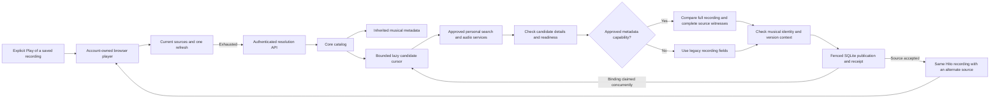
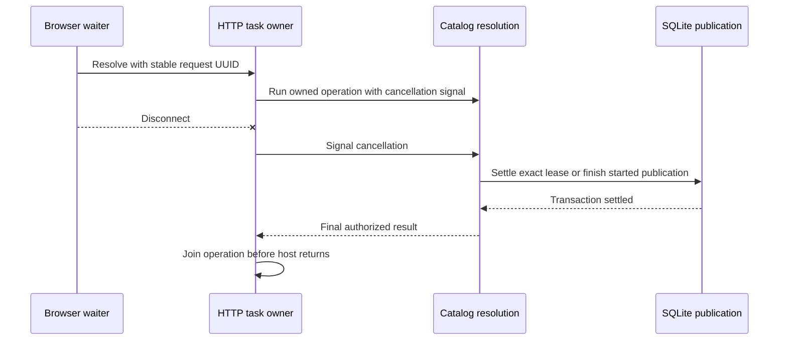

# Automatic audio sources

Automatic source resolution and durable manual correction are deployed to the normal local development server. Controlled Chromium workflows and one real Spotify-to-YouTube WebKit target pass, including actual audio, seeking and private-state preservation. Native integration, broader matching quality and the remaining release gates are unfinished.

Refresh the browser after upgrading. Existing YouTube connections need **Settings → Plugins → Check connection → Accept changes** to approve the added metadata capability. Ordinary Play can then find audio for an imported Spotify recording without a per-track URL or review. Manual choice remains available to correct a result. This does not approve capabilities or credentials on the listener's behalf.

## Playback and ownership

Ordinary browser Play can start a known recording even when the page's availability snapshot is false. The playback owner tries current sources, one refresh of existing bindings, then one automatic-resolution stage. Unknown retained playlist entries cannot start playback. Loading a page does not start resolution or a persistent download.

Core searches with the recording's inherited metadata, preserving personal display edits. It does not give one plugin another plugin's recording identifier. An accepted alternate source keeps the original recording, primary metadata owner, playlist entries, likes and progress. Automatic associations carry their own policy evidence rather than pretending the user confirmed them.

The public command is `POST /api/v1/recordings/{recording}/sources/resolve` with a nonempty `request_id` UUID. The response contains Hito request, resolution and recording identities, a controlled outcome and current authorized sources. Rust handlers and wire types generate OpenAPI and TypeScript.

## Current policy and bounds

Connections without an approved metadata capability use matching normalized legacy titles and known musical artists. Approved metadata connections can hydrate wrapped video summaries and compare the structured musical title instead. The complete metadata recording must equal the fetched detail, and its complete unique source-witness set must equal the fetched source IDs. Missing or inconsistent enriched evidence rejects the candidate; it does not fall back to the legacy path.

Both paths reject unknown or channel-only musical artists and compare visible live, remix, cover, karaoke, instrumental, slowed and sped-up qualifiers. Enriched matching retains version context from the original video title, structured title, release and album. Both durations must be known and at least one second. The permitted difference is two percent, bounded between three and ten seconds. These thresholds have deterministic fixture coverage; they have not been calibrated against a real music corpus. Additional video qualifier forms still need public regression coverage.

Each attempt considers at most four approved personal connections, twenty search results per connection and three detailed candidates per connection. Eligible summaries retain the provider's search order. Opaque identifiers and duration differences no longer reorder candidates before the detail limit. Exchanges are sequential within an attempt.

The YouTube plugin searches the YouTube Music songs catalog. Its flat results can contain only a video identity and title, so the summary keeps an unknown artist and missing duration. Core still requires independently hydrated musical title, known artist, duration, version context and complete source witnesses before accepting audio. A search result alone cannot supply that evidence.

Caller admission reserves at most two active account slots across cloned catalog handles. A running account rejects excess callers with a controlled conflict before SQLite. In the verified development source, a cancelling owner can reserve one successor in that same slot, with at most two successors globally. Further callers receive Busy before SQLite and create no receipt aliases. Waiting consumes the original ten-second budget; cancelling a waiting successor releases only its exact reservation. Durable pending resolutions retain their account/global limits.

A ten-second budget bounds admission and read-only preparation; a twelve-second lease and token checks fence publication. A started SQLite publication is awaited and can extend beyond the foreground budget. Caller capacity remains held through publication and the final authorized result.

The cursor searches each selected connection once and retains its place within the current provider page. If another operation claims a candidate before publication, the atomic binding check rolls back that publication and advances the same cursor. The resolution retains its original request, receipt, lease, deadline and candidate limits. Other publication conflicts remain errors.

The [musical-metadata endpoint](plugins.md#musical-metadata-in-development) retains track title, album context and source witnesses alongside the full video title. Core now requests that evidence only through an accepted installation's metadata capability. A controlled public workflow resolves `Performer - Song (Official Audio)` without guessing from the wrapper. Enriched decisions retain the bounded SDK response under policy `hito.musical-source.metadata.v1`; migration 0037 adds its nullable JSON field without changing legacy decisions or their digest. Missing provider context can still conceal a recording version. Provider metadata is not acoustic verification; broader live matching remains unfinished beyond the single target below.

## Retry and cancellation

Core stores durable request receipts. Replaying an accepted UUID returns the same resolution identity and rechecks access before returning current sources. A historical `ready` outcome is not current playback authority. Reusing a request UUID for another recording conflicts.

The browser freezes one UUID and request body. An ambiguous acknowledgement permits one retry with that exact body and the same account-owned cancellation signal. Rejected client requests are not retried automatically. Account or queue replacement cancels the old owner and fences late results. A resolution response cannot replay an audio source already exhausted in that playback cycle.

Supplied cancellation can interrupt read-only candidate work. Once publication starts, core awaits its fenced transaction before settling the caller. If a binding collision rejects that publication, cancellation is checked before further provider IO and settles the same receipt as cancelled. A successful publication still settles as ready after cancellation arrives. Abruptly dropping the entire core future remains outside this guarantee. The verified HTTP ownership work below retains the core future after a response waiter disconnects; no detached cleanup task is used.

## HTTP resolution lifetime in verified source

The real server host owns source-resolution tasks separately from response waiters. Losing the HTTP waiter signals cooperative cancellation. Core cancels read-only provider work, awaits exact-token lease cleanup and retains any started publication and final authorization checks. Core also owns the bounded successor handoff. HTTP does not maintain a business admission queue.

Connection shutdown keeps its existing five-second drain and forced-abort policy. Owned resolutions are joined afterward, before the host reports that it stopped. An embedded router without this host runs inline with its caller's lifetime; this slice does not make an abruptly dropped direct core future safe.

Actual regressions first showed a disconnected provider read ending while its durable lease blocked the next Play, and publication ownership ending before a held writer was released. A later retry-burst regression exposed an unbounded transport wait queue in the prototype. The final implementation passes all four HTTP cases, including forced connection abort during publication. Two additional public core cases verify cancelled reservation replacement and two-account saturation/isolation. Six existing core admission, cancellation, binding-race and revocation cases also pass.

The frozen source passes all 139 distinct server tests, strict all-target core/server Clippy and formatting in Docker. Both independent specialist rounds are complete, with final security, correctness and performance reviews passing. The integrated source also passes 299 distinct core cases with one usual ignored fault case. The combined image `sha256:6eacc678c8f0ff5380c8947e670bde52f9fd17009db7b040eb474ee5fc48f366` passes fresh owned-audio Chromium/WebKit workflows and is deployed locally after stopped clone and normal preservation audits. Migration 0045 is unchanged. These are source, protocol and packaged browser checks; native, physical-device and release latency guarantees remain open. See [next-entry acceptance](next-entry-preparation.md) and [local deployment](status.md#running-local-deployment).

## Verified evidence

- The first public HTTP case passes identity preservation, candidate filtering, immutable receipt replay and current source privacy against a real temporary server, SQLite and owned protocol provider.
- The populated migration-35-to-36 case passes exact preservation of prior typed rows, rowids, migration checksums, sequences, provider binding history, private state, downloads, artwork and preparation references, with foreign-key, integrity and FTS checks. It is an owned fixture, not a stopped whole-volume rehearsal of the normal installation.
- Migration regressions populate 259 and 4,099 bindings with recording, source, artwork, preparation and download references. Actual migration work stays below the unchanged budgets with absent, inherited and fresh planner statistics: approximately 146 to 150 thousand and 1.949 to 1.953 million SQLite VM steps respectively. The original 100,000-recording upgrade also passes, with a 10.3-second reopen in its development smoke test. These are migration checks, not release latency benchmarks.
- The publication-cancellation regression first failed after a held SQLite writer was released. With the fix, the same case passes accepted association settlement, receipt replay, unchanged primary metadata and a subsequent Play without another provider search. The migration and HTTP cases and strict production Clippy pass with that fix.
- Two React-owner cases pass account-switch cancellation and exact-body retry after a lost acknowledgement. They preserve duplicate queue occurrences and use the real browser player with fetch and media boundaries. They do not prove real browser decoding or server restart durability.
- The complete frontend suite passes 220 cases across 61 files, both TypeScript checks and the production build.
- A held provider-source exchange followed by public connection removal now stops later candidate requests. The regression preserves primary metadata, personal edits, activity and duplicate playlist entries. Its active control still reaches the next eligible candidate.
- Public matching cases reject studio-to-live and live-to-studio associations for releases titled `Live`, `Live Sessions` and `Live 1998`. The extended matrix first reproduced an accepted live/studio mismatch, then passed after album context recognized the complete word `live` independently of musical-title qualifiers. A studio song whose musical title is `Live` still resolves and plays its exact owned WAV; that same bare title cannot hide a conflicting live album context.
- When candidate A already belongs to another Hito recording, resolution skips it and selects B. A second case claims A through public adoption after candidate selection, then verifies continuation to B with one search and the original request and budget. Both recordings retain their identities and metadata; A still serves its original WAV and the target plays B's distinct WAV.
- Cancellation during that rejected publication prevents B detail, source and audio requests. Replaying the cancelled receipt returns the same identity without provider IO or private-state changes. The separate successful-publication cancellation case still returns ready. All three cases and strict Clippy pass.
- Six excess same-account calls return controlled Busy while an owner is held. After settlement, its UUID replays and rejected new UUIDs receive distinct fresh receipts. A separate three-account case admits two held owners, rejects the third without provider IO, then admits that account when one owner settles. Its receipts and source access remain private to each account. These cases and their strict Clippy checks pass; whole-future-drop capacity and durable-lease recovery remain separate boundaries.
- The SDK passes seventeen public contract cases with schema generation enabled. YouTube passes nineteen fixture cases, with one live case explicitly ignored, and both pass strict all-target Clippy. New cases cover structured artists, retained video-version titles, malformed lists, legacy fallback and a separate snapshot-bound musical-metadata endpoint. These are owned extractor/HTTP fixtures, not live automatic matching.
- The new host workflow imports two unavailable Spotify-like occurrences, preserves primary metadata, likes and progress, resolves a wrapped video using approved structured metadata, and reads its exact owned WAV through core's authorized audio boundary. No provider audio is requested before that explicit open. This verifies protocol and audio-body ownership, not browser or native decoding.
- A separate source-witness mismatch case reaches actual detail, source and metadata exchanges, then rejects the ready source without publishing an observation or source. Primary and private state remain unchanged; replay returns the same rejection without further provider IO. Both host cases and strict test Clippy pass.
- Further public cases first reproduced incorrect acceptance when `Live at`, `Live from` or `Live in` appeared after the performer and song in the original video title. Word-boundary qualifier checks now reject all three while the structured playback, source-witness and original album/bare-title controls still pass. The HTTP workflow and strict default-workspace all-target Clippy pass after those fixes.
- Two enriched-path cases then reproduced incorrect handling of the canonical song title `Live` inside `Performer - Live`. Exact known performer/title wrappers now exempt only the trailing-title heuristic. Explicit video qualifiers and independent release/album context remain active. Both cases pass: the studio target plays the exact owned WAV, and a live-album target rejects that same studio candidate.
- The selected core resolution regressions, unchanged 100,000-recording upgrade, exact migration-0036 work budget, populated latest-migration preservation, HTTP resolution and strict default-workspace all-target Clippy pass with host metadata consumption. The original populated preservation case starts at migration 0035 and ends at 0037.
- A separate populated 0036-to-0037 characterization preserves every prior typed table projection, rowid and migration receipt/checksum, including a completed legacy automatic decision and its source, choice and request chain. Its added metadata remains null; immutable-history guards, foreign keys, integrity and a second reopen pass. The fixture uses fixed valid opaque digests; it does not recompute historical matching evidence or establish a migration work bound.

Release image `sha256:5c9f204c7fb22705223bc7ca37c69360f50fcf4b5ec67f4b26a7b12ddcc766bf`, built from `47100cb`, passes the isolated Chromium workflow. It imports duplicate unavailable entries, preserves personal edits and likes, presses ordinary Play, rejects incompatible candidates, selects the studio source and advances an owned WAV through Hito's relay. It creates no second recording, manual attachment or persistent download. Health, exact OpenAPI and served JS/CSS, anonymous native-player rejection and fixture log-redaction checks pass on that same image. Its temporary server is stopped.

That earlier image precedes the publication-cancellation fix. Image `sha256:4924140bb50cf9858fb6964e0f0916ca25a6c86d791faeb2b677b53ee892e4e9`, built from `f2ae130`, passes the combined isolated Chromium workflow. It covers ordinary automatic Play, explicit distinct A/B downloads, manual correction, saved playback and seeking during provider failure, reset and account isolation. Runtime OpenAPI and assets match. The browser log observer checks cached text and emission-time structured snapshots, including navigation canaries; its final privacy and callback counters are zero. See [the complete workflow and limits](manual-sources.md). The matching-recovery image below supersedes this local deployment.

The same Hito image and YouTube image `sha256:a57e5da04f07139db2ca6b970403fd77616f254896bcdc6a8e192ce66ba01d81` pass the real automatic WebKit workflow. One imported Spotify recording retains its original metadata owner, personal title/artist, likes, playlist and catalog identity. A library search limits the queue to that single recording, then one ordinary Play receives one automatic resolution and decodes AAC. Seeking and navigation preserve playback; progress follows the paused position. There are zero manual matching actions, persistent-download writes, external browser requests, privacy failures or callback errors. Eleven positive AAC responses and advancing media time establish playback; one synthetic WebKit status-zero event is reported separately. The final test took 14.5 seconds, not a start-latency benchmark.

The Spotify plugin returned 503 on the first live attempt. Both direct service checks subsequently returned 200. The second attempt exposed a test assumption about the default grid view; explicitly selecting List view preserved every assertion, and the unchanged application passed the third attempt. This is one target, not corpus-wide matching or provider reliability acceptance.

## Matching recovery verified on 17 October 2026

A completed-request snapshot contained thirty `no_suitable_source` outcomes, three `ready` outcomes and four protected choices. Eighteen rapid negative attempts occurred between withdrawal of the YouTube service and its reconnection; they did not establish failed YouTube searches. Read-only reproduction of three failed recording identities, representing two distinct musical targets, found twenty ordinary video results each. All eighteen examined candidates lacked a structured musical title and known musical artist, despite successful HTTP exchanges.

Two separate defects are corrected. Eligible candidates retain provider relevance instead of being reordered by duration and opaque identity before the three-detail limit. The YouTube plugin searches Music songs, retains truthful unknown summary metadata, and hydrates each selected video independently. No title, artist, version, duration, source-witness or authority checks were relaxed.

The public search-order regression first failed with `NoSuitableSource`, then passed and opened the exact owned WAV. Fourteen directed core cases pass, including versions, witnesses, revoked connections, concurrent binding claims and the new log-redaction case. YouTube passes twenty fixture cases, with its separate live-audio case explicitly ignored. Scoped strict Clippy and workspace formatting pass. Independent reviews of selection, diagnostics and the plugin search change pass.

Hito image `sha256:2070dc45b5fa12bc4371ff88fdb93a634bc813c6002ec0e887fb66f5f31e6fe4` and YouTube image `sha256:497267e06352260f159ae0410869cd9dcbe5302b9ba5baedae3f1444305fa797`, both built from `2b4ad7e`, are deployed locally. The complete controlled Chromium workflow passes in 9.3 seconds. The real Spotify-to-YouTube WebKit workflow passes in 15.5 seconds, including one automatic resolution, actual AAC playback, seeking, navigation and private-state preservation. It observes twelve positive audio responses, one separately classified synthetic status-zero observation and no invalid audio, external browser requests, persistent-download writes or private-log failures. These durations are workflow timings, not release latency benchmarks.

The new plugin also passes a read-only protocol replay of those three failed identities. All receive twenty eligible summaries and a first candidate accepted by the reproduced unchanged musical policy, across fifty-four successful HTTP exchanges. This checks two distinct songs and does not prove account publication or actual playback for those private recordings. A further distinct collaboration remains rejected because artist order and feature-title presentation differ; broader matching remains open.

A fresh stopped whole-volume backup precedes the update. Both images are healthy; runtime policy, mounts, ports and other environment values are preserved. Accounts, sessions, plugin connections, all thirty-nine migration receipts and prior managed files compare unchanged. Database integrity and foreign keys pass. Served assets and OpenAPI match, anonymous player access is rejected, and the server reaches the plugin manifest. No normal account was authenticated or modified for acceptance.

Resolution DEBUG events now report `source_resolution_search_candidates` with returned/plausible counts and the detail limit, and `source_resolution_candidate_rejected` with a controlled static reason. Request spans retain correlation. Private titles, artists, search terms, provider identities, bodies and URLs remain excluded. The local deployment enables these events with `RUST_LOG=info,hito_core::catalog::provider::resolution=debug`.

## Remaining work

Artist-credit presentation remains strict. Reordered collaborations and feature suffixes can reject the same recording because the current contract retains one display artist string. Add complete structured recording credits before comparing member sets or accepting equivalent feature-title presentation. Do not reconstruct artist boundaries by splitting that display string or infer credits from search terms.

Intermittent YouTube audio opening is also unresolved. A subsequent normal-server snapshot recorded five audio HTTP 502 responses before body delivery, alongside twelve successful 206 responses. Search, detail, metadata and source exchanges succeeded. A bounded read-only replay of six recent sources later returned 206 for every 1 KiB range. That replay does not prove the failure fixed. Rejected upstream status, framing, range, MIME and validator checks currently share the same 502 response, so its cause remains unconfirmed. The user approved tracking this separately while release features continue.

The [manual-selection workflow](manual-sources.md) verifies binding B across representation changes, provider disconnection and restart, including distinct downloaded audio and physical cleanup after replacement. Current-choice reads, return to Automatic, correction controls and previous-source download presentation are implemented. Direct resolver checks cover unread saved-body revocation, dependent-action gating during uncertain writes and download reconciliation after conflicts. Successful attachment refreshes the choice list without navigation or draft loss. Automatic retries, Follow updates and later concurrent revisions still need their own acceptance cases. Explicit attachment remains an independent operation that adds an alternate source.

Both independent security, correctness and performance review rounds are complete for the first automatic-resolution artifact. The first round found five issues. Public regressions and fixes cover migration child-reference work, candidate calls after revocation, an explicit release titled Live, bounded caller admission and binding collisions before or during publication. The second round passed security and performance source review and found one remaining correctness issue in broader live album contexts. Its public regression and minimal fix pass resolver verification; there was no third review.

At `6d6545b`, workspace formatting, complete core/server all-target tests and strict default-workspace all-target Clippy pass. After the final album-context fix, all ten directed core resolution cases, the HTTP resolution workflow and strict default-workspace all-target Clippy pass. The complete suite predates that final fix; the unchanged frontend evidence above remains separate. These gates do not establish live-provider, final-image, platform or release-scale acceptance.

The separate host musical-metadata implementation completed both independent review rounds. Security and performance source reviews passed both rounds. The second correctness review found the canonical `Live` wrapper issue described above; its public regressions and fix pass resolver verification. There was no third review. Further malformed-evidence, authority, cancellation and persistence boundaries remain under verification. Source reviews do not establish runtime acceptance.

At `45e0008`, workspace formatting and the complete core/server all-target suite pass. After the canonical-title fix, all nine directed core cases for musical evidence, video versions and populated evidence upgrade pass, alongside HTTP resolution and strict default-workspace all-target Clippy. The complete suite predates that last fix; these directed results remain separate from full-suite, final-image and live-provider acceptance.

The stopped whole-volume 0035-to-0039 clone rehearsal and subsequent normal upgrade pass migration preservation and separate runtime checkpoints with no row or managed-file changes. Other required work includes retained automatic-decision revalidation after metadata changes, remaining authority and concurrency boundaries, failed-ready-source recovery, broader live matching, native integration and platform, codec and performance gates. The automatic-source item in [TODO.md](../TODO.md) remains open.
