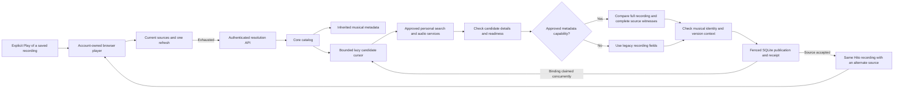

# Automatic audio sources

Automatic source resolution is in development on a separate branch. Its first controlled browser workflow passes, but the normal local server still runs the earlier image. Real Spotify-to-YouTube selection, durable manual correction and native integration remain unfinished.

## Playback and ownership

Ordinary browser Play can start a known recording even when the page's availability snapshot is false. The playback owner tries current sources, one refresh of existing bindings, then one automatic-resolution stage. Unknown retained playlist entries cannot start playback. Loading a page does not start resolution or a persistent download.

Core searches with the recording's inherited metadata, preserving personal display edits. It does not give one plugin another plugin's recording identifier. An accepted alternate source keeps the original recording, primary metadata owner, playlist entries, likes and progress. Automatic associations carry their own policy evidence rather than pretending the user confirmed them.

The public command is `POST /api/v1/recordings/{recording}/sources/resolve` with a nonempty `request_id` UUID. The response contains Hito request, resolution and recording identities, a controlled outcome and current authorized sources. Rust handlers and wire types generate OpenAPI and TypeScript.

## Current policy and bounds

Connections without an approved metadata capability use matching normalized legacy titles and known musical artists. Approved metadata connections can hydrate wrapped video summaries and compare the structured musical title instead. The complete metadata recording must equal the fetched detail, and its complete unique source-witness set must equal the fetched source IDs. Missing or inconsistent enriched evidence rejects the candidate; it does not fall back to the legacy path.

Both paths reject unknown or channel-only musical artists and compare visible live, remix, cover, karaoke, instrumental, slowed and sped-up qualifiers. Enriched matching retains version context from the original video title, structured title, release and album. Both durations must be known and at least one second. The permitted difference is two percent, bounded between three and ten seconds. These thresholds have deterministic fixture coverage; they have not been calibrated against a real music corpus. Additional video qualifier forms still need public regression coverage.

Each attempt considers at most four approved personal connections, twenty search results per connection and three detailed candidates per connection. Exchanges are sequential within an attempt.

Caller admission permits one in-flight resolution call per account and two globally across cloned catalog handles. Excess callers receive a controlled conflict before entering SQLite admission; they do not wait or create observer aliases. Durable pending resolutions retain their account/global limits.

A ten-second budget bounds admission and read-only preparation; a twelve-second lease and token checks fence publication. A started SQLite publication is awaited and can extend beyond the foreground budget. Caller capacity remains held through publication and the final authorized result.

The cursor searches each selected connection once and retains its place within the current provider page. If another operation claims a candidate before publication, the atomic binding check rolls back that publication and advances the same cursor. The resolution retains its original request, receipt, lease, deadline and candidate limits. Other publication conflicts remain errors.

The [musical-metadata endpoint](plugins.md#musical-metadata-in-development) retains track title, album context and source witnesses alongside the full video title. Core now requests that evidence only through an accepted installation's metadata capability. A controlled public workflow resolves `Performer - Song (Official Audio)` without guessing from the wrapper. Enriched decisions retain the bounded SDK response under policy `hito.musical-source.metadata.v1`; migration 0037 adds its nullable JSON field without changing legacy decisions or their digest. Missing provider context can still conceal a recording version. Provider metadata is not acoustic verification, and real automatic YouTube acceptance remains unfinished.

## Retry and cancellation

Core stores durable request receipts. Replaying an accepted UUID returns the same resolution identity and rechecks access before returning current sources. A historical `ready` outcome is not current playback authority. Reusing a request UUID for another recording conflicts.

The browser freezes one UUID and request body. An ambiguous acknowledgement permits one retry with that exact body and the same account-owned cancellation signal. Rejected client requests are not retried automatically. Account or queue replacement cancels the old owner and fences late results. A resolution response cannot replay an audio source already exhausted in that playback cycle.

Supplied cancellation can interrupt read-only candidate work. Once publication starts, core awaits its fenced transaction before settling the caller. If a binding collision rejects that publication, cancellation is checked before further provider IO and settles the same receipt as cancelled. A successful publication still settles as ready after cancellation arrives. Abruptly dropping the entire core future and HTTP disconnect ownership remain separate verification work. No detached cleanup task is used to claim immediate release.

## Verified evidence

- The first public HTTP case passes identity preservation, candidate filtering, immutable receipt replay and current source privacy against a real temporary server, SQLite and owned protocol provider.
- The populated migration-35-to-36 case passes exact preservation of prior typed rows, rowids, migration checksums, sequences, provider binding history, private state, downloads, artwork and preparation references, with foreign-key, integrity and FTS checks. It is an owned fixture, not a stopped whole-volume rehearsal of the normal installation.
- Migration regressions populate 259 and 4,099 bindings with recording, source, artwork, preparation and download references. Actual migration work stays below the unchanged budgets with absent, inherited and fresh planner statistics: approximately 146 to 150 thousand and 1.949 to 1.953 million SQLite VM steps respectively. The original 100,000-recording upgrade also passes, with a 10.3-second reopen in its development smoke test. These are migration checks, not release latency benchmarks.
- The publication-cancellation regression first failed after a held SQLite writer was released. With the fix, the same case passes accepted association settlement, receipt replay, unchanged primary metadata and a subsequent Play without another provider search. The migration and HTTP cases and strict production Clippy pass with that fix.
- Two React-owner cases pass account-switch cancellation and exact-body retry after a lost acknowledgement. They preserve duplicate queue occurrences and use the real browser player with fetch and media boundaries. They do not prove real browser decoding or server restart durability.
- The complete frontend suite passes 220 cases across 61 files, both TypeScript checks and the production build.
- A held provider-source exchange followed by public connection removal now stops later candidate requests. The regression preserves primary metadata, personal edits, activity and duplicate playlist entries. Its active control still reaches the next eligible candidate.
- Public matching cases reject studio-to-live and live-to-studio associations for releases titled `Live`, `Live Sessions` and `Live 1998`. The extended matrix first reproduced an accepted live/studio mismatch, then passed after album context recognized the complete word `live` independently of musical-title qualifiers. A studio song whose musical title is `Live` still resolves and plays its exact owned WAV; that same bare title cannot hide a conflicting live album context.
- When candidate A already belongs to another Hito recording, resolution skips it and selects B. A second case claims A through public adoption after candidate selection, then verifies continuation to B with one search and the original request and budget. Both recordings retain their identities and metadata; A still serves its original WAV and the target plays B's distinct WAV.
- Cancellation during that rejected publication prevents B detail, source and audio requests. Replaying the cancelled receipt returns the same identity without provider IO or private-state changes. The separate successful-publication cancellation case still returns ready. All three cases and strict Clippy pass.
- Six excess same-account calls return controlled Busy while an owner is held. After settlement, its UUID replays and rejected new UUIDs receive distinct fresh receipts. A separate three-account case admits two held owners, rejects the third without provider IO, then admits that account when one owner settles. Its receipts and source access remain private to each account. These cases and their strict Clippy checks pass; whole-future-drop capacity and durable-lease recovery remain separate boundaries.
- The SDK passes seventeen public contract cases with schema generation enabled. YouTube passes nineteen fixture cases, with one live case explicitly ignored, and both pass strict all-target Clippy. New cases cover structured artists, retained video-version titles, malformed lists, legacy fallback and a separate snapshot-bound musical-metadata endpoint. These are owned extractor/HTTP fixtures, not live automatic matching.
- The new host workflow imports two unavailable Spotify-like occurrences, preserves primary metadata, likes and progress, resolves a wrapped video using approved structured metadata, and reads its exact owned WAV through core's authorized audio boundary. No provider audio is requested before that explicit open. This verifies protocol and audio-body ownership, not browser or native decoding.
- A separate source-witness mismatch case reaches actual detail, source and metadata exchanges, then rejects the ready source without publishing an observation or source. Primary and private state remain unchanged; replay returns the same rejection without further provider IO. Both host cases and strict test Clippy pass.
- The selected core resolution regressions, unchanged 100,000-recording upgrade, exact migration-0036 work budget, populated latest-migration preservation, HTTP resolution and strict default-workspace all-target Clippy pass with host metadata consumption. The populated preservation case starts at migration 0035 and ends at 0037; populated 0036 decision-evidence preservation still needs its own case.

Release image `sha256:5c9f204c7fb22705223bc7ca37c69360f50fcf4b5ec67f4b26a7b12ddcc766bf`, built from `47100cb`, passes the isolated Chromium workflow. It imports duplicate unavailable entries, preserves personal edits and likes, presses ordinary Play, rejects incompatible candidates, selects the studio source and advances an owned WAV through Hito's relay. It creates no second recording, manual attachment or persistent download. Health, exact OpenAPI and served JS/CSS, anonymous native-player rejection and fixture log-redaction checks pass on that same image. Its temporary server is stopped.

That image precedes the publication-cancellation fix. A final accepted image must include the fix and pass runtime verification again. Neither this candidate nor the separately verified preparation UI has replaced the normal server.

## Remaining work

Durable manual selection must survive automatic retries, Follow updates and restart. Choosing provider binding B must exclude known-wrong binding A and its saved copies while allowing a verified saved copy of B during an outage. Download admission must not reuse A solely because it belongs to the same recording. Explicit attachment remains an independent operation that adds an alternate source.

Both independent security, correctness and performance review rounds are complete for the first automatic-resolution artifact. The first round found five issues. Public regressions and fixes cover migration child-reference work, candidate calls after revocation, an explicit release titled Live, bounded caller admission and binding collisions before or during publication. The second round passed security and performance source review and found one remaining correctness issue in broader live album contexts. Its public regression and minimal fix pass resolver verification; there was no third review.

At `6d6545b`, workspace formatting, complete core/server all-target tests and strict default-workspace all-target Clippy pass. After the final album-context fix, all ten directed core resolution cases, the HTTP resolution workflow and strict default-workspace all-target Clippy pass. The complete suite predates that final fix; the unchanged frontend evidence above remains separate. These gates do not establish live-provider, final-image, platform or release-scale acceptance.

The separate host musical-metadata implementation passed its first independent security, correctness and performance source reviews. Further public version, malformed-evidence, authority, cancellation and persistence boundaries remain under verification. Those source reviews do not cover future resolver changes or establish runtime acceptance.

Other required work includes retained automatic-decision revalidation after metadata changes, remaining authority and concurrency boundaries, failed-ready-source recovery, real Spotify/YouTube playback, native integration, final review, full upgrade rehearsal and platform, codec and performance gates. The automatic-source item in [TODO.md](../TODO.md) remains open.
