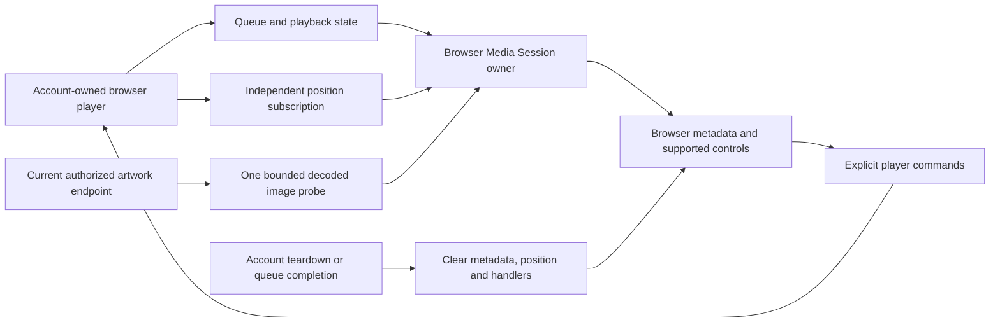

# Browser Now Playing integration

The browser player publishes the current authorized title, artist, verified artwork, duration, position and playback state through the browser's Media Session API. This is deployed to the normal local development server after isolated Chromium/WebKit acceptance and stopped clone and normal preservation audits. Album metadata is not in the current player track contract; native operating-system integration and physical device acceptance remain open.

## Ownership

Position updates publish imperatively and do not rerender catalog pages. The bridge registers supported Play, Pause, seeking, Previous, Next and Stop actions. Play and Pause use explicit commands against the media element's actual paused state, including a pending Play promise. The shared native command adapter also retains explicit Resume/Pause direction; this does not add native OS media controls.

Artwork uses one ten-second probe of the current recording's same-origin authenticated endpoint. Only successfully decoded dimensions are published. The bridge does not start provider artwork retrieval or Download. An existing approved artwork workflow can notify it when a cover becomes ready. Recording/account changes cancel old probes and fence late callbacks.

Account teardown and queue completion clear metadata, playback state, position and registered handlers. Handlers retain an occurrence generation and cannot control a later account or queue occurrence. Missing browser APIs degrade independently without preventing ordinary playback. Display values stay out of workflow logs.

## Verification and limits

The integrated source passes all 273 frontend cases across 88 files, both TypeScript checks and its production build. Directed cases cover partial API support, repeated system Play before the native play event, seeking, track changes, queue completion, Strict Mode, account replacement, stale handlers, invalid positions and late artwork callbacks.

The locally deployed image `sha256:3c2941e1ea009813503c39cd0fb0ca1bfefea5477189d4202c6ae1be5278221c` combines the verified migration-0045 server from application source `83ae186` with shared UI source `0e2a516`. Its Rust application source is unchanged from the prior deployment, and the integrated assets match the tested prototype byte for byte. Fresh Chromium and WebKit workflows pass in 5.6 and 5.7 seconds. They use native Media Session APIs, two owned WAV sources and an authorized decoded cover. They verify metadata and position, Play/Pause/Seek/Next/Previous/Stop, actual advancing audio bound to the expected source after track changes, remembered callback rejection and logout cleanup in the original document. A subsequent artwork request returns 401. No implicit Download, source choice, automatic resolution, external browser request or private console value is accepted.

The test forwards instrumented calls to native APIs before observing them. It invokes the registered system handlers from trusted browser clicks; it does not exercise physical media keys or lock-screen UI. Unsupported engines skip explicitly. Both tested engines expose the required APIs and pass without a skip or autoplay override.

Two test defects were corrected without application changes. The first assertion observed the paused property before the browser delivered its queued pause event. The test now waits within its existing eight-second limit for the same expected Media Session state. This follows the [HTML pause steps](https://html.spec.whatwg.org/multipage/media.html#internal-pause-steps). The logout gate initially tried to evaluate a document during navigation; it now observes actual native clearing in that original document, invokes remembered callbacks there and delivers only bounded boolean evidence. Independent gate review also required exact source identity after Next/Previous. Both final review findings are resolved; production review passes separately.

Chromium and WebKit backend checks examine 2,213 and 2,252 JSON records respectively without the fixed private fixture canaries. Both disposable servers stop with exit zero and no OOM. These counts describe these fixtures, not a complete privacy or reliability audit.

The same deployed image also passes fresh Chromium/WebKit next-entry workflows after integration, preserving background buffering and natural advancement. Local publication retains all nine ordered server configuration files, the prior image alias, fresh backups and unchanged provider services. Health, exact OpenAPI/assets, anonymous player rejection and loopback/LAN checks pass without authenticating a normal listener. See [deployment evidence](status.md#running-local-deployment).

Physical Safari/phone presentation, OS artwork fetching, hardware controls, album publication and native desktop integration remain unverified or unfinished. This feature does not resolve the reported mobile Safari duration/silent-tail bug or establish gapless playback and release latency targets.

## Duration revisions in verified source

The browser player now observes `durationchange` as well as initial metadata. When the browser revises an estimate, the timeline and position subscribers receive the new duration without changing the selected recording, source, queue, speed or heard progress. Nonfinite or negative durations become unknown. The current source, media element and playback generation fence stale events after source changes, prepared-media handoff and account teardown. Repeated identical values do not notify subscribers. A safe debug event records the recording identifier, outcome and handler timing.

Six deterministic public-player cases and 64 related playback regressions pass in Docker, including an independent repeat, both TypeScript checks and formatting. Fresh source review found no unresolved issue. The first regression reproduces a browser estimate changing from 440 to 220 seconds without another metadata event. This qualifies the observation behavior in source only. It is not deployed and does not establish the cause or resolution of the reported physical mobile Safari duration and silent-tail bug.
