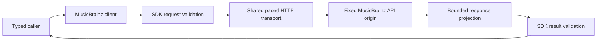

# Built-in MusicBrainz adapter

The `hito-metadata-musicbrainz` crate implements artist search, artist profiles and paged release-group discographies. The core host source composes one shared client and supports account settings and explicitly reviewed recording-credit associations. Search is verified at the adapter boundary; core search, preview and confirmation pages remain unfinished. The running server makes no MusicBrainz requests through this crate.

## Ownership

The adapter owns fixed-origin HTTP, pacing and response projection. It accepts and returns the shared plugin SDK catalog types. It owns no SQLite state, account credentials, artist matching, cache, playback or rendering. Core owns account permissions, provider policy and admission around the shared client.

Production calls use `https://musicbrainz.org/ws/2/`. Construction performs no network request. The endpoint override exists only in crate tests and accepts an owned literal loopback address. Requests identify Hito and the maintenance contact as `Hito/<version> (contact@example.invalid)`. MusicBrainz documents its origin, JSON requests and browse operations in the [API specification](https://musicbrainz.org/doc/MusicBrainz_API), and application identification and pacing in its [rate-limit policy](https://musicbrainz.org/doc/MusicBrainz_API/Rate_Limiting).

## Artist search

Search accepts the shared `ArtistSearchRequest` and returns one `ArtistSearchPage`. It quotes the query as literal text, escapes Lucene punctuation and then URL-encodes the HTTP query parameters. MusicBrainz requires literal escaping separately from URL encoding in its [search protocol](https://musicbrainz.org/doc/MusicBrainz_API/Search). Search runs only when called and never crawls later pages automatically.

Candidates retain canonical, non-nil MusicBrainz artist IDs. Equal names remain separate when IDs differ. Known artist kinds are projected into the shared enum; absent or future kinds remain unknown. Empty optional disambiguation is null. Search results do not create artist associations or change recording metadata.

Continuation cursors bind the exact query and limit through a SHA-256 digest and retain the actual next numeric offset. Changed query, limit or snapshot is rejected before HTTP. The returned offset must match the request; totals cannot fall behind the current page, and offset arithmetic is checked. Search is live and returns a null snapshot. The upstream response creation timestamp is not an immutable catalog snapshot.

## Profiles and discographies

Profile lookups require a canonical MusicBrainz artist identifier. The returned identifier must match exactly. Names never establish an association. Unknown kind, sort name, disambiguation and revision remain nullable.

Discography calls request one release-group page with artist credits. They preserve separate group identities, canonical credited members, credited aliases, join phrases, secondary types and partial dates. A release group does not select an edition or supply that edition's track list. Artist relationships are not treated as similarity recommendations.

Continuation tokens bind the artist, page limit and next numeric offset. They never become URLs. Offsets advance by the number of returned groups, including short pages. The adapter does not crawl subsequent pages. Upstream browse is live, so responses report no immutable snapshot. An unknown total continues after a nonempty page and ends at an empty page.

## Bounds and cancellation

Cloned clients share a one-second request-start gate across search, profiles and discographies. A cancelled waiter releases its place without reserving a later start. The adapter creates no background tasks. The core host separately owns admission and the aggregate caller budget.

Connections have a two-second timeout; each HTTP request has a ten-second total timeout including body reads. Proxy use, redirects and automatic retries are disabled. The transport requests JSON with identity encoding. It caps search bodies at 262,144 bytes, profile bodies at 65,536 bytes and browse bodies at 1,048,576 bytes, checking both declared lengths and received chunks before JSON parsing. Search input is bounded before escaping, hashing or cursor parsing. Shared SDK validation limits normalized search pages to 20 candidates and 65,536 encoded bytes. Errors and workflow logs use static outcomes, correlation IDs, counts and elapsed times rather than raw request or response values.

## Verification and remaining work

All 15 crate tests pass through Docker Compose, together with strict all-target crate Clippy and workspace formatting. The seven search cases cover literal Unicode and punctuation, same-name distinct artists, short-page continuation, changed contexts rejected before HTTP, invalid identities/counts/text, checked offset overflow, exact declared and streamed body limits, redirects and status failures. They also verify shared search/profile pacing and canceled waiters. The earlier eight profile/discography cases retain their assertions. Captures verify active adapter logs omit queries, private names, cursors, snapshots, response bodies and URLs. Fixture shutdown is joined.

Independent security, correctness and performance reviews pass. These are controlled protocol checks, not live MusicBrainz availability, complete pagination-state coverage or public-release acceptance.

The [core profile host](artist-catalog-host.md) supplies evidence associations, built-in defaults, replaceable HTTP preferences and account-scoped cancellation in source. Core candidate discovery and preview, automatic enrichment, persistent bounded caching, HTTP/UI integration, discographies, selected-edition tracks and live integration remain open. Verified core source also retains bounded raw MusicBrainz artist tag assertions and refreshes old inspection metadata without redecoding unchanged audio. See [tag evidence and limits](metadata.md#musicbrainz-artist-tag-evidence-in-verified-source). These assertions do not establish canonical associations. File tags remain the first metadata source; enrichment must preserve personal overrides and work independently of playback availability.
