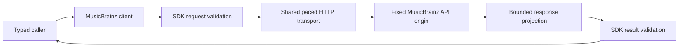

# Built-in MusicBrainz adapter

The `hito-metadata-musicbrainz` crate implements artist search, artist profiles and paged release-group discographies. The core host source composes one shared client and supports account settings and explicitly reviewed recording-credit associations. Core search, preview, confirmation, authenticated HTTP routes and shared recording-detail controls have source and packaged browser verification. The running normal server makes no MusicBrainz requests through this crate.

## Ownership

The adapter owns fixed-origin HTTP, pacing and response projection. It accepts and returns the shared plugin SDK catalog types. It owns no SQLite state, account credentials, artist matching, cache, playback or rendering. Core owns account permissions, provider policy and admission around the shared client.

Production calls use `https://musicbrainz.org/ws/2/`. Construction performs no network request. The endpoint override exists only in crate tests and accepts an owned literal loopback address. Requests identify Hito as `Hito/<version>`, followed by ` (<contact>)` when the operator sets `HITO_METADATA_CONTACT` ([operations](operations.md#metadata-contact)); MusicBrainz asks for a way to reach the operator. MusicBrainz documents its origin, JSON requests and browse operations in the [API specification](https://musicbrainz.org/doc/MusicBrainz_API), and application identification and pacing in its [rate-limit policy](https://musicbrainz.org/doc/MusicBrainz_API/Rate_Limiting).

## Artist search

Search accepts the shared `ArtistSearchRequest` and returns one `ArtistSearchPage`. It quotes the query as literal text, escapes Lucene punctuation and then URL-encodes the HTTP query parameters. MusicBrainz requires literal escaping separately from URL encoding in its [search protocol](https://musicbrainz.org/doc/MusicBrainz_API/Search). Search runs only when called and never crawls later pages automatically.

Candidates retain canonical, non-nil MusicBrainz artist IDs. Equal names remain separate when IDs differ. Known artist kinds are projected into the shared enum; absent or future kinds remain unknown. Empty optional disambiguation is null. Search results do not create artist associations or change recording metadata.

Continuation cursors bind the exact query and limit through a SHA-256 digest and retain the actual next numeric offset. Changed query, limit or snapshot is rejected before HTTP. The returned offset must match the request; totals cannot fall behind the current page, and offset arithmetic is checked. Search is live and returns a null snapshot. The upstream response creation timestamp is not an immutable catalog snapshot.

## Profiles and discographies

Profile lookups require a canonical MusicBrainz artist identifier. The returned identifier must match exactly. Names never establish an association. Unknown kind, sort name, disambiguation and revision remain nullable.

Discography calls request one release-group page with artist credits. They preserve separate group identities, canonical credited members, credited aliases, join phrases, secondary types and partial dates. A release group does not select an edition or supply that edition's track list. Artist relationships are not treated as similarity recommendations.

A typed request (`album`, `ep`, `single` or `other`) adds `type=<name>` to the same browse and is bounded and paced like the whole-catalog browse. Its continuation token also binds the type, uses its own version prefix and cannot continue the whole catalog or another type. Returned groups must match the requested type. Continuation tokens bind the artist, page limit and next numeric offset. They never become URLs. Offsets advance by the number of returned groups, including short pages. The adapter does not crawl subsequent pages. Upstream browse is live, so responses report no immutable snapshot. An unknown total continues after a nonempty page and ends at an empty page.

## Artist links

`artist_wikidata(id)` calls `artist/<id>?inc=url-rels` and returns the Wikidata entity of the first `wikidata` URL relation (`Q` followed by digits), or nothing. The answer must name the requested artist, holds at most 1,024 relations and is capped at 65,536 bytes; a 404 is an empty result. It shares the one-second pacing gate. Search candidates now also carry the MusicBrainz `country` and the year of `life-span.begin` (four digits, otherwise unstated). The [artist photo client](plugin-artwork.md#artist-photos) uses the entity.

## Identifier lookups

`recordings_by_isrc` and `artists_by_url` serve [artist matching from provider evidence](artist-matching.md#matching-from-provider-evidence). The first requires a canonical upper-case ISRC and calls `isrc/<ISRC>?inc=artist-credits`; the second requires a canonical https page address without credentials, port, query or fragment and calls `url?resource=<address>&inc=artist-rels`. Invalid input fails before any HTTP. A 404 is an empty result. Answers must name canonical identifiers, a returned ISRC must equal the requested one, at most 100 recordings or relations are accepted, and bodies are capped at 262,144 bytes. They share the pacing gate, timeouts, disabled redirects and absence of retries described below, and their logs carry only a static outcome, a count and the elapsed time. Six owned protocol cases cover the two lookups, including log redaction. Neither lookup has succeeded against the live service.

`release_group_of` serves the [edition named by the file tags](catalog-browsing.md#edition-named-by-the-file-tags): it requires a canonical release identifier and calls `release/<id>?inc=release-groups`, accepts only an answer with a canonical release id and a canonical release group id (a merged release answers with the surviving id), reads a 404 as unknown and caps the body at 65,536 bytes. It shares the pacing gate, timeouts and absence of retries, and logs only a static outcome and the elapsed time. Two owned protocol cases cover it; it has not succeeded against the live service.

`artist_recordings_matching` serves [name matching](artist-matching.md#matching-by-name-with-corroboration): it takes a canonical lower-case artist identifier and one to six probes (a library title and the length range it may have) and calls `recording?query=arid:<id> AND ((recording:"<title>" AND dur:[<min> TO <max>]) OR …)&limit=40&offset=0`, so that an artist with thousands of recordings answers about the library's titles without being paged. Titles are escaped as a quoted literal like artist search input and sent to MusicBrainz together with the artist identifier; this is the one place library titles leave the host, only while automatic artist lookup is on, at most six titles per request. The answer is the `count` MusicBrainz states and the matching recordings (identifier, title, optional length; the relevance score and release lists are ignored), so a caller knows whether the page covers all matches. A 404 is an empty result; the offset must be zero, at most 40 recordings are accepted and none may repeat, and titles must be nonempty and at most 512 bytes. Invalid artists or probes (none, seven, an empty or oversized title, an inverted range) fail before any HTTP. The body is capped at 2,097,152 bytes because a result lists every release of the recording (about 24 KB each for a popular song). The name search itself reuses the quoted literal credit name. Logs carry the static outcome, the number of probes, the item count and the elapsed time only. Shapes confirmed by manual live requests on 2026-10-31; see [what is verified](artist-matching.md#verification).

`MusicBrainzClient::with_loopback_endpoint` aims a client at an owned fake on a literal loopback address and refuses every other origin. The method and core's `CoreConfig::musicbrainz_loopback_endpoint` exist only under `cfg(any(test, feature = "test-support"))` (the same self dev-dependency pattern as the debrid crates), so a normal server build contains neither and cannot be pointed away from MusicBrainz. Page addresses are also limited to the allowlist in [artist matching](artist-matching.md#matching-from-provider-evidence).

## Genre lookups

`genres(entity, id)` serves the [genre pass of automatic matching](artist-matching.md#musicbrainz-genres). The entity is an artist, a release group or a recording; the identifier must be canonical and lower case, otherwise the call fails before any HTTP. It calls `<entity>/<id>?inc=genres` and reads only the official `genres` list, never the free-form `tags`. The answer must name the requested identifier, hold at most 64 genres and give each a nonempty name of at most 64 bytes; names come back strongest first (by vote count, then name) with case-only repeats removed. A 404 is an empty result. The call shares the pacing gate, timeouts, disabled redirects and absence of retries, caps the body at 262,144 bytes and logs a static outcome, a count and the elapsed time. Five owned protocol cases cover the request targets, the dropped tags, 404 and 503, invalid answers and log redaction. The 2026-11-11 [live enrichment attempt](#live-enrichment-acceptance) verified the artist path and returned 18 genres before another operation failed. Live release-group and recording genre checks remain open.

## Bounds and cancellation

Cloned clients share a one-second request-start gate across search, profiles and discographies. A cancelled waiter releases its place without reserving a later start. The adapter creates no background tasks. The core host separately owns admission and the aggregate caller budget.

Connections have a two-second timeout; each HTTP request has a ten-second total timeout including body reads. Proxy use, redirects and automatic retries are disabled. The transport requests JSON with identity encoding. It caps search bodies at 262,144 bytes, profile bodies at 65,536 bytes and browse bodies at 1,048,576 bytes, checking both declared lengths and received chunks before JSON parsing. Search input is bounded before escaping, hashing or cursor parsing. Shared SDK validation limits normalized search pages to 20 candidates and 65,536 encoded bytes. Errors and workflow logs use static outcomes, correlation IDs, counts and elapsed times rather than raw request or response values.

## Verification and remaining work

All 15 crate tests pass through Docker Compose, together with strict all-target crate Clippy and workspace formatting. The seven search cases cover literal Unicode and punctuation, same-name distinct artists, short-page continuation, changed contexts rejected before HTTP, invalid identities/counts/text, checked offset overflow, exact declared and streamed body limits, redirects and status failures. They also verify shared search/profile pacing and canceled waiters. The earlier eight profile/discography cases retain their assertions. Captures verify active adapter logs omit queries, private names, cursors, snapshots, response bodies and URLs. Fixture shutdown is joined.

Independent security, correctness and performance reviews pass. These are controlled protocol checks, not live MusicBrainz availability, complete pagination-state coverage or public-release acceptance.

## Live integration gate

The ignored `tests/live.rs` case additionally requires `HITO_MUSICBRAINZ_LIVE=1`. It uses the production client and maintenance contact, a literal public artist query, an exact selected identity and at most two discography pages of two items. Its four-request maximum uses the production pacing and timeouts within a 50-second workflow deadline. It checks shared contracts and honest unknown snapshots/revisions without depending on current release titles or ordering. Diagnostics contain only a static stage, error code and numeric HTTP status.

The 2026-10-18 attempts did not pass. One reached discography after successful search and profile reads, then received HTTP 503; another received HTTP 503 at search. An exact read-only search probe also returned HTTP 200, so the observations do not establish a permanent endpoint or request-format failure. No automatic retry, endpoint override or relaxed assertion was added. On 2026-11-09 the unchanged gate passed against the live service: search, profile and two discography pages completed in 3.2 seconds. This is one successful run, not a measure of the service's availability. The 15 owned cases, ignored-by-default live gate, strict all-target crate Clippy and workspace formatting pass; an independent review of the live gate passes.

The [core profile host](artist-catalog-host.md) supplies evidence associations, built-in defaults, replaceable HTTP preferences and account-scoped cancellation in source. [Artist review](artist-review.md) adds candidate discovery, preview, confirmation and shared HTTP/UI workflows. [Artist matching](artist-matching.md) applies embedded file-tag identifiers without any MusicBrainz request, and, while the account's metadata settings select the built-in provider, resolves ISRC codes and provider artist pages through the two identifier lookups above (covered by owned fakes only; the live service has not answered them). Name-based matching uses artist search plus a per-title recording search and accepts an artist only when its recordings corroborate the library (owned fakes only; the live service has not answered these requests). Automatic enrichment, persistent bounded caching, host discographies, selected-edition tracks, normal-server publication and successful live integration remain open. Verified core source also retains bounded raw MusicBrainz artist tag assertions and refreshes old inspection metadata without redecoding unchanged audio. See [tag evidence and limits](metadata.md#musicbrainz-artist-tag-evidence-in-verified-source). These assertions do not establish canonical associations. File tags remain the first metadata source; enrichment must preserve personal overrides and work independently of playback availability.

### Live core acceptance

On 2026-11-09 the ignored `crates/core/tests/artist_catalog/live_musicbrainz.rs` cases ran against the public service through the core artist catalog host: real temporary SQLite, a tagged library file, the built-in production client with its pacing and user agent, and a literal public artist identity confirmed through the normal review path. They require `HITO_MUSICBRAINZ_LIVE=1` and are skipped otherwise. Each case has a 90 second deadline and makes four provider requests (eight in all; the two cases passed in 15 seconds together). Failures name only a static stage or code; no titles are logged.

- Discography case: pages the whole catalog (two pages of up to 10 release groups), checks canonical and non-repeating release-group identities, an album among them, an Album-only typed page whose items are all albums, and the edition listing of one album with at least two distinct canonical edition identities.
- Track-list case: reads one edition's complete track list through the artist path and through the album-page path, checks media and track positions strictly ascending, canonical recording identities, identical results from both paths, and that an unlinked library track never matches.

These runs prove the read path, not a packaged chosen-artist browser flow. Command: `HITO_MUSICBRAINZ_LIVE=1 cargo test -p hito-core --test artist_catalog live_musicbrainz -- --ignored --test-threads=1`.

### Live enrichment acceptance

The ignored `tests/live_enrichment.rs` case additionally requires `HITO_MUSICBRAINZ_LIVE=1`. It checks artist genres, recording corroboration, recording artist identity and an ISRC cross-check through one production client. The public recording reference comes from the official [recording search example](https://musicbrainz.org/doc/MusicBrainz_API/Search#Recording). Four requests at most share the production pacing, maintenance contact and timeouts within a 60-second workflow deadline. Ordinary tests make no request through this case. Explicit execution without opt-in fails before creating the client. Logs contain safe stage codes, counts, timings and request correlations.

The single 2026-11-11 run verified 18 artist genres, then received HTTP 503 during recording corroboration after 1,089 ms overall. Exactly two requests were attempted; recording artist and ISRC checks were not reached. No retry, endpoint override or relaxed assertion followed. MusicBrainz documents several [throttling conditions that return 503](https://musicbrainz.org/doc/MusicBrainz_API/Rate_Limiting); this result does not identify its cause or demonstrate an adapter defect. Recording corroboration and the two unreached identity stages remain unqualified by this automated live check.

An independent source-snapshot Docker repeat passes all 55 owned crate cases, strict all-target Clippy and formatting. Both live cases remain ignored in ordinary execution. It separately verifies the missing-opt-in rejection with external networking disabled. All 3,933 source and support inputs remain unchanged during that repeat. This adds acceptance coverage for existing behavior; it changes no production adapter, running service or frontend.

Run inside the Docker Compose tools container: `HITO_MUSICBRAINZ_LIVE=1 cargo test --locked -p hito-metadata-musicbrainz --test live_enrichment -- --ignored --test-threads=1`.
