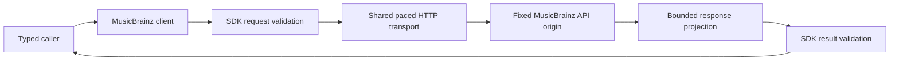

# Built-in MusicBrainz adapter

The `hito-metadata-musicbrainz` crate implements artist profiles and paged release-group discographies. This is a verified client foundation in source. Core provider selection, persistent identity associations, enrichment settings and catalog pages do not call it yet. The running server makes no MusicBrainz requests through this crate.

## Ownership

The adapter owns fixed-origin HTTP, pacing and response projection. It accepts and returns the shared plugin SDK catalog types. It owns no SQLite state, account credentials, artist matching, cache, playback or rendering. A future core host must use one shared client and enforce account permissions and provider policy before calling it.

Production calls use `https://musicbrainz.org/ws/2/`. Construction performs no network request. The endpoint override exists only in crate tests and accepts an owned literal loopback address. Requests identify Hito and the maintenance contact as `Hito/<version> (contact@example.invalid)`. MusicBrainz documents its origin, JSON requests and browse operations in the [API specification](https://musicbrainz.org/doc/MusicBrainz_API), and application identification and pacing in its [rate-limit policy](https://musicbrainz.org/doc/MusicBrainz_API/Rate_Limiting).

## Profiles and discographies

Profile lookups require a canonical MusicBrainz artist identifier. The returned identifier must match exactly. Names never establish an association. Unknown kind, sort name, disambiguation and revision remain nullable.

Discography calls request one release-group page with artist credits. They preserve separate group identities, canonical credited members, credited aliases, join phrases, secondary types and partial dates. A release group does not select an edition or supply that edition's track list. Artist relationships are not treated as similarity recommendations.

Continuation tokens bind the artist, page limit and next numeric offset. They never become URLs. Offsets advance by the number of returned groups, including short pages. The adapter does not crawl subsequent pages. Upstream browse is live, so responses report no immutable snapshot. An unknown total continues after a nonempty page and ends at an empty page.

## Bounds and cancellation

Cloned clients share a one-second request-start gate across profiles and discographies. A cancelled waiter releases its place without reserving a later start. The adapter creates no background tasks. Host admission and an overall caller budget remain the future host's responsibility.

Connections have a two-second timeout; each HTTP request has a ten-second total timeout including body reads. Proxy use, redirects and automatic retries are disabled. The transport requests JSON with identity encoding. It caps profile bodies at 65,536 bytes and browse bodies at 1,048,576 bytes, checking both declared lengths and received chunks before JSON parsing. Shared SDK validation bounds the normalized result. Errors and workflow logs use static outcomes, correlation IDs, counts and elapsed times rather than raw request or response values.

## Verification and remaining work

All eight crate tests pass through Docker Compose, together with strict all-target crate Clippy and workspace formatting. Owned HTTP fixtures verify exact request headers and identity, shared pacing and cancelled reservations, short-page continuation, changed cursor contexts, profile and browse body limits, MIME rejection, redirect rejection and private error bodies. Exact-limit and one-byte-overflow cases cover declared and streamed transfer lengths. Captures verify active adapter logs omit private names, cursors, snapshots and URLs. Fixture shutdown is joined.

Independent security, correctness and performance reviews pass. These are controlled protocol checks, not live MusicBrainz availability, complete pagination-state coverage or public-release acceptance.

Remaining work includes evidence-backed artist associations, a generic authorized core catalog host, built-in default and replaceable HTTP provider preferences, persistent bounded caching, account-scoped cancellation, artist/discography UI, selected-edition tracks and live integration. File tags must remain the first metadata source, personal overrides must survive enrichment, and metadata outages must not block the library or playback.
