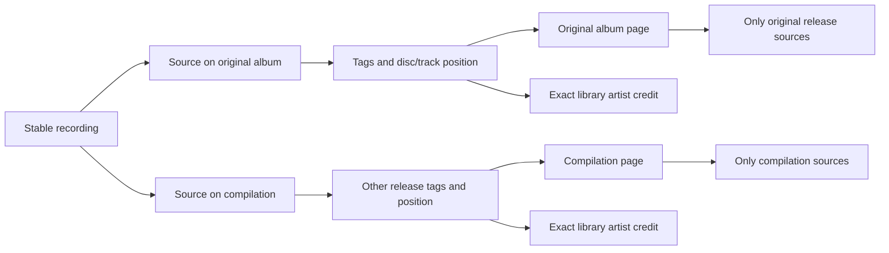
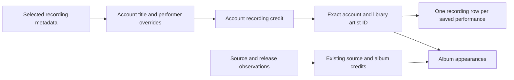
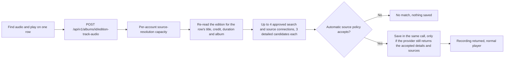
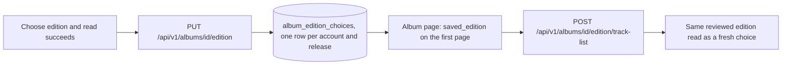

# Artists and albums

The sidebar opens Albums and Artists alongside the track library. Albums show the account's effective title and album credit, cover, track count, and ordered track list. An artist page lists recordings with that account's selected performer credit and releases carrying its exact source, recording performer or album credit. Search on each index stays within that collection. Navigation keeps the account's player running.

Search uses FTS5 `unicode61` with case and diacritic folding and prefix matching for each word, as track search does. Searching `BJÖRK` can find `Björk`. Identity remains an exact, case-sensitive credit scoped to the account and library. Hito does not split `Artist feat. Guest` or infer that equal names identify the same person. Personal fields are described in [metadata editing](metadata.md). A credit also leaves the Artists list once every recording and release it holds belongs to a [chosen artist group](artist-identity-groups.md); that group card replaces it. Automatic provider matching remains future work.

## Recordings have release appearances

A recording identifies a performance. Its sources can describe several releases, so the recording's selected display metadata cannot define all album membership.

Album membership follows source metadata. Equal recordings at distinct disc/track positions retain separate occurrences. Copies sharing the recording and position collapse to one row. Unknown positions sort after known track numbers within their disc; titles break ties. Local release identity remains conservative and includes the parent directory, album tag, and album-artist tag. Matching album names in separate folders do not establish that two releases are identical.

Album cards, headers, and track rows request release-scoped artwork. They never borrow a cover from another release of the same performance. Embedded/folder cover reading retains the existing ownership checks, budgets, and four-reader limit. Responses are private and not stored in shared caches. Missing artwork stays neutral.

Track playback uses stable recording IDs. Likes and playlists therefore keep their references when metadata changes. Album queue rows use separate occurrence IDs, retaining repeated performances. Results are paged, with 60 entries by default and a maximum of 200. An album or artist track collection spanning pages offers **Play this page**. Artist recording and album pages have independent offsets; changing one preserves the other. A page emptied by later changes keeps Previous available, and a collection with no available tracks cannot start playback. Complete playback across catalog pages remains tracked in TODO.md.

## Provider albums with unknown album artists

A provider can identify a release without supplying its album artist. Hito retains the verified release ID and title, disc/track positions and recording performers. Its album artist and artist ID are null. The album header, album cards and search album results show the server's inference (the named artist, or "Various artists") as plain text and never as a guessed artist link. The web app falls back to the artists of the loaded tracks only when a payload lacks the field entirely; a null inference means the server found nothing to claim, so no credit is shown (search says "Unknown artist"). Home's recent albums keep the artist string that the home read supplies. The server infers a display album artist itself so every surface agrees: `Release.inferred_artist` is a typed value, `{"kind":"named","name":...}` when every track names the same artist (compared without case or surrounding spacing) and `{"kind":"various"}` when the tracks name different or some unnamed artists. It is null when the release has an album artist (stated or personal; those always win) or no track names an artist. It is computed on read from the tracks' stored artists, never stored, never an artist link, and not affected by track-level personal edits (the list read has no per-account recording fields). The same value appears in album lists, album detail and artist pages. A recording performer does not establish an album artist.

Provider release appearances exist independently of playable sources. Importing metadata can therefore create an unavailable album page without requesting audio or creating a download. Repeated playlist entries retain their stable entry IDs; the same recording at the same album position contributes one album row. Album reads combine these appearances with source metadata and retain the provider binding for later source refresh.

An account can set a personal album artist and return to the provider value, including null. This changes that account's grouping without changing recording metadata, provider observations, playlist entries or another account's fields.

Migration 0045 permits unknown album credits while retaining populated release rows and their references. A populated 0044-to-0045 fixture checks typed rows, rowids, receipts, sequences, migration checksums, foreign keys and search state. Separate deterministic work tests cover migration with 2,048 albums across ten accounts, and fixed 96-track catalog reads with up to 4,096 unrelated source copies. These are query-work guards, not the release latency benchmark.

The packaged Chromium workflow imports three occurrences of two source-free recordings, browses the album and performers, edits and resets the private album credit, and checks unchanged identities and provenance, no audio requests and no download writes. The combined frontend passes 246 tests; 297 distinct core cases and 135 server cases pass across the full run and focused fixture corrections, with one usual core fault test ignored. Generated contracts and strict all-target Clippy pass for the affected backend packages. The package is deployed on the normal local server after a stopped backup, restored-clone rehearsal and preservation audit. Existing Spotify copies can now use the separately verified [missing-album lookup](playlist-metadata-refresh.md).

## Recordings without albums

A saved recording has a selected effective artist even when a provider supplies no release or no sources. Hito shows that artist and its real tracks without creating an album. Removing a connection withdraws audio availability while retaining recordings, credits, and private collection references.

The Tracks section uses selected recording metadata, personal fields, likes, and current source availability. Album appearances retain their source-specific titles and performers. A performer credited only on an alternate source or an album can therefore have album appearances without a selected recording track. Artist names remain exact scoped labels, not canonical provider people or inferred matches.

`GET /api/v1/recordings?artist=<credit-id>` filters by the authenticated account's exact recording credit. Artist detail returns separate `recordings` and `releases` pages. `offset` pages albums, `recording_offset` pages recordings, and `limit` bounds each page to 1–200, default 60. The web uses the same detail read and URL parameters. Searching an artist's name does not replace that identity filter.

## Complete track list on an album page

An album page can compare its library tracks with a catalog edition. The page shows **Show complete track list** on its first page when one of the album's recordings has a confirmed artist identity (the same review used in Recording Details) that Hito can still use now. Core checks that metadata providers are enabled, the association's provider is selected and installed, and the recording's current credit still equals the reviewed one. It prefers a recording credited to the album artist over a featured credit, then the earliest track. Later pages of a long album do not offer the action. Loading the page makes no catalog request. The button reads the reviewed artist, then the first discography page. The user picks a release group, an edition, and **Choose edition**. Only that choice reads the edition's tracks.

```mermaid
flowchart LR
  Page[Album page] --> Anchor[First album track with a confirmed artist]
  Anchor --> Browse[Discography, editions, Choose edition]
  Browse --> Read[POST /api/v1/albums/id/edition-track-list]
  Read --> Provider[Reviewed provider reads the edition]
  Provider --> Merge[Core matches tracks by provider recording ID]
  Merge --> Rows[Disc and track order with library and catalog-only rows]
  Rows -->|Play on a catalog-only row| Save[Save through the same provider, then play]
```

Rows follow the provider's disc and track order, including repeated recordings, bonus discs, pregaps and data tracks. A row is "In your library" only when the provider recording ID of the occurrence equals the current, non-retired primary identity of a recording this account can access, on the same installation, and that identity is the recording's current metadata binding. A provider ID that is only attached as audio to another recording stays catalog-only, says so and offers no Play, because saving it would return that other recording. Equal titles never match, and a track without a provider recording ID stays catalog-only. The row shows the account's own title when it has one. Album recordings that the edition does not list appear under a separate heading. The built-in MusicBrainz provider has no stored recording identities, so its rows are all catalog-only and cannot be saved from here. They can look for audio instead, as described next.

Play on a catalog-only row saves that one recording through the provider that served the edition, using the existing metadata and source adoption, and then starts playback. The normal playback owner finds audio, including automatic resolution through other approved providers. Reading the list saves nothing, creates no download and starts no audio. The album's own table keeps working during a provider outage, and the section shows that the list is unavailable with an explicit retry. Leaving the page cancels a pending read or save.

### Finding audio for tracks the catalog provider cannot save

A catalog-only row offers **Play** only when the provider that served the edition can also save recordings and identifies the track. Every other audio row (the built-in MusicBrainz provider, a catalog-only plugin, or a track without a provider identity) offers **Find audio and play**. The action asks the account's own approved connections that offer both search and sources, saves the one recording that passes the automatic source policy, and plays it. It never uses names to link a row to a library recording.

The request names the album, the anchor recording, the reviewed association, the release group, the edition and the occurrence. It carries no title, artist or duration, so the evidence always comes from a fresh provider read under the same authority checks as the track list. Only audio rows of that edition qualify; unknown occurrences and pregap or data rows return not found.

The match uses the same policy as automatic source resolution: equal normalized title and a known equal artist, durations within two percent (three to ten seconds), matching version qualifiers such as live or remix, a ready source and, for connections with the metadata capability, complete musical metadata. The server enforces this, not the web app. The save is part of the same call: it fetches the provider's recording again and saves it only if the details and the ready-source list equal what the policy accepted. A provider that changes its answer in between gets the `changed` outcome and nothing is saved. A candidate already saved in the library returns that same recording, so repeating the search creates no duplicate. The general save route used by Discover is unchanged and is the user's own explicit choice.

A catalog row with an unknown or collective credit (such as Various Artists), or without a length of at least one second, cannot be searched and reports `insufficient_evidence` instead of a failed match. A joined credit such as "A feat. B" is compared as that whole text, so it matches only a provider artist spelled the same way.

The route takes the same per-account capacity as source resolution, so one account cannot start parallel searches and a search cannot starve playback resolution. A second request while one runs gets `busy` without any provider call.

Outcomes: `saved`, `no_match`, `insufficient_evidence`, `no_providers`, `busy`, `changed`, `unavailable` (a provider failed or the 15-second budget ended), `cancelled`, `disabled`, `unsupported` and `needs_choice`. Failures are shown on the row with the button still enabled, so the user can retry, and the album table and library rows stay playable. The web app keeps found recordings per album, edition and occurrence, and switching edition cancels a pending search. The saved recording is the audio provider's own recording. The catalog row is not linked to it after a reload, so a later visit shows the row as catalog-only again and finding audio returns the same saved recording.

Logs record the outcome, connection and candidate counts and timings only.

### Remembered edition

After a successful read, **Choose edition** also remembers the choice for this album and this account. On later visits the album page shows **Show complete track list** and reads that edition directly. There is no discography or edition browsing. The list has **Change edition**, which opens the browser again, and **Forget edition**, which clears the choice. Loading the page still makes no catalog request, and the saved read happens only when the user clicks.

The link stores the account, the library release ID, the reviewed anchor recording and artist association (which fixes the provider installation), the release-group ID and the edition ID. Each change increments a revision. Setting and clearing take the revision the client last saw and a request ID. A conflicting revision is rejected, repeating a request ID with the same contents returns the first receipt, and reusing it with different contents is a conflict. Receipts are immutable and kept.

The page reports one of three states. Unset means no edition is remembered. Ready means the link is usable now. Needs choice means a link exists but cannot be read: metadata providers are disabled, the provider is no longer selected or installed, the artist credit changed, or the anchor recording left the album. A needs-choice link makes no provider request and leaks nothing but its revision. The row is kept, so re-enabling the provider makes it ready again. The user chooses again to replace it. Only the owning account sees or changes a link. Another account gets not found. Later pages of a long album carry no saved edition.

Logs record outcomes, counts and timings, never edition, release-group or provider identifiers.

Limits. The album must have at most 1,000 tracks to be compared. The server cannot check that a chosen edition still exists at the provider when it saves the link, so the web app saves only after a successful read. If the provider later drops the edition, the list reports unavailable and the user can change or forget it. When the album was saved from the chosen edition's own provider release, the list says so. Live-provider acceptance is still open.

The chosen-artist [discography](artist-discography.md#comparing-a-linked-album-with-its-edition) can ask how much of the remembered edition an album holds: `POST /api/v1/albums/{id}/edition/library-level` reuses this read and answers In library, Partly in library or Linked with "n of m tracks". It runs only when the user asks and fetches nothing without a remembered edition.

## Ownership and indexing

`Catalog` owns access, grouping, paging, and typed reads. JSON and Inertia adapters use the same capability. HTTP responses and artwork references include only libraries the account can access; private detail IDs return not found. Browser pagination preserves active filters and page size without logging query values.

Account artist rows have stable opaque IDs for exact library credits. Their initial observed IDs are preserved; later personal labels stay outside the shared observed registry. Account recording/source-to-credit links and effective releases are indexed by account and artist ID. Source inspection, accepted personal edits, and new membership grants update the affected account relations inside their core transaction. Legacy witness adoption uses the same source writer. Recording credits also refresh when selected local metadata changes or a folder/source owner fails over. Provider adoption updates them even with an empty source list. These changes share the existing write transaction; future metadata writers must retain that boundary.

Album aggregation starts from selected releases before visiting source metadata. Artist summaries start from selected credits and indexed source links. These join constraints avoid scanning unrelated metadata and the repeated artist-by-album lookup found during review.

## Upgrades and limits

Migrations 0009 through 0012 add positions, exact credits, Unicode search, and source-credit links. Existing rows receive credit/search backfills. A separate metadata inspection version makes the next ordinary scan refresh old cached tags without changing the decoded-audio identity algorithm. Until rescanned, old files may have unknown disc/track positions. Originals and personal references remain intact.

Migration 0021 backfills effective recording credits from existing records and account overrides, retaining previously registered artist IDs. No rescan or provider request is needed.

The backfill visits recordings and library members before looking up each exact account artist. A real SQLx migration regression closes and reopens a 100,000-recording database with ten accounts and 100,000 existing account artists, both without statistics and after `ANALYZE`. A SQLite progress handler limits upgrade work to 250 million VM operations. Both cases take about 106 million operations in the targeted Docker run, preserving one million credits and existing artist IDs. This guards against an artist-by-recording scan; it does not establish playback latency or concurrent-listener targets.

Public fixture tests cover albumless and source-free provider records, private edits/reset/refresh, owner failover, prior-database backfill, independent JSON/Inertia paging, unavailable retention, alternate releases for shared audio, repeated positions, duplicate copies, cached positions, exact credits, Unicode/literal search, retags, artwork isolation, permissions, and playback order. Docker browser checks cover artist/album navigation, persistent playback, and phone layout. Review diagnostics use synthetic SQLite catalogs and are not release latency benchmarks.

Personal recording title/artist and album title/artist fields, private grouping, and local provenance are implemented in [metadata details](metadata.md). Provider-backed matching/enrichment, canonical artist identities, appearance corrections, and final compatibility/performance acceptance remain unfinished.

Listening history rows carry the track's album (`album` and `release_id`, read from the account's catalog like a track list) so the Album column links to the album. Home also reads `recently_added`, the twelve newest albums of the account's open libraries that hold at least one non-podcast recording, in one bounded query; their credit uses the same inferred artist as other album lists. Recently played albums are capped at twelve.
