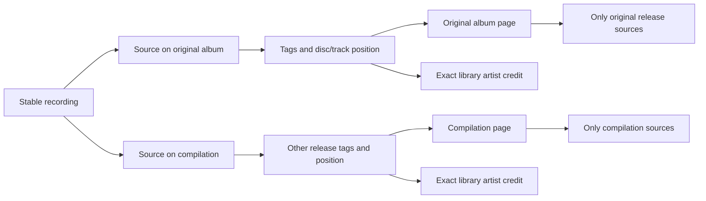
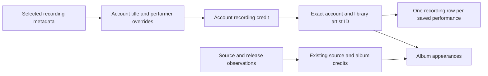

# Artists and albums

The sidebar opens Albums and Artists alongside the track library. Albums show the account's effective title and album credit, cover, track count, and ordered track list. An artist page lists recordings with that account's selected performer credit and releases carrying its exact source or album credit. Search on each index stays within that collection. Navigation keeps the account's player running.

Search uses FTS5 `unicode61` with case and diacritic folding and prefix matching for each word, as track search does. Searching `BJÖRK` can find `Björk`. Identity remains an exact, case-sensitive credit scoped to the account and library. Hito does not split `Artist feat. Guest` or infer that equal names identify the same person. Personal fields are described in [metadata editing](metadata.md). Provider-backed artist identities and matching remain future work.

## Recordings have release appearances

A recording identifies a performance. Its sources can describe several releases, so the recording's selected display metadata cannot define all album membership.

Album membership follows source metadata. Equal recordings at distinct disc/track positions retain separate occurrences. Copies sharing the recording and position collapse to one row. Unknown positions sort after known track numbers within their disc; titles break ties. Local release identity remains conservative and includes the parent directory, album tag, and album-artist tag. Matching album names in separate folders do not establish that two releases are identical.

Album cards, headers, and track rows request release-scoped artwork. They never borrow a cover from another release of the same performance. Embedded/folder cover reading retains the existing ownership checks, budgets, and four-reader limit. Responses are private and not stored in shared caches. Missing artwork stays neutral.

Track playback uses stable recording IDs. Likes and playlists therefore keep their references when metadata changes. Album queue rows use separate occurrence IDs, retaining repeated performances. Results are paged, with 60 entries by default and a maximum of 200. An album or artist track collection spanning pages offers **Play this page**. Artist recording and album pages have independent offsets; changing one preserves the other. A page emptied by later changes keeps Previous available, and a collection with no available tracks cannot start playback. Complete playback across catalog pages remains tracked in TODO.md.

## Recordings without albums

A saved recording has a selected effective artist even when a provider supplies no release or no sources. Hito shows that artist and its real tracks without creating an album. Removing a connection withdraws audio availability while retaining recordings, credits, and private collection references.

The Tracks section uses selected recording metadata, personal fields, likes, and current source availability. Album appearances retain their source-specific titles and performers. A performer credited only on an alternate source or an album can therefore have album appearances without a selected recording track. Artist names remain exact scoped labels, not canonical provider people or inferred matches.

`GET /api/v1/recordings?artist=<credit-id>` filters by the authenticated account's exact recording credit. Artist detail returns separate `recordings` and `releases` pages. `offset` pages albums, `recording_offset` pages recordings, and `limit` bounds each page to 1–200, default 60. The web uses the same detail read and URL parameters. Searching an artist's name does not replace that identity filter.

## Ownership and indexing

`Catalog` owns access, grouping, paging, and typed reads. JSON and Inertia adapters use the same capability. HTTP responses and artwork references include only libraries the account can access; private detail IDs return not found. Browser pagination preserves active filters and page size without logging query values.

Account artist rows have stable opaque IDs for exact library credits. Their initial observed IDs are preserved; later personal labels stay outside the shared observed registry. Account recording/source-to-credit links and effective releases are indexed by account and artist ID. Source inspection, accepted personal edits, and new membership grants update the affected account relations inside their core transaction. Legacy witness adoption uses the same source writer. Recording credits also refresh when selected local metadata changes or a folder/source owner fails over. Provider adoption updates them even with an empty source list. These changes share the existing write transaction; future metadata writers must retain that boundary.

Album aggregation starts from selected releases before visiting source metadata. Artist summaries start from selected credits and indexed source links. These join constraints avoid scanning unrelated metadata and the repeated artist-by-album lookup found during review.

## Upgrades and limits

Migrations 0009 through 0012 add positions, exact credits, Unicode search, and source-credit links. Existing rows receive credit/search backfills. A separate metadata inspection version makes the next ordinary scan refresh old cached tags without changing the decoded-audio identity algorithm. Until rescanned, old files may have unknown disc/track positions. Originals and personal references remain intact.

Migration 0021 backfills effective recording credits from existing records and account overrides, retaining previously registered artist IDs. No rescan or provider request is needed.

The backfill visits recordings and library members before looking up each exact account artist. A real SQLx migration regression closes and reopens a 100,000-recording database with ten accounts and 100,000 existing account artists, both without statistics and after `ANALYZE`. A SQLite progress handler limits upgrade work to 250 million VM operations. Both cases take about 106 million operations in the targeted Docker run, preserving one million credits and existing artist IDs. This guards against an artist-by-recording scan; it does not establish playback latency or concurrent-listener targets.

Public fixture tests cover albumless and source-free provider records, private edits/reset/refresh, owner failover, prior-database backfill, independent JSON/Inertia paging, unavailable retention, alternate releases for shared audio, repeated positions, duplicate copies, cached positions, exact credits, Unicode/literal search, retags, artwork isolation, permissions, and playback order. Docker browser checks cover artist/album navigation, persistent playback, and phone layout. Review diagnostics use synthetic SQLite catalogs and are not release latency benchmarks.

Personal recording title/artist and album title/artist fields, private grouping, and local provenance are implemented in [metadata details](metadata.md). Provider-backed matching/enrichment, canonical artist identities, appearance corrections, and final compatibility/performance acceptance remain unfinished.
