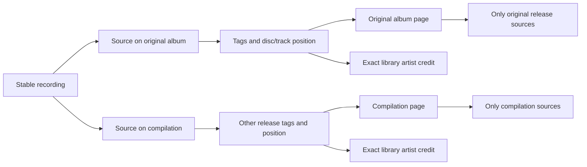

# Artists and albums

The sidebar opens Albums and Artists alongside the track library. Albums show their tagged credit, cover, track count, and ordered track list. An artist page lists releases carrying that exact artist or album credit. Search on each index stays within that collection. Navigation keeps the account's player running.

Search uses FTS5 `unicode61` with case and diacritic folding and prefix matching for each word, as track search does. Searching `BJÖRK` can find `Björk`. Identity remains an exact, case-sensitive, library-scoped credit. Hito does not split `Artist feat. Guest` or infer that equal names identify the same person. Provider-backed artist identities and correction tools remain future work.

## Recordings have release appearances

A recording identifies a performance. Its sources can describe several releases, so the recording's selected display metadata cannot define all album membership.

Album membership follows source metadata. Equal recordings at distinct disc/track positions retain separate occurrences. Copies sharing the recording and position collapse to one row. Unknown positions sort after known track numbers within their disc; titles break ties. Local release identity remains conservative and includes the parent directory, album tag, and album-artist tag. Matching album names in separate folders do not establish that two releases are identical.

Album cards, headers, and track rows request release-scoped artwork. They never borrow a cover from another release of the same performance. Embedded/folder cover reading retains the existing ownership checks, budgets, and four-reader limit. Responses are private and not stored in shared caches. Missing artwork stays neutral.

Track playback uses stable recording IDs. Likes and playlists therefore keep their references when metadata changes. Album queue rows use separate occurrence IDs, retaining repeated performances. Results are paged, with 60 entries by default and a maximum of 200. An album spanning pages offers **Play this page**. Complete playback across catalog pages remains tracked in TODO.md.

## Ownership and indexing

`Catalog` owns access, grouping, paging, and typed reads. JSON and Inertia adapters use the same capability. HTTP responses and artwork references include only libraries the account can access; private detail IDs return not found. Browser pagination preserves active filters and page size without logging query values.

Artist registry rows have stable opaque IDs for exact library credits. Source-to-credit links are indexed by artist ID. The source metadata writer updates those links in the same transaction as tag observations and recording display ownership. Legacy witness adoption uses that same writer. Future metadata writers must retain this transaction boundary.

Album aggregation starts from selected releases before visiting source metadata. Artist summaries start from selected credits and indexed source links. These join constraints avoid scanning unrelated metadata and the repeated artist-by-album lookup found during review.

## Upgrades and limits

Migrations 0009 through 0012 add positions, exact credits, Unicode search, and source-credit links. Existing rows receive credit/search backfills. A separate metadata inspection version makes the next ordinary scan refresh old cached tags without changing the decoded-audio identity algorithm. Until rescanned, old files may have unknown disc/track positions. Originals and personal references remain intact.

Public fixture tests cover alternate releases for shared audio, repeated positions, duplicate copies, cached positions, exact credits, Unicode/literal search, retags, artwork isolation, permissions, and playback order. Docker browser checks cover artist/album navigation, persistent playback, and phone layout. Review diagnostics use synthetic SQLite catalogs and are not release latency benchmarks.

Metadata provenance APIs, personal overrides, provider-backed matching/enrichment, canonical artist identities, and final compatibility/performance acceptance remain unfinished.
