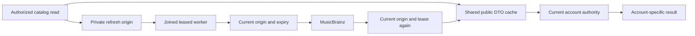
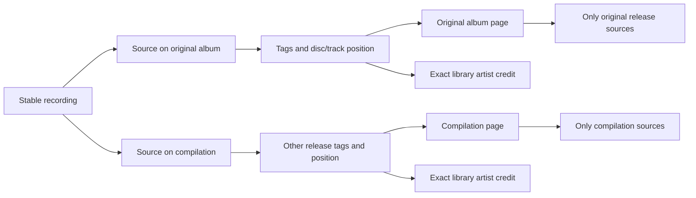
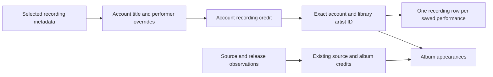
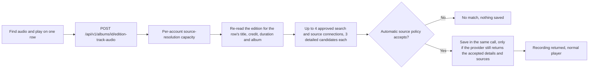
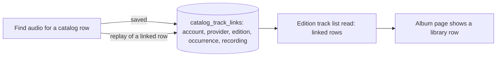
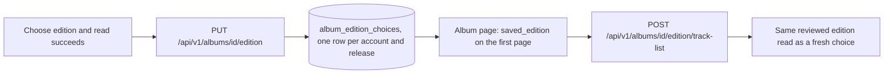
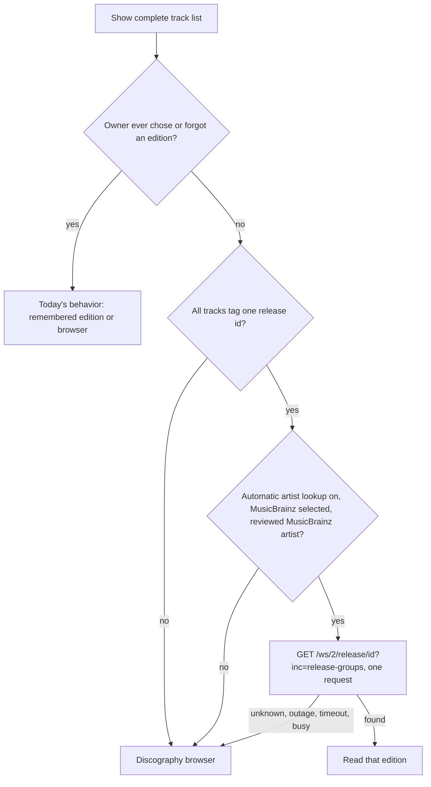
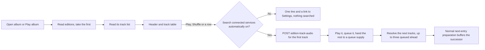
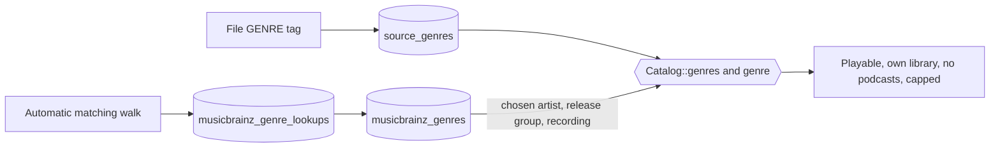

# Artists and albums

The sidebar opens Albums and Artists alongside the track library. Albums show the account's effective title and album credit, cover, track count, and ordered track list. An artist page lists recordings with that account's selected performer credit and releases carrying its exact source, recording performer or album credit. Search on each index stays within that collection. Navigation keeps the account's player running.

Search uses FTS5 `unicode61` with case and diacritic folding and prefix matching for each word, as track search does. Searching `BJÖRK` can find `Björk`. Identity remains an exact, case-sensitive credit scoped to the account and library. Hito does not split `Artist feat. Guest` or infer that equal names identify the same person. Personal fields are described in [metadata editing](metadata.md). A credit also leaves the Artists list once every recording and release it holds belongs to a [chosen artist group](artist-identity-groups.md); that group card replaces it. Automatic provider matching remains future work.

## Catalog cache in development

The isolated backend cache branch now reuses validated public MusicBrainz profiles, discography pages, release-group edition pages and edition tracks. This work is not integrated or deployed. The fresh-provider behavior described later remains the deployed baseline. The cache contains provider data, never assembled account pages, personal choices or confirmation contexts. Account access, credit and metadata policy are checked again before returning a result.

Stale reads can return the last validated copy while bounded background work refreshes it. Retained reads and unconfirmed artist previews have different durable origin tags. An unconfirmed preview creates no artist association; its origin stores account and recording ownership, policy and digests of current credit and corrections. Sessions, raw review contexts and credited text are not persisted in refresh jobs. Only an authorized explicit read creates or renews interest. Retrying a job does not renew it.

The missing preview refresh has a preserved failing/passing protocol test. On the passing source, thirty-five named executions cover the new held refresh, the twenty-five-case cache prefix, database ownership, table classification and existing review behavior. This is development evidence with temporary SQLite and owned protocol fixtures. Four additional controls verify the five-minute Review boundary before upstream I/O and publication, retry non-renewal, and renewal by a new explicit authorized read.

The artist-preview title path also reuses the complete cached discography page, including its continuation. Its failing/passing regression and forty-one affected executions pass. Five additional controls cover full-page reuse, limit separation, personal HTTP-provider scope, stale refresh, policy withdrawal and a cancelled waiting account. The complete retained-origin lifetime, authority-withdrawal, erasure and upgrade matrix, indexed capacity bounds, full affected verification and independent final review remain open. See [current evidence](status.md#2026-11-12-backend-cache-and-credential-work-in-progress).

## Recordings have release appearances

A recording identifies a performance. Its sources can describe several releases, so the recording's selected display metadata cannot define all album membership.

Album membership follows source metadata. Equal recordings at distinct disc/track positions retain separate occurrences. Copies sharing the recording and position collapse to one row. Unknown positions sort after known track numbers within their disc; titles break ties. Local release identity remains conservative and includes the parent directory, album tag, and album-artist tag. Matching album names in separate folders do not establish that two releases are identical.

Album cards, headers, and track rows request release-scoped artwork. They never borrow a cover from another release of the same performance. Embedded/folder cover reading retains the existing ownership checks, budgets, and four-reader limit. Responses are private and not stored in shared caches. Missing artwork stays neutral.

Track playback uses stable recording IDs. Likes and playlists therefore keep their references when metadata changes. Album queue rows use separate occurrence IDs, retaining repeated performances. Results are paged, with 60 entries by default and a maximum of 200. An album or artist track collection spanning pages offers **Play this page**. Artist recording and album pages have independent offsets; changing one preserves the other. A page emptied by later changes keeps Previous available, and a collection with no available tracks cannot start playback. Complete playback across catalog pages remains tracked in TODO.md.

## Provider albums with unknown album artists

A provider can identify a release without supplying its album artist. Hito retains the verified release ID and title, disc/track positions and recording performers. Its album artist and artist ID are null. The album header, album cards and search album results show the server's inference (the named artist, or "Various artists") as plain text and never as a guessed artist link. The web app falls back to the artists of the loaded tracks only when a payload lacks the field entirely; a null inference means the server found nothing to claim, so no credit is shown (search says "Unknown artist"). Home's recent albums keep the artist string that the home read supplies. The server infers a display album artist itself so every surface agrees: `Release.inferred_artist` is a typed value, `{"kind":"named","name":...}` when every track names the same artist (compared without case or surrounding spacing) and `{"kind":"various"}` when the tracks name different or some unnamed artists. It is null when the release has an album artist (stated or personal; those always win) or no track names an artist. It is computed on read from the tracks' stored artists, never stored, never an artist link, and not affected by track-level personal edits (the list read has no per-account recording fields). The same value appears in album lists, album detail and artist pages. A recording performer does not establish an album artist.

Provider release appearances exist independently of playable sources. Importing metadata can therefore create an unavailable album page without requesting audio or creating a download. Repeated playlist entries retain their stable entry IDs; the same recording at the same album position contributes one album row. Album reads combine these appearances with source metadata and retain the provider binding for later source refresh.

An account can set a personal album artist and return to the provider value, including null. This changes that account's grouping without changing recording metadata, provider observations, playlist entries or another account's fields.

Migration 0045 permits unknown album credits while retaining populated release rows and their references. A populated 0044-to-0045 fixture checks typed rows, rowids, receipts, sequences, migration checksums, foreign keys and search state. Separate deterministic work tests cover migration with 2,048 albums across ten accounts, and fixed 96-track catalog reads with up to 4,096 unrelated source copies. These are query-work guards, not the release latency benchmark.

The packaged Chromium workflow imports three occurrences of two source-free recordings, browses the album and performers, edits and resets the private album credit, and checks unchanged identities and provenance, no audio requests and no download writes. The combined frontend passes 246 tests; 297 distinct core cases and 135 server cases pass across the full run and focused fixture corrections, with one usual core fault test ignored. Generated contracts and strict all-target Clippy pass for the affected backend packages. The package is deployed on the normal local server after a stopped backup, restored-clone rehearsal and preservation audit. Existing Spotify copies can now use the separately verified [missing-album lookup](playlist-metadata-refresh.md).

## Recordings without albums

A saved recording has a selected effective artist even when a provider supplies no release or no sources. Hito shows that artist and its real tracks without creating an album. Removing a connection withdraws audio availability while retaining recordings, credits, and private collection references.

The Tracks section uses selected recording metadata, personal fields, likes, and current source availability. Album appearances retain their source-specific titles and performers. A performer credited only on an alternate source or an album can therefore have album appearances without a selected recording track. Artist names remain exact scoped labels, not canonical provider people or inferred matches.

`GET /api/v1/recordings?artist=<credit-id>` filters by the authenticated account's exact recording credit. Artist detail returns separate `recordings` and `releases` pages. `offset` pages albums, `recording_offset` pages recordings, and `limit` bounds each page to 1–200, default 60. The web uses the same detail read and URL parameters. Searching an artist's name does not replace that identity filter.

## Complete track list on an album page

An album page can compare its library tracks with a catalog edition. The page shows **Show complete track list** on its first page when one of the album's recordings has a confirmed artist identity (the same review used in Recording Details) that Hito can still use now. Core checks that metadata providers are enabled, the association's provider is selected and installed, and the recording's current credit still equals the reviewed one. It prefers a recording credited to the album artist over a featured credit, then the earliest track. Later pages of a long album do not offer the action. Loading the page makes no catalog request. The button reads the reviewed artist, then the first discography page. The user picks a release group, an edition, and **Choose edition**. Only that choice reads the edition's tracks.

```mermaid
flowchart LR
  Page[Album page] --> Anchor[First album track with a confirmed artist]
  Anchor --> Browse[Discography, editions, Choose edition]
  Browse --> Read[POST /api/v1/albums/id/edition-track-list]
  Read --> Provider[Reviewed provider reads the edition]
  Provider --> Merge[Core matches tracks by provider recording ID]
  Merge --> Rows[Disc and track order with library and catalog-only rows]
  Rows -->|Play on a catalog-only row| Save[Save through the same provider, then play]
```

Rows follow the provider's disc and track order, including repeated recordings, bonus discs, pregaps and data tracks. A row is "In your library" only when the provider recording ID of the occurrence equals the current, non-retired primary identity of a recording this account can access, on the same installation, and that identity is the recording's current metadata binding. A provider ID that is only attached as audio to another recording stays catalog-only, says so and offers no Play, because saving it would return that other recording. Equal titles never match, and a track without a provider recording ID stays catalog-only. The row shows the account's own title when it has one. Album recordings that the edition does not list appear under a separate heading. The built-in MusicBrainz provider has no stored recording identities, so its rows are all catalog-only and cannot be saved from here. They can look for audio instead, as described next.

Play on a catalog-only row saves that one recording through the provider that served the edition, using the existing metadata and source adoption, and then starts playback. The normal playback owner finds audio, including automatic resolution through other approved providers. Reading the list saves nothing, creates no download and starts no audio. The album's own table keeps working during a provider outage, and the section shows that the list is unavailable with an explicit retry. Leaving the page cancels a pending read or save.

### Finding audio for tracks the catalog provider cannot save

A catalog-only row offers **Play** only when the provider that served the edition can also save recordings and identifies the track. Every other audio row (the built-in MusicBrainz provider, a catalog-only plugin, or a track without a provider identity) offers **Find audio and play**. The action asks the account's own approved connections that offer both search and sources, saves the one recording that passes the automatic source policy, and plays it. It never uses names to link a row to a library recording.

The request names the album, the anchor recording, the reviewed association, the release group, the edition and the occurrence. It carries no title, artist or duration, so the evidence always comes from a fresh provider read under the same authority checks as the track list. Only audio rows of that edition qualify; unknown occurrences and pregap or data rows return not found.

The match uses the same policy as automatic source resolution: equal normalized title and a known equal artist, durations within two percent (three to ten seconds), matching version qualifiers such as live or remix, a ready source and, for connections with the metadata capability, complete musical metadata. The server enforces this, not the web app. The save is part of the same call: it fetches the provider's recording again and saves it only if the details and the ready-source list equal what the policy accepted. A provider that changes its answer in between gets the `changed` outcome and nothing is saved. A candidate already saved in the library returns that same recording, so repeating the search creates no duplicate. The general save route used by Discover is unchanged and is the user's own explicit choice.

A catalog row with an unknown or collective credit (such as Various Artists), or without a length of at least one second, cannot be searched and reports `insufficient_evidence` instead of a failed match. A joined credit such as "A feat. B" is compared as that whole text, so it matches only a provider artist spelled the same way.

The route takes the same per-account capacity as source resolution, so one account cannot start parallel searches and a search cannot starve playback resolution. A second request while one runs gets `busy` without any provider call.

Outcomes: `saved`, `no_match`, `insufficient_evidence`, `no_providers`, `busy`, `changed`, `unavailable` (a provider failed or the 15-second budget ended), `cancelled`, `disabled`, `unsupported`, `needs_choice` and `search_off`. Failures are shown on the row with the button still enabled, so the user can retry, and the album table and library rows stay playable. The web app keeps found recordings per album, edition and occurrence, and switching edition cancels a pending search. The saved recording is the audio provider's own recording. A successful save is remembered, as described in [remembered recordings for catalog rows](#remembered-recordings-for-catalog-rows).

Logs record the outcome, connection and candidate counts and timings only.

### Remembered recordings for catalog rows

Current behavior in source (migration 0090, owned fakes, not deployed). When finding audio for a catalog row ends in `saved`, Hito stores a link for that account: provider (built-in MusicBrainz or one plugin installation) + edition id + occurrence id (the track's own id inside that edition) to the saved recording. Nothing is linked on `no_match`, `insufficient_evidence`, `busy`, `changed`, `unavailable`, `cancelled`, `search_off` or any other outcome. Linking again replaces the link and never adds a second row. Names are never compared to create or find a link, and a link made on one edition is not reused on another.

- **Reads.** The edition track-list route used by the catalog album page returns `linked`, a list of `{occurrence_id, recording}` for rows whose link points to a recording the account can still read (the recording exists and is in a library the account belongs to). A removed or unreadable recording means the row is unlinked and `linked` simply omits it. The library album comparison also adds a link to `matches` for an occurrence that has no exact provider-identity match; the identity match always wins.
- **Replay.** Finding audio for a linked row answers `saved` with the linked recording, after the usual fresh edition read that validates the occurrence but without any audio-provider search or save. The web app also seeds linked rows into the page, so Play on such a row plays the recording directly through the shared queue.
- **Web.** A linked row is a normal library row: the title links to the recording page, Like, Details and Add to playlist work, and Play uses the shared table. After a successful find, the browser forgets its cached read of that edition so the next visit shows the link at once.
- **Privacy and removal.** Rows belong to one account; reads filter by that account and its library membership, so another account's link is never returned. Deleting an account removes its links; erasing a recording removes links that name it (the table is classified as removed with the recording). Names, titles and provider ids are not logged.
- **Not covered.** Saving a recording with the general provider save used by Discover does not know which catalog row it came from and creates no link. The album page's provider-identity matching for plugins that can save recordings is unchanged. No live-provider run was made for this change.

### Remembered edition

After a successful read, **Choose edition** also remembers the choice for this album and this account. On later visits the album page shows **Show complete track list** and reads that edition directly. There is no discography or edition browsing. The list has **Change edition**, which opens the browser again, and **Forget edition**, which clears the choice. Loading the page still makes no catalog request, and the saved read happens only when the user clicks.

The link stores the account, the library release ID, the reviewed anchor recording and artist association (which fixes the provider installation), the release-group ID and the edition ID. Each change increments a revision. Setting and clearing take the revision the client last saw and a request ID. A conflicting revision is rejected, repeating a request ID with the same contents returns the first receipt, and reusing it with different contents is a conflict. Receipts are immutable and kept.

The page reports one of three states. Unset means no edition is remembered. Ready means the link is usable now. Needs choice means a link exists but cannot be read: metadata providers are disabled, the provider is no longer selected or installed, the artist credit changed, or the anchor recording left the album. A needs-choice link makes no provider request and leaks nothing but its revision. The row is kept, so re-enabling the provider makes it ready again. The user chooses again to replace it. Only the owning account sees or changes a link. Another account gets not found. Later pages of a long album carry no saved edition.

Logs record outcomes, counts and timings, never edition, release-group or provider identifiers.

Limits. The album must have at most 1,000 tracks to be compared. The server cannot check that a chosen edition still exists at the provider when it saves the link, so the web app saves only after a successful read. If the provider later drops the edition, the list reports unavailable and the user can change or forget it. When the album was saved from the chosen edition's own provider release, the list says so. Live-provider acceptance is still open.

The chosen-artist [discography](artist-discography.md#comparing-a-linked-album-with-its-edition) can ask how much of the remembered edition an album holds: `POST /api/v1/albums/{id}/edition/library-level` reuses this read and answers In library, Partly in library or Linked with "n of m tracks". It runs only when the user asks and fetches nothing without a remembered edition.

### Edition named by the file tags

Current behavior in source, covered by tests with owned fakes; not a public release and not checked against live MusicBrainz. When every track of a library album carries the same MusicBrainz release id in its file tags (`MUSICBRAINZ_ALBUMID`, kept since inspection version 5) and the owner has never chosen an edition for that album, **Show complete track list** opens straight on that edition instead of the discography browser. The list says it comes from the file tags, and **Change edition** opens the browser as before. Nothing is remembered: the tagged edition is worked out again on each click, and **Forget edition** does not appear because no choice exists.

`POST /api/v1/albums/{id}/tagged-edition` answers `found` with the anchor recording, its reviewed MusicBrainz association, the release group and the edition (the tagged release id, or the surviving release when MusicBrainz reports a merge), or `none`. The web app then reads the edition with the existing `edition-track-list` route. Every reason for not finding an edition answers `none` and falls back to today's behavior: tracks that disagree or lack the tag, an owner choice (a forgotten choice counts, because the owner decided), consent off, no readable MusicBrainz artist for the album, an id that MusicBrainz does not know, an outage, a timeout, and a lookup that is already running for the account (`busy`, no second request). The lookup always makes exactly one request, even when the files also tag a release group, because MusicBrainz is the authority on which group holds the release and a stale tag would otherwise open the wrong list, under the 15-second budget, the 13-second lookup deadline, the 10-second HTTP timeout, the one-request-per-second MusicBrainz pace and the shared admission limit, without retries. It is never made when the page loads or when files are scanned, only after the click. An owner's choice is never overwritten. Logs carry the outcome and timing only, never the identifiers.

### MusicBrainz identifiers on details pages

Album details show the release id, and the release group id when it is tagged, only when every track of the album states the same value. Track details show the recording id of the selected observation. Each is small text linking to musicbrainz.org (opened in a new tab without a referrer). Only ids that Hito already holds from file tags are shown; the pages make no MusicBrainz request, and a value that is missing, malformed or in conflict is not shown. These are public catalog identifiers read from the owner's own files; they are visible to the same accounts that can open the album or track page, and they are not logged. Provider-entity links are not part of this change.

## Playing a catalog album from a discography card

Current behavior in source, covered by tests with owned fakes; not a public release. A release card in a chosen artist's discography links to its own [catalog album page](artist-discography.md#catalog-album-page), and its corner play button opens that page and plays. Recording Details still opens the release in place. Nothing is requested until a card is opened. The page has the same album header as a library album (cover, title, credit, track count and length, **Play**, **Shuffle**) and the library's track table (number that turns into a play icon on hover, title, time). The first edition the provider lists is read automatically. A compact **Edition** selector appears only when the provider lists two or more editions or more pages of them. The page no longer shows an Editions section, a duplicate title or a "has not been checked" note, and a catalog-only card says "Not in your library" instead of "Catalog only". Pregap and data tracks are not listed.

Playing needs the account's `automatic_service_search` choice, and the server enforces it. Both audio routes (this one and the library album route) read the choice inside their admission permit and answer `search_off` before any provider call when it is off. The page turns that outcome into one line with a link to Settings, Privacy and searches nothing. Because every search asks again, turning the choice off while an album plays stops its queue supply at the next track with the same line.

`POST /api/v1/recordings/{id}/artist-associations/{association}/edition-track-audio` takes the release group, edition and occurrence only and answers with the same `AlbumTrackAudio` outcomes and the same automatic source policy, admission and 15-second budget as [finding audio for a library album track](#finding-audio-for-tracks-the-catalog-provider-cannot-save). It needs no library album, only the reviewed artist association of the anchor recording.

Pressing Play resolves only the pressed track before playback starts. The remaining tracks go to the player as a queue supply that resolves one track at a time and stays at most three tracks ahead of the current one, so a long album does not search every track at once. Each resolved recording is appended in album order, which also lets the normal [next-entry preparation](next-entry-preparation.md) buffer it. A track that no service has shows "Not found on your services" on its row and is skipped without a pre-check. A failed search shows "Couldn't search right now" and is skipped; three failed searches in a row stop the album with one message. Leaving the page or switching edition while the first track is still being searched cancels that search and starts no playback. Once playback has started, the queue supply belongs to the player: it keeps feeding the album after you leave the page or switch edition, and stops only when the player starts something else, is cleared or retired, the search choice is turned off, or three searches in a row fail. No connected audio provider, disabled metadata providers or an unsupported provider stop the album with one message. Clicking a row starts from that row; earlier tracks are not queued. Shuffle starts at a random track and turns the player's shuffle on, so it mixes only the tracks resolved so far. Every track costs one fresh read of the edition from the provider, so the evidence always comes from the provider and under the same authority checks; nothing is cached between tracks.

The cover is shown when it was already retrieved: it is read from the Cover Art Archive route `GET /api/v1/cover-art/{release|release-group}/{mbid}` when the edition or release group identifier is a MusicBrainz identifier, falling back to the generated cover. A cover that is still being retrieved appears after the page is opened again.

## Genres and artist radio

Current behavior, covered by local tests and running on the local development server (migrations 0068 and 0069). Not a public release.

**Genres.** Inspection version 6 retains the `genre` tag (ID3 `TCON`, Vorbis `GENRE`, MP4 genre atom, WAV INFO `IGNR`) as `InspectedTags.genre`, a raw source assertion like the other tags (null when absent or not yet inspected). When a file is observed, its genres are also written to `source_genres` (migration 0068): the tag is split on `;`, each name has its spacing collapsed and is cut to 64 characters, the key is the lower-cased name, and at most eight genres are kept per file. The rows are a derived read model, replaced each time the file is observed; they are not evidence, and the observation keeps the raw tag. Names without a letter or digit are ignored.

- `Catalog::genres` returns up to 18 genres, busiest first, each with a key, a label (the spelling on the first matching playable file) and the number of distinct library recordings, counted once per recording. Only playable recordings count: a removed or unmounted file, a source this host cannot play and podcast episodes never match, and a genre with nothing playable disappears. Other accounts' libraries never count. The genres are found by walking the covering index `source_genres_by_genre(genre_key, source_id, label)` (at most 2,000 genres) and each count stops at 1,000 (shown as "1,000+"), so the work depends on the number of genres and the cap, not on the number of tracks; a work-budget case with the cap lowered to 20 compares 40 and 300 tagged tracks.
- `Catalog::genre` returns one genre (not found when the account has no playable recording with it), up to 24 albums ordered by their number of tracks in the genre, and up to 100 tracks ordered by title. Both are chosen from at most the first 1,000 matching recordings, so the sort never covers a whole genre. The albums come from one release lookup and the tracks from one recording lookup.
- One-time cost: the first scan after the version 5 to 6 upgrade re-probes every file once without decoding audio again (the same behavior as earlier version changes), and genres appear for each file as it is re-probed.

**Genres from MusicBrainz.** Imported (provider) music has no files, so most of a streaming library has no file tag. The automatic matching walk therefore also reads the official MusicBrainz genres (`inc=genres`; free-form tags are never used) of the identities the account's library names, as described in [artist matching](artist-matching.md#musicbrainz-genres). They are stored as observations with provenance `musicbrainz` in `musicbrainz_genres` (migration 0069), keyed by the MusicBrainz identifier, and read together with the file-tag rows:

- A recording takes its genres from its file tags when any source has them. Only recordings without a file genre use MusicBrainz: through the artist the account chose for the recording (including automatic ISRC, artist page and name matches), then through the release group and the recording identifier retained from tags. Personal edits and reviewed artist choices are never changed by genres, and a recording is counted once per genre however many sources name it.
- The reads keep the same availability filter, tile and page bounds and count cap as before. Each genre source is read through its own covering index (`source_genres_by_genre`, `musicbrainz_genres_by_genre(genre_key, entity, mbid, label)`, and `recording_musicbrainz_observation_by_mbid` for the identifier join) and stops at the cap, so the work depends on the number of genres and the cap. A second work-budget case compares 40 and 300 artist-tagged tracks.
- Reading is not gated by the lookup setting: genres already cached are public data keyed by MusicBrainz identifiers that appear in the account's own library, so an account that turned automatic lookups off still sees them, but the walk reads nothing new for it. The tile key walk and every count are scoped to the account's own recordings, so other accounts' genres cannot use up its bounds.
- An answer MusicBrainz returns that Hito cannot read (too many genres, an over-long name, the wrong identifier) is cached as an empty lookup and asked again after seven days, so it neither repeats on every walk nor makes a restart queue a new one. An outage caches nothing and is retried by the walk's backoff.
- Until the walk has read an identity, its tracks have no genre. On a library that predates this feature, the next server start queues one walk for each account that allows automatic lookups and names an identity with no lookup younger than 30 days.

**Artist radio.** `ArtistCatalog::artist_radio` takes one chosen artist (an identity group of the account). It reads up to 50 random available library recordings of that artist and, when the artist is a built-in MusicBrainz identity and the account's similarity provider answers (see [similar artists](artist-similarity.md#radio)), up to five random available library recordings for each similar artist that is also a chosen artist of the account, then keeps two fifths of the queue for the artist and the rest for the others (topping up from whichever side has more), removes repeats and shuffles. Without a similarity provider, or when it fails, the radio is the artist's own tracks. It adds nothing to the library and requests nothing from a service beyond the one similarity request.

## Ownership and indexing

`Catalog` owns access, grouping, paging, and typed reads. JSON and Inertia adapters use the same capability. HTTP responses and artwork references include only libraries the account can access; private detail IDs return not found. Browser pagination preserves active filters and page size without logging query values.

Account artist rows have stable opaque IDs for exact library credits. Their initial observed IDs are preserved; later personal labels stay outside the shared observed registry. Account recording/source-to-credit links and effective releases are indexed by account and artist ID. Source inspection, accepted personal edits, and new membership grants update the affected account relations inside their core transaction. Legacy witness adoption uses the same source writer. Recording credits also refresh when selected local metadata changes or a folder/source owner fails over. Provider adoption updates them even with an empty source list. These changes share the existing write transaction; future metadata writers must retain that boundary.

Album aggregation starts from selected releases before visiting source metadata. Artist summaries start from selected credits and indexed source links. These join constraints avoid scanning unrelated metadata and the repeated artist-by-album lookup found during review.

## Upgrades and limits

Migrations 0009 through 0012 add positions, exact credits, Unicode search, and source-credit links. Existing rows receive credit/search backfills. A separate metadata inspection version makes the next ordinary scan refresh old cached tags without changing the decoded-audio identity algorithm. Until rescanned, old files may have unknown disc/track positions. Originals and personal references remain intact.

Migration 0021 backfills effective recording credits from existing records and account overrides, retaining previously registered artist IDs. No rescan or provider request is needed.

The backfill visits recordings and library members before looking up each exact account artist. A real SQLx migration regression closes and reopens a 100,000-recording database with ten accounts and 100,000 existing account artists, both without statistics and after `ANALYZE`. A SQLite progress handler limits upgrade work to 250 million VM operations. Both cases take about 106 million operations in the targeted Docker run, preserving one million credits and existing artist IDs. This guards against an artist-by-recording scan; it does not establish playback latency or concurrent-listener targets.

Public fixture tests cover albumless and source-free provider records, private edits/reset/refresh, owner failover, prior-database backfill, independent JSON/Inertia paging, unavailable retention, alternate releases for shared audio, repeated positions, duplicate copies, cached positions, exact credits, Unicode/literal search, retags, artwork isolation, permissions, and playback order. Docker browser checks cover artist/album navigation, persistent playback, and phone layout. Review diagnostics use synthetic SQLite catalogs and are not release latency benchmarks.

Personal recording title/artist and album title/artist fields, private grouping, and local provenance are implemented in [metadata details](metadata.md). Provider-backed matching/enrichment, canonical artist identities, appearance corrections, and final compatibility/performance acceptance remain unfinished.

Listening history rows carry the track's album (`album` and `release_id`, read from the account's catalog like a track list) so the Album column links to the album. Home also reads `recently_added`, the twelve newest albums of the account's open libraries that hold at least one non-podcast recording, in one bounded query over the newest 200 of the account's releases (an account whose newest 200 releases are all empty or in removed libraries sees fewer); their credit uses the same inferred artist as other album lists. Recently played albums are capped at twelve.
