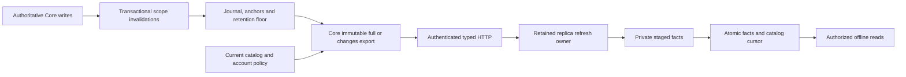
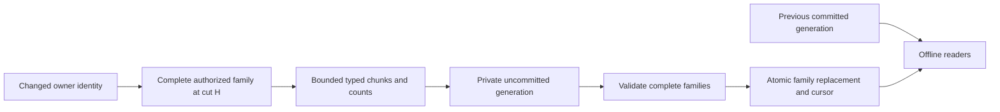

# Incremental catalog synchronization design

This is the selected development design, not an implemented public protocol. The current [catalog cache](catalog-replication.md) still accepts local snapshot-only facts. A private journal foundation is being developed separately; no usable catch-up cursor is advertised before complete producer coverage is verified.

## Ownership and representation

Core records catalog invalidations in the authoritative write transaction. It materializes immutable normalized facts from one SQLite read snapshot, using the existing account and source policies. The client stages and publishes facts in its private profile. The collection cursor, accepted events and offline outbox remain separate.

The complete representation must include provider-only recordings, source metadata, inherited and account releases, both local-source and provider release appearances, personal edits and resets, artists, ordered credits, verified artist identities, recording groups and source policy. Existing Hito identities remain exact strings. A fact key contains its entity kind and full identity tuple. Changes replace complete owner families or remove typed roots, as defined below.

Provider IDs can contain filesystem coordinates and must not be exported indiscriminately. Credentials, raw observations, local paths and signed stream URLs remain private. Server relay observations never establish client-local playback readiness. References to inaccessible canonical recordings are excluded.

Membership alone does not reproduce recording-card behavior. That policy also depends on personal edits, likes, progress, bookmarks, choices and downloads. Complete rendering still needs the separately planned populated collection projection and its pending-operation overlay.

## Complete family replacement

The journal retains affected owners, not every former child key. After deleting a source or credit member, a reader cannot recover its old child identity from current rows. Sending only current child upserts would therefore leave stale facts on the client. The selected contract replaces the complete affected family instead.

| Owner | Complete owned facts | Derived or separately owned facts |
| --- | --- | --- |
| Recording | Inherited fields, personal overrides, sources and source metadata, release appearances, ordered credits, validated identity contributions, source choice and outbound group edges | Release/artist roots, collection activity and aggregate summaries |
| Release | Inherited and account release fields, personal overrides and edition choice | Track appearances and counts derived from recording families |
| Artist | Primitive account artist and credit-key data, authorized photo observation and recheck time | Recording-derived eligibility, usage and group summaries |
| Account policy | Effective source preferences and approved-provider policy needed by catalog readers | Credentials, private configuration and collection operations |

An outbound member-to-canonical edge belongs to the member recording. A split pair uses the schema's canonical sorted identity pair and belongs to the smaller recording ID. Both endpoints must be currently readable. An authorized reference into another library may remain unresolved when that library is not cached; the client must not fabricate a recording. Identity-group descriptors come from validated recording contributions. The client tracks each contribution's ownership so replacing one family cannot remove a descriptor still used by another.

A family declares complete child counts by kind. Bounded typed chunks may span pages, but the family has a strict total byte and child limit. The client stages chunks and rejects conflicting keys, duplicate completions, missing children and excess counts. One final transaction replaces completed families, removes typed root tombstones and publishes the catalog cursor. Failure preserves the entire previous generation. Root deletion removes only its owned facts and keeps unrelated roots and collection references.

Primitive artist observations must not become an effective photo summary without its dependencies. Removing a recording credit can change the former artist's eligibility after that relationship has disappeared. The client derives eligibility and summaries from visible recording contributions and account policy. Any future independently stored derived summary needs explicit former/new parent invalidation and convergence tests.

## Transactional capture

Triggers append typed entity or dependency-scope invalidations. Moves retain both old and new identities; deletion retains enough old identity to produce a tombstone. A release, folder, service or account-policy change records a bounded scope, rather than writing one journal entry for every affected recording.

During export, Core expands distinct scopes into one bounded indexed SQL work set, deduplicates keys and reads facts in keyset batches. It must not collect an entire library into a Rust work vector or scan it repeatedly for every parent change. Business availability and identity policy remain in Core readers.

A full export captures journal head H and its history anchor in the same SQLite read transaction as the facts. A changes export reads distinct affected owner keys in the interval from the accepted catalog cut through H, then returns complete family replacements or typed root tombstones as of H. Concurrent writes are wholly visible in that transaction or follow H. The final authority fence must also verify that required history and the export lease remain valid before publication.

Pages are transport progress. The client advances its catalog cursor only when every page and all identity/count/binding checks commit atomically. It never acknowledges collection operations using a catalog cut or the old snapshot collection watermark.

An oversized changes batch can require a full bootstrap. If a full bootstrap itself exceeds a documented budget, return a distinct capacity failure; repeated rebootstrap must not become an infinite recovery loop.

## Opaque cursors and restored history

A catalog cursor is a fresh random 32-byte base64url handle. Only its SHA-256 digest and private binding are persisted. The binding includes server lineage, semantic projection version, account, library, exact access-grant identity, availability context and journal sequence/anchor. Tokens and digests are excluded from logs.

Every accepted export issues a fresh handle, including an empty export. Hash-only storage cannot recover a previous token, and token reuse only while the global head stays unchanged would expose unrelated write activity. Issuance is bounded by explicit row/byte quotas and retention, with active exports protected. Missing or evicted handles require an explicit fresh bootstrap. They do not erase the locally authorized cache or alter collection state.

Each durable journal sequence has a random history anchor. The retention floor preserves its anchor separately. Validation requires an exact binding, a cut within the retained interval and the matching anchor. A server UUID and numeric sequence alone cannot detect restoration followed by sequence reuse. Divergent or missing restored history requires bootstrap.

Cursor handles do not depend on the plugin credential key. The configured backend host identity belongs to a persisted availability context; changing the host rotates that context before export admission. The synchronization client identity is unrelated. A semantic projection version also invalidates history after changes to fact meaning or dependency coverage, independently of the SQLite migration and HTTP versions.

Retention has explicit work, row and byte budgets. Slow replication must not turn ordinary authoritative writes into an unbounded cleanup or prevent them solely to preserve old replication history. Blocking export leases can expire explicitly before bounded compaction. Erasing an account removes private invalidation payload and cursor/lease state while preserving any anonymous history anchor still needed by other accounts.

## Authority and time

The server checks current session, PIN and exact grant for creation and each page response. Local publication checks current local session, activation, connection generation and expected catalog head through profile COMMIT and queued rollback settlement.

A remote grant can change after the final authorized response and before local commit. The completed export can still become last-known cached data under the accepted offline policy. No final network request removes that window. A grant identity is a binding, not a revocation oracle. Locally retired work or an already-observed newer head/context must still be fenced before publication.

Access changes must be inspected before filtering invalidations to the requested library. Revoking library B can remove a group reference exported from still-accessible library A. These actor visibility changes require account-wide expansion or explicit bootstrap. Library deletion also erases its scoped payload, so surviving account-only invalidation must remain available without retaining the deleted library's private keys. Account erasure still removes that account's private history. The private foundation is being changed to capture access through authoritative grant rows; complete behavior and convergence remain acceptance requirements.

Current audio catalog predicates and retained-download/podcast authority views are driven by rows and backend host identity. Artist-photo lookup state has a separate clock dependency: a missing/unavailable lookup becomes unknown after one day without a row change. Replication must carry observed state and a recheck time, or provide a scheduled invalidation, rather than promise a timeless derived state.

## Acceptance and implementation sequence

The complete capability requires all of these steps:

1. A normalized full-export contract and public traces covering local, provider-only, personal and verified identity facts.
2. Complete transactional invalidation coverage and the shared snapshot/journal cut.
3. Changes materialization, bounded retention, expiry and restored-history fallback.
4. Private client staging/publication with restart, cancellation and SQL-failure preservation.
5. Actual HTTP convergence, scale qualification and independent review.

A dependency/trigger manifest must cover every exported column and policy input. Migration tests verify exact trigger and index declarations. Actual indexing, provider import/Follow/repair, personal edits/reset, identity/group changes, withdrawal, folder rebinding, source choices, retention and erasure workflows must converge to an independently constructed full export at the same cut. Method-call counters do not establish producer closure.

Further tests cover snapshot/write races, duplicate delivery, conflicting keys, source-only tombstones, regrant, local retirement, late publication, observer drop after commit, history floor/compaction, rollback and sequence reuse after restoration. A queued collection operation must keep its exact identity/body and independent cursor throughout. A 100,000-record mixed catalog must exercise one-record, release and folder changes with bounded SQL work and physical profile/WAL observations.

Migration numbers and file ownership are allocated centrally. Foundation migration 0095 is reserved; normalized profile migrations are not yet allocated. Intermediate internal work must remain explicitly incomplete until the complete contract and producer closure pass. Populated collections, remote audio, standalone import preview and desktop profile selection remain separate release work.
