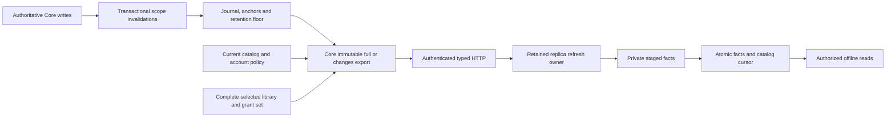
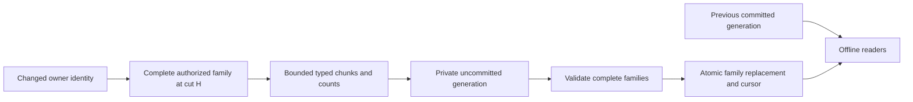
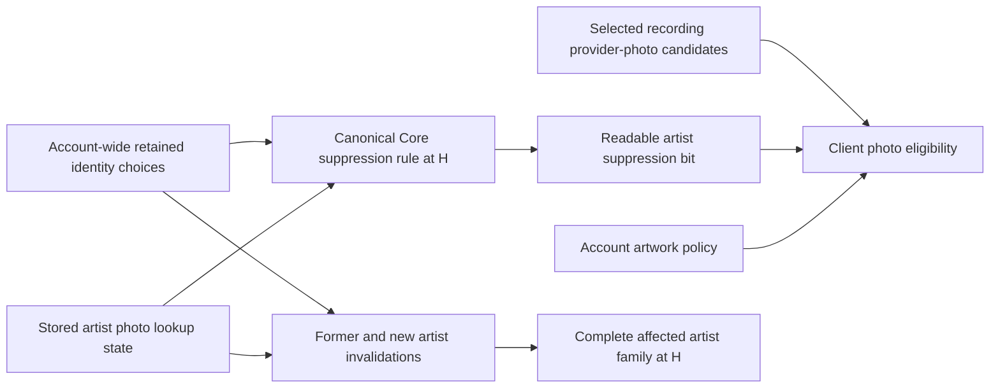
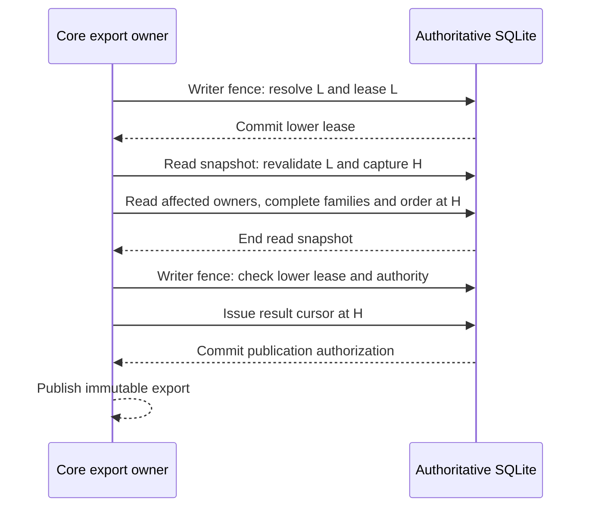

# Incremental catalog synchronization design

This is the selected development design, not an implemented public protocol. The current [catalog cache](catalog-replication.md) still accepts local snapshot-only facts. A private journal foundation is being developed separately; no usable catch-up cursor is advertised before complete producer coverage is verified.

## Ownership and representation

Core records catalog invalidations in the authoritative write transaction. It materializes immutable normalized facts from one SQLite read snapshot, using the existing account and source policies. The client stages and publishes facts in its private profile. The collection cursor, accepted events and offline outbox remain separate.

The complete representation must include provider-only recordings, source metadata, inherited and account releases, both local-source and provider release appearances, personal edits and resets, artists, ordered credits, verified artist identities, recording groups and source policy. Existing Hito identities remain exact strings. A fact key contains its entity kind and full identity tuple. Changes replace complete owner families or remove typed roots, as defined below.

Provider IDs can contain filesystem coordinates and must not be exported indiscriminately. Credentials, raw observations, local paths and signed stream URLs remain private. Server relay observations never establish client-local playback readiness. References to inaccessible canonical recordings are excluded.

Membership alone does not reproduce recording-card behavior. That policy also depends on personal edits, likes, progress, bookmarks, choices and downloads. Complete rendering still needs the separately planned populated collection projection and its pending-operation overlay.

Safe catalog inputs also include source genre contributions and their validated fallback, selected observation provenance, and extracted audio/release facts used by Details and album-year views. Raw tags and full observation history remain behind their authenticated inspection API. Library names/personal descriptors, podcast subscription/episode descriptors and durable edition/adoption links need named connection or content projections. Audiobook chapters, bookmarks, continuation and playback preferences remain collection state. These boundaries preserve the full release scope; catalog membership alone does not implement them.

## Joint selected-library scope

The normalized format uses an explicit selected set of zero to sixteen exact library identities. It canonicalizes their order and rejects duplicates. Every selected library binds its exact current grant. An empty set exports only the actor's policy and empty ordering streams. The existing snapshot-only API remains single-library.

One read transaction captures the catalog cut, all selected facts, ordering and group-label observations. One retained export and cursor describe that complete set. Every page and final publication checks the whole binding. The client stages and publishes the selected set atomically, preserving the previous complete generation if refresh fails. This is the selected implementation contract, not completed HTTP or desktop behavior.

Authorized references can point outside the selected set. Every such reference checks the target's current readability. A private account access epoch changes whenever that account's library grants change, including grants outside the selected set. Construction leases and cursors capture that epoch so a revoked reference cannot survive merely because the selected grants stayed unchanged. The epoch never leaves Core.

Independent library snapshots cannot preserve the current global Recent view. Recordings use recording row order; releases and artists use their account-row order. Raw rowids or receipt counters would reveal unrelated activity. The normalized format instead streams typed exact root IDs in server order and carries final predecessor placements for affected surviving roots. Root deletion splices the existing sequence. The client validates root coverage, completion, missing anchors, duplicate placements and cycles before committing facts, sequence links and cursor together. It never renumbers surviving roots from local arrival order.

The server keeps numeric ordering private. Scoped indexes and bounded keyset/merge reads provide the ordered streams and predecessor lookups. Ordering is a separate typed stream, with its own root-kind counts and chunk completion; it does not turn a 100,000-root sequence into an oversized ordinary entity family.

Group labels also depend on the whole selected scope. A safe winner descriptor contains Hito references for the selected-set winner. Per-library winner inputs preserve the existing library-filtered view. Current receipt ordering stays in Core; the client derives list sorting from the appropriate label and complete visible contributions. Accepted identity choices retain their existing eligibility after provider removal; provider availability separately controls new lookups and photo rules.

Recording and artist invalidations expand through retained choice groups before current eligibility filters. Destructive choice changes also capture the former and new account-owned group IDs, so a removed winner can update surviving contributions. Account-wide access invalidation remains the fallback after library deletion or permission changes.

## Complete family replacement

The journal retains affected owners, not every former child key. After deleting a source or credit member, a reader cannot recover its old child identity from current rows. Sending only current child upserts would therefore leave stale facts on the client. The selected contract replaces the complete affected family instead.

| Owner          | Complete owned facts                                                                                                                                                              | Derived or separately owned facts                                 |
| -------------- | --------------------------------------------------------------------------------------------------------------------------------------------------------------------------------- | ----------------------------------------------------------------- |
| Recording      | Inherited fields, personal overrides, sources and source metadata, release appearances, ordered credits, validated identity contributions, source choice and outbound group edges | Release/artist roots, collection activity and aggregate summaries |
| Release        | Inherited and account release fields, personal overrides and edition choice                                                                                                       | Track appearances and counts derived from recording families      |
| Artist         | Primitive account artist and credit-key data, authorized photo observation and recheck time, built-in photo suppression                                                           | Recording-derived eligibility, usage and group summaries          |
| Account policy | Effective source preferences and approved-provider policy needed by catalog readers                                                                                               | Credentials, private configuration and collection operations      |

A saved edition choice belongs to its release family. Preserve its revision and explicit clear, and capture the existing reader's Unset, Ready or NeedsChoice state at H. Safe fields can include currently readable Hito recording and account association references plus an owned provider reference. Do not copy the public saved-edition DTO into the catalog: its HTTP provider edition and release-group strings can contain private coordinates. Raw selections remain in Core.

Choice applicability depends on recording membership, source appearances, current credit/association and provider policy. A recording invalidation must therefore reach releases whose choices reference that recording, including a readable recording outside the selected set. Expand this dependency before filtering output owners. Destructive changes must retain the former release candidate or directly invalidate it. A current choice row alone cannot prove that no replacement is needed.

Complete edition contents, occurrence matching and durable adoption links need a separately named private content projection. The current online saved-edition read resolves through a Hito release identity; a future cached-content contract must also bind the expected choice revision, provider authority and complete content snapshot. The current API does not yet supply that whole cache contract. Connection descriptors and podcast/audiobook grouping also retain their separate projection work. These are unfinished release requirements, not omitted catalog fields or invented link identities.

An outbound member-to-canonical edge belongs to the member recording. A split pair uses the schema's canonical sorted identity pair and belongs to the smaller recording ID. Both endpoints must be currently readable. An authorized reference into another library may remain unresolved when that library is not cached; the client must not fabricate a recording. Identity-group descriptors come from validated recording contributions. The client tracks each contribution's ownership so replacing one family cannot remove a descriptor still used by another.

A family declares complete child counts by kind. Bounded typed chunks may span pages, but the family has a strict total byte and child limit. The client stages chunks and rejects conflicting keys, duplicate completions, missing children and excess counts. One final transaction replaces completed families, removes typed root tombstones and publishes the catalog cursor. Failure preserves the entire previous generation. Root deletion removes only its owned facts and keeps unrelated roots and collection references.

Recording families carry provider-photo candidates before built-in suppression. A candidate contains only the Hito artist identity and an account-owned typed provider reference. The canonical reader retains provider activity, artwork capability, current observation, binding and exact main-credit checks. Raw upstream artist coordinates stay in Core. The client combines these candidates with account artwork policy and the artist's built-in suppression observation.

Built-in suppression is an explicit exception to deriving artist behavior from selected recording families. The canonical rule reads the account's retained choices, including choices for recordings outside the selected libraries. A selected artist can therefore change its provider-photo eligibility without any selected recording changing. Export one authoritative `BuiltinPhotoSuppression { blocked }` observation in that readable artist's family at H. Do not export the outside recording, association, identity group or MusicBrainz identifier to explain that bit.

The shared Core predicate uses stored lookup state. A stored `missing` artist photo permits provider fallback even after its recheck time expires. Applying the effective time-based state to this rule would change existing behavior. The normal photo observation still carries its separate recheck time.

Choice insert, update, reset and deletion must invalidate the former and new artist parents before those relationships disappear. A private photo-policy scope must reach only those parents; ordinary artist-name invalidation also expands recording dependencies and is too broad for this purpose. Existing account scopes conservatively cover group and lookup changes. Keep those dependencies until a separately verified optimization replaces them.

The isolated full-export candidate passes public behavior tests for an outside-library reset, stored lookup states and account/grant isolation. The separate private parent-invalidation slice now passes three fresh specialist reviews and an independent 86-case Docker repeat. Its account-only `artist_photo` scope retains former/new parents and enqueues Artist owners without recording expansion. Full/changes materialization, convergence, complete scale qualification and client rendering remain unverified. This observation is a policy input with explicit dependencies, not a completed effective-photo summary. Recording-derived eligibility, usage and group summaries still require complete visible contributions and account policy.

## Transactional capture

Triggers append typed entity or dependency-scope invalidations. Moves retain both old and new identities; deletion retains enough old identity to produce a tombstone. A release, folder, service or account-policy change records a bounded scope, rather than writing one journal entry for every affected recording.

During export, Core expands distinct scopes into one bounded indexed SQL work set, deduplicates keys and reads facts in keyset batches. It must not collect an entire library into a Rust work vector or scan it repeatedly for every parent change. Business availability and identity policy remain in Core readers.

A full export captures journal head H and its history anchor in the same SQLite read transaction as the facts. A changes export reads distinct affected owner keys in the interval from the accepted catalog cut through H, then returns complete family replacements or typed root tombstones as of H. Concurrent writes are wholly visible in that transaction or follow H. The final authority fence must also verify that required history and the export lease remain valid before publication.

A new changes export must lease its input cut L before opening the fact snapshot. Leasing only H does not protect the interval that starts at L. The initial writer transaction resolves the input cursor, checks its complete authority and acquires the lower-cut lease. It commits before the read transaction begins. The read resolves L again, captures H and builds the affected-owner workset and complete replacements in that same snapshot.

After the read ends, one final writer transaction checks the original lower-cut lease and current authority, then issues the result cursor at H before publication. If bounded retention expired the lower lease during construction, discard the candidate even when H and a lease at H are still valid. A historical snapshot can remain internally consistent after its input history is no longer publishable.

A ready retained export is different. Its request identity locates the already materialized result, whose cursor checks current authority, context and expiry. Retry must not resolve old input history again or consume a new construction lease. Compaction or expiry of L alone cannot invalidate that retained result.

An isolated development workset test exercises this distinction with real journal appends and concurrent public collection writes. It advances retention beyond L but below H while the borrowed read still returns the original H facts. The final lower lease fails, the upper lease remains valid, and authority-only validation still passes. This is evidence for the fence requirement, not accepted changes delivery or client convergence; those remain unfinished.

Pages are transport progress. The client advances its selected-set catalog cursor only when every fact/order page and all identity/count/binding checks commit atomically. It never acknowledges collection operations using a catalog cut or the old snapshot collection watermark.

An oversized changes batch can require a full bootstrap. If a full bootstrap itself exceeds a documented budget, return a distinct capacity failure; repeated rebootstrap must not become an infinite recovery loop.

## Opaque cursors and restored history

A catalog cursor is a fresh random 32-byte base64url handle. Only its SHA-256 digest and private binding are persisted. The binding includes server lineage, semantic projection version, account and its private access epoch, the complete selected library/grant set, availability context and journal sequence/anchor. Tokens and digests are excluded from logs.

Every accepted export issues a fresh handle, including an empty export. Hash-only storage cannot recover a previous token, and token reuse only while the global head stays unchanged would expose unrelated write activity. Issuance is bounded by explicit row/byte quotas and retention, with active exports protected. Missing or evicted handles require an explicit fresh bootstrap. They do not erase the locally authorized cache or alter collection state.

Retained immutable pages check current authority, the account access epoch, context and expiry without requiring old journal rows to remain retained. Resuming incremental changes separately validates the history anchor and retention floor. History compaction alone must not make an already published immutable page unreadable.

Each durable journal sequence has a random history anchor. The retention floor preserves its anchor separately. Validation requires an exact binding, a cut within the retained interval and the matching anchor. A server UUID and numeric sequence alone cannot detect restoration followed by sequence reuse. Divergent or missing restored history requires bootstrap.

Cursor handles do not depend on the plugin credential key. The configured backend host identity belongs to a persisted availability context; changing the host rotates that context before export admission. The synchronization client identity is unrelated. A semantic projection version also invalidates history after changes to fact meaning or dependency coverage, independently of the SQLite migration and HTTP versions.

Retention has explicit work, row and byte budgets. Slow replication must not turn ordinary authoritative writes into an unbounded cleanup or prevent them solely to preserve old replication history. Blocking export leases can expire explicitly before bounded compaction. Erasing an account removes private invalidation payload and cursor/lease state while preserving any anonymous history anchor still needed by other accounts.

## Authority and time

The server checks current session, PIN and the complete exact grant set for creation and each page response. Local publication checks current local session, activation, connection generation and expected catalog head through profile COMMIT and queued rollback settlement.

A remote grant can change after the final authorized response and before local commit. The completed export can still become last-known cached data under the accepted offline policy. No final network request removes that window. A grant identity is a binding, not a revocation oracle. Locally retired work or an already-observed newer head/context must still be fenced before publication.

Access changes must be inspected before filtering invalidations to the requested library. Revoking library B can remove a group reference exported from still-accessible library A. These actor visibility changes require account-wide expansion or explicit bootstrap. Library deletion also erases its scoped payload, so surviving account-only invalidation must remain available without retaining the deleted library's private keys. Account erasure still removes that account's private history. The isolated foundation candidate captures access through authoritative grant rows and private actor epochs; complete consumer behavior and convergence remain acceptance requirements.

Current audio catalog predicates and retained-download/podcast authority views are driven by rows and backend host identity. Artist-photo lookup state has a separate clock dependency: a missing/unavailable lookup becomes unknown after one day without a row change. Replication must carry observed state and a recheck time, or provide a scheduled invalidation, rather than promise a timeless derived state.

## Isolated journal qualification

On 11 November 2026, the isolated private foundation passes an independent Docker repeat of 38 journal cases, two account-erasure plan cases, nine public account-deletion cases and two historical playlist upgrades, plus workspace formatting. All 2,467 Rust, SQL and Cargo inputs match before and after the run. Fresh security, correctness and performance specialists independently review the same 26 frozen files without finding a confirmed defect.

The cases cover exact selected sets, UTF-8 byte limits and integer ordinals, protected quotas, unselected-library revocation, regrant and rollback, history-only compaction, restart and divergent restore, former/new identity groups, correction erasure, and actual account-deletion rollback and cleanup. Three predecessor indexes are checked against 100,000-row tables under absent, stale and fresh planner statistics. Measured source-insert work in the common-producer fixture remains 586 VM steps per row at both 128 and 512 rows under stale and fresh statistics.

A later frozen candidate adds the bounded affected-owner workset. An independent Docker repeat passes all 69 journal cases, two account-erasure plan cases, nine account-deletion cases and one actual historical playlist upgrade, plus workspace formatting. All 2,482 Rust, SQL and Cargo inputs remain exact. Three fresh specialist reviews pass against its 42 frozen dependency files.

The workset borrows the caller's read transaction and returns at most 64 deduplicated owners per page. It traverses dependencies before filtering selected output, including retained identity groups and saved-edition releases. TEMP state enforces the interval, identity-byte, internal-key and aggregate-edge budgets. Cancellation settlement belongs to the outer transaction owner; dropping the Rust borrow does not claim asynchronous cleanup.

Qualification found and corrected two work-budget gaps. Unmatched source parents now count before observation expansion; a 100,001-source input returns a typed budget failure. Actor-prefixed release-credit lookups avoid scanning another account's 100,001 unrelated credits under absent, stale and fresh statistics. A partial TEMP output index keeps sparse selected output bounded after traversal through 99,998 internal owners. These are private workset checks, not complete catalog construction or release performance results.

These candidates are not integrated with the complete normalized consumer. The later candidate's strict library check exits with exactly 46 unused-private-API errors and no other diagnostics; it is not a strict pass. Complete producer convergence, client application and the full release workload remain unproved. Existing SnapshotOnly behavior is preserved. The newly selected artist-photo policy observation needs its own parent-invalidation slice and convergence evidence.

## Artist photo dependency qualification

The frozen photo-policy slice passes an independent repeat of 74 journal cases, two account-erasure plan cases, nine account-deletion cases and one historical playlist upgrade. Formatting passes, and all 2,485 Rust, SQL and Cargo inputs remain unchanged. Fresh security, performance and correctness reviews pass against the same 46 dependency files. The strict library check still fails with exactly 49 unused private-consumer APIs and no other diagnostics.

Five new cases cover outside-library reset, former/new artist moves and coalescence, retirement, deletion and reinsertion, stored photo/group changes, peer isolation and revoked/regranted outside-library access. A parent-only change emits one selected artist among 100,000 unrelated recordings and choices with 1,400 measured VM steps. The existing sparse-output case correctly gains that artist while retaining the exact 100,000 combined internal-key cap and its output-work guard.

One shared canonical predicate uses the existing actor/artist index and the group's unique account/identity index. Negative lookup work fell from roughly 800,000 VM steps under adverse statistics to at most 1,800 in the tested distribution. That fixture has 100,000 unrelated choices and only two groups; it does not prove a full metadata-rich export or arbitrary group distributions. Complete normalized construction, changes delivery, client publication, p95 and physical deployment remain unfinished. No application image, VPS or package changed.

## Acceptance and implementation sequence

The complete capability requires all of these steps:

1. A normalized full-export contract and public traces covering local, provider-only, personal and verified identity facts.
2. Complete transactional invalidation coverage and the shared snapshot/journal cut.
3. Changes materialization, bounded retention, expiry and restored-history fallback.
4. Private client staging/publication with restart, cancellation and SQL-failure preservation.
5. Actual HTTP convergence, scale qualification and independent review.

A dependency/trigger manifest must cover every exported column and policy input. Migration tests verify exact trigger and index declarations. Actual indexing, provider import/Follow/repair, personal edits/reset, identity/group changes, withdrawal, folder rebinding, source choices, retention and erasure workflows must converge to an independently constructed full export at the same cut. Method-call counters do not establish producer closure.

Further tests cover snapshot/write races, duplicate delivery, conflicting keys, source-only tombstones, regrant, local retirement, late publication, observer drop after commit, history floor/compaction, rollback and sequence reuse after restoration. A queued collection operation must keep its exact identity/body and independent cursor throughout. A 100,000-record mixed catalog must exercise one-record, release and folder changes with bounded SQL work and physical profile/WAL observations.

Migration numbers and file ownership are allocated centrally. Foundation migration 0095 is reserved; normalized profile migrations are not yet allocated. Intermediate internal work must remain explicitly incomplete until the complete contract and producer closure pass. Populated collections, remote audio, standalone import preview and desktop profile selection remain separate release work.
