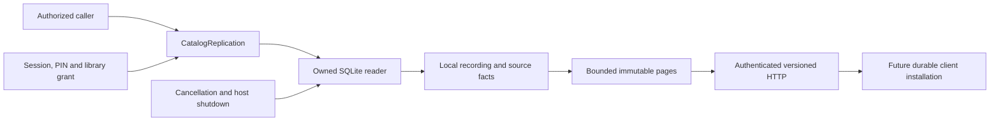

# Catalog replication

Catalog replication is being built for desktop remote mode. A desktop must keep its standalone library separate from the server profile and remain usable when the server is unavailable. The [release scope](release-plan.md) includes catalog changes, populated playlists, likes, progress and source availability. The snapshot capability described here is an initial local-catalog boundary, not complete remote mode.

## Snapshot ownership

Core owns the catalog read, authorization, SQLite connection, materialization and retained pages. HTTP and desktop adapters must consume its typed results without querying SQLite. The snapshot contains inherited recording fields and source-specific title, artist, duration and release appearances. Recording, source and release identities retain their existing string values.

A source's `server_relay` value is an observation of whether the server can relay it. It does not make that file local or offline-ready on another device. Facts exclude filesystem coordinates, folder labels, credentials, raw tags and provider stream URLs. The authorized inherited display title remains catalog data even when indexing derived it from a filename.

`begin` returns a snapshot identity and metadata only after successful construction and a final authority check. Repeating it for the same account, library and current grant resumes the same immutable snapshot without rebuilding it or extending its expiry. It can resume even when the retained registry is full. `page` reads an ordinal from that materialization. Each read validates its requesting session, PIN state and current library-grant identity. Snapshots belong to the account and library, so another currently authorized session of the same account can read them. Revoking and recreating library access does not restore access to an old snapshot.

`release` requires a current unlocked session. It removes only that account's snapshot and allows owned cleanup after library access is revoked. Unknown, expired and foreign handles are idempotent; a foreign caller cannot remove the owner's snapshot. Account erasure retires its constructions and removes retained pages. Host shutdown closes the capability and joins its reader.

## HTTP delivery

The versioned routes use shared authentication, origin policy and Core wire types. HTTP owns no SQL, retention or synchronization rules.

| Method | Route                                            | Successful response                                                            |
| ------ | ------------------------------------------------ | ------------------------------------------------------------------------------ |
| POST   | `/api/v1/catalog/snapshots`                      | `200 CatalogSnapshot`, accepting the strict shared `BeginCatalogSnapshot` body |
| GET    | `/api/v1/catalog/snapshots/{id}/pages/{ordinal}` | `200 CatalogSnapshotPage`                                                      |
| DELETE | `/api/v1/catalog/snapshots/{id}`                 | Empty `204`                                                                    |

Pages are compact JSON with no additional envelope and retain the 256 KiB encoded-page bound. Responses use the existing private, no-store policy. Malformed path fields return a safe JSON error, and invalid or inaccessible page handles return not found. Native bearer requests may omit Origin under the existing policy; browser cookie mutations still require origin verification. OpenAPI and TypeScript are generated from the actual Rust routes and types.

If the caller loses a successful creation response, it can repeat POST to recover the same handle and facts until expiry or release. Release followed by POST constructs a fresh view. These transient server handles do not provide durable client storage or incremental changes.

## Resource and cancellation policy

Only one constructor runs at a time. An export is limited to 100,000 recordings and 128 MiB of encoded pages, with at most 128 local sources per recording. Each fact is bounded to 64 KiB; a page contains at most 200 facts and 256 KiB. The retained registry allows at most ten snapshots and 256 MiB of encoded data, including a full export reservation while construction is active. These are export budgets, not a bound on the application's total memory.

A constructor has one ten-second success deadline beginning at public entry. It cannot publish a ready snapshot after that deadline. Cancellation retires the observer, while the retained owner continues to settle SQLite work and close its connection. Cleanup can outlast the success deadline; admission remains held until it finishes. An idle reader waiter is cancellable without acquiring the connection. A successful construction keeps the reader for reuse, and capability close joins active construction before gracefully closing the reader.

Snapshots expire after five minutes and are transient. Restart invalidates their handles. There is no durable snapshot file or new database migration in this slice.

## Qualification

Docker qualification on 10 November 2026 passes six unit cases for SQL work, scale and retained deadline ownership, one public snapshot tracer and five public authority/immutability cases. The shared runtime case proves snapshot retirement while HTTP is still draining. Existing account-deletion, replica and real Router regressions also pass. An independent repeat covered the six unit cases, six public snapshot cases, eight account-deletion cases, nineteen replica cases and the runtime case against unchanged source. These overlapping component counts are not a release total.

The scale fixture contains 100,000 recordings, distinct release identities, source-metadata rows and valid local-file coordinates, with foreign keys enabled and checked. One owned WAV supplies the only ready relay observation; the remaining coordinates represent unavailable historical files. Every recording identity is read through 500 public pages, totaling 52,450,811 encoded bytes. This is a synthetic database export test, not a 100,000-file scan or listening-load gate.

Absent, stale and fresh planner statistics each require about 24.1 million SQLite VM steps, below the fixed 60-million construction budget. In the independent run, construction takes 3.26 to 3.35 seconds on an Apple M5 Pro with 24 GiB RAM and 15 logical CPUs, using Docker 29.4 Linux arm64 and a 4 GiB tools container. Debug information and incremental compilation are disabled. These are three warm development observations, not p95 or cold-storage measurements.

Review exposed repeated scans under stale statistics. Snapshot queries now use bounded recording batches and existing indexed identity lookups. A corrected regression verifies that recordings, releases, metadata and file coordinates all grow, rather than silently ignoring invalid fixture rows. To isolate export from an existing source-artist write-trigger problem, the fixture constructs data with triggers and foreign keys enabled, then restores the exact captured one-row planner statistics before measuring the actual snapshot reader. It preserves and checks both statistics tables when present. This does not qualify the separate stale-statistics write path.

Controlled deadline cases verify that a held publication writer cannot publish late, a reader waiter can expire without acquiring its slot, and close retains the reader until in-flight SQL settles. Public cases cover another account, a second current session of the owner, revoked sessions, PIN locking, revoke/regrant, retained source-specific release facts after rescan, and invalid handles after close. Fresh reviews found and resolved query-work, deadline and test-cleanup defects. Strict scoped checks and formatting pass. No running server or desktop package is updated by this slice.

The create-or-resume and release extension has an independent 26-case Docker repeat covering public snapshot/authority/lifecycle behavior, retained SQL work and deadlines, and actual server runtime closure. It also caught and corrected retention-clock handling after expiry and reservation lifetime during SQL cancellation. The synthetic 100,000-recording runs remain about 3.34 to 3.37 seconds in that repeat; these are warm development observations.

The HTTP adapter passes ten actual Router/TCP cases, independently repeated in 6.49 seconds. They cover strict and bounded requests, session/PIN/account/grant isolation, browser/native origin policy, immutable retry after rescan, owned and foreign release, original expiry, fresh construction, and escaped pages near 256 KiB. The TCP case reads a committed snapshot identity before dropping the socket, then verifies the same retained facts and joined server shutdown. It proves retry after publication and partial client consumption, not prepublication cancellation or an interrupted server write. Existing collection state remains unchanged.

Three fresh source reviews cover security, correctness and resource/recovery ownership. Strict server all-target Clippy, formatting, both TypeScript checks and independent byte-for-byte regeneration of OpenAPI/TypeScript pass. The generated contract adds three paths and eight shared schemas, preserving existing entries. These checks supplement the earlier combined 261-case run; they are not a new full-suite or release result.

## Incremental replication remains open

The wire mode is explicitly `snapshot_only`. `collection_watermark` is an observation of the collection log during construction. It must never advance an existing collection cursor or acknowledge an offline operation. The collection log does not cover every writer of exported catalog fields, so it cannot yet provide catalog catch-up.

Durable client installation still needs staging, validation, atomic publication and restart recovery in the private server profile. Incremental synchronization additionally needs a catalog change journal covering every exported-field writer and resumable change delivery. Populated playlist projection, likes/progress, remote audio ownership and desktop profile selection also remain open. Provider-only recordings require their own catalog coverage. Personal overrides and standalone import preview must remain separate. See [offline replica ownership](offline-replicas.md).

A producer audit identified the dependencies that incremental delivery must cover:

| Facts that change                                      | Producers to cover                                                                           |
| ------------------------------------------------------ | -------------------------------------------------------------------------------------------- |
| Local recording/source metadata and release appearance | Indexing, legacy recovery and metadata-owner selection                                       |
| Inherited recording/release fields                     | Local indexing and provider adoption, import, Follow and metadata repair on mixed recordings |
| Server relay observation                               | File withdrawal/recovery, folder connection/rebinding and account source choice              |
| Recording disappearance                                | Maintenance purge and account erasure, with durable tombstones                               |
| Cache authority                                        | Session/PIN validation and exact account/library grant incarnation                           |

The current raw snapshot does not export artist identities, recording-group membership or personal overrides. A journal covering the current fields would not establish replication of those wider catalog semantics. Indexing events alone are insufficient, and a dirty revision must not be cleared by acknowledgement of an older revision. The next contract must also handle snapshot/change races, release/folder fanout and expired history without changing the collection outbox or treating the snapshot watermark as its acknowledgement.
