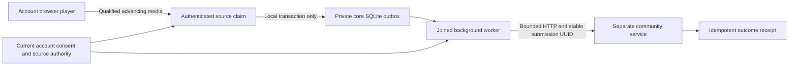
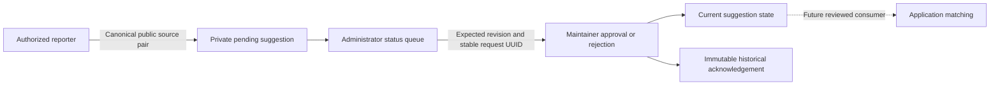
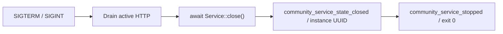
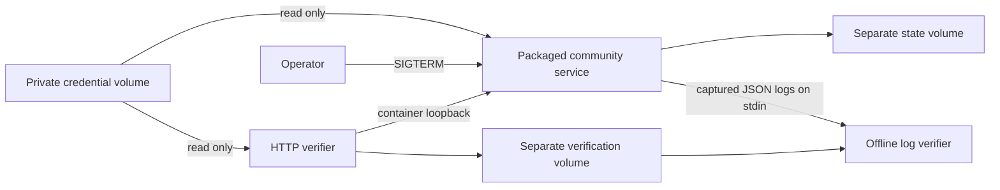
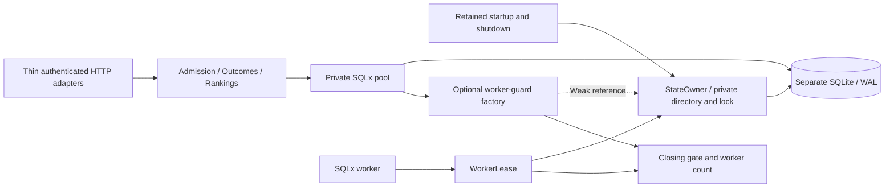

# Community service

`hito-community` owns an independent SQLite store and Axum router for reporter admission, successful-playback receipts, and candidate rankings. It has no dependency on the application core or its database. The application integration below is source-qualified and awaits current packaged acceptance and publication. Private correction suggestions and maintainer decisions are implemented in the development service. Application correction submission, matching consumers and public operation remain unfinished under the [release plan](release-plan.md#community-service).

## Application integration in development

Each account has separate playback-reporting and metadata-correction preferences, both disabled by default. Settings reads and updates use the shared authenticated account boundary and a revision check. Enabling metadata corrections does not permit playback reporting; the correction producer remains unfinished.

The browser observes five seconds of advancing media time before submitting a source claim. It excludes seeks, pauses, stalls and stale media generations, and checks advancement against elapsed time and playback speed. This is a listening heuristic, not proof that a person heard the audio. An account-scoped sender admits at most eight claims, sends one at a time and retries the same submission UUID at most once. Its request and response-body deadlines remain independent of progress writes, navigation and Continue.



Core resolves the claimed source through the account's current approved installation and library access. Only canonical public YouTube and Jamendo references leave the application. Local files, titles, paths, audio, provider credentials and stream URLs are excluded. Admission never contacts the community service. Logout, disabled consent, withdrawn provider access and changed source authority retire queued or running work; held responses cannot restore that authority.

The server integration is optional. Configure both `HITO_COMMUNITY_ORIGIN` and `HITO_COMMUNITY_ADMIN_TOKEN_FILE` to enable delivery. The origin requires HTTPS, with HTTP allowed only for numeric loopback addresses. The token file must be absolute, private, owned by the effective user and contain the community service's administrator token. With neither setting, delivery stays disabled. An incomplete or invalid pair disables it with a static warning. Configuration and startup do not provision reporters or make network requests. Each account's reporter credentials are encrypted separately from plugin credentials through the existing private key store.

The application outbox permits 64 pending reports per account and 256 globally, with one running per account and two globally. Delivery allows three attempts over seven days, two-second bounded exchanges and an eight-second operation deadline. Server shutdown joins the worker. Resetting community credentials affects only the caller's reporter credentials and unfinished reports; it preserves consent preferences, listening state, originals and other accounts.

The combined source passes 505 frontend cases, both TypeScript configurations and the production build, including a shared Provider test with held community delivery, a fixed Continue progress barrier and fresh chapter qualification. The core/HTTP fixtures cover consent, provenance, replay, revocation and credential recovery. The combined core/server regressions, strict default workspace checks and remaining default package tests pass. Current packaged browser-to-service acceptance, native outcome production, ranking consumption, application correction submission, moderation controls and normal deployment remain unfinished.

## Current HTTP contract

POST request bodies use JSON with a 16 KiB limit. Request objects reject unknown fields. Authentication accepts one `Authorization: Bearer` header containing a 64-character lowercase hexadecimal token. Responses carry `Cache-Control: no-store` and a generated `X-Request-Id`.

| Route | Authority | Behavior |
| --- | --- | --- |
| `POST /v1/admin/reporters` | Separate administrator bearer | Accepts `{}` and returns `201` with a new reporter UUID and random 256-bit bearer. The token is returned on creation; there is no token-read endpoint. |
| `DELETE /v1/admin/reporters/{reporter_id}` | Separate administrator bearer | Atomically removes that reporter's credential, outcomes and correction suggestions. A valid existing or unknown UUID returns an empty `204`; malformed UUIDs return `400`. Missing credentials and reporter bearers return `401`. |
| `POST /v1/outcomes` | Provisioned reporter bearer | Accepts a version-4 submission UUID, public source reference, and `successful_playback` outcome. A committed new receipt returns `201`; an exact retry by that reporter returns the original receipt with `200`. Reusing its UUID for another source returns `409`. After 300 new accepted submissions in the rolling 60-second window, new claims return `429` with `Retry-After: 60`. |
| `POST /v1/rankings` | Public | Accepts 1–32 distinct candidate source references and returns only those candidates, ordered by distinct successful reporters. Equal counts preserve input order. |
| `POST /v1/corrections` | Provisioned reporter bearer | Suggests `same_recording` for two distinct canonical public sources. A new version-4 submission UUID returns `201` and an immutable pending acknowledgement; exact or reversed-pair replay returns `200`, and changed content returns `409`. |
| `GET /v1/admin/corrections` | Separate administrator bearer | Reads up to 32 suggestions for one status, using an `after` sequence cursor. There is no public or reporter moderation queue. |
| `POST /v1/admin/corrections/{correction_id}/review` | Separate administrator bearer | Records approval or rejection with a version-4 request UUID and expected revision. New decisions return `201`; exact retries return their historical acknowledgement with `200`. Changed request content or a stale revision returns `409`. |
| `GET /v1/openapi.json` | Public | Returns OpenAPI 3 generated from the registered Rust handlers and actual wire DTOs, including distinct administrator and reporter bearer schemes. |

The schema records strict input objects, the candidate count and uniqueness rules, and request and response types. Field descriptions explain the conditional provider-ID rules and version-4 UUID requirement without changing accepted UUID text forms. The candidate schema uses the actual `SourceRef` component and shares its maximum count with runtime validation. There is no separately maintained JSON API model.

The [Rust wire types](../crates/hito-community/src/wire.rs) define the contract. Source references contain `provider` and `recording_id`. YouTube IDs have exactly 11 ASCII letters, digits, underscores, or hyphens. Jamendo IDs are canonical positive decimal `u64` values without leading zeros. Other providers and URL-shaped references are rejected. No request field accepts audio, paths, credentials, stream URLs, titles, or arbitrary metadata.

The trusted host supplies an administrator token and an absolute state directory through `Config`. Only the administrator can provision reporters. The database stores reporter-token hashes; the administrator-token hash stays in process memory. A reporter UUID is a service pseudonym, separate from application accounts and backend host or synchronization identities. Credentials do not attest real listening or distinct humans. The service accepts a playback-success claim; it does not validate audio or measure playback itself. Selection reports are not an accepted outcome.

Each reporter contributes at most one count per source, even with multiple submission UUIDs. Counts cover the currently retained reports. They are not a measured playback-success probability. The future application client must filter candidates to configured, available providers before requesting rankings and preserve personal source choices and overrides. Sending candidate IDs is itself a disclosure that the opt-in design must address.

## Outcome limits in development

Each reporter can create at most 300 outcome receipts in the rolling 60-second window, measured with SQLite's seconds clock. The limit survives service restart and is independent for each reporter. An exact receipt replay still returns `200` when full; conflicting UUID reuse remains `409`, and invalid requests keep their existing rejection behavior. Replays and rejections consume no capacity. An over-limit request returns `429`, the static JSON error `rate_limited` and a fixed `Retry-After: 60`, without creating a receipt or changing rankings. Expiring from this window does not erase retained outcomes or their ranking contributions.

The existing immediate write transaction checks live reporter authority, resolves any prior receipt, checks the limit, then inserts. The limit reads at most 300 recent rows through the declared `(reporter_id, created_at)` covering index. Service migration `0002` adds only that index. It changes no existing table, row or credential.

Author-run Docker checks cover the 301st rejection, peer independence, exact replay and conflict behavior, restart, the 60-second boundary, concurrent requests at the last available slot, and a full reporter revoked while its authenticated body remains unread. The real-child check retains peer receipts, private credential-file identity and TRACE redaction. The migration check preserves every legacy typed row, rowid, schema object, foreign key and old migration-ledger field, and verifies both actual migration checksums.

The actual public admission path reported 2,400 SQLite VM steps at 100-step sampling with 1,000 and 100,000 old rows for both the current reporter and a peer, under absent, inherited and fresh statistics on fresh service connections. All six cases stayed below the fixed 10,000-step allowance. The unindexed query exceeded that allowance at only 1,000 old rows. These are bounded-work checks, not latency or public-load measurements. All thirteen community cases, strict all-target Clippy and formatting passed; the generated contract changed only the new outcome `429` response. Independent review and release acceptance remain separate.

This limit covers new authenticated outcome submissions only. Retained-outcome quotas, automatic erasure, public endpoint abuse controls and load qualification remain unfinished.

## Reporter revocation in development

An administrator can revoke a reporter through the versioned DELETE route above. The existing foreign-key cascade removes all of that reporter's outcomes in the same atomic write, so its ranking contribution disappears. Repeated deletion returns `204`. Other reporters retain their credentials, outcomes and exact receipt replays. The revoked bearer remains unauthorized after a service restart. This operation changes only the community store; it does not change application preferences or library data.

Outcome submission rechecks the reporter inside its write transaction before reading a previous receipt or inserting an outcome. Submission and revocation therefore have a transaction order. An outcome committed first can be accepted and then erased by revocation. An outcome whose body was still unread when revocation committed returns `401` after body release and cannot recreate a contribution.

The development checks use the public router with private temporary SQLite and a real child serving HTTP. The race fixture requires an authenticated request to reach `100 Continue`, holds its body, acknowledges deletion, then releases the body and requires `401`. It also checks retained peer receipt replay, candidate counts, unchanged private administrator-file identity and TRACE log redaction. All ten community cases, strict all-target Clippy and formatting passed in the author-run Docker check. The generated document adds one operation while preserving all four prior operation objects and components exactly. Independent review and release acceptance remain separate.

## Correction suggestions in development

The service accepts only an unordered pair of exact public YouTube or Jamendo recording references and the `same_recording` relation. It accepts no title, URL, audio, local path or arbitrary metadata. The pair asserts the same recording and version; it does not imply that covers, live performances or remixes are interchangeable.

A single immediate transaction checks current reporter authority, existing submission content and admission bounds before inserting a pending suggestion. The development defaults permit ten new suggestions per reporter per rolling minute, 32 pending per reporter and 1,024 pending overall. Exact retries do not consume new capacity. New over-limit submissions return `429` with `Retry-After: 60`. Further quota, concurrency and adversarial acceptance remains open.



Only the administrator can read or review suggestions. Each accepted new review advances the revision, including a repeated decision. Runtime validation, SQLite constraints and generated OpenAPI retain exact JSON-safe revision values. A replayed review acknowledges its historical decision; the administrator queue supplies current state.

Revoking a reporter cascades to that reporter's suggestions, including approved suggestions. Minimal review acknowledgements remain independently, containing decision identifiers and revisions without provider references or reporter identity. They cannot recreate an erased suggestion. Neither pending nor approved suggestions currently affect rankings or application matching, and the service performs no provider fetch. Personal application overrides therefore have no correction consumer to compete with yet.

The foundation passes all 16 community cases, strict all-target Clippy and formatting in Docker, including an independent repeat and fresh source review. The actual generated contract preserves all five previous path objects and thirteen previous component objects while adding the three correction operations. The historical database fixture preserves typed rows, rowids, prior schema, receipts and migration metadata while applying the additive third migration. This is source acceptance, not acceptance of the complete correction feature. Application submission, an approved matching consumer, further correction types, held-body revocation, wider quotas, retention and public hosting remain open.

## Executable runtime

The development executable takes an absolute state directory and an absolute administrator-token file path:

```sh
hito-community --state-directory /srv/hito-community/state \
  --admin-token-file /run/secrets/hito-community-admin-token
```

It listens on `127.0.0.1:8095` by default. An optional `--listen IP:PORT` supplies a socket address. There is no inline-token or environment-token option. The token file must already exist as a regular file owned by the effective user, with one hard link and exact `0400` or `0600` permissions. Its contents must be 64 lowercase hexadecimal characters, optionally followed by LF or CRLF. The final open uses no-follow and nonblocking flags, and reads at most 67 bytes. Non-Unix credential loading fails closed pending an ACL design.

The runtime registers SIGTERM and SIGINT before listening. Public `GET /v1/openapi.json` provides schema readiness. On a signal, Axum drains admitted requests before the runtime awaits `Service::close()`. Only after that state barrier returns does the runtime emit its correlated state-close event and report a successful stop. Bind and serve errors use the same awaited state cleanup before reporting failure.



JSON lifecycle logs carry a generated service-instance UUID, safe outcomes and elapsed times. A hard target filter admits only this crate before applying `RUST_LOG`; dependency TRACE output cannot be enabled through the environment filter. Malformed filters fall back to `info` without echoing their contents. Failures use static reasons rather than raw arguments, paths or errors.

The runtime instance span covers readiness, shutdown request, runtime state-close and stopped events. Library initialization and lifecycle tasks do not all inherit that span. In particular, the existing `community_state_closed` event is not guaranteed to carry `service_id`. The runtime-owned `community_service_state_closed` acknowledgment follows the actual awaited close and supplies that correlation without changing library logging.

## Private development container

[Dockerfile.community](../Dockerfile.community) and [scripts/community/compose.yaml](../scripts/community/compose.yaml) package the executable for an isolated local project. On 18 October 2026, the `linux/arm64` image built from community source `9c85538` passed health, effective configuration, private-volume provisioning, authenticated HTTP, persisted-receipt replay, log privacy and held-request shutdown checks. This configuration does not change the normal Hito deployment or complete a public-release gate.

Compose uses `network_mode: none`, with no published ports or application network. Only the container's IPv4 loopback is available, so external HTTP clients cannot reach the service; inspect it through `docker compose exec`. This follows Docker's [none-network behavior](https://docs.docker.com/engine/network/drivers/none/). The binary retains its default `127.0.0.1:8095` listener. A schema health check runs every five seconds without credentials or provider requests.

The pinned Rust and Debian stages follow the existing plugin images. The build copies the workspace manifests, crates and patched SQLx source, builds only `hito-community` in release mode with two jobs, and disables debug information and incremental compilation. Its cache uses `HITO_COMMUNITY_CACHE_ID` and `TARGETARCH`; Compose derives the cache identity from the isolated project. Use a different project and image tag for each source snapshot. Keep at least 40 GiB host headroom and combined Hito Cargo targets within 10 GiB, with compiler-heavy work run sequentially. The runtime also retains Hito's license and the vendored SQLx licenses and provenance.

The service runs as UID/GID 10001 with a read-only root filesystem, dropped capabilities, no-new-privileges, one CPU, 256 MiB memory and 64 PIDs. A private 16 MiB `/tmp` tmpfs supports temporary files. Logs rotate at 10 MiB with three files. SIGTERM has a 30-second Compose grace period for HTTP drain and joined state cleanup; Docker can force termination after that deadline. Restart is explicit.

State and credentials use separate, explicitly named external Docker volumes with copying disabled. Use fresh local-driver volumes for this procedure. State is writable at `/var/lib/hito-community`; `/run/secrets` is mounted read-only. Both volume roots must be owned by 10001:10001 with mode `0700`, and the administrator file must have mode `0400` and one hard link. File-backed Compose secrets cannot supply reliable UID remapping; see [Docker's secret ownership rules](https://docs.docker.com/reference/compose-file/services/#secrets). Provisioning inside the Linux volumes preserves the executable's existing policy.

From this checkout, choose fresh names and build the isolated image:

```sh
export HITO_COMMUNITY_PROJECT=hito-community-dev
export HITO_COMMUNITY_IMAGE_TAG=development
export HITO_COMMUNITY_STATE_VOLUME=hito-community-dev-state
export HITO_COMMUNITY_CREDENTIAL_VOLUME=hito-community-dev-credentials
docker compose -p "$HITO_COMMUNITY_PROJECT" -f scripts/community/compose.yaml --profile community config --quiet
docker compose -p "$HITO_COMMUNITY_PROJECT" -f scripts/community/compose.yaml --profile community build community
```

The administrator token belongs in an existing private file outside this checkout and its build context. Use an owned fake canary for packaging verification. Token contents pass through standard input, never process arguments, environment values or terminal output. Do not enable shell tracing. This one-time procedure refuses existing volumes, nonempty volume roots and credential overwrite. It checks the exact token syntax and sets all modes while root still owns the entries, then transfers ownership as its final operation. The offline provisioning process receives only the CHOWN capability.

```sh
export HITO_COMMUNITY_ADMIN_TOKEN_FILE=/absolute/private/hito-community-admin-token
(
  set -eu
  test "$HITO_COMMUNITY_STATE_VOLUME" != "$HITO_COMMUNITY_CREDENTIAL_VOLUME"
  for volume in "$HITO_COMMUNITY_STATE_VOLUME" "$HITO_COMMUNITY_CREDENTIAL_VOLUME"; do
    if docker volume inspect "$volume" >/dev/null 2>&1; then
      printf '%s\n' 'Refusing an existing community volume' >&2
      exit 1
    fi
  done
  docker volume create --driver local --label org.hito.purpose=community-state "$HITO_COMMUNITY_STATE_VOLUME" >/dev/null
  docker volume create --driver local --label org.hito.purpose=community-credentials "$HITO_COMMUNITY_CREDENTIAL_VOLUME" >/dev/null
  docker run --rm -i --network none --read-only --user 0:0 --log-driver none \
    --cap-drop ALL --cap-add CHOWN --security-opt no-new-privileges:true \
    --mount "type=volume,source=$HITO_COMMUNITY_STATE_VOLUME,target=/var/lib/hito-community,volume-nocopy" \
    --mount "type=volume,source=$HITO_COMMUNITY_CREDENTIAL_VOLUME,target=/run/secrets,volume-nocopy" \
    --entrypoint /bin/sh "hito-community:$HITO_COMMUNITY_IMAGE_TAG" -eu -c '
      reject() { printf "%s\n" "Community volume provisioning rejected" >&2; exit 1; }
      for directory in /run/secrets /var/lib/hito-community; do
        test "$(stat -c %u:%g "$directory" 2>/dev/null)" = 0:0 || reject
        for entry in "$directory"/* "$directory"/.[!.]* "$directory"/..?*; do
          { test ! -e "$entry" && test ! -L "$entry"; } || reject
        done
      done
      chmod 0700 /run/secrets /var/lib/hito-community 2>/dev/null || reject
      umask 077
      set -C
      token=/run/secrets/hito-community-admin-token
      head -c 67 2>/dev/null > "$token" || reject
      test -f "$token" && test ! -L "$token" || reject
      test "$(stat -c %h "$token" 2>/dev/null)" = 1 || reject
      size=$(stat -c %s "$token" 2>/dev/null) || reject
      case "$size" in
        64) ;;
        65) test "$(tail -c 1 "$token" 2>/dev/null | od -An -tx1 | tr -d " \n")" = 0a || reject ;;
        66) test "$(tail -c 2 "$token" 2>/dev/null | od -An -tx1 | tr -d " \n")" = 0d0a || reject ;;
        *) reject ;;
      esac
      head -c 64 "$token" 2>/dev/null | LC_ALL=C grep -Eq "^[0-9a-f]{64}$" || reject
      chmod 0400 "$token" 2>/dev/null || reject
      chown 10001:10001 "$token" /run/secrets /var/lib/hito-community 2>/dev/null || reject
    ' < "$HITO_COMMUNITY_ADMIN_TOKEN_FILE"
)
```

Both volumes are external: Compose neither creates them nor deletes them with the project. See [external volume lifecycle](https://docs.docker.com/reference/compose-file/volumes/#external). A failed provisioning attempt requires inspection of its dedicated volumes before any retry; the recipe does not replace existing data.

Start and inspect only this project. These commands show schema readiness and metadata without reading the token:

```sh
export HITO_COMMUNITY_LOG_LEVEL=trace
docker compose -p "$HITO_COMMUNITY_PROJECT" -f scripts/community/compose.yaml --profile community up --wait --wait-timeout 30 --no-deps --no-build community
docker compose -p "$HITO_COMMUNITY_PROJECT" -f scripts/community/compose.yaml --profile community exec -T community id
docker compose -p "$HITO_COMMUNITY_PROJECT" -f scripts/community/compose.yaml --profile community exec -T community stat -c '%u:%g %a %h %F' /var/lib/hito-community /run/secrets /run/secrets/hito-community-admin-token
docker compose -p "$HITO_COMMUNITY_PROJECT" -f scripts/community/compose.yaml --profile community exec -T community curl -fsS --noproxy '*' --max-time 2 --output /dev/null http://127.0.0.1:8095/v1/openapi.json
HITO_COMMUNITY_CONTAINER=$(docker compose -p "$HITO_COMMUNITY_PROJECT" -f scripts/community/compose.yaml --profile community ps -q community)
docker inspect --format '{{.State.Health.Status}} {{.Config.User}} {{.HostConfig.ReadonlyRootfs}} {{.HostConfig.NetworkMode}} {{json .HostConfig.CapDrop}} {{json .HostConfig.SecurityOpt}} {{.HostConfig.PidsLimit}} {{.HostConfig.Memory}} {{.HostConfig.NanoCpus}} {{json .HostConfig.LogConfig}}' "$HITO_COMMUNITY_CONTAINER"
docker inspect --format '{{range .Mounts}}{{println .Type .Destination .RW}}{{end}}' "$HITO_COMMUNITY_CONTAINER"
docker compose -p "$HITO_COMMUNITY_PROJECT" -f scripts/community/compose.yaml --profile community stop community
docker inspect --format '{{.State.ExitCode}} {{.State.OOMKilled}}' "$HITO_COMMUNITY_CONTAINER"
docker compose -p "$HITO_COMMUNITY_PROJECT" -f scripts/community/compose.yaml --profile community up --wait --wait-timeout 30 --no-deps --no-build community
docker compose -p "$HITO_COMMUNITY_PROJECT" -f scripts/community/compose.yaml --profile community stop community
docker compose -p "$HITO_COMMUNITY_PROJECT" -f scripts/community/compose.yaml --profile community down
```

These inspection commands establish configuration and readiness only. The protocol checks below supply separate persistence, privacy and active-request evidence. The external state and credential volumes remain after `down`. Public networking, TLS, hosting and operational safeguards remain outside this private example.

### Packaged protocol verification

[verify.py](../scripts/community/verify.py) and [compose.verify.yaml](../scripts/community/compose.verify.yaml) exercise the packaged HTTP service through its container loopback. Use only fresh test volumes and a fake administrator credential. The verifier needs a third, distinct external volume selected with `HITO_COMMUNITY_VERIFY_VOLUME`, provisioned empty with owner 10001:10001 and mode `0700`. It stores its returned reporter credentials and receipts privately with mode `0600`. It never mounts the application database.



The `first`, `restart`, `drain` and `logs` phases each have a ten-second absolute deadline and static pass/fail output. HTTP responses, input logs and credential files have explicit size bounds. The HTTP verifier shares the service network namespace; the log verifier runs with no network after the service stops. Both retain the unprivileged, read-only-root and dropped-capability restrictions.

Use both Compose files and profiles for each phase:

```sh
docker compose -p "$HITO_COMMUNITY_PROJECT" -f scripts/community/compose.yaml -f scripts/community/compose.verify.yaml --profile community --profile community-verify run -T --rm --no-deps --pull never community-verify first
# Stop the actual community container, require exit 0, then restart it with TRACE logging.
docker compose -p "$HITO_COMMUNITY_PROJECT" -f scripts/community/compose.yaml -f scripts/community/compose.verify.yaml --profile community --profile community-verify run -T --rm --no-deps --pull never community-verify restart
```

The first phase checks the generated schema, actual missing-bearer and reporter-bearer administrator rejections, private administrator provisioning, an accepted playback outcome, candidate-only rankings and safe invalid-input responses. After an actual container stop and restart, the second phase uses the saved reporter to recover the exact original receipt with HTTP 200. The ranking remains one successful reporter, and a candidate list excluding that source never returns it.

The drain phase needs coordinated operator actions within its deadline. Start it detached with a unique container name. It opens an authenticated administrator request with `Expect: 100-continue`, requires the actual interim response and writes a fresh private `drain-held` marker before withholding the body. After observing that marker, signal the service with SIGTERM. Independently require a new `community_shutdown_requested` event, a still-running service and the still-held request. Create an empty, fresh mode-0600 `drain-release` file in the verifier volume to release the body. Require both containers to exit with status 0 and no OOM kill. A verifier success alone does not prove those external observations.

Capture the service's original JSON logs without Docker timestamp prefixes, then pass them through stdin to `community-verify-logs`. It verifies the administrator and both returned reporter tokens are absent, along with the query, cookie, header, body, source and path canaries. It requires two complete lifecycles with distinct service UUIDs. In the final lifecycle, the exact held request's correlated HTTP 201 must precede library state close, followed by the runtime close acknowledgment and stopped event. Library events are not required to carry the runtime span.

All four phases passed against image `39f29901bc55`, with the actual stop/restart and SIGTERM/aliveness observations performed separately. Both service and held-request verifier exited 0 without OOM kills. Two independent review rounds found and corrected missing authentication-denial probes and an insufficient log-order assertion. No application code changed to satisfy these checks. This is one owned Linux container workflow; public networking, TLS, application opt-ins, rate limits, production credentials, load and other platforms remain unverified.

## Private state and teardown



Capability modules own SQL and transactions. The service composition owns startup and shutdown. State admission checks the original ancestry component by component, including alias locations and targets. Ancestors must belong to root or the effective user and prevent replacement by other users; sticky temporary directories are allowed. State directories and files must belong to the effective user with exact `0700` and `0600` modes. Final entries use no-follow opens. Linux SQLite paths use the retained directory handle. Non-Unix state admission currently fails closed.

The pinned [SQLx SQLite package](third-party/sqlx-sqlite.md) has an optional worker-guard factory. Its default is absent, so other consumers keep the existing behavior. A guard is reserved before thread creation and transferred to the worker. It is released after worker-local resources and references are released. Shared SQLite state can also have owners outside that worker, so the guard is not a promise of complete SQLite destruction or OS thread termination.

The community factory holds the tracker and a weak state-owner reference. Under one mutex it checks that admission is open, upgrades the owner, and increments the worker count. A worker lease releases its owner reference before publishing the decremented count. Shutdown closes admission, closes the pool to size zero, waits for counted leases to finish, releases the state owner, then acknowledges completion. Pool options and live routers do not keep a strong state-owner reference. Failed initial connection setup waits for the same lease barrier; retained startup work survives caller cancellation.

SQLx core 0.8.6 can return from `Pool::close()` after a concurrent connection return has repopulated its idle queue. A root Docker diagnostic observed pool size 1 and idle count 0 before close, then size 1 and idle count 1 after it returned. That idle connection retained its worker sender. The private teardown therefore awaits close passes until size reaches zero before waiting for worker leases. With the configured one-connection pool and admission closed, an unfinished connection must either close before releasing its permit or enter the idle queue before releasing it. A second pass drains that late return. This barrier uses awaited resource cleanup rather than timed polling.

Structured service events contain static routes, safe outcomes, request IDs, counts, and durations. Token, reporter, source-reference, path, raw-body, and raw-driver-error values are excluded. The real-process fixture captures logs with `RUST_LOG=trace` and checks controlled private inputs; broader adversarial privacy cases remain pending.

## Evidence and remaining work

Accepted root-run Docker evidence includes:

| Public regression | Evidence |
| --- | --- |
| [Outcome HTTP tracer](../crates/hito-community/tests/outcome_http.rs) | Reporter provisioning, durable receipt, restart, exact replay, and candidate ranking passed in 0.03 seconds. Close runs while the router still owns service clones. Each phase has a bounded deadline. |
| [Failed startup](../crates/hito-community/tests/startup_failure.rs) | An actual SQLite authorizer rejects initial journal-mode setup and a destructor holds real close. Startup remains pending for the original five-second check with its state claim held. After release, failed startup returns with the first callback's exit marker set and the claim already released; reopening the same state succeeds. The latest run passed in 5.02 seconds. |
| [State admission](../crates/hito-community/tests/state_admission.rs) | A private state directory below a nonsticky `0777` ancestor is rejected before state files are created. Passed in less than 0.01 seconds. |
| [Generated OpenAPI](../crates/hito-community/tests/openapi.rs) | The original four-route check covered distinct authority, strict DTO references, body and ID constraints, candidate bounds, replay/conflict responses, and fixture-secret/path exclusion. Passed in 0.02 seconds. The revocation slice above adds the fifth operation. |
| [Executable runtime](../crates/hito-community/tests/runtime.rs) | A real child loads an owned `0400` token file, serves schema readiness, and admits an authenticated request whose body is held at HTTP `100 Continue`. SIGTERM leaves the child pending until body release; its `201` response precedes joined state cleanup and exit zero. A restart accepts the persisted reporter. TRACE capture excludes controlled tokens, private paths, source IDs, query/header/cookie values and raw-body values. Lifecycle events share a valid instance UUID, and restart has a different UUID. Passed in 0.11 seconds. |
| [Credential bootstrap denials](../crates/hito-community/tests/runtime_bootstrap.rs) | Six real-child cases reject a final symlink, extra hard link, exposed permissions, FIFO, oversized file and malformed token bytes. Each returns a static failure reason without readiness or state creation. Prepared entries retain their identity, mode, UID/GID, link count, length, symlink target and regular-file bytes. The fixture never reads FIFO contents. |
| [Malformed log filter](../crates/hito-community/tests/runtime_bootstrap.rs) | An invalid `RUST_LOG` filter falls back to INFO-level lifecycle output. Schema readiness and an authenticated rejected request exercise JSON logs that exclude the filter string, credential, private paths and query/header/cookie/body values. The child then shuts down successfully. |
| [Failed bind and recovery](../crates/hito-community/tests/runtime_bootstrap.rs) | An actual retained local listener causes `bind_failed` without readiness or a successful-stop event. Library state-close and runtime state-close events precede the failure event. After the failed child exits and the listener is released, a new child starts on the same address with the same state and stops successfully. Credential contents and entry metadata remain unchanged. |

The earlier runtime qualification passed all eight then-current cases; the three bootstrap cases completed in 0.08 seconds. The later correction foundation passes all 16 current cases as described above. Strict all-target Clippy for community passed in 8.26 seconds. The earlier OpenAPI slice passed four community cases and three Jamendo cases together in a locked Docker run, with formatting, strict all-target Clippy for both crates and an independent OpenAPI source review.

Independent runtime security and performance source reviews found no issues. The correctness review identified missing instance correlation at state close. An added public child assertion failed on the absent runtime event, then passed after the runtime emitted its acknowledgment after awaited cleanup. The accepted checks use owned Linux fixtures; source review is not load or platform evidence.

The first bootstrap test review, R1, found two gaps in the test gate: snapshots checked bytes without entry metadata or symlink identity, and per-read socket timeouts allowed trickled responses to exceed the request or readiness budget. The corrected snapshots include all prepared entries and targets. Requests now enforce an absolute deadline across connect, write and read, and readiness caps requests to its overall five-second budget and rejects late success. The second independent source review, R2, passed both corrections.

Bootstrap evidence does not cover credential UID mismatch, filesystem replacement races, every CLI rejection boundary or SIGINT. The failed-bind test observes cleanup event ordering and recovery after process exit; post-exit restart is not independent proof of pre-exit resource release. Platform, load, container and deployment acceptance remain open.

The startup fixture previously required the close callback's observed OS thread to disappear after gate release. That exceeded the documented resource barrier: SQLite connection state is shared through `Arc`, and its final destruction can run on the caller. The corrected gate keeps the genuine blocked C close, pending startup and held-claim checks, then asserts callback exit, immediate claim release and recovery. A separate source review accepted this fixture correction. Historical failing samples observed a live callback thread with a released claim; their exact thread identity and cause remain unproven.

The preceding foundation passed workspace and modified-driver formatting, strict all-target Clippy for community, core, server and the folder plugin, and 55 directed driver compatibility cases. Those comprise twelve selected core cases, all 38 folder-plugin cases and five server cases covering embedded lifecycle, signals and download restart. These are development checks, not full workspace, packaged-image or platform acceptance. Caller-cancellation, setup-timeout, spawn-failure, wider alias and ownership cases, and load behavior need their own controlled evidence.

The service is not ready for public deployment. Further adversarial runtime bootstrap and cancellation, public deployment configuration, broader public rate limits, retained-outcome quotas, broader retention and erasure, moderation tooling, application correction submission and reviewed matching consumption, provider-backed validation, live hosting, and DNS remain open. Reporter revocation and the per-reporter outcome rate limit are implemented and tested in the development slices above; revocation has no operator UI or application integration. Correction suggestions must require provider validation or maintainer approval before affecting automatic matching. The application path above still needs complete browser/native and outage acceptance. This service crate performs no outbound provider fetch.
