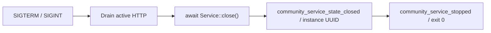
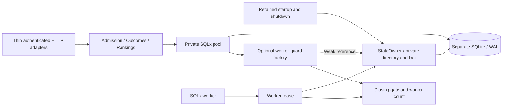

# Community service

`hito-community` owns an independent SQLite store and Axum router for reporter admission, successful-playback receipts, and candidate rankings. It has no dependency on the application core or its database. Application opt-ins, corrections, and public operation remain unfinished under the [release plan](release-plan.md#community-service).

## Current HTTP contract

POST request bodies use JSON with a 16 KiB limit. Request objects reject unknown fields. Authentication accepts one `Authorization: Bearer` header containing a 64-character lowercase hexadecimal token. Responses carry `Cache-Control: no-store` and a generated `X-Request-Id`.

| Route | Authority | Behavior |
| --- | --- | --- |
| `POST /v1/admin/reporters` | Separate administrator bearer | Accepts `{}` and returns `201` with a new reporter UUID and random 256-bit bearer. The token is returned on creation; there is no token-read endpoint. |
| `POST /v1/outcomes` | Provisioned reporter bearer | Accepts a version-4 submission UUID, public source reference, and `successful_playback` outcome. A committed new receipt returns `201`; an exact retry by that reporter returns the original receipt with `200`. Reusing its UUID for another source returns `409`. |
| `POST /v1/rankings` | Public | Accepts 1–32 distinct candidate source references and returns only those candidates, ordered by distinct successful reporters. Equal counts preserve input order. |
| `GET /v1/openapi.json` | Public | Returns OpenAPI 3 generated from the registered Rust handlers and actual wire DTOs, including distinct administrator and reporter bearer schemes. |

The schema records strict input objects, the candidate count and uniqueness rules, and request and response types. Field descriptions explain the conditional provider-ID rules and version-4 UUID requirement without changing accepted UUID text forms. The candidate schema uses the actual `SourceRef` component and shares its maximum count with runtime validation. There is no separately maintained JSON API model.

The [Rust wire types](../crates/hito-community/src/wire.rs) define the contract. Source references contain `provider` and `recording_id`. YouTube IDs have exactly 11 ASCII letters, digits, underscores, or hyphens. Jamendo IDs are canonical positive decimal `u64` values without leading zeros. Other providers and URL-shaped references are rejected. No request field accepts audio, paths, credentials, stream URLs, titles, or arbitrary metadata.

The trusted host supplies an administrator token and an absolute state directory through `Config`. Only the administrator can provision reporters. The database stores reporter-token hashes; the administrator-token hash stays in process memory. A reporter UUID is a service pseudonym, separate from application accounts and backend host or synchronization identities. Credentials do not attest real listening or distinct humans. The service accepts a playback-success claim; it does not validate audio or measure playback itself. Selection reports are not an accepted outcome.

Each reporter contributes at most one count per source, even with multiple submission UUIDs. Counts cover the currently retained reports. They are not a measured playback-success probability. The future application client must filter candidates to configured, available providers before requesting rankings and preserve personal source choices and overrides. Sending candidate IDs is itself a disclosure that the opt-in design must address.

## Executable runtime

The development executable takes an absolute state directory and an absolute administrator-token file path:

```sh
hito-community --state-directory /srv/hito-community/state \
  --admin-token-file /run/secrets/hito-community-admin-token
```

It listens on `127.0.0.1:8095` by default. An optional `--listen IP:PORT` supplies a socket address. There is no inline-token or environment-token option. The token file must already exist as a regular file owned by the effective user, with one hard link and exact `0400` or `0600` permissions. Its contents must be 64 lowercase hexadecimal characters, optionally followed by LF or CRLF. The final open uses no-follow and nonblocking flags, and reads at most 67 bytes. Non-Unix credential loading fails closed pending an ACL design.

The runtime registers SIGTERM and SIGINT before listening. Public `GET /v1/openapi.json` provides schema readiness. On a signal, Axum drains admitted requests before the runtime awaits `Service::close()`. Only after that state barrier returns does the runtime emit its correlated state-close event and report a successful stop. Bind and serve errors use the same awaited state cleanup before reporting failure.



JSON lifecycle logs carry a generated service-instance UUID, safe outcomes and elapsed times. A hard target filter admits only this crate before applying `RUST_LOG`; dependency TRACE output cannot be enabled through the environment filter. Malformed filters fall back to `info` without echoing their contents. Failures use static reasons rather than raw arguments, paths or errors.

The runtime instance span covers readiness, shutdown request, runtime state-close and stopped events. Library initialization and lifecycle tasks do not all inherit that span. In particular, the existing `community_state_closed` event is not guaranteed to carry `service_id`. The runtime-owned `community_service_state_closed` acknowledgment follows the actual awaited close and supplies that correlation without changing library logging.

## Private state and teardown



Capability modules own SQL and transactions. The service composition owns startup and shutdown. State admission checks the original ancestry component by component, including alias locations and targets. Ancestors must belong to root or the effective user and prevent replacement by other users; sticky temporary directories are allowed. State directories and files must belong to the effective user with exact `0700` and `0600` modes. Final entries use no-follow opens. Linux SQLite paths use the retained directory handle. Non-Unix state admission currently fails closed.

The pinned [SQLx SQLite package](third-party/sqlx-sqlite.md) has an optional worker-guard factory. Its default is absent, so other consumers keep the existing behavior. A guard is reserved before thread creation and transferred to the worker. It is released after worker-local resources and references are released. Shared SQLite state can also have owners outside that worker, so the guard is not a promise of complete SQLite destruction or OS thread termination.

The community factory holds the tracker and a weak state-owner reference. Under one mutex it checks that admission is open, upgrades the owner, and increments the worker count. A worker lease releases its owner reference before publishing the decremented count. Shutdown closes admission, closes the pool to size zero, waits for counted leases to finish, releases the state owner, then acknowledges completion. Pool options and live routers do not keep a strong state-owner reference. Failed initial connection setup waits for the same lease barrier; retained startup work survives caller cancellation.

SQLx core 0.8.6 can return from `Pool::close()` after a concurrent connection return has repopulated its idle queue. A root Docker diagnostic observed pool size 1 and idle count 0 before close, then size 1 and idle count 1 after it returned. That idle connection retained its worker sender. The private teardown therefore awaits close passes until size reaches zero before waiting for worker leases. With the configured one-connection pool and admission closed, an unfinished connection must either close before releasing its permit or enter the idle queue before releasing it. A second pass drains that late return. This barrier uses awaited resource cleanup rather than timed polling.

Structured service events contain static routes, safe outcomes, request IDs, counts, and durations. Token, reporter, source-reference, path, raw-body, and raw-driver-error values are excluded. The real-process fixture captures logs with `RUST_LOG=trace` and checks controlled private inputs; broader adversarial privacy cases remain pending.

## Evidence and remaining work

Accepted root-run Docker evidence includes:

| Public regression | Evidence |
| --- | --- |
| [Outcome HTTP tracer](../crates/hito-community/tests/outcome_http.rs) | Reporter provisioning, durable receipt, restart, exact replay, and candidate ranking passed in 0.03 seconds. Close runs while the router still owns service clones. Each phase has a bounded deadline. |
| [Failed startup](../crates/hito-community/tests/startup_failure.rs) | An actual SQLite authorizer rejects initial journal-mode setup and a destructor holds real close. Startup remains pending for the original five-second check with its state claim held. After release, failed startup returns with the first callback's exit marker set and the claim already released; reopening the same state succeeds. The corrected fixture passed in 5.03 seconds. |
| [State admission](../crates/hito-community/tests/state_admission.rs) | A private state directory below a nonsticky `0777` ancestor is rejected before state files are created. Passed in less than 0.01 seconds. |
| [Generated OpenAPI](../crates/hito-community/tests/openapi.rs) | The public document describes the four actual routes, distinct authority, strict DTO references, body and ID constraints, candidate bounds, replay/conflict responses, and fixture-secret/path exclusion. Passed in 0.02 seconds. |
| [Executable runtime](../crates/hito-community/tests/runtime.rs) | A real child loads an owned `0400` token file, serves schema readiness, and admits an authenticated request whose body is held at HTTP `100 Continue`. SIGTERM leaves the child pending until body release; its `201` response precedes joined state cleanup and exit zero. A restart accepts the persisted reporter. TRACE capture excludes controlled tokens, private paths, source IDs, query/header/cookie values and raw-body values. Lifecycle events share a valid instance UUID, and restart has a different UUID. Passed in 0.11 seconds. |

The latest full community run passed all five cases, and strict all-target Clippy passes. The earlier OpenAPI slice passed four community cases and three Jamendo cases together in a locked Docker run, with formatting, strict all-target Clippy for both crates and an independent OpenAPI source review.

Independent runtime security and performance source reviews found no issues. The correctness review identified missing instance correlation at state close. An added public child assertion failed on the absent runtime event, then passed after the runtime emitted its acknowledgment after awaited cleanup. The accepted checks use owned Linux fixtures; source review is not load or platform evidence.

The startup fixture previously required the close callback's observed OS thread to disappear after gate release. That exceeded the documented resource barrier: SQLite connection state is shared through `Arc`, and its final destruction can run on the caller. The corrected gate keeps the genuine blocked C close, pending startup and held-claim checks, then asserts callback exit, immediate claim release and recovery. A separate source review accepted this fixture correction. Historical failing samples observed a live callback thread with a released claim; their exact thread identity and cause remain unproven.

The preceding foundation passed workspace and modified-driver formatting, strict all-target Clippy for community, core, server and the folder plugin, and 55 directed driver compatibility cases. Those comprise twelve selected core cases, all 38 folder-plugin cases and five server cases covering embedded lifecycle, signals and download restart. These are development checks, not full workspace, packaged-image or platform acceptance. Caller-cancellation, setup-timeout, spawn-failure, wider alias and ownership cases, and load behavior need their own controlled evidence.

The service is not ready for public deployment. Adversarial runtime bootstrap and cancellation, container packaging, deployment configuration, rate limits, quotas, retention and erasure, reporter revocation, moderation, correction suggestions, provider-backed validation, live hosting, and DNS remain open. Correction suggestions must require provider validation or maintainer approval before affecting automatic matching. Separate disabled-by-default application opt-ins, account isolation, personal overrides, and playback during community outages remain client work. There is currently no application-to-community network path and no outbound provider fetch in this crate.
