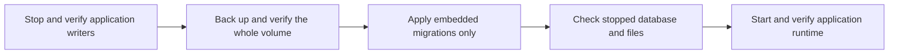

# Database maintenance

The server includes an explicit migration-only command, now included in the normal local development deployment. It exists so an upgrade can inspect migrated data before normal startup launches background work.

```text
hito-server migrate --database PATH --expect-version VERSION
```

`PATH` must identify an existing regular Hito SQLite database. `VERSION` must match its current, complete embedded migration prefix. Missing files, unrelated databases and mismatched histories are rejected. SQLx validates the migration checksums and applies the same embedded migrations used by normal startup.

Stop every application writer and take a whole-volume backup before using this command. Keep the SQLite database on local persistent storage. An exclusive SQLite connection does not establish that another Hito process has stopped, particularly with WAL or an idle connection pool. The operator must verify that separately.



The command bypasses runtime configuration, web assets, folder initialization, device identity, plugin-key initialization, HTTP listeners and background jobs. Core owns the database connection and migration lifecycle. Canceling an observing future leaves that owned operation running through connection close. The CLI waits for completion when it receives its graceful shutdown signal.

SQLx applies migrations with its own transaction handling. A batch can stop after earlier migrations have committed. Do not infer that an error rolled back the entire upgrade. Inspect the actual migration history before retrying or restoring the stopped backup.

Success emits JSON with the previous and current versions, applied count and elapsed time. Failure emits a static error code and elapsed time. Output excludes the database path, raw database errors, credentials and library contents.

The real-binary test upgrades a populated migration-29 library through migration 35 while unavailable runtime assets and due scan, Follow and download jobs are present. It verifies no provider requests, preservation of prior typed application and FTS rows, noncontiguous transfer and receipt rowids, sequence high-water marks, migration checksums, private key and device-ID bytes, and original and managed audio bytes. It checks foreign keys and database integrity after the upgrade.

Nine additional real-binary cases verify missing, empty and unrelated files, wrong versions, checksum failures, invalid integer and text success markers, an exact-version no-op and selection of a literal URI-like filename beside another database. Failure output is checked against private path, title and token canaries. A separate public-capability test cancels the observer at a completed history-read barrier, then requires the owned migration's post-close outcome, preserved data and a fresh writable transaction. All 11 directed cases, strict core/server Clippy, default workspace checks and formatting pass.

These tests do not establish whole-volume filesystem metadata preservation, backup restoration, real lock contention, graceful CLI signals, platform acceptance or public upgrade readiness. Those checks remain separate release work. Native command-line path parsing also does not add non-UTF-8 filename support to SQLx.

## Stopped migration 0046 to 0048 rehearsal

On 2026-10-18, the bundled migration-only executable in image `sha256:ecfaee71be260f83131d9a3d513165f7b52fbcc3925023754c610b461c38e0f8` upgraded a separate restored clone from migration 0046 to 0048. The input was a retained, verified whole-volume archive taken while the normal server was stopped. This rehearsal never mounted or queried the normal volume and did not authenticate a listener account.

Archive headers and payload hashes matched the retained manifest before restoration into a new empty volume. The stopped baseline and migrated clone passed read-only audits. The migration ran as UID 10001 with networking disabled, no published ports, a read-only container root and write access only to the clone. Its JSON outcome reported two applied migrations and the process exited successfully. No server runtime or background worker started.

The audit preserved all 106 prior application tables, 12 prior views and 12,572 prior typed rows, including rowids, generated columns, sequence state, statistics and index/foreign-key metadata. All 46 earlier migration receipts and checksums remained unchanged. The only schema additions were four empty tables, four declared indexes, six implicit indexes and eight triggers, plus the two verified migration receipts. Integrity and foreign-key checks passed; six FTS integrity checks ran on separate writable audit copies.

Non-SQLite files, keys and host identity retained their exact contents, owners, modes and timestamps. Original database permissions were preserved rather than normalized; private audit copies use mode 0600. Source hashes and result hashes bind each accepted stage to the reviewed audit. All five owned containers exited with code zero, no out-of-memory termination or active clone writer remained, and the clone and private evidence were retained.

This establishes the stopped clone's restoration and migration-only preservation. Full runtime startup, active work, normal deployment, migration 0049 and packaged platform upgrades remain separate gates.

## Migration 0056, remembered album editions

Migration 0056 is purely additive. It creates `album_edition_choices` (one row per account and release, with revision, reviewed association, provider installation, release-group ID and edition ID), `album_edition_choice_receipts`, two scope triggers that require the account's own association, and two triggers that keep receipts immutable and retained. It adds 8 schema objects (2 tables, 2 implicit indexes, 4 triggers) and touches no existing table, row, index or trigger. Both new tables start empty.

An upgrade test builds a populated migration-55 database, snapshots every table with its rowids, applies 0056, and requires the snapshot, the prior schema text, foreign keys and integrity to stay exact. It names the 8 added objects exactly and exercises the new constraints. The migration-only server tests name the same objects, and the schema snapshot bound is now 546 objects (it was 540, with 538 present before 0056).

Before upgrading a deployment, stop writers and take the whole-volume backup described above. Running `hito-server migrate --expect-version 55` then applies only 0056. Restoring the backup is the rollback, since the migration is not reversible in place. Nothing here has been run against the VPS volume.

## Migration 0065, correction erasure

Migration 0065 changes how the append-only artist-correction tables allow rows to leave. It runs on the local development server and is not part of a release. It adds `correction_erasure_scopes` (kind `account` or `recording`, plus a subject) with its implicit index and one insert trigger, `shared_artist_correction_source`. It replaces 19 delete or update triggers so that a delete is allowed only while a scope row names the row's account or recording, and it rebuilds `shared_artist_corrections` and `shared_artist_correction_states` so their author columns, and the pointers from a correction to its administrator's private change, can become null. The rebuild copies every row in sequence order and keeps the numbering high-water mark. It adds 3 schema objects and replaces 21 (2 tables and 19 triggers); the declared lists in the upgrade fixtures name each one, and the server schema snapshot bound is now 637 objects.

The scope table is empty outside a transaction. Nothing disables a trigger at run time. Erasing happens only through core's account and recording erase steps, which are not called by any workflow yet. Because rows can now be removed, gaps appear in the correction ordering table, but its values are never renumbered, so VACUUM and restore keep the order in which personal and shared decisions were made.

An upgrade test builds a populated migration-64 database with three shared corrections (numbers 1, 2 and 5), their subjects and states, applies 0065 with foreign keys enforced, and requires identical rows, a clean foreign key check, the high-water mark of 5 and a next number of 6. Before upgrading a deployment, stop writers and take the whole-volume backup described above; running `hito-server migrate --expect-version 64` applies 0065 after any pending earlier migration. Restoring the backup is the rollback.

## Migration 0066, automatic metadata

Migration 0066 adds `account_metadata_automation` (the automatic artist lookup, artwork and service search choices, plus the last matching result), `artist_matching_jobs` (one resumable matching walk per account) and `cover_art_lookups` (Cover Art Archive lookups per account). It only adds 3 tables and 6 indexes, and the server schema snapshot bounds are now 646 objects and 150 tables. It runs on the local development server. During development the file was edited in place after first being written, so a development volume that applied an earlier 0066 must be recreated (or have those three tables dropped and `_sqlx_migrations` row 66 removed) before upgrading; the normal local volume did not have the early version. Rollback of a deployment is the whole-volume backup described above.

## Migration 0067, account erasure

Migration 0067 lets account deletion remove the retained ledgers an account owns. It adds `erased_download_files` (managed download file and attempt identifiers plus the host device, no account reference) with its implicit key index and `erased_download_files_host`, and it replaces 17 delete triggers (download receipts, retentions, playlist receipts and terminal failures; provider bindings; source resolution, choice and reset receipts and automatic source decisions; podcast episodes, source mappings, request counts, subscription, refresh and unsubscribe receipts and podcast sources; playlist metadata refresh receipts). Each trigger now allows a delete only while an `account` row in `correction_erasure_scopes` names the account that owns the row, found directly or through the owning intent, installation, resolution, episode or recording library. Without that row every delete is refused as before. It adds 3 schema objects and replaces 17 triggers; the declared lists in the upgrade fixtures name each one, and the server schema snapshot bounds are now 649 objects and 151 tables. It runs on the local development server. Rollback of a deployment is the whole-volume backup described above.

Account deletion is the only caller. The scope row is written and removed inside the deletion transaction, and opening the database clears any leftover scope. `erased_download_files` is the crash-recovery ledger for files: the download worker removes each listed file for its own host and then the row, so a restart after the commit still removes them. The pinned upgrade and maintenance fixtures now cover version 67.

The ledger is drained only by the host whose `host_device` matches the entry, which assumes one backend host per database. Entries for another host stay until that host runs the download worker. One pass tries every entry of this host (up to 256); an entry whose file cannot be removed stays and is retried on the next pass without holding back the others, and a warning with counts only is logged.

## Migration 0068, source genres

Migration 0068 adds `source_genres` (one row per source and normalized genre key, with the display label) and the covering index `source_genres_by_genre`. Rows come from the `genre` file tag that inspection version 6 retains. Existing files fill in on their first re-scan, which re-probes every file once. The table cascades with its source. It runs on the local development server. See [genres](catalog-browsing.md#genres-and-artist-radio).

## Migration 0069, MusicBrainz genres

Migration 0069 adds `musicbrainz_genre_lookups` (entity kind `artist`, `release_group` or `recording`, MusicBrainz identifier and fetch time), `musicbrainz_genres` (up to eight genres per identity, provenance fixed to `musicbrainz`, deleted with the lookup row), the index `musicbrainz_genres_by_genre` and an index on `recording_musicbrainz_observations` by identifier. The cache is keyed by MusicBrainz identifier, not by account. Account erasure keeps cache rows only for identities another account still names. It runs on the local development server. See [MusicBrainz genres](artist-matching.md#musicbrainz-genres).

## Migration 0070, source unavailability

Migration 0070 adds `source_unavailability` (source, and the Unix time it stopped being available; deleted with its source), the index `source_unavailability_by_since` and three triggers on `sources`: one on insert of an unavailable source, one when `ready` changes from 1 to 0 (records the time, replacing an older row) and one when `ready` becomes 1 (deletes the row). It copies a row for every source that is unavailable when it runs, dated at the upgrade, so existing missing files start their 30-day clock then. It adds 6 schema objects (1 table, 1 implicit key index, 1 index and 3 triggers), changes no existing row and runs on the local development server. The pinned upgrade and maintenance fixtures name each object, and the schema snapshot bound is now 664 objects. Rollback of a deployment is the whole-volume backup described above.

Retention is part of the server's background work, not of the stopped migration command. Two minutes after start and every six hours, one bounded pass removes library recordings whose files have been missing for 30 days (only while their folders are connected and have completed a scan) and that no account or personal decision uses (at most 500 per pass in transactions of 50, then again after five seconds while more are due). The same removal is the administrator action in Settings. Rules, limits and evidence: [missing tracks](music-folders.md#missing-tracks).

## Migration 0071, credit match provenance

Migration 0071 adds `artist_association_credit_matches` (one row per artist association, with the evidence kind `file_tag_artist_id`, `isrc`, `provider_url` or `name_discography`, the number of source tracks of 1 or more, and the receipt order). It adds two triggers: one refuses every update, and one refuses a delete unless a `correction_erasure_scopes` row names the association's account or recording. It then queues matching and clears old work. Every account that has a name check gets its matching job set to rerun, or a new job if it has none. After that the migration deletes all rows in `artist_name_checks`, so those credits are examined again under the score rule. It rewrites no association, credit or other existing row. It adds 3 schema objects.

For an operator: take the whole-volume backup first. The delete of name checks cannot be undone, and only a restored backup reverses the migration. It is safe with live queued rows. It does not touch queued downloads, scans or lookups, and a matching walk that is under way is marked to run again. See [credit-level matching](artist-matching.md#credit-level-matching).

Evidence: `crates/core/tests/artist_identity/artist_credit_matches_upgrade.rs` checks that all name checks are gone, that accounts with checks walk again, that a walk under way is rerun and that other accounts are untouched, and that the new table refuses an unknown evidence kind and a source track count of 0.

## Migration 0072, name check rule

Migration 0072 adds `artist_name_checks.rule` (integer, default 1) and `artist_matching_jobs.unavailable` (0 or 1, default 0, checked). The flag counts a walk that met an unavailable provider once, so attempts count walks and not batches. It then sets every account that has a name check to rerun. It keeps every name check row, and the default records them as rule 1, which the current rule ignores. No other existing row changes. No table or index is added.

For an operator: take the whole-volume backup first. Restoring it is the only way back. It is safe with live queued rows, since each added column has a default and the only data change is the rerun flag. See [matching by name with corroboration](artist-matching.md#matching-by-name-with-corroboration).

Evidence: `crates/core/tests/artist_identity/artist_name_check_rule_upgrade.rs` checks that checks keep their rows with rule 1, that accounts with checks walk again with their attempt count kept, and that `unavailable=2` is refused.

## Migration 0073, coverage matches

Migration 0073 adds `artist_association_coverage_matches` (association, matched tracks of 1 or more, probed tracks no lower than matched tracks, receipt order). It has the same two triggers as 0071: updates are refused and deletes are refused outside an erasure scope. It sets every account that has a name check to rerun. It does not delete name checks and rewrites no existing row. It adds 3 schema objects.

For an operator: take the whole-volume backup first. Restoring it is the only way back. It is safe with live queued rows. Name checks of the earlier rule stay in place but no longer hide a recording, so affected accounts walk again after the server starts. See [credit-level matching](artist-matching.md#credit-level-matching).

Evidence: `crates/core/tests/artist_identity/artist_coverage_matches_upgrade.rs` checks that checks keep their rows and rule numbers, that accounts with checks walk again, and that matched tracks of 0, or matched above probed, are refused.

## Migration 0074, name match rule

Migration 0074 adds `artist_association_name_matches.rule` (default 2) and sets it to 3 for matches created at or after the install time that `_sqlx_migrations` holds for migration 73. If that row is missing, every match stays at 2. To do this it drops the immutability trigger on the table and creates it again with the same name and message. It sets every account that has a name check to rerun. It rewrites existing name match rows, but only the new column. It keeps name checks.

For an operator: take the whole-volume backup first. Restoring it is the only way back. The rule split depends on timestamps, so a database whose migration 73 install time was lost, or was reset by a restore, labels every match as rule 2. The migration is safe with live queued rows. See [matching by name with corroboration](artist-matching.md#matching-by-name-with-corroboration).

Evidence: `crates/core/tests/artist_identity/artist_name_match_rule_upgrade.rs` checks that a match made before migration 0073 is rule 2 and a later one is rule 3, that the account walks again, and that updating a match is still refused. The test does not cover a missing migration 73 row.

## Migration 0075, artist review queue

Migration 0075 adds three tables. `artist_name_candidates` holds the artists the name walk found under a credit and could not tell apart, with position, name, kind, disambiguation, country and the number of corroborated titles. `artist_review_dismissals` holds the candidates an account dismissed. `artist_association_candidate_confirmations` is provenance for an association the account created by confirming a candidate, with the evidence kind fixed to `user_confirmed_candidate`. The provenance table has the same two triggers as 0071. The first two tables reference `users`. The migration sets every account that has a name check to rerun. It starts with no candidates, dismissals or confirmations and rewrites no existing row. It adds 3 tables and 2 triggers, plus the implicit key indexes.

For an operator: take the whole-volume backup first. Restoring it is the only way back. It is safe with live queued rows. The walk fills the candidate table, not the migration. See [the review queue](artist-matching.md#review-queue-for-credits-the-walk-could-not-identify) and [artist review](artist-review.md).

Evidence: `crates/core/tests/artist_identity/artist_review_queue_upgrade.rs` checks that the three tables exist and are empty, that checks keep their rows and rules, that accounts with checks walk again, that rows for a missing user or association are refused, and that the provenance row cannot be updated or deleted.

## Migration 0076, recording identifier matches

Migration 0076 adds `artist_association_recording_id_matches` (association, receipt order, created time) with the same two triggers as 0071. It then queues a re-examination. Every account whose library holds a recording with a MusicBrainz recording identifier in its current tag observation gets its job set to rerun, or a new job. The migration deletes the `artist_provider_checks` rows for those recordings only. It rewrites no association or credit.

For an operator: take the whole-volume backup first. The deleted provider checks cannot be recovered, and restoring the backup is the only way back. It is safe with live queued rows. Recordings without a tagged identifier keep their checks. See [release and recording identifiers from tags](artist-matching.md#release-and-recording-identifiers-from-tags).

Evidence: `crates/core/tests/artist_identity/artist_recording_id_matches_upgrade.rs` has two cases. One checks that the migration only adds the provenance table and its triggers and keeps every earlier schema object exactly. The other checks that the check for the tagged recording is deleted, the check for the untagged one stays, and both library members get a job with rerun 0.

## Migration 0077, recording groups

Migration 0077 adds `recording_group_members` (account, recording, canonical recording, proof `musicbrainz_recording` or `isrc`; the canonical recording must differ from the member) and `recording_group_splits` (account, two recordings stored in order, so the pair is unique). It adds the indexes `recording_group_members_canonical`, `recording_group_members_canonical_only`, `recording_group_splits_other`, `recording_musicbrainz_observation_mbid` and `recording_isrc_observation_isrc`. Two triggers refuse an update and refuse an insert that would make a group more than one level deep. It sets rerun on every account that has a recording with a current ISRC or recording identifier, or adds a job. It changes no recording, source or personal reference. The groups are filled by the walk that follows. It adds 2 tables, 5 indexes, 2 triggers and the implicit key indexes.

For an operator: take the whole-volume backup first. Restoring it is the only way back. It is safe with live queued rows. See [one card for a proven song](recording-identity.md#one-card-for-a-proven-song).

Evidence: `crates/core/tests/catalog/recording_groups_upgrade.rs` has two cases. One checks that only the tables, triggers and identifier indexes are added and every earlier object is kept. The other checks the requeue. An account with a tagged recording that already had a job is set to rerun, an account with an ISRC gets a new job at rerun 0, and an account with neither gets none.

## Migration 0078, credited artists

Migration 0078 adds three tables. `recording_credit_observations` holds a credit label and a credit key per observation. `recording_credited_artist_observations` holds up to 16 artists per observation (position 0 to 15) with name, role `main` or `featured`, join phrase, provider artist identifier and an `https://` page URL, each with a length check. `account_credit_keys` maps an account, library and credit key to an account artist. Updates to the first two tables are refused by triggers. It adds the indexes `recording_credit_observation_recording`, `recording_credited_artist_observation_recording` and `account_credit_key_artist`. It copies and queues nothing. Older observations have no rows, and existing credits are not regrouped.

For an operator: take the whole-volume backup first. Restoring it is the only way back. It only adds objects, so it is safe with live queued rows. See [credited artists from providers](metadata.md#credited-artists-from-providers).

Evidence: `crates/core/tests/catalog/credited_artists_upgrade.rs` checks that every earlier schema object is kept, that an existing credit still reads the same, that the three tables start empty, and that malformed rows and updates are refused.

## Migration 0079, follow approval baseline

Migration 0079 adds `playlist_follows.approved_capabilities` and `playlist_follows.approved_credential` (both nullable text). It then fills them for every follow whose recorded installation revision equals the installation's current revision. The capability list comes from the installation manifest. The credential marker is the hex of 24 bytes taken from the saved credential, or null if there is none. A follow recorded against an older installation revision keeps null in both columns. This rewrites existing `playlist_follows` rows. It adds no table or index.

For an operator: take the whole-volume backup first. Restoring it is the only way back. It is safe with live queued rows. Follows that stay null do not resume by themselves, and the owner approves their current capabilities once. See [connection changes and resume](playlist-follow.md#connection-changes-automatic-resume-and-explicit-resume).

Evidence: `crates/core/tests/playlist_follow/playlist_follow_approval_upgrade.rs` checks that a follow at the current revision gets a capability list that contains `search` and that a follow at an older revision gets none. That test does not check the credential marker, so I cannot say from the tests how the marker is built beyond what the SQL does.

## Migration 0080, artist photos

Migration 0080 rebuilds `cover_art_lookups` so its kind check also admits `artist`. The columns, primary key, foreign key and both indexes (`cover_art_lookups_queue` and `cover_art_lookups_asset`) are recreated unchanged. The rows are copied unchanged with their state, attempts, next attempt, lease and update time. No table or index is added or removed, so the schema snapshot bounds do not change. This is the only change.

For an operator: take the whole-volume backup first. Restoring it is the only way back. It is safe with live queued rows. They are copied with their lease and attempt values, as long as the writers are stopped as the migration command requires. It was applied to the local development server and is part of the 2026-11-02 deployment. See [artist photos](plugin-artwork.md#artist-photos).

Evidence: `crates/core/tests/catalog/artist_photos_upgrade.rs` checks that release and release-group lookups survive with the same state, attempts and next attempt, that an artist lookup is refused before and accepted after, and that other kinds stay refused.

## Migration 0081, credited artist photos

Migration 0081 rebuilds `cover_art_lookups` a second time, with the same columns, keys and indexes. Its kind check also admits `credited_artist`, and its identifier check allows 1 to 64 characters for that kind and exactly 36 for the others. Existing rows are copied unchanged. No table or index is added or removed.

For an operator: take the whole-volume backup first. Restoring it is the only way back. It is safe with live queued rows, since queued, running, ready, missing and unavailable lookups are copied with their values. It was applied to the local development server and is part of the 2026-11-02 deployment. See [artist photos](plugin-artwork.md#artist-photos).

Evidence: `crates/core/tests/catalog/credited_artist_photos_upgrade.rs` has two cases. One checks that lookups are kept, that a credited artist lookup is refused before and accepted after, and that an empty identifier, a 65-character identifier and unknown kinds are refused. The other checks that ready, running and unavailable lookups are kept whole and that a foreign key check finds no violations.
