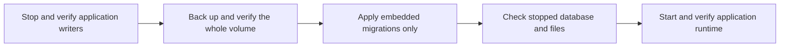

# Database maintenance

The development server includes an explicit migration-only command. It is not yet included in the normal local deployment. It exists so an upgrade can inspect migrated data before normal startup launches background work.

```text
hito-server migrate --database PATH --expect-version VERSION
```

`PATH` must identify an existing regular Hito SQLite database. `VERSION` must match its current, complete embedded migration prefix. Missing files, unrelated databases and mismatched histories are rejected. SQLx validates the migration checksums and applies the same embedded migrations used by normal startup.

Stop every application writer and take a whole-volume backup before using this command. Keep the SQLite database on local persistent storage. An exclusive SQLite connection does not establish that another Hito process has stopped, particularly with WAL or an idle connection pool. The operator must verify that separately.



The command bypasses runtime configuration, web assets, folder initialization, device identity, plugin-key initialization, HTTP listeners and background jobs. Core owns the database connection and migration lifecycle. Canceling an observing future leaves that owned operation running through connection close. The CLI waits for completion when it receives its graceful shutdown signal.

SQLx applies migrations with its own transaction handling. A batch can stop after earlier migrations have committed. Do not infer that an error rolled back the entire upgrade. Inspect the actual migration history before retrying or restoring the stopped backup.

Success emits JSON with the previous and current versions, applied count and elapsed time. Failure emits a static error code and elapsed time. Output excludes the database path, raw database errors, credentials and library contents.

The real-binary test upgrades a populated migration-29 library through migration 35 while unavailable runtime assets and due scan, Follow and download jobs are present. It verifies no provider requests, preservation of prior typed application and FTS rows, noncontiguous transfer and receipt rowids, sequence high-water marks, migration checksums, private key and device-ID bytes, and original and managed audio bytes. It checks foreign keys and database integrity after the upgrade.

Nine additional real-binary cases verify missing, empty and unrelated files, wrong versions, checksum failures, invalid integer and text success markers, an exact-version no-op and selection of a literal URI-like filename beside another database. Failure output is checked against private path, title and token canaries. A separate public-capability test cancels the observer at a completed history-read barrier, then requires the owned migration's post-close outcome, preserved data and a fresh writable transaction. All 11 directed cases, strict core/server Clippy, default workspace checks and formatting pass.

These tests do not establish whole-volume filesystem metadata preservation, backup restoration, real lock contention, graceful CLI signals, platform acceptance or public upgrade readiness. Those checks remain separate release work. Native command-line path parsing also does not add non-UTF-8 filename support to SQLx.
