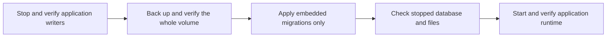

# Database maintenance

The server includes an explicit migration-only command, now included in the normal local development deployment. It exists so an upgrade can inspect migrated data before normal startup launches background work.

```text
hito-server migrate --database PATH --expect-version VERSION
```

`PATH` must identify an existing regular Hito SQLite database. `VERSION` must match its current, complete embedded migration prefix. Missing files, unrelated databases and mismatched histories are rejected. SQLx validates the migration checksums and applies the same embedded migrations used by normal startup.

Stop every application writer and take a whole-volume backup before using this command. Keep the SQLite database on local persistent storage. An exclusive SQLite connection does not establish that another Hito process has stopped, particularly with WAL or an idle connection pool. The operator must verify that separately.



The command bypasses runtime configuration, web assets, folder initialization, device identity, plugin-key initialization, HTTP listeners and background jobs. Core owns the database connection and migration lifecycle. Canceling an observing future leaves that owned operation running through connection close. The CLI waits for completion when it receives its graceful shutdown signal.

SQLx applies migrations with its own transaction handling. A batch can stop after earlier migrations have committed. Do not infer that an error rolled back the entire upgrade. Inspect the actual migration history before retrying or restoring the stopped backup.

Success emits JSON with the previous and current versions, applied count and elapsed time. Failure emits a static error code and elapsed time. Output excludes the database path, raw database errors, credentials and library contents.

The real-binary test upgrades a populated migration-29 library through migration 35 while unavailable runtime assets and due scan, Follow and download jobs are present. It verifies no provider requests, preservation of prior typed application and FTS rows, noncontiguous transfer and receipt rowids, sequence high-water marks, migration checksums, private key and device-ID bytes, and original and managed audio bytes. It checks foreign keys and database integrity after the upgrade.

Nine additional real-binary cases verify missing, empty and unrelated files, wrong versions, checksum failures, invalid integer and text success markers, an exact-version no-op and selection of a literal URI-like filename beside another database. Failure output is checked against private path, title and token canaries. A separate public-capability test cancels the observer at a completed history-read barrier, then requires the owned migration's post-close outcome, preserved data and a fresh writable transaction. All 11 directed cases, strict core/server Clippy, default workspace checks and formatting pass.

These tests do not establish whole-volume filesystem metadata preservation, backup restoration, real lock contention, graceful CLI signals, platform acceptance or public upgrade readiness. Those checks remain separate release work. Native command-line path parsing also does not add non-UTF-8 filename support to SQLx.

## Stopped migration 0046 to 0048 rehearsal

On 2026-10-18, the bundled migration-only executable in image `sha256:ecfaee71be260f83131d9a3d513165f7b52fbcc3925023754c610b461c38e0f8` upgraded a separate restored clone from migration 0046 to 0048. The input was a retained, verified whole-volume archive taken while the normal server was stopped. This rehearsal never mounted or queried the normal volume and did not authenticate a listener account.

Archive headers and payload hashes matched the retained manifest before restoration into a new empty volume. The stopped baseline and migrated clone passed read-only audits. The migration ran as UID 10001 with networking disabled, no published ports, a read-only container root and write access only to the clone. Its JSON outcome reported two applied migrations and the process exited successfully. No server runtime or background worker started.

The audit preserved all 106 prior application tables, 12 prior views and 12,572 prior typed rows, including rowids, generated columns, sequence state, statistics and index/foreign-key metadata. All 46 earlier migration receipts and checksums remained unchanged. The only schema additions were four empty tables, four declared indexes, six implicit indexes and eight triggers, plus the two verified migration receipts. Integrity and foreign-key checks passed; six FTS integrity checks ran on separate writable audit copies.

Non-SQLite files, keys and host identity retained their exact contents, owners, modes and timestamps. Original database permissions were preserved rather than normalized; private audit copies use mode 0600. Source hashes and result hashes bind each accepted stage to the reviewed audit. All five owned containers exited with code zero, no out-of-memory termination or active clone writer remained, and the clone and private evidence were retained.

This establishes the stopped clone's restoration and migration-only preservation. Full runtime startup, active work, normal deployment, migration 0049 and packaged platform upgrades remain separate gates.

## Migration 0056, remembered album editions

Migration 0056 is purely additive. It creates `album_edition_choices` (one row per account and release, with revision, reviewed association, provider installation, release-group ID and edition ID), `album_edition_choice_receipts`, two scope triggers that require the account's own association, and two triggers that keep receipts immutable and retained. It adds 8 schema objects (2 tables, 2 implicit indexes, 4 triggers) and touches no existing table, row, index or trigger. Both new tables start empty.

An upgrade test builds a populated migration-55 database, snapshots every table with its rowids, applies 0056, and requires the snapshot, the prior schema text, foreign keys and integrity to stay exact. It names the 8 added objects exactly and exercises the new constraints. The migration-only server tests name the same objects, and the schema snapshot bound is now 546 objects (it was 540, with 538 present before 0056).

Before upgrading a deployment, stop writers and take the whole-volume backup described above. Running `hito-server migrate --expect-version 55` then applies only 0056. Restoring the backup is the rollback, since the migration is not reversible in place. Nothing here has been run against the VPS volume.

## Migration 0065, correction erasure

Migration 0065 changes how the append-only artist-correction tables allow rows to leave. It runs on the local development server and is not part of a release. It adds `correction_erasure_scopes` (kind `account` or `recording`, plus a subject) with its implicit index and one insert trigger, `shared_artist_correction_source`. It replaces 19 delete or update triggers so that a delete is allowed only while a scope row names the row's account or recording, and it rebuilds `shared_artist_corrections` and `shared_artist_correction_states` so their author columns, and the pointers from a correction to its administrator's private change, can become null. The rebuild copies every row in sequence order and keeps the numbering high-water mark. It adds 3 schema objects and replaces 21 (2 tables and 19 triggers); the declared lists in the upgrade fixtures name each one, and the server schema snapshot bound is now 637 objects.

The scope table is empty outside a transaction. Nothing disables a trigger at run time. Erasing happens only through core's account and recording erase steps, which are not called by any workflow yet. Because rows can now be removed, gaps appear in the correction ordering table, but its values are never renumbered, so VACUUM and restore keep the order in which personal and shared decisions were made.

An upgrade test builds a populated migration-64 database with three shared corrections (numbers 1, 2 and 5), their subjects and states, applies 0065 with foreign keys enforced, and requires identical rows, a clean foreign key check, the high-water mark of 5 and a next number of 6. Before upgrading a deployment, stop writers and take the whole-volume backup described above; running `hito-server migrate --expect-version 64` applies 0065 after any pending earlier migration. Restoring the backup is the rollback.

## Migration 0080, artist photos

Migration 0080 rebuilds `cover_art_lookups` with the same columns, keys and indexes so its kind check also admits `artist`. Existing rows are copied unchanged; no table or index is added or removed, so the schema snapshot bounds do not change. It is covered by an upgrade case that keeps release and release-group lookups exactly, admits an artist lookup and still refuses other kinds. It has not been applied to the running local server.

## Migration 0081, credited artist photos

Migration 0081 rebuilds `cover_art_lookups` a second time, with the same columns, keys and indexes, so its kind check also admits `credited_artist` and its identifier check allows 1 to 64 characters for that kind (36 for the MusicBrainz kinds, as before). Existing rows are copied unchanged; no table or index is added or removed. It is covered by an upgrade case that keeps lookups exactly and admits and refuses the right kinds and identifier lengths. It has not been applied to the running local server. Roll back by restoring the whole-volume backup.

## Migration 0066, automatic metadata

Migration 0066 adds `account_metadata_automation` (the automatic artist lookup, artwork and service search choices, plus the last matching result), `artist_matching_jobs` (one resumable matching walk per account) and `cover_art_lookups` (Cover Art Archive lookups per account). It only adds 3 tables and 6 indexes, and the server schema snapshot bounds are now 646 objects and 150 tables. It runs on the local development server. During development the file was edited in place after first being written, so a development volume that applied an earlier 0066 must be recreated (or have those three tables dropped and `_sqlx_migrations` row 66 removed) before upgrading; the normal local volume did not have the early version. Rollback of a deployment is the whole-volume backup described above.

## Migration 0067, account erasure

Migration 0067 lets account deletion remove the retained ledgers an account owns. It adds `erased_download_files` (managed download file and attempt identifiers plus the host device, no account reference) with its implicit key index and `erased_download_files_host`, and it replaces 17 delete triggers (download receipts, retentions, playlist receipts and terminal failures; provider bindings; source resolution, choice and reset receipts and automatic source decisions; podcast episodes, source mappings, request counts, subscription, refresh and unsubscribe receipts and podcast sources; playlist metadata refresh receipts). Each trigger now allows a delete only while an `account` row in `correction_erasure_scopes` names the account that owns the row, found directly or through the owning intent, installation, resolution, episode or recording library. Without that row every delete is refused as before. It adds 3 schema objects and replaces 17 triggers; the declared lists in the upgrade fixtures name each one, and the server schema snapshot bounds are now 649 objects and 151 tables. It runs on the local development server. Rollback of a deployment is the whole-volume backup described above.

Account deletion is the only caller. The scope row is written and removed inside the deletion transaction, and opening the database clears any leftover scope. `erased_download_files` is the crash-recovery ledger for files: the download worker removes each listed file for its own host and then the row, so a restart after the commit still removes them. The pinned upgrade and maintenance fixtures now cover version 67.

The ledger is drained only by the host whose `host_device` matches the entry, which assumes one backend host per database. Entries for another host stay until that host runs the download worker. One pass tries every entry of this host (up to 256); an entry whose file cannot be removed stays and is retried on the next pass without holding back the others, and a warning with counts only is logged.

## Migration 0068, source genres

Migration 0068 adds `source_genres` (one row per source and normalized genre key, with the display label) and the covering index `source_genres_by_genre`. Rows come from the `genre` file tag that inspection version 6 retains. Existing files fill in on their first re-scan, which re-probes every file once. The table cascades with its source. It runs on the local development server. See [genres](catalog-browsing.md#genres-and-artist-radio).

## Migration 0069, MusicBrainz genres

Migration 0069 adds `musicbrainz_genre_lookups` (entity kind `artist`, `release_group` or `recording`, MusicBrainz identifier and fetch time), `musicbrainz_genres` (up to eight genres per identity, provenance fixed to `musicbrainz`, deleted with the lookup row), the index `musicbrainz_genres_by_genre` and an index on `recording_musicbrainz_observations` by identifier. The cache is keyed by MusicBrainz identifier, not by account. Account erasure keeps cache rows only for identities another account still names. It runs on the local development server. See [MusicBrainz genres](artist-matching.md#musicbrainz-genres).

## Migration 0070, source unavailability

Migration 0070 adds `source_unavailability` (source, and the Unix time it stopped being available; deleted with its source), the index `source_unavailability_by_since` and three triggers on `sources`: one on insert of an unavailable source, one when `ready` changes from 1 to 0 (records the time, replacing an older row) and one when `ready` becomes 1 (deletes the row). It copies a row for every source that is unavailable when it runs, dated at the upgrade, so existing missing files start their 30-day clock then. It adds 6 schema objects (1 table, 1 implicit key index, 1 index and 3 triggers), changes no existing row and runs on the local development server. The pinned upgrade and maintenance fixtures name each object, and the schema snapshot bound is now 664 objects. Rollback of a deployment is the whole-volume backup described above.

Retention is part of the server's background work, not of the stopped migration command. Two minutes after start and every six hours, one bounded pass removes library recordings whose files have been missing for 30 days (only while their folders are connected and have completed a scan) and that no account or personal decision uses (at most 500 per pass in transactions of 50, then again after five seconds while more are due). The same removal is the administrator action in Settings. Rules, limits and evidence: [missing tracks](music-folders.md#missing-tracks).
