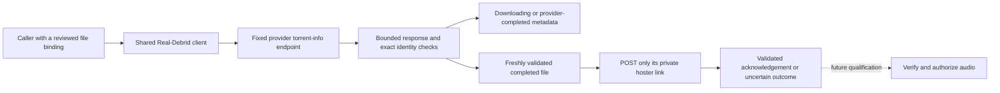

# Debrid adapter development

The first adapter foundation is `hito-debrid-real-debrid`. It reads progress for one already selected torrent file and can request unrestriction after freshly revalidating that file. It returns metadata receipts, not playable sources. This verified library is not a plugin service that can be connected in Settings. Real-Debrid submission, file selection and playback integration remain unfinished. AllDebrid, Premiumize and TorBox remain planned.

## Observation and ownership

The caller supplies a provider access token separately from any Hito plugin-service credential. It also supplies an exact torrent ID, info hash, file ID, path and size. An observation must retain that binding. A changed file is rejected rather than substituted.

The supported states are downloading and completed with exactly one selected file. Progress retains the provider's integer percentage as basis points. Provider completion does not mean that Hito has a playable source. Completion links are validated privately and discarded. The observer neither fetches audio nor creates files, transfers or downloads. Other provider states currently fail closed.

These semantics follow the [official Real-Debrid API](https://api.real-debrid.com/), where torrent progress and selected-file completion are separate from link unrestriction.

## Bound-file unrestriction

`unrestrict_bound_file` repeats the torrent-info lookup. Only a completed, unchanged selected file permits a form-encoded `POST /unrestrict/link`. The request carries its freshly validated private hoster link and the separate provider credential. It requests no remote-traffic option and makes no submission, file-selection or media request.

A valid acknowledgement must echo the exact original link, confirm the positive bound byte count and contain a syntactically valid HTTPS download URL. Multiple results are rejected. The URL remains private and is discarded. `UnrestrictionReceipt` contains only the exact file binding and confirmed bytes. These checks do not establish audio format, content identity, safe media destinations or readiness for playback.

After possible POST dispatch, transport, deadline, status, framing, body and receipt failures become `UnrestrictionUncertain`. Definitive HTTP 401 and 403 retain their rejection status. Failures before dispatch retain their original classification. This is conservative: execution can begin without proving any bytes reached the provider. The client never repeats the POST automatically. Future durable orchestration must retain this distinction when an acknowledgement is lost.

## Transport and limits

Production requests use the fixed HTTPS API origin. Proxy discovery, redirects and automatic retries are disabled. Authorization headers are sensitive; errors and application logs use static outcomes, correlation IDs and elapsed times.

Clones share two promptly admitted operations and a 250 ms request-start interval. Independent constructors do not share these limits, even with the same credential. Future account integration must retain one shared client for each provider account.

Each observation or unrestriction has one 12-second overall budget, including admission, pacing and response processing. One owned admission permit spans both unrestriction exchanges. HTTP has a two-second connection timeout and a ten-second request timeout. JSON bodies are limited to 65,536 bytes through both declared-length and streamed checks before parsing. Dropping an operation drops its owned request future.

## Evidence and remaining work

All 13 crate tests, strict all-target Clippy and formatting pass through Docker Compose. The final test run takes 12.03 seconds. The original seven owned protocol cases verify progress and provider completion, changed-file rejection, declared and chunked overflow rejection before a withheld remainder, valid exact-limit JSON, and connection release followed by another observation after cancellation.

Unrestriction cases verify exact GET/POST form bytes, a received POST followed by acknowledgement loss, pre-POST rejection of changed or downloading files, and eight rejected or invalid acknowledgement scenarios. A real seven-second torrent-info delay followed by a held POST distinguishes the aggregate deadline from separate request deadlines. Timeout and caller-drop cases require peer EOF while client clones remain alive, then a successful manual observation with exact GET/POST/GET history. The fixture tasks join before result assertions. This proves resumed progress, not restoration of both admission slots for the POST workflow.

Two held clone observations reject a third promptly without another HTTP request. After cancellation, both slots accept held observations again and all four connections close. Fixture tasks join shutdown. The request timing check uses pre-poll baselines with 5 ms tolerance; it is a pacing characterization, not an exact packet-arrival or complete rate-limit proof. Scoped application-log captures exclude private tokens, IDs, paths, names and URLs; they do not establish dependency-log privacy.

Independent correctness, security and performance source reviews pass, with a separate review of the added lifecycle evidence. Broader hostile-response, mixed-operation capacity, deadline-phase and rate-limit qualification remains open. These checks do not establish live-provider compatibility, audio readiness or release latency targets.

The complete integration still needs provider-account provisioning, durable preparation orchestration, supported state transitions, safe exact-file link resolution, authorized audio delivery, recovery, shared-client lifecycle and live test accounts. The other three adapters need their own provider protocols and acceptance evidence.
