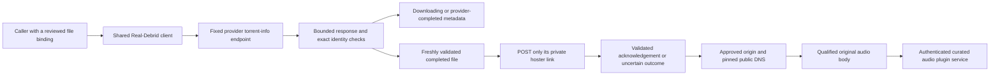
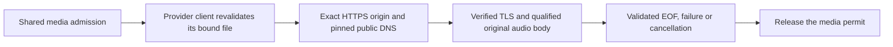
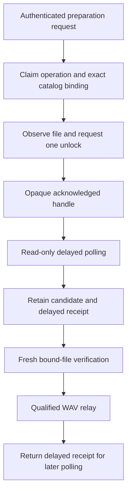
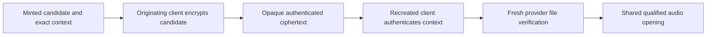
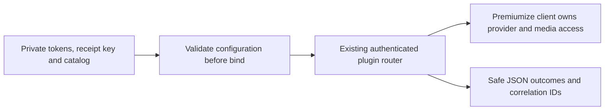

# Debrid adapter development

The first adapter foundation is `hito-debrid-real-debrid`. It reads progress for one already selected torrent file, requests unrestriction after freshly revalidating that file, and can open narrowly qualified WAV or explicitly declared MPEG-1 Layer III audio. Observation and unrestriction receipts remain metadata, not playable sources. A separate curated plugin service and executable use this adapter. Account delivery, broader media compatibility, submission, file selection and durable preparation remain unfinished; this is not a ready general-purpose Real-Debrid connection. The separate [AllDebrid library](../crates/debrid/all-debrid/README.md) supports bound-file observation, submission, unlock, delayed polling and narrowly qualified candidate audio. Its curated service, executable and restricted image have separate qualification below; application delivery remains unfinished. TorBox and Premiumize have separate observation and narrowly qualified audio clients below.

## Layout

Each provider has a client crate and a plugin service. Clients live in `crates/debrid/<provider>` (`real-debrid`, `all-debrid`, `torbox`, `premiumize`) and share `crates/remote-audio`. Services live in `plugins/<provider>` and depend on their client and on `crates/plugin-sdk`. Client crates expose a `test-support` feature with fixtures for their protocol tests; see [testing](testing.md). Only the Real-Debrid client's name is used in the early sections below, because it was built first.

## Observation and ownership

The caller supplies a provider access token separately from any Hito plugin-service credential. It also supplies an exact torrent ID, info hash, file ID, path and size. An observation must retain that binding. A changed file is rejected rather than substituted.

The supported states are downloading and completed with exactly one selected file. Progress retains the provider's integer percentage as basis points. Provider completion does not mean that Hito has a playable source. Completion links are validated privately and discarded. The observer neither fetches audio nor creates files, transfers or downloads. Other provider states currently fail closed.

These semantics follow the [official Real-Debrid API](https://api.real-debrid.com/), where torrent progress and selected-file completion are separate from link unrestriction.

## Bound-file unrestriction

`unrestrict_bound_file` repeats the torrent-info lookup. Only a completed, unchanged selected file permits a form-encoded `POST /unrestrict/link`. The request carries its freshly validated private hoster link and the separate provider credential. It requests no remote-traffic option and makes no submission, file-selection or media request.

A valid acknowledgement must echo the exact original link, confirm the positive bound byte count and contain a syntactically valid HTTPS download URL. Multiple results are rejected. The URL remains private and is discarded. `UnrestrictionReceipt` contains only the exact file binding and confirmed bytes. These checks do not establish audio format, content identity, safe media destinations or readiness for playback.

After possible POST dispatch, transport, deadline, status, framing, body and receipt failures become `UnrestrictionUncertain`. Definitive HTTP 401 and 403 retain their rejection status. Failures before dispatch retain their original classification. This is conservative: execution can begin without proving any bytes reached the provider. The client never repeats the POST automatically. Future durable orchestration must retain this distinction when an acknowledgement is lost.

## Transport and limits

Production requests use the fixed HTTPS API origin. Proxy discovery, redirects and automatic retries are disabled. Authorization headers are sensitive; errors and application logs use static outcomes, correlation IDs and elapsed times.

Clones share two promptly admitted API operations and a 250 ms request-start interval. Independent constructors do not share these limits, even with the same credential. Future account integration must retain one shared client for each provider account.

Each observation or unrestriction has one 12-second overall budget, including admission, pacing and response processing. One owned admission permit spans both unrestriction exchanges. Each API exchange resolves its fixed origin through an owned asynchronous resolver, rejects any nonpublic answer and pins the complete admitted address set for TLS. DNS and connection establishment share a two-second budget; request pacing remains separate. HTTP has a ten-second request timeout. JSON bodies are limited to 65,536 bytes through both declared-length and streamed checks before parsing. Dropping an operation drops its request, DNS futures and sockets.

## Bound audio opening

`open_bound_audio` revalidates the exact selected file and unrestricts its current link before opening media. The operator supplies one to 32 explicit HTTPS origins on port 443. Credentials, IP-literal origins, redirects and destinations outside that list are rejected. All returned DNS addresses must be public, with at most 32 answers; the connection uses only the admitted set and still verifies the original hostname and certificate. The API credential never goes to the media host. The signed media address remains private to the adapter.

Opening has one nine-second budget across provider validation, unrestriction, DNS, TLS and the qualification prefix. Media TCP/TLS connection establishment has a two-second timeout within that budget. API and media use the same startup DNS configuration. Resolver work belongs to the calling future, with at most 16 background futures per lookup; the bounded DNS transport may retransmit packets and does not establish a zero-packet-retry guarantee.

The current qualifier accepts a canonical 44-byte-header PCM16 WAV representation, with one to eight channels and sample rates from 8,000 to 384,000 Hz. Header lengths, alignment and the bound file size must agree. The returned body retains the exact file binding, length and format; it emits chunks no larger than 64 KiB, detects premature or excess bytes, and has a 15-second idle-read deadline. Two media permits remain owned through EOF, error or caller drop. Qualification does not prove the recording's musical identity. Real-Debrid MP3 support is described below; AAC, other WAV layouts, conversion and seeking remain unfinished. No file or persistent download is created.

## Curated recording detail budgets

Core accepts at most 32,768 serialized bytes from a recording-detail response. An aggregate catalog limit does not establish this smaller per-recording limit.

All four curated services (Real-Debrid, All-Debrid, TorBox and Premiumize) now admit their catalogs through `admit_curated_catalog` in `hito-plugin-sdk`, so the limits are the same. A catalog has 1 to 128 entries. Each recording's JSON is at most 32,768 bytes, and all recordings together are at most 49,152 bytes. Admission runs when the service builds its configuration, before a router or listener exists. The [startup sequence](plugins.md#curated-catalog-admission-at-startup) is in the plugin guide.

Two behavior changes came with the shared function. All-Debrid and TorBox now reject a recording over 32,768 bytes. Premiumize and TorBox aggregates no longer count private source, label and binding bytes.

Tested evidence: the SDK's own rule tests, and a Real-Debrid HTTP regression that uses SDK-valid attribution metadata at exactly 32,768 bytes and one byte above. It checks unchanged structured metadata, private headers, zero provider and media requests, joined cleanup and safe completion logs. This qualifies catalog admission, not a new packaged image or live-provider playback.

## Real-Debrid MP3 relay

Curated Real-Debrid recording entries can set `"audio_kind": "mp3"`. Omitting the field keeps the existing `pcm16_wav` default. Unsupported values fail before the executable binds its listener. The other three debrid adapters still select WAV explicitly.

The shared opener qualifies the original bytes against the declaration. MP3 currently requires MPEG-1 Layer III, two complete consecutive frames with matching sample rate and channel count, and at most one leading ID3v2.3 or ID3v2.4 tag. The tag payload is limited to 61,440 bytes and the complete qualification prefix to 65,536 bytes. This check does not decode or validate the entire file, infer duration, or convert audio. GET emits `audio/mpeg` and retains original bytes through EOF. HEAD only observes the current binding, with no unrestriction or media request.

Five authenticated HTTP cases pass, including an independent repeat. They cover native PCM and original bytes through EOF, declaration mismatches, malformed and incomplete prefixes, exact tag-size bounds and held partial headers. Fifty named client/executable regressions and the existing WAV service boundary cases pass. Legacy JSON startup, unsupported-kind rejection before binding, input preservation and safe logs are checked through the real executable. Scoped strict checks and three independent source reviews pass; dependencies are unchanged.

Compatibility fixtures now also cover tagless stereo, genuine ID3v2.3 stereo, a valid ID3v2.4 footer over unchanged MPEG bytes, and genuine ID3v2.4 mono. All use 48 kHz at 128 kbit/s. Each fixture first decodes natively through EOF, then passes the authenticated HTTP workflow with metadata-only HEAD, exact original bytes, private headers/logs and matching decoded PCM. The new profile case passes independently, followed by all six MP3 HTTP cases and scoped test Clippy. These tests change no production code.

VBR, other rates/bitrates and broader codec profiles still need compatibility fixtures. A rebuilt restricted image, ordinary Hito account playback, browser/native behavior, seeking and live-provider acceptance remain open. This change does not resolve the VPS YouTube failure.

## Shared media ownership

`hito-remote-audio` now owns the credential-free HTTPS, DNS and original-body policy used by the four debrid adapters. Provider clients still own credentials, current file authority and provider-specific acknowledgements. The shared body retains the caller's typed binding and maps failures to that provider's public error type.

The caller acquires the media permit before provider revalidation. It supplies the private target only after that revalidation succeeds. The shared body retains the permit through EOF, failure or drop. Provider API capacity remains separate.

All 22 existing Real-Debrid adapter cases and six service cases pass after extraction, including an independent repeat. Strict all-target checks and formatting pass. A fresh source review confirms the moved destination, DNS, TLS, framing, length, cancellation and log rules; all 663 external lockfile package blocks remain byte-identical. The extraction preserves the current narrow WAV support. The later AllDebrid packet below uses this opener. Neither a connectable AllDebrid service nor normal-server deployment is claimed. See [the crate's contract](../crates/remote-audio/README.md).

## AllDebrid candidate audio

An opaque `GeneratedFileCandidate` can now be consumed by `open_bound_audio`. The client first acquires shared media capacity, then repeats the provider status and complete file-tree observation. Only the exact completed binding permits opening the candidate's private address. The nine-second opening deadline covers revalidation, DNS, TLS and WAV qualification. It makes no new unlock request and creates no persistent download.

The shared origin, DNS, TLS, WAV, length and EOF rules still apply. Provider credentials stay with the AllDebrid API; media receives no authorization, cookie or referer header. The candidate address has no public getter or serialization. An immediate unlock acknowledgement now yields the same opaque candidate type; it requires the exact selected-file byte count and a bounded HTTPS address. It makes no delayed poll and does not establish media readiness before opening.

Two new owned TLS cases extend the prior seven protocol cases. The first performs preparation and a real delayed poll before fresh revalidation and one media GET. It reads exactly 384,044 WAV bytes and decodes 192,000 samples, while retaining a same-name, same-size file in a different directory as a rejected decoy. The second cancels a held opening under another log dispatcher. Client EOF precedes recovery; exactly two cancellation outcomes retain their original correlation, the decoy capture remains empty, and two recovered bodies remain live together before full consumption.

The cancellation case initially panicked during nested span retirement. The fix retains the owning dispatcher for both completion logging and span retirement. The unchanged case then passed. All nine AllDebrid cases, 22 Real-Debrid cases and six Real-Debrid service cases pass together, with strict affected-crate checks and formatting. An independent repeat and final source review pass. All 174 qualified inputs match the integrated source; external lockfile package blocks and the shared/RD/service sources remain unchanged.

A third media case covers an immediate generated acknowledgement. It verifies exactly five API calls and one credential-free WAV GET, with fresh bound-file observation, exact bytes through EOF and decoding, and no delayed poll or second unlock. Its first run failed with `GeneratedLinkUnsupported`; the same case passed after the typed candidate branch was implemented. All ten AD cases, strict AD all-target checks with test support and formatting pass, including an independent repeat. Independent source review passes. Shared/RD/service and dependency inputs remain unchanged.

These checks qualify an offline protocol library with deterministic fixtures. A connectable AllDebrid service, durable application preparation, adversarial acknowledgement controls, broader formats, seeking, failure controls and live-provider acceptance remain open.

## AllDebrid curated-WAV service library

`hito-plugin-all-debrid` exposes authenticated search, recording detail, sources, preparation, preparation status and WAV relay routes. One operator-curated catalog contains at most 128 exact file bindings. The service credential is separate from the provider credential. Metadata-only search and detail make no provider request. The manifest advertises preparation and a playback-only persistence ceiling.

Preparation claims an operation before provider work. An accepted acknowledgement becomes an opaque authenticated handle bound to that operation and the exact catalog entry. Replaying a current operation cannot retarget it to another recording. A retained delayed handle can restore read-only polling after service restart when the private receipt key and catalog are unchanged. The core application remains responsible for durable requests and uncertain submissions; the service does not promise an unlimited operation history across restarts.

Readiness repeats the provider observation before publishing a completed candidate. A busy or cancelled media opening retains the delayed receipt, so a later status request can recover without another unlock. A definite failure before unlock dispatch can retry the same operation after a five-second guard. An uncertain mutation remains uncertain and cannot enter that retry path. Direct candidates have no delayed receipt to restore after opening.

Five public HTTP/TLS cases pass in Docker, with strict all-target package Clippy, formatting, independent source review and independent repeated runs. They verify exact authenticated responses, sealed receipt isolation, restart restoration, operation retarget rejection, changed provider readiness, real held-body connection release, bounded media capacity, exact WAV decoding and guarded retry. The recovery case observes 27 provider requests, three unlocks and three media requests; the pre-unlock retry case observes four provider requests and one unlock. Correlated outcome logs exclude credentials, private catalog data and signed addresses.

The final independent run passes all five cases in 33.02 seconds. All 193 qualified source inputs match after cherry-picking into the current application branch, and all 663 external lockfile package blocks remain unchanged. The test organization moved three test bodies and four helpers without changing their bytes. These are deterministic fixture checks, not live-provider compatibility or release-latency measurements.

The executable and private-input bootstrap are qualified separately below. The restricted image, Hito account connection, packaged application preparation, active-media shutdown, seeking, broader codecs and live acceptance remain open. The normal deployment has not changed.

## AllDebrid executable bootstrap

The `hito-plugin-all-debrid` executable defaults to `127.0.0.1:8097`. It requires `--provider-token-file`, `--service-token-file`, `--receipt-key-file` and `--catalog-file`; `--listen` is optional. The provider and service credentials must differ. The receipt key is exactly 32 binary bytes and must not be all zero. Retain that private key with the unchanged catalog to restore acknowledged delayed handles after restart.

Every input must be an absolute regular file, with one hard link, owned by the running user and mode `0400` or `0600`. The opened descriptor rejects a final symlink, checks size/type/ownership/permissions before reading and rechecks metadata afterward. Token files accept at most 4,098 bytes with one optional terminal newline; tokens remain bounded to 4,096 printable nonspace ASCII bytes. The catalog accepts at most 1 MiB and uses strict typed parsing before the existing catalog validation. Input errors use static reasons. The executable reads configuration before binding.

The lifecycle owns a generated service correlation, safe readiness/failure/shutdown outcomes and elapsed times. Requested TRACE output remains limited to owned service, adapter and shared-media namespaces. Startup and authenticated catalog metadata do not contact the provider. SIGINT or SIGTERM stops accepting work and joins the HTTP server's graceful shutdown.

One real-child case first failed because bootstrap was absent, then passed unchanged after implementation. It verifies the public manifest, rejection of missing/wrong/provider credentials at the service boundary, exact search/detail responses, unchanged private input bytes/metadata and nine safe lifecycle/request events through joined SIGTERM. A separate child workflow rejects 30 cases covering short/oversized/zero receipt keys and symlinks, hard links, public permissions, FIFOs, directories, oversized files and wrong owners across all four inputs. These controls passed immediately as new coverage; no production fix or RED is claimed for them.

The lifecycle and all 30 rejection controls pass in independent Docker repeats. All five prior public service cases also pass, with strict all-target package Clippy and formatting. Fresh source review found no unresolved P1/P2 in the bootstrap. All 208 qualified inputs match after integration, and all 663 external dependency blocks remain unchanged. The implementation keeps argument parsing, typed configuration, private files, logging and lifecycle in separate cohesive owners.

These Linux process fixtures do not qualify all semantic CLI/catalog inputs, a restricted image, application preparation, live accounts or shutdown with an active audio body. Seeking and broader codecs also remain open. The normal persistent server was not changed.

## AllDebrid restricted package

`docker/plugin-all-debrid.Dockerfile` and `compose.all-debrid.yaml` package the selected
executable separately from Hito. The service runs as UID/GID 10001 with a
read-only root and private input volume, no Linux capabilities, no privilege
escalation and bounded CPU, memory, PIDs and logs. Normal publication defaults to
loopback port 8097. Its public manifest supplies health; credentials never appear
in arguments or environment variables.

The build helper verifies a frozen file/mode inventory, derives the build
environment from that manifest and checks the resolved Compose context,
Dockerfile, image tag and source/cache identities before compiling. Review found
that inherited shell variables could override the original environment file and
compile a different tree under the expected labels. The actual configuration
control failed before the correction and passed afterward, including an
independent repeat. The final source review found no unresolved P1/P2.

The independently built image is
`sha256:0973019ed75592054fe5003c2af30506cf3beb45cf94b23932784762982e0a3a`.
Its frozen context contains 1,490 file/mode records over base revision
`31ebbd03b0d7ca170f53cd6a6e82c92b9d632794` and the packaging additions, with input
digest `bdb39850323e51f84b0bf3e79bb39e30ce47bc404747680cbd70a4130dfb8c42`.
Cargo built only the selected executable, locked and offline, with two jobs and
debug information and incremental compilation disabled. This qualifies that
standalone image, not a current-main Hito application image. All 208 accepted
service inputs and the packaging implementation match after integration;
qualification prose was updated afterward.

One actual isolated audit passed in 8.142 seconds. All four containers used
network mode `none` without published ports. A root helper provisioned one
uniquely owned synthetic volume; the service used its unprivileged identity and
read-only mount. Real manifest health, three credential rejections, authenticated
search and exact detail all passed without provider or audio requests. Four
private files retained their bytes, inode, owner, link count, modes, size, mtime
and ctime. Complete bounded TRACE contained ten allowed events with generated
correlations and safe outcomes. Idle SIGTERM joined with exit 0. Checked cleanup
removed all four containers and the volume; an independent inventory confirmed
zero survivors. Frozen inputs stayed exact before and after the run.

Use the [build and audit instructions](../scripts/debrid/all-debrid/README.md)
for a new frozen snapshot. Its revision and digest will describe that snapshot;
later qualification documentation is not part of the historical image above.
Application provisioning/preparation, live credentials, seeking, broader audio
formats and shutdown with active audio remain open. The normal Hito deployment
was not changed.

## Curated-WAV service and executable

`hito-plugin-real-debrid` owns HTTP authentication and rendering-neutral SDK responses. It serves one operator-reviewed catalog of at most 128 canonical PCM16 WAV recordings through one shared provider client. The public manifest advertises Search and Sources with a `playback_only` persistence ceiling. Search and detail make no provider call. Sources and HEAD observe the bound file; explicit GET alone revalidates, unrestricts once and relays qualified audio. The relay strips caller credentials and upstream private headers, returns a full non-seekable WAV representation and validates final EOF before releasing the last declared bytes. It creates no persistent download and advertises no preparation capability.

The executable defaults to `127.0.0.1:8096`. It accepts `--provider-token-file`, `--service-token-file`, `--catalog-file` and optional `--listen`. Credentials remain separate. Each input must be an absolute, regular, single-link file owned by the running user with mode `0400` or `0600`. Loading rejects symlinks, nonregular files, permissive modes and oversized data through the opened descriptor. Strict catalog parsing is bounded to 1 MiB; existing SDK and adapter validation retain metadata, source and binding limits. File buffers zeroize, post-read metadata is checked, and errors expose static reasons. JSON logging admits only owned namespaces even when TRACE is requested.

All 22 adapter and six service cases pass together in Docker, with strict all-target checks for both crates and formatting. The hosted HTTP/TLS case decodes the exact owned WAV and verifies authentication, source/header isolation and private logs. Two boundary cases cover malformed/protocol/opaque-ID rejection with no upstream work, pagination, and a provider file changing after ready observation and HEAD. A real-child case verifies startup, authenticated metadata, held control-body completion through SIGTERM, closed listening and correlated private logs. Two bootstrap cases reject 17 unsafe file/catalog/credential scenarios before binding while preserving input bytes and Unix metadata. Fresh independent source reviews pass.

`docker/plugin-real-debrid.Dockerfile` and `compose.real-debrid.yaml` define a restricted standalone image and an external private credential volume. Builds require an immutable source ID for a separate Cargo cache; running a prebuilt image does not.

Image `sha256:ea431ad6ec5339720b24cd504a359a8c28f20c9daa4ce527a1ed99cdb6a149cb`, built from `13041bf`, passes isolated container startup and metadata acceptance. It runs as UID/GID 10001 with a read-only root and credential mount, dropped capabilities, one CPU, 256 MiB memory and 64 processes. The audit disables all external networking and publishes no ports. Health, the public manifest, exact authenticated search/detail, absent and wrong credentials, unknown recording and invalid limit checks pass. All three private input files retain their bytes, inode, owner, mode, links and timestamps. A repeated TRACE run emits 19 bounded JSON records with one lifecycle identity and no supplied private canaries, including both normalized credential values. Synthetic JSON leaks first exposed a missing normalized provider-token check in the audit; the corrected gate and its independent second review pass. Idle SIGTERM exits with code zero in 0.074 seconds. The stopped container and private audit evidence remain under `/private/tmp/hito-real-debrid-package-13041bf/`.

This container check makes no live provider or media request. The service is not in the normal deployment.

Responsive control-body shutdown does not establish active-media quiescence. A backpressured audio response can delay graceful shutdown; a forced total drain deadline and actual container stop-grace qualification remain required release work. Live provider accounts, application integration, broader codecs, ranges, seeking and durable preparation also remain open.

## Evidence and remaining work

All 22 crate tests, strict all-target Clippy and formatting pass through Docker Compose against the integrated workspace. The test run takes 12.07 seconds and Clippy 1.05 seconds. The original seven owned protocol cases verify progress and provider completion, changed-file rejection, declared and chunked overflow rejection before a withheld remainder, valid exact-limit JSON, and connection release followed by another observation after cancellation.

Unrestriction cases verify exact GET/POST form bytes, a received POST followed by acknowledgement loss, pre-POST rejection of changed or downloading files, and eight rejected or invalid acknowledgement scenarios. A real seven-second torrent-info delay followed by a held POST distinguishes the aggregate deadline from separate request deadlines. Timeout and caller-drop cases require peer EOF while client clones remain alive, then a successful manual observation with exact GET/POST/GET history. The fixture tasks join before result assertions. This proves resumed progress, not restoration of both admission slots for the POST workflow.

Two held clone observations reject a third promptly without another HTTP request. After cancellation, both slots accept held observations again and all four connections close. Fixture tasks join shutdown. The request timing check uses pre-poll baselines with 5 ms tolerance; it is a pacing characterization, not an exact packet-arrival or complete rate-limit proof. Scoped application-log captures exclude private tokens, IDs, paths, names and URLs; they do not establish dependency-log privacy.

The audio cases open owned HTTPS media, deliver an exact 384,044-byte stereo 48 kHz fixture and decode its 192,000 samples through the shared audio decoder. They check full-body delivery, rejected destinations and framing, stalled and cancelled DNS ownership, both media slots after failure, and successful manual recovery. The destination matrix rejects mixed public/private A and AAAA answers in both orders, an untrusted certificate and a wrong-host certificate. Peer EOF and exact TLS alerts precede recovery, with no authenticated HTTP request to a rejected destination. A held API POST DNS preflight remains a definite failure before dispatch, rather than an uncertain unrestriction acknowledgement.

Independent correctness, security and performance source reviews pass, including fresh reviews of the owned DNS and destination matrix. Broader hostile-response, mixed-operation capacity, deadline-phase and rate-limit qualification remains open. These checks do not establish live-provider compatibility, SDK source readiness or release latency targets.

The complete integration still needs provider-account provisioning, durable preparation orchestration, supported state transitions, application delivery of the authenticated service, ranges and seeks, broader codec support, application recovery, shared-client lifecycle and live test accounts. The other provider foundations retain their own scope and verification limits below.

## TorBox observation

The separate `hito-debrid-torbox` client observes one caller-configured torrent file. It rechecks the exact torrent ID, info hash, total bytes, selected file ID, exact provider name and selected bytes. Both completion and presence flags are required for provider-completed metadata; a state label alone cannot qualify it. This result does not establish recording identity or playable audio.

Twelve public protocol cases, strict crate checks, formatting, independent source review and an independent repeat pass. They verify owned HTTPS requests, persisted binding preservation, changed or ambiguous identity, malformed responses, declared and streamed bounds, clone-shared admission and pacing, cancellation and deadline recovery. The strengthened cancellation case witnesses peer closure before fixture shutdown while another client remains alive. A targeted second review and the independent repeat include that stronger control; production code was unchanged by it.

The observation client uses a fixed provider origin and sensitive bearer authorization with no redirects, proxy discovery or automatic retries. Logs contain static outcomes, private correlation IDs and timing. Candidate audio has separate qualification below. Submission, durable application preparation, plugin delivery and live-provider acceptance remain unfinished. See [the exact contract and reproducible checks](../crates/debrid/torbox/README.md).

## TorBox candidate audio

TorBox can prepare an opaque file-link candidate after freshly rechecking the configured completed file. Its fixed-origin request uses the documented query token and explicit file ID, including zero, with archive, redirect and name-appending flags disabled. Observation still uses bearer authorization. See the [official request contract](https://api.torbox.app/openapi.json).

A candidate acknowledges only a bounded nonempty link string. It establishes no destination, recording identity or playable audio. The original opening API consumes it; the service can now retain an opaque candidate and borrow it for another explicit opening. Each opening rechecks the exact torrent and file binding, then uses the unchanged shared media owner for allowed HTTPS origins, public DNS pinning, TLS, framing and canonical PCM16 WAV validation. Media requests copy no provider authorization, cookie or referrer headers. Provider-returned query contents are private and are not assumed to exclude credentials.

Dispatched requests with missing or invalid acknowledgements remain uncertain, without automatic retry. Explicit authentication and provider rejections stay typed. The link is private and zeroizing, with no public URL accessor, debug representation or serialization. No link lifetime is inferred.

All ten audio cases and the twelve original observation cases pass, together with default and test-support strict Clippy and formatting. Independent security, correctness and performance reviews and a separate 22-case repeat pass. Tests consume exact owned WAV bytes through EOF and decode every sample. They verify changed-file rejection, acknowledgement loss, timeout, cancellation, media failures and shared body admission. Peer-closure witnesses precede fixture shutdown while another client remains alive.

An early test incorrectly expected a misleading MIME header to override valid WAV bytes. The corrected positive consumes the entire valid payload; actual HTML, non-WAV, framing, redirect and origin negatives remain rejected. Production did not change for that test correction. The service-library foundation is qualified below; executable delivery, application installation, broader codecs, seeking and live-provider acceptance remain open. The normal server is unchanged.

## TorBox curated-WAV service library

The separate `hito-plugin-torbox` library exposes an authenticated HTTP plugin for operator-curated exact torrent-file bindings. Its public manifest declares shared SDK capabilities; search, recording details, source reads and preparation use structured data. The service owns its bearer credential, opaque identifiers and private durable preparation receipts. The existing TorBox client owns provider authorization, exact file verification, private links and shared audio transport. No plugin-supplied UI or core database access is introduced.

The first public HTTP/TLS tracer waits for incomplete metadata, retains one preparation handle, freshly verifies completion and the selected file, and mints one private candidate. Receipt replay does not mint again. Source reads and HEAD recheck readiness without opening audio. Explicit GET verifies and relays all 65,580 owned WAV bytes through EOF, with every one of the 32,768 PCM samples checked.

The service reserves the client's actual shared media permit before capturing a ready candidate and its operation ID. It borrows that private candidate outside the brief ledger lock, revalidates the exact file and shared transport policy, then checks that the operation is still current before returning audio headers. Explicit GETs can reuse the candidate after EOF. No link lifetime, automatic renewal or new mint is inferred.

A regression prepares three distinct files, holds two real streaming bodies, then rejects the third GET without provider or media I/O or a new mint. Its exact receipt remains ready, and metadata and HEAD still work. Dropping a held body closes its upstream peer; retrying the third candidate plays the exact WAV without reminting. Separate held control requests also leave the ready candidate intact when control admission is full. Provider 429 and 5xx responses retain it for a later explicit retry. Definitive changed bindings retire it with SourceChanged. A concurrent late changed-binding failure can refine the same operation's SourceUnavailable reason, but cannot alter a newer operation or restore readiness.

Ten public HTTP/TLS service cases and all 22 prior client cases pass, with strict default/test-support service checks, formatting and the final independent source review. Repeated GET, temporary 503, control admission and concurrent failure regressions each failed before their correction. Rate-limit and newer-operation controls pass without a manufactured failing baseline. The three old service-test changes retain readiness after EOF and add one exact observation; the remaining 23 old cases and fixtures are unchanged.

An independent repeat passes all 32 cases across six qualified binaries in 58.607 seconds, with source and build outputs read-only, external networking disabled, all 2,388 source hashes and binary hashes unchanged, and no remaining owned containers. This is a functional fixture duration, not a playback benchmark. All 11 changed inputs match after integration; manifests, lock selections and wire models remain unchanged.

The private service journal now preserves ready and uncertain receipts across joined service-owner replacement. It commits checking and mint intent before consuming provider work, encrypts ready candidates and authenticates the complete receipt set. Exact operation/handle replay and catalog reconciliation retain old uncertainty claims. One bounded joined worker owns SQLite; no database transaction spans provider I/O.

Twenty-one directed service cases pass, including ready and lost-acknowledgement replacement, catalog evolution, ownership/key validation, selective receipt deletion, escaped maximum-length filenames and physical SQLite capacity. Both full-database cases reject a new operation before provider I/O while preserving the prior receipt through joined replacement. The uncertain operation is never reminted. Scoped default/test-support strict checks and source reviews pass within the private single-owner contract. A conditional review concern involving a concurrent external SQLite writer is outside that contract; general live-tamper protection is not claimed.

An independent Docker check on the combined source passes ready replacement, lost-acknowledgement replacement and the escaped-filename workflow. All 170 checked source inputs remain unchanged, with external networking disabled and zero remaining test containers. The three cases take 12.99 seconds after compilation; the complete invocation takes 64.587 seconds. The two longer physical-capacity cases were qualified separately on the feature snapshot.

The journal has 1,024 lifetime receipts, a 16 MiB database limit, 17 MiB WAL limit, 64 KiB SHM limit and combined 40 MiB logical/allocated ceiling. It has no long-term receipt eviction policy. Restoring a complete valid backup does not establish freshness.

The private executable now reads distinct provider/service credentials, an operator catalog and explicit journal creation/opening settings. It bounds HTTP connections and joins them before closing the state worker. One real-process workflow qualifies missing-state rejection, metadata authorization, active request-body cancellation and same-state reopening. Both all-target strict modes and three directed library regressions pass. Two further process cases qualify 16 argument, credential/catalog and journal-path rejections while preserving exact operator state. The new cases and original executable workflow pass together, with both strict modes. An independent combined-source repeat passes all three in 4.094 seconds including compilation, with 184 checked inputs unchanged and no test containers remaining. Ready/audio recovery across executable/container restart, broader unsafe-input/lifecycle faults, application installation, broader codecs, seeking and live TorBox acceptance remain open. See [private configuration and reproduction commands](../plugins/torbox/README.md#private-executable).

The pinned Linux/arm64 container and explicit-volume Compose deployment now pass isolated and independent metadata/authentication audits. They create and reopen the same journal with joined owners, preserve all four private inputs, validate restricted runtime settings and safe TRACE events, and remove only their owned resources. All 1,742 qualified input files and modes matched the integration checkout before the service README qualification update; executable and build inputs remain unchanged. Provider audio and application enrollment are not exercised. See [image identity, operator configuration and remaining limits](../plugins/torbox/README.md#container-package).

### Verified preparation before minting

The TorBox client now separates exact file verification from the consuming generated-link request. `verify_bound_file` returns a move-only capability retaining the originating client, copied binding, actual control permit and original absolute deadline. Caller work does not reset that deadline. Expiry before dispatch sends no mutation; uncertain dispatched acknowledgements retain their existing classification without automatic retries. The existing eager API delegates through the same stages.

This is a prerequisite for a service-owned durable intent journal. It does not persist receipts or candidates. Six new TLS cases and all 32 unchanged client/service cases, strict affected checks, formatting, three independent specialist reviews and an independent 38-case repeat pass. Source and binary hashes remain unchanged during the repeat, with zero containers left behind. Verification, caller delay and active-mint deadlines are measured; a dedicated held-pacing expiry case remains open. See [the client contract](../crates/debrid/torbox/README.md#verified-preparation-before-minting).

### Authenticated candidate persistence

The TorBox client can seal a generated candidate as versioned authenticated ciphertext of at most 16,384 bytes. The private key, provider credential and fixed API origin authenticate the state, operation and handle UUIDs, recording/source IDs and every exact file-binding field. Only the originating client or its clones can seal a minted candidate. A recreated client can restore it with the same authority and context. The caller owns key and ciphertext storage; this client performs no filesystem or database work.

Three new public TLS workflows cover destroyed and recreated client owners, two complete WAV/PCM openings with one total mint, foreign-client and wrong-authority rejection, every context field, malformed envelopes and private structured completion logs. All 38 unchanged client/service cases also pass. Four affected strict-check modes, scoped formatting and independent source review pass. A separate 41-case repeat took 86.594 seconds with source and binaries read-only, 20 binary hash checks and no remaining containers. The integrated inputs match; only the existing TorBox client dependency block changes, preserving all 684 other lockfile blocks.

This is a prerequisite for the service journal. It does not implement durable service intent, uncertainty history, restart recovery, an executable, live-provider compatibility or broader codecs. See [the client contract](../crates/debrid/torbox/README.md#authenticated-candidate-persistence).

## Premiumize observation

The separate `hito-debrid-premiumize` client observes one configured transfer by exact ID and creation timestamp. It reports queued, running, provider failure, seeding or completion, with finite unit-fraction progress. Matching display names cannot replace the configured transfer. Cloud transfer completion does not establish selected-file, content or recording identity and produces no playable source.

Thirteen public owned-HTTPS cases, strict default and test-support checks, formatting, fresh source review and an independent repeat pass. They cover typed errors, duplicate or changed transfers, documented phase/progress consistency, bounds, clone-shared admission/pacing, cancellation with actual peer closure and deadline recovery. The original tracer remains byte-identical. A provisional assumption that seeding progress must be one was removed after checking the provider contract; a seeding fraction of 0.5 is explicitly accepted. All existing dependency blocks are preserved.

Bearer authentication supports the provider's documented API-key and access-token forms. Selected-file audio is qualified separately below. Credential enrollment, transfer creation, plugin delivery, application preparation and live-provider acceptance remain open. See [the exact contract and verification limits](../crates/debrid/premiumize/README.md).

## Premiumize bound cloud-file audio

Premiumize can open one operator-curated cloud file after two fresh authenticated reads. The transfer must match its exact identifier and creation timestamp, be completed or seeding, and retain the configured file and folder identifiers. Item details must then match the file identifier, name, byte length, creation timestamp and folder. Missing folder identifiers and incomplete, folder-only or external transfers are outside this narrow path. Deprecated item fields do not establish authority. See the [official API contract](https://www.premiumize.me/api).

The returned link remains private and zeroized. The existing shared media client owns HTTPS origins, public DNS pinning, TLS, framing and WAV qualification. API authorization, cookies and Referer are not copied to media requests. Media admission precedes API work; API admission releases before streaming. One nine-second deadline covers both metadata reads and media opening. Subsequent playback retains the shared body's admission, byte limits and read-idle deadline.

Fourteen new audio cases and all thirteen unchanged observation cases pass, alongside default and test-support strict all-target Clippy and workspace formatting. Tests consume all 384,044 owned WAV bytes through EOF and validate all 192,000 decoded PCM samples. Other controls cover changed bindings, malformed and failed API responses, unsupported states, exact media origins, redirects, framing, non-WAV bodies, aggregate deadlines, active-body capacity and cancellation. Peer-close witnesses run before fixture shutdown while another client clone remains alive; explicit recovery succeeds without automatic retry. Correlated logs retain their originating dispatcher and exclude private canaries.

The first public audio case failed with unsupported audio and passed after implementation. Later controls passed on their first behavior runs. A separate deadline check constrains each of its three held stages to 8.7–9.75 seconds, distinguishing the aggregate deadline from the API client's ten-second timeout. Independent security, correctness and performance reviews pass. An independent sequential repeat passes all fourteen audio cases in 44.21 seconds and all thirteen observation cases in 18.81 seconds. After integration, all twenty crate inputs match the qualified source; only Premiumize's local lockfile block changes, preserving every other package block.

This qualifies a client for canonical PCM16 WAV from a completed or seeding curated cloud file. A connectable plugin service, application preparation, credential enrollment, transfer creation, seeking, broader codecs and live Premiumize/CDN acceptance remain open. These fixtures do not establish release playback latency. The normal server is unchanged.

## Premiumize bound cloud-file metadata

`observe_bound_file` reuses the existing exact transfer and item validators to
return ready-only metadata. It retains the configured binding and current
completed or seeding phase/progress, discards the private zeroizing link and
performs no media admission or GET. The existing transfer observer separately
reports queued, running and failed states. Neither result verifies playable bytes
or recording identity.

One nine-second deadline covers both paced API requests and validation. Clones
share two API slots; held audio bodies use separate media capacity. Nine new
public TLS cases and all 27 original cases pass, with strict default/test-support
checks, formatting and independent security, correctness and performance review.
An independent sequential repeat passes all 36 in 94.10 seconds. Source and
executable hashes remain exact. Controls include changed authority, malformed
responses, real cancellation peer closure, manual recovery, aggregate deadlines
and metadata availability while two verified WAV bodies retain media leases.

The separate HTTP router library is qualified below. Executable delivery,
application preparation, enrollment, transfer creation, seeking, broader formats
and live acceptance remain open. The normal deployment is unchanged.

## Premiumize curated-WAV service library

The separate `hito-plugin-premiumize` library exposes the shared plugin protocol for operator-curated recordings and existing exact cloud-file bindings. Each service bearer selects its own catalog, provider client, media origins and receipt key. Search and details use configured metadata without provider requests. Source availability and each audio GET freshly verify transfer and item authority. Preparation monitors existing transfers; it never creates or submits them.

Preparation receipts are stateless HMAC-SHA256 tags over the operation UUID, service authority, full sorted catalog and selected recording/source/file binding. Rebuilding clients and routers or reordering configuration preserves them when those inputs stay identical. Changed catalog, service bearer or receipt key invalidates them before provider I/O. Replacing the provider account requires a new receipt key. The opaque client does not expose a provider-credential fingerprint to this service.

Startup permits up to 16 connections and 128 recordings per catalog, with a 49,152-byte canonical catalog budget and a 32,768-byte detail-response limit. An actual HTTP boundary regression first exposed startup accepting one extra detail byte, then passed after the individual bound was added. Whole canonical PCM16 WAV is the only qualified audio representation. The response body retains the upstream stream and media admission lease; cancelling it closes the owned TLS peer even while another client clone survives.

Seven public HTTP/TLS cases and all 36 unchanged client cases pass. Strict default/test-support checks, scoped formatting and final independent source review pass. An independent repeat runs all 43 cases across eight pinned executables in 99.478 seconds, checking exact WAV bytes, all PCM samples, receipt isolation and reconstruction, cancellation and recovery, safe log schemas and workflow correlations. Source and executable hashes remain identical and no owned containers remain.

The router library now has a separately qualified executable below. Packaging, enrollment, application connection and preparation, broader codecs, seeking, capacity stress and live Premiumize/CDN acceptance remain open. The normal Mac and VPS deployments are unchanged. See [the service contract and reproduction commands](../plugins/premiumize/README.md).

## Premiumize private executable

The `hito-plugin-premiumize` executable loads one connection through required `--provider-token-file`, `--service-token-file`, `--receipt-key-file` and `--catalog-file` arguments. It defaults to `127.0.0.1:8099`. Configuration is validated before listening and has no inline credential or environment fallback. The router library still supports multiple separately authenticated connections; the executable currently configures one.

Unix descriptor reads require absolute paths, a regular file with one link, effective-user ownership and mode `0400` or `0600`. Reads reject final-component symlinks, oversized content and changed descriptor metadata. The binary receipt key is exactly 32 bytes and must not be all zero; normalized provider and service credentials must differ. Catalog JSON is bounded and typed before the existing per-entry and aggregate limits apply. Startup does not alter these files. JSON logs retain fixed safe failure reasons and Hito correlation IDs, while excluding dependency traces even at trace verbosity.

The first process test failed against the unimplemented executable, then passed with native file arguments, actual metadata HTTP requests and idle SIGTERM shutdown. Four further bootstrap tests exercise 46 invalid configurations, including a real foreign file owner, FIFO, symlink, hard link, modes, malformed data and bounds. Every case preserves operator inputs and joins its child processes. All 12 service and 36 unchanged client tests pass, alongside scoped formatting, both strict service modes and fresh independent source review. A separate replay of 10 pinned test executables passes all 48 cases in 99.793 seconds, with 24 binary hash checks, all 2,440 source-file pins unchanged and no remaining owned containers.

This qualifies the executable's metadata/bootstrap behavior and the existing HTTP/TLS fixtures. It does not qualify active-audio shutdown, deployment packaging, application enrollment, live Premiumize/CDN playback, general codecs or seeking. Reproduction commands and exact file formats are in [the crate README](../plugins/premiumize/README.md).

## Protocol fixtures in workspace verification

Workspace tests and strict Clippy explicitly enable the four debrid-client `test-support` features and both the TorBox and Premiumize services' separate `test-support` features. Enabling only a client feature does not enable its service's protocol fixtures. The composed locked/offline Linux feature graph retains the prior five feature selections and adds Premiumize's service feature, selecting all five of its integration targets without compilation or dependency changes. Script syntax also passes. This does not establish that the complete CI workflow passes. Production feature defaults are unchanged.
