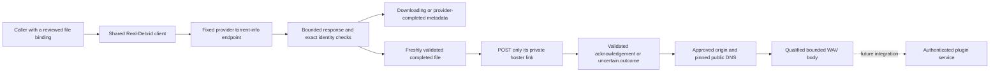

# Debrid adapter development

The first adapter foundation is `hito-debrid-real-debrid`. It reads progress for one already selected torrent file, requests unrestriction after freshly revalidating that file, and can open a narrowly qualified WAV stream. Observation and unrestriction receipts remain metadata, not playable sources. This library is not a plugin service that can be connected in Settings. Real-Debrid submission, file selection and application playback integration remain unfinished. AllDebrid, Premiumize and TorBox remain planned.

## Observation and ownership

The caller supplies a provider access token separately from any Hito plugin-service credential. It also supplies an exact torrent ID, info hash, file ID, path and size. An observation must retain that binding. A changed file is rejected rather than substituted.

The supported states are downloading and completed with exactly one selected file. Progress retains the provider's integer percentage as basis points. Provider completion does not mean that Hito has a playable source. Completion links are validated privately and discarded. The observer neither fetches audio nor creates files, transfers or downloads. Other provider states currently fail closed.

These semantics follow the [official Real-Debrid API](https://api.real-debrid.com/), where torrent progress and selected-file completion are separate from link unrestriction.

## Bound-file unrestriction

`unrestrict_bound_file` repeats the torrent-info lookup. Only a completed, unchanged selected file permits a form-encoded `POST /unrestrict/link`. The request carries its freshly validated private hoster link and the separate provider credential. It requests no remote-traffic option and makes no submission, file-selection or media request.

A valid acknowledgement must echo the exact original link, confirm the positive bound byte count and contain a syntactically valid HTTPS download URL. Multiple results are rejected. The URL remains private and is discarded. `UnrestrictionReceipt` contains only the exact file binding and confirmed bytes. These checks do not establish audio format, content identity, safe media destinations or readiness for playback.

After possible POST dispatch, transport, deadline, status, framing, body and receipt failures become `UnrestrictionUncertain`. Definitive HTTP 401 and 403 retain their rejection status. Failures before dispatch retain their original classification. This is conservative: execution can begin without proving any bytes reached the provider. The client never repeats the POST automatically. Future durable orchestration must retain this distinction when an acknowledgement is lost.

## Transport and limits

Production requests use the fixed HTTPS API origin. Proxy discovery, redirects and automatic retries are disabled. Authorization headers are sensitive; errors and application logs use static outcomes, correlation IDs and elapsed times.

Clones share two promptly admitted API operations and a 250 ms request-start interval. Independent constructors do not share these limits, even with the same credential. Future account integration must retain one shared client for each provider account.

Each observation or unrestriction has one 12-second overall budget, including admission, pacing and response processing. One owned admission permit spans both unrestriction exchanges. Each API exchange resolves its fixed origin through an owned asynchronous resolver, rejects any nonpublic answer and pins the complete admitted address set for TLS. DNS and connection establishment share a two-second budget; request pacing remains separate. HTTP has a ten-second request timeout. JSON bodies are limited to 65,536 bytes through both declared-length and streamed checks before parsing. Dropping an operation drops its request, DNS futures and sockets.

## Bound audio opening

`open_bound_audio` revalidates the exact selected file and unrestricts its current link before opening media. The operator supplies one to 32 explicit HTTPS origins on port 443. Credentials, IP-literal origins, redirects and destinations outside that list are rejected. All returned DNS addresses must be public, with at most 32 answers; the connection uses only the admitted set and still verifies the original hostname and certificate. The API credential never goes to the media host. The signed media address remains private to the adapter.

Opening has one nine-second budget across provider validation, unrestriction, DNS, TLS and the qualification prefix. Media TCP/TLS connection establishment has a two-second timeout within that budget. API and media use the same startup DNS configuration. Resolver work belongs to the calling future, with at most 16 background futures per lookup; the bounded DNS transport may retransmit packets and does not establish a zero-packet-retry guarantee.

The current qualifier accepts a canonical 44-byte-header PCM16 WAV representation, with one to eight channels and sample rates from 8,000 to 384,000 Hz. Header lengths, alignment and the bound file size must agree. The returned body retains the exact file binding, length and format; it emits chunks no larger than 64 KiB, detects premature or excess bytes, and has a 15-second idle-read deadline. Two media permits remain owned through EOF, error or caller drop. Qualification does not prove the recording's musical identity, and MP3, AAC, other WAV layouts, conversion and seeking remain unfinished. No file or persistent download is created.

## Evidence and remaining work

All 22 crate tests, strict all-target Clippy and formatting pass through Docker Compose against the integrated workspace. The test run takes 12.07 seconds and Clippy 1.05 seconds. The original seven owned protocol cases verify progress and provider completion, changed-file rejection, declared and chunked overflow rejection before a withheld remainder, valid exact-limit JSON, and connection release followed by another observation after cancellation.

Unrestriction cases verify exact GET/POST form bytes, a received POST followed by acknowledgement loss, pre-POST rejection of changed or downloading files, and eight rejected or invalid acknowledgement scenarios. A real seven-second torrent-info delay followed by a held POST distinguishes the aggregate deadline from separate request deadlines. Timeout and caller-drop cases require peer EOF while client clones remain alive, then a successful manual observation with exact GET/POST/GET history. The fixture tasks join before result assertions. This proves resumed progress, not restoration of both admission slots for the POST workflow.

Two held clone observations reject a third promptly without another HTTP request. After cancellation, both slots accept held observations again and all four connections close. Fixture tasks join shutdown. The request timing check uses pre-poll baselines with 5 ms tolerance; it is a pacing characterization, not an exact packet-arrival or complete rate-limit proof. Scoped application-log captures exclude private tokens, IDs, paths, names and URLs; they do not establish dependency-log privacy.

The audio cases open owned HTTPS media, deliver an exact 384,044-byte stereo 48 kHz fixture and decode its 192,000 samples through the shared audio decoder. They check full-body delivery, rejected destinations and framing, stalled and cancelled DNS ownership, both media slots after failure, and successful manual recovery. The destination matrix rejects mixed public/private A and AAAA answers in both orders, an untrusted certificate and a wrong-host certificate. Peer EOF and exact TLS alerts precede recovery, with no authenticated HTTP request to a rejected destination. A held API POST DNS preflight remains a definite failure before dispatch, rather than an uncertain unrestriction acknowledgement.

Independent correctness, security and performance source reviews pass, including fresh reviews of the owned DNS and destination matrix. Broader hostile-response, mixed-operation capacity, deadline-phase and rate-limit qualification remains open. These checks do not establish live-provider compatibility, SDK source readiness or release latency targets.

The complete integration still needs provider-account provisioning, durable preparation orchestration, supported state transitions, authenticated plugin delivery, ranges and seeks, broader codec support, application recovery, shared-client lifecycle and live test accounts. The other three adapters need their own provider protocols and acceptance evidence.
