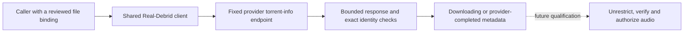

# Debrid adapter development

The first adapter foundation is `hito-debrid-real-debrid`. It reads progress for one already selected torrent file. It is a library in verified source, not a plugin service that can be connected in Settings. Real-Debrid submission, file selection, link unrestriction and playback integration remain unfinished. AllDebrid, Premiumize and TorBox remain planned.

## Observation and ownership

The caller supplies a provider access token separately from any Hito plugin-service credential. It also supplies an exact torrent ID, info hash, file ID, path and size. An observation must retain that binding. A changed file is rejected rather than substituted.

The supported states are downloading and completed with exactly one selected file. Progress retains the provider's integer percentage as basis points. Provider completion does not mean that Hito has a playable source. Completion links are validated privately and discarded. The observer neither fetches audio nor creates files, transfers or downloads. Other provider states currently fail closed.

These semantics follow the [official Real-Debrid API](https://api.real-debrid.com/), where torrent progress and selected-file completion are separate from link unrestriction.

## Transport and limits

Production requests use the fixed HTTPS API origin. Proxy discovery, redirects and automatic retries are disabled. Authorization headers are sensitive; errors and application logs use static outcomes, correlation IDs and elapsed times.

Clones share two promptly admitted operations and a 250 ms request-start interval. Independent constructors do not share these limits, even with the same credential. Future account integration must retain one shared client for each provider account.

An observation has a 12-second overall budget, including admission, pacing and response processing. HTTP has a two-second connection timeout and a ten-second request timeout. JSON bodies are limited to 65,536 bytes through both declared-length and streamed checks before parsing. Dropping the observation drops its owned request future.

## Evidence and remaining work

All seven crate tests, strict all-target Clippy and formatting pass through Docker Compose. Owned protocol tests verify progress and provider completion, changed-file rejection, declared and chunked overflow rejection before a withheld remainder, valid exact-limit JSON, and connection release followed by another observation after cancellation.

Two held clone observations reject a third promptly without another HTTP request. After cancellation, both slots accept held observations again and all four connections close. Fixture tasks join shutdown. The request timing check uses pre-poll baselines with 5 ms tolerance; it is a pacing characterization, not an exact packet-arrival or complete rate-limit proof. Scoped application-log captures exclude private tokens, IDs, paths, names and URLs; they do not establish dependency-log privacy.

Independent correctness, security and performance source reviews pass. Broader hostile-response, cumulative-deadline and rate-limit qualification remains open. These checks do not establish live-provider compatibility, audio readiness or release latency targets.

The complete integration still needs provider-account provisioning, durable preparation orchestration, supported state transitions, safe exact-file link resolution, authorized audio delivery, recovery, shared-client lifecycle and live test accounts. The other three adapters need their own provider protocols and acceptance evidence.
