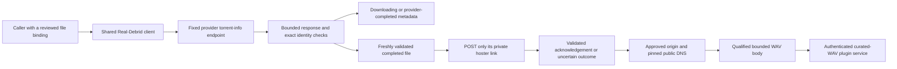
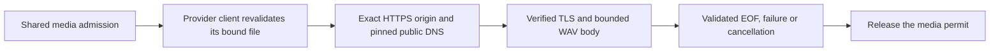
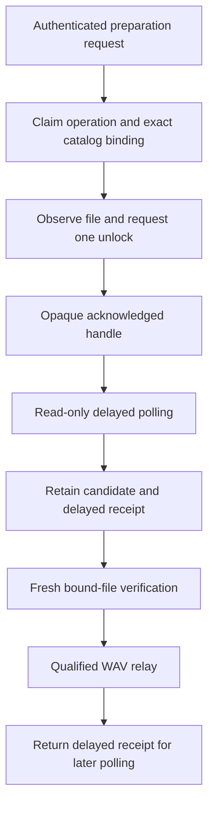

# Debrid adapter development

The first adapter foundation is `hito-debrid-real-debrid`. It reads progress for one already selected torrent file, requests unrestriction after freshly revalidating that file, and can open a narrowly qualified WAV stream. Observation and unrestriction receipts remain metadata, not playable sources. A separate curated-WAV plugin service and executable now use this adapter. Account delivery, broader media compatibility, submission, file selection and durable preparation remain unfinished; this is not a ready general-purpose Real-Debrid connection. The separate [AllDebrid library](../crates/hito-debrid-all-debrid/README.md) supports bound-file observation, submission, unlock, delayed polling and narrowly qualified candidate audio. Its connectable plugin remains unfinished. Premiumize and TorBox remain planned.

## Observation and ownership

The caller supplies a provider access token separately from any Hito plugin-service credential. It also supplies an exact torrent ID, info hash, file ID, path and size. An observation must retain that binding. A changed file is rejected rather than substituted.

The supported states are downloading and completed with exactly one selected file. Progress retains the provider's integer percentage as basis points. Provider completion does not mean that Hito has a playable source. Completion links are validated privately and discarded. The observer neither fetches audio nor creates files, transfers or downloads. Other provider states currently fail closed.

These semantics follow the [official Real-Debrid API](https://api.real-debrid.com/), where torrent progress and selected-file completion are separate from link unrestriction.

## Bound-file unrestriction

`unrestrict_bound_file` repeats the torrent-info lookup. Only a completed, unchanged selected file permits a form-encoded `POST /unrestrict/link`. The request carries its freshly validated private hoster link and the separate provider credential. It requests no remote-traffic option and makes no submission, file-selection or media request.

A valid acknowledgement must echo the exact original link, confirm the positive bound byte count and contain a syntactically valid HTTPS download URL. Multiple results are rejected. The URL remains private and is discarded. `UnrestrictionReceipt` contains only the exact file binding and confirmed bytes. These checks do not establish audio format, content identity, safe media destinations or readiness for playback.

After possible POST dispatch, transport, deadline, status, framing, body and receipt failures become `UnrestrictionUncertain`. Definitive HTTP 401 and 403 retain their rejection status. Failures before dispatch retain their original classification. This is conservative: execution can begin without proving any bytes reached the provider. The client never repeats the POST automatically. Future durable orchestration must retain this distinction when an acknowledgement is lost.

## Transport and limits

Production requests use the fixed HTTPS API origin. Proxy discovery, redirects and automatic retries are disabled. Authorization headers are sensitive; errors and application logs use static outcomes, correlation IDs and elapsed times.

Clones share two promptly admitted API operations and a 250 ms request-start interval. Independent constructors do not share these limits, even with the same credential. Future account integration must retain one shared client for each provider account.

Each observation or unrestriction has one 12-second overall budget, including admission, pacing and response processing. One owned admission permit spans both unrestriction exchanges. Each API exchange resolves its fixed origin through an owned asynchronous resolver, rejects any nonpublic answer and pins the complete admitted address set for TLS. DNS and connection establishment share a two-second budget; request pacing remains separate. HTTP has a ten-second request timeout. JSON bodies are limited to 65,536 bytes through both declared-length and streamed checks before parsing. Dropping an operation drops its request, DNS futures and sockets.

## Bound audio opening

`open_bound_audio` revalidates the exact selected file and unrestricts its current link before opening media. The operator supplies one to 32 explicit HTTPS origins on port 443. Credentials, IP-literal origins, redirects and destinations outside that list are rejected. All returned DNS addresses must be public, with at most 32 answers; the connection uses only the admitted set and still verifies the original hostname and certificate. The API credential never goes to the media host. The signed media address remains private to the adapter.

Opening has one nine-second budget across provider validation, unrestriction, DNS, TLS and the qualification prefix. Media TCP/TLS connection establishment has a two-second timeout within that budget. API and media use the same startup DNS configuration. Resolver work belongs to the calling future, with at most 16 background futures per lookup; the bounded DNS transport may retransmit packets and does not establish a zero-packet-retry guarantee.

The current qualifier accepts a canonical 44-byte-header PCM16 WAV representation, with one to eight channels and sample rates from 8,000 to 384,000 Hz. Header lengths, alignment and the bound file size must agree. The returned body retains the exact file binding, length and format; it emits chunks no larger than 64 KiB, detects premature or excess bytes, and has a 15-second idle-read deadline. Two media permits remain owned through EOF, error or caller drop. Qualification does not prove the recording's musical identity, and MP3, AAC, other WAV layouts, conversion and seeking remain unfinished. No file or persistent download is created.

## Shared media ownership

`hito-remote-audio` now owns the credential-free HTTPS, DNS and WAV-body policy used by Real-Debrid and AllDebrid. Provider clients still own credentials, current file authority and provider-specific acknowledgements. The shared body retains the caller's typed binding and maps failures to that provider's public error type.

The caller acquires the media permit before provider revalidation. It supplies the private target only after that revalidation succeeds. The shared body retains the permit through EOF, failure or drop. Provider API capacity remains separate.

All 22 existing Real-Debrid adapter cases and six service cases pass after extraction, including an independent repeat. Strict all-target checks and formatting pass. A fresh source review confirms the moved destination, DNS, TLS, framing, length, cancellation and log rules; all 663 external lockfile package blocks remain byte-identical. The extraction preserves the current narrow WAV support. The later AllDebrid packet below uses this opener. Neither a connectable AllDebrid service nor normal-server deployment is claimed. See [the crate's contract](../crates/hito-remote-audio/README.md).

## AllDebrid candidate audio

An opaque `GeneratedFileCandidate` can now be consumed by `open_bound_audio`. The client first acquires shared media capacity, then repeats the provider status and complete file-tree observation. Only the exact completed binding permits opening the candidate's private address. The nine-second opening deadline covers revalidation, DNS, TLS and WAV qualification. It makes no new unlock request and creates no persistent download.

The shared origin, DNS, TLS, WAV, length and EOF rules still apply. Provider credentials stay with the AllDebrid API; media receives no authorization, cookie or referer header. The candidate address has no public getter or serialization. An immediate unlock acknowledgement now yields the same opaque candidate type; it requires the exact selected-file byte count and a bounded HTTPS address. It makes no delayed poll and does not establish media readiness before opening.

Two new owned TLS cases extend the prior seven protocol cases. The first performs preparation and a real delayed poll before fresh revalidation and one media GET. It reads exactly 384,044 WAV bytes and decodes 192,000 samples, while retaining a same-name, same-size file in a different directory as a rejected decoy. The second cancels a held opening under another log dispatcher. Client EOF precedes recovery; exactly two cancellation outcomes retain their original correlation, the decoy capture remains empty, and two recovered bodies remain live together before full consumption.

The cancellation case initially panicked during nested span retirement. The fix retains the owning dispatcher for both completion logging and span retirement. The unchanged case then passed. All nine AllDebrid cases, 22 Real-Debrid cases and six Real-Debrid service cases pass together, with strict affected-crate checks and formatting. An independent repeat and final source review pass. All 174 qualified inputs match the integrated source; external lockfile package blocks and the shared/RD/service sources remain unchanged.

A third media case covers an immediate generated acknowledgement. It verifies exactly five API calls and one credential-free WAV GET, with fresh bound-file observation, exact bytes through EOF and decoding, and no delayed poll or second unlock. Its first run failed with `GeneratedLinkUnsupported`; the same case passed after the typed candidate branch was implemented. All ten AD cases, strict AD all-target checks with test support and formatting pass, including an independent repeat. Independent source review passes. Shared/RD/service and dependency inputs remain unchanged.

These checks qualify an offline protocol library with deterministic fixtures. A connectable AllDebrid service, durable application preparation, adversarial acknowledgement controls, broader formats, seeking, failure controls and live-provider acceptance remain open.

## AllDebrid curated-WAV service library

`hito-plugin-all-debrid` exposes authenticated search, recording detail, sources, preparation, preparation status and WAV relay routes. One operator-curated catalog contains at most 128 exact file bindings. The service credential is separate from the provider credential. Metadata-only search and detail make no provider request. The manifest advertises preparation and a playback-only persistence ceiling.

Preparation claims an operation before provider work. An accepted acknowledgement becomes an opaque authenticated handle bound to that operation and the exact catalog entry. Replaying a current operation cannot retarget it to another recording. A retained delayed handle can restore read-only polling after service restart when the private receipt key and catalog are unchanged. The core application remains responsible for durable requests and uncertain submissions; the service does not promise an unlimited operation history across restarts.

Readiness repeats the provider observation before publishing a completed candidate. A busy or cancelled media opening retains the delayed receipt, so a later status request can recover without another unlock. A definite failure before unlock dispatch can retry the same operation after a five-second guard. An uncertain mutation remains uncertain and cannot enter that retry path. Direct candidates have no delayed receipt to restore after opening.

Five public HTTP/TLS cases pass in Docker, with strict all-target package Clippy, formatting, independent source review and independent repeated runs. They verify exact authenticated responses, sealed receipt isolation, restart restoration, operation retarget rejection, changed provider readiness, real held-body connection release, bounded media capacity, exact WAV decoding and guarded retry. The recovery case observes 27 provider requests, three unlocks and three media requests; the pre-unlock retry case observes four provider requests and one unlock. Correlated outcome logs exclude credentials, private catalog data and signed addresses.

The final independent run passes all five cases in 33.02 seconds. All 193 qualified source inputs match after cherry-picking into the current application branch, and all 663 external lockfile package blocks remain unchanged. The test organization moved three test bodies and four helpers without changing their bytes. These are deterministic fixture checks, not live-provider compatibility or release-latency measurements.

The executable and private-input bootstrap are qualified separately below. The restricted image, Hito account connection, packaged application preparation, active-media shutdown, seeking, broader codecs and live acceptance remain open. The normal deployment has not changed.

## AllDebrid executable bootstrap

The `hito-plugin-all-debrid` executable defaults to `127.0.0.1:8097`. It requires `--provider-token-file`, `--service-token-file`, `--receipt-key-file` and `--catalog-file`; `--listen` is optional. The provider and service credentials must differ. The receipt key is exactly 32 binary bytes and must not be all zero. Retain that private key with the unchanged catalog to restore acknowledged delayed handles after restart.

Every input must be an absolute regular file, with one hard link, owned by the running user and mode `0400` or `0600`. The opened descriptor rejects a final symlink, checks size/type/ownership/permissions before reading and rechecks metadata afterward. Token files accept at most 4,098 bytes with one optional terminal newline; tokens remain bounded to 4,096 printable nonspace ASCII bytes. The catalog accepts at most 1 MiB and uses strict typed parsing before the existing catalog validation. Input errors use static reasons. The executable reads configuration before binding.

The lifecycle owns a generated service correlation, safe readiness/failure/shutdown outcomes and elapsed times. Requested TRACE output remains limited to owned service, adapter and shared-media namespaces. Startup and authenticated catalog metadata do not contact the provider. SIGINT or SIGTERM stops accepting work and joins the HTTP server's graceful shutdown.

One real-child case first failed because bootstrap was absent, then passed unchanged after implementation. It verifies the public manifest, rejection of missing/wrong/provider credentials at the service boundary, exact search/detail responses, unchanged private input bytes/metadata and nine safe lifecycle/request events through joined SIGTERM. A separate child workflow rejects 30 cases covering short/oversized/zero receipt keys and symlinks, hard links, public permissions, FIFOs, directories, oversized files and wrong owners across all four inputs. These controls passed immediately as new coverage; no production fix or RED is claimed for them.

The lifecycle and all 30 rejection controls pass in independent Docker repeats. All five prior public service cases also pass, with strict all-target package Clippy and formatting. Fresh source review found no unresolved P1/P2 in the bootstrap. All 208 qualified inputs match after integration, and all 663 external dependency blocks remain unchanged. The implementation keeps argument parsing, typed configuration, private files, logging and lifecycle in separate cohesive owners.

These Linux process fixtures do not qualify all semantic CLI/catalog inputs, a restricted image, application preparation, live accounts or shutdown with an active audio body. Seeking and broader codecs also remain open. The normal persistent server was not changed.

## Curated-WAV service and executable

`hito-plugin-real-debrid` owns HTTP authentication and rendering-neutral SDK responses. It serves one operator-reviewed catalog of at most 128 canonical PCM16 WAV recordings through one shared provider client. The public manifest advertises Search and Sources with a `playback_only` persistence ceiling. Search and detail make no provider call. Sources and HEAD observe the bound file; explicit GET alone revalidates, unrestricts once and relays qualified audio. The relay strips caller credentials and upstream private headers, returns a full non-seekable WAV representation and validates final EOF before releasing the last declared bytes. It creates no persistent download and advertises no preparation capability.

The executable defaults to `127.0.0.1:8096`. It accepts `--provider-token-file`, `--service-token-file`, `--catalog-file` and optional `--listen`. Credentials remain separate. Each input must be an absolute, regular, single-link file owned by the running user with mode `0400` or `0600`. Loading rejects symlinks, nonregular files, permissive modes and oversized data through the opened descriptor. Strict catalog parsing is bounded to 1 MiB; existing SDK and adapter validation retain metadata, source and binding limits. File buffers zeroize, post-read metadata is checked, and errors expose static reasons. JSON logging admits only owned namespaces even when TRACE is requested.

All 22 adapter and six service cases pass together in Docker, with strict all-target checks for both crates and formatting. The hosted HTTP/TLS case decodes the exact owned WAV and verifies authentication, source/header isolation and private logs. Two boundary cases cover malformed/protocol/opaque-ID rejection with no upstream work, pagination, and a provider file changing after ready observation and HEAD. A real-child case verifies startup, authenticated metadata, held control-body completion through SIGTERM, closed listening and correlated private logs. Two bootstrap cases reject 17 unsafe file/catalog/credential scenarios before binding while preserving input bytes and Unix metadata. Fresh independent source reviews pass.

`Dockerfile.plugin-real-debrid` and `compose.real-debrid.yaml` define a restricted standalone image and an external private credential volume. Builds require an immutable source ID for a separate Cargo cache; running a prebuilt image does not.

Image `sha256:ea431ad6ec5339720b24cd504a359a8c28f20c9daa4ce527a1ed99cdb6a149cb`, built from `13041bf`, passes isolated container startup and metadata acceptance. It runs as UID/GID 10001 with a read-only root and credential mount, dropped capabilities, one CPU, 256 MiB memory and 64 processes. The audit disables all external networking and publishes no ports. Health, the public manifest, exact authenticated search/detail, absent and wrong credentials, unknown recording and invalid limit checks pass. All three private input files retain their bytes, inode, owner, mode, links and timestamps. A repeated TRACE run emits 19 bounded JSON records with one lifecycle identity and no supplied private canaries, including both normalized credential values. Synthetic JSON leaks first exposed a missing normalized provider-token check in the audit; the corrected gate and its independent second review pass. Idle SIGTERM exits with code zero in 0.074 seconds. The stopped container and private audit evidence remain under `/private/tmp/hito-real-debrid-package-13041bf/`.

This container check makes no live provider or media request. The service is not in the normal deployment.

Responsive control-body shutdown does not establish active-media quiescence. A backpressured audio response can delay graceful shutdown; a forced total drain deadline and actual container stop-grace qualification remain required release work. Live provider accounts, application integration, broader codecs, ranges, seeking and durable preparation also remain open.

## Evidence and remaining work

All 22 crate tests, strict all-target Clippy and formatting pass through Docker Compose against the integrated workspace. The test run takes 12.07 seconds and Clippy 1.05 seconds. The original seven owned protocol cases verify progress and provider completion, changed-file rejection, declared and chunked overflow rejection before a withheld remainder, valid exact-limit JSON, and connection release followed by another observation after cancellation.

Unrestriction cases verify exact GET/POST form bytes, a received POST followed by acknowledgement loss, pre-POST rejection of changed or downloading files, and eight rejected or invalid acknowledgement scenarios. A real seven-second torrent-info delay followed by a held POST distinguishes the aggregate deadline from separate request deadlines. Timeout and caller-drop cases require peer EOF while client clones remain alive, then a successful manual observation with exact GET/POST/GET history. The fixture tasks join before result assertions. This proves resumed progress, not restoration of both admission slots for the POST workflow.

Two held clone observations reject a third promptly without another HTTP request. After cancellation, both slots accept held observations again and all four connections close. Fixture tasks join shutdown. The request timing check uses pre-poll baselines with 5 ms tolerance; it is a pacing characterization, not an exact packet-arrival or complete rate-limit proof. Scoped application-log captures exclude private tokens, IDs, paths, names and URLs; they do not establish dependency-log privacy.

The audio cases open owned HTTPS media, deliver an exact 384,044-byte stereo 48 kHz fixture and decode its 192,000 samples through the shared audio decoder. They check full-body delivery, rejected destinations and framing, stalled and cancelled DNS ownership, both media slots after failure, and successful manual recovery. The destination matrix rejects mixed public/private A and AAAA answers in both orders, an untrusted certificate and a wrong-host certificate. Peer EOF and exact TLS alerts precede recovery, with no authenticated HTTP request to a rejected destination. A held API POST DNS preflight remains a definite failure before dispatch, rather than an uncertain unrestriction acknowledgement.

Independent correctness, security and performance source reviews pass, including fresh reviews of the owned DNS and destination matrix. Broader hostile-response, mixed-operation capacity, deadline-phase and rate-limit qualification remains open. These checks do not establish live-provider compatibility, SDK source readiness or release latency targets.

The complete integration still needs provider-account provisioning, durable preparation orchestration, supported state transitions, application delivery of the authenticated service, ranges and seeks, broader codec support, application recovery, shared-client lifecycle and live test accounts. The other three adapters need their own provider protocols and acceptance evidence.
