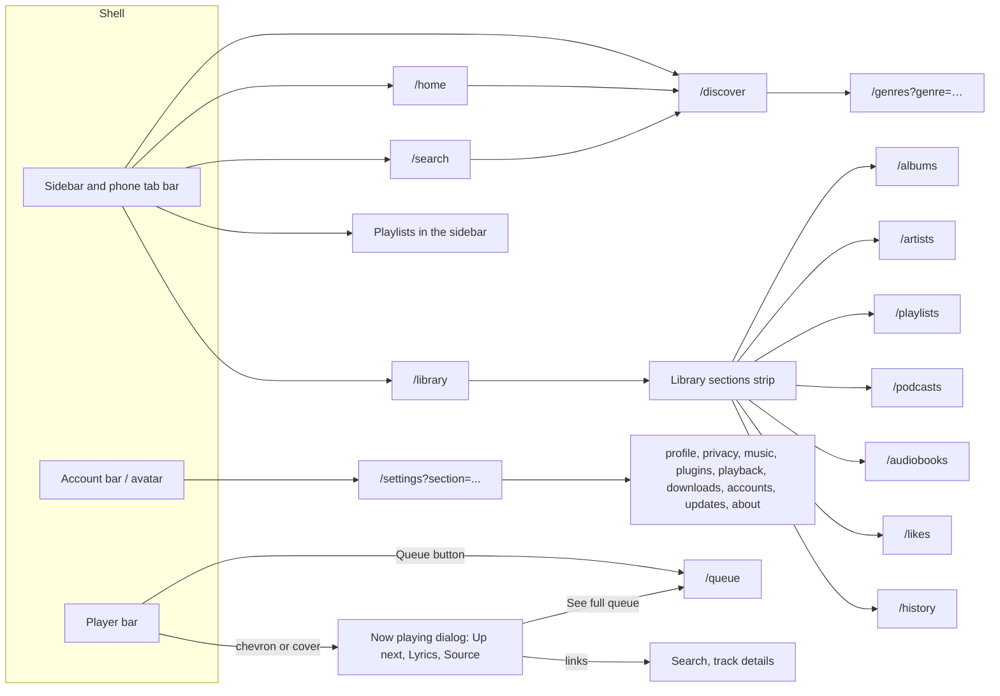
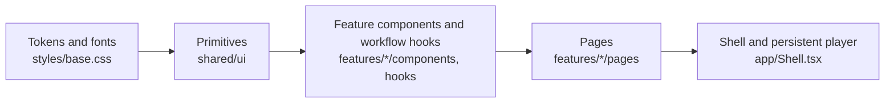

# Design system

**Status.** The web redesign is implemented in `apps/web` for every screen the server can fill: foundation, Settings, Home, Search and Discover, Library, Artist, Album and Playlist, Now playing and Queue, Podcasts and Audiobooks, and first-run setup. Open items are listed under "Still open"; the work that needs new server data or capabilities is tracked in the [TODO](../TODO.md). This is a local development state, not a public release.

| Area | State |
| --- | --- |
| Colour tokens, light and dark | Implemented in `apps/web/src/styles/base.css`; dark follows `prefers-color-scheme`. Old palette variables are aliases of the new tokens. |
| Figtree | Implemented, bundled locally with `@fontsource-variable/figtree` (OFL-1.1, see [third-party notices](third-party-notices.md)). No CDN. One family for everything; times and counts use tabular numbers. |
| Primitives in `apps/web/src/shared/ui` | Button, SegmentedControl, Listbox, FilterPills, Switch, AvailabilityLabel, StatusDot, HealthDot, ListRow, SettingsCard, SectionWarning, FallbackCover, BrandMark. Settings use them (plus SettingRow and Dialog); the other pages keep their class names. |
| Shell | Sidebar (240 px, its own darker ground) with the mark, Home / Search (⌘K on Apple systems, Ctrl+K elsewhere) / Discover / Library / Plugins, a Playlists list that starts with Liked tracks and shows the quiet playlist tile for each playlist (the shared page props carry no playlist cover flag, so the sidebar never asks providers for artwork), and an account bar (account and settings link, keyboard shortcuts, lock, sign-out) at the bottom of the sidebar on desktop and only the avatar in the page header on phones. The top bar holds one pill search field ("Search, or paste a playlist link" on the global pages, with the shortcut hint) and a plugins pill that opens Settings → Plugins. The prototype's "2 plugins · 1 to review" counts are not shown: no page prop carries them, and fetching the plugin list from the shell on every page would add a request (and provider traffic in tests) to every screen. Below 768 px the navigation becomes a five-tab bottom bar. |
| Player bar | Its own ground (`--dock`): 56 px cover, title and artists, like and menu on the left; shuffle, previous, a blue play button, next and repeat over a 4 px seek bar with a visible thumb in the middle; speed, mute, volume, a chevron to open Now playing and "Queue · N" on the right. Below 768 px it is a raised mini player above the tab bar. Playback logic is unchanged. The prototype's "Ready · from <source>" line is not shown: the playing track carries no source name. There is no right-hand listening rail; Now playing and the queue open from the player. |
| Settings | Implemented: a grouped navigation (Your account: Profile, Privacy & lock; Listening: Music & providers, Plugins, Playback, Downloads & storage; Server: Accounts, Updates, About) with one deep link per section, a section heading, and cards built from SettingsCard, SettingRow, Switch, SegmentedControl, Button, HealthDot and SectionWarning. See "Settings" below. |
| Home | Implemented at `/home` (see "Home, Search and Discover" below). |
| Search | Implemented at `/search` with All / Library / Providers scopes (see below). |
| Discover | Implemented at `/discover`: From your services (featured by connected services, source only), By genre tiles from the library, Radio from… chosen artists, and the provider search below. |
| Now playing, Queue, first-run setup | Implemented (phases 5 and 7, see below). |
| Library sort | Implemented: a "Sort" pill (the label sits inside the pill, as in the Library menus artboard) on Library tracks (Recently added, Title, Artist), Albums (those and Year) and Artists (Recently added, Name). The choice is the `?sort=` query value (Recently added is the default and leaves the address clean) and is applied by the server before paging. The menu is the shared Listbox: Enter opens it with focus on the chosen option, arrows move focus without choosing, Enter chooses and returns focus to the pill, Escape closes without choosing. |
| Library page frame | Implemented for tracks, albums, artists, playlists, podcasts, audiobooks and history: the page heading (36 px) with Play and Shuffle, then the section tabs (an underline strip: Tracks, Albums, Artists, Playlists, Podcasts, Audiobooks, History; Liked tracks lives in the sidebar), then the sort row. The tabs are drawn by the page (`LibraryHeading`), so collection detail pages such as an album or a playlist no longer show them. Library tracks use a table: a choice box, cover with title and artist, album, availability (the source status dot plus "Local" or "from your services", with Find when no source) and time. Choosing rows shows a selection bar (Select the N loaded, Add to queue, Add to playlist, Clear selection). Not built: the Availability and Plays from filters, "Select all that match", Download and Edit details on a selection, and the Album and Duration sorts, because the server reads take no such parameters. |
| States board, dark-mode screens | Not built. |

**Language.** The prototype labels are Portuguese, but the app stays English for now (Home, Search, Library, "Account and settings"). Translation is a separate i18n item in the [TODO](../TODO.md).

Routes: Home opens `/home`, Search opens `/search` (a real page, not a focus shortcut) and Library opens `/library`; albums, artists, playlists, podcasts, audiobooks, likes and history stay at their routes and are reachable from the "Library sections" strip shown on those pages. `/discover` is its own destination with a sidebar entry and a phone tab (the prototype's sidebar has no Discover item; the entry was added so the page is reachable without going through Search). `/genres?genre=<key>` is the genre page and highlights Discover too. Settings open from the avatar. `/` and the post-sign-in landing remain the library: several browser flows assert the library heading after sign-in, so moving the landing to Home is deferred (see the [TODO](../TODO.md)). The ⌘K / Ctrl+K shortcut focuses the page's search field (`#shell-search`) and otherwise opens `/search` and focuses its field.

**Search placement (one rule).** Every page except the track details page has one search field, in the top bar above the page content, at the same place and size. On Home, Search, Discover, genre, Queue and Settings pages it is the global search and opens `/search`; on Library, Albums, Artists, Playlists and the other Library sections it filters the library (its label says "Search library"). Pages do not draw a second global field of their own. On phones (below 768 px) the top bar field appears only on Library pages; the Search tab leads to the Search page, which draws its own field under the title because the top bar has none there. Settings keeps its separate settings search inside the page.

**Fallback cover rule (implemented).** Real artwork always wins. When there is none, `FallbackCover` draws one quiet grey tile (`--cover-tile`) with a glyph (`--cover-glyph`) for what the thing is: a note for an album, track, podcast or audiobook, a list for a playlist, a person for an artist (a circle), and a heart on the action colour for Liked tracks. It has no text, no colour from a hash and no border, so artwork carries the colour. A playlist without a cover of its own shows the first four distinct covers of its tracks when it has four (`PlaylistMosaic`, used on the playlist page header); with fewer it shows the first track's cover. Sidebar and Home playlist rows have no track list, so they show the list glyph. The role is `img` with the label "Cover of …", "Photo of …" for artists and "Liked tracks cover". `Artwork` keeps the tile underneath while an image is pending. Genre covers are the one exception for now: `coverArt(kind, id, title, subtitle)` in `apps/web/src/shared/ui/coverArt.ts` still builds the generated hash-based art for Discover tiles and the genre page header until those screens are redesigned. Other header tints and avatars still use the older eight-colour `coverPalette`.

**Keyboard shortcuts (implemented).** `?` opens a dialog that lists every shortcut and has a "Single-key shortcuts" switch (stored in this browser). Playback: Space play or pause, Shift → and Shift ← next and previous track, M mute (a second press restores the volume), L like the playing track; arrows act only on a focused seek or volume slider. Go to: ⌘K or Ctrl K search, G then H Home, G then L Library, G then P Plugins, Q the queue, N Now playing. Shortcuts pause while a field, dialog or contenteditable has focus, Space leaves buttons, links and sliders to their own behaviour, and a modifier combination is never a shortcut. The switch turns off Space, letters and G chords; `?` and Shift arrows stay on. Lyrics, list selection and queue reordering shortcuts from the prototype are not built (no matching action exists yet).

The prototype with every screen is a private design canvas: https://claude.ai/artifact/HurdZx23txC2chX73MX529. The rows marked **v2** are the agreed direction; earlier rows are explorations kept for history.

## Structure

Navigation and what opens from the player:



Component layers. Each layer imports only from the layers to its left:



Pages own one route. Workflow hooks own async work and cancellation. Playback position reaches the screen only through the small seek and clock components, so pages, tabs and queue rows do not re-render on position ticks.

## Principles

- **Three destinations.** Home, Search (one search across library and providers, ⌘K on desktop) and Library. Artists, albums, playlists, podcasts, audiobooks, likes and history are separate routes reached from a section strip; the prototype's single filter bar is not built. Settings open from the avatar.
- **One shell.** The sidebar, the player bar and the cover are shared components. Every screen uses them unchanged.
- **One action per state.** Each item shows its availability and only the action that state allows.
- **Nothing merges by itself.** Uncertain matches wait for review; the user decides.
- **Suggestions explain themselves.** Each suggestion says why it appears and can be dismissed.
- **Warnings stay local.** A provider or folder failure marks its own section, never the whole page.
- **Own controls.** Switches and segmented controls; no native checkboxes or selects.
- **Technical, but secondary.** Formats, conversions, durations and dates are shown in monospace and never compete with titles.

## Identity

The mark is the three availability states in a row, followed by the word "hito":

- ● filled: in the library
- ○ outlined: available from a provider
- ◌ dashed: catalog only, no audio yet

The same three rings appear wherever availability is shown, so the brand and the core product idea are the same thing.

## Colour

The table lists the base tokens. The app also defines `control-border` and `control-off` (3:1 on the page and surface, for input borders and a switch that is off), and `ink-hover` and `action-hover` for button hover. Cover colours come with an inset edge so dark covers show on a dark page.

| Token | Value | Use |
| --- | --- | --- |
| `bg` | `#fbfbfa` | Page |
| `surface` | `#ffffff` | Cards, player |
| `subtle` | `#eeeeea` | Selection, segmented controls |
| `line` | `#e6e5e1` | Dividers |
| `ink` | `#141414` | Text, primary action |
| `muted` | `#5f5e5a` | Metadata (6.3:1 on `bg`) |
| `action` | `#2f4bff` | Add, available |
| `success` | `#0f7a4f` | Working |
| `warning` | `#9a5b00` | Slow, disconnected |
| `error` | `#b5412b` | Failures, destructive text |

Dark mode uses the same token names with `bg #111110`, `sidebar-bg #0c0c0b`, `surface #1b1b19`, `subtle #262624` (raised), `line #2a2a27`, `line-strong #3a3a36`, `ink #f2f1ed`, `ink-soft #cfcec8`, `muted #a3a29c`, `action #6f86ff`, `link #8fa2ff` (hover `#b3c0ff`, also the focus colour), `warning #e5b567` (needs you), `error #f0a08c` (failed) and `dock #161615`. One blue for play, progress and focus; amber only for what needs the person; everything else stays neutral so artwork carries the colour. All body text meets 4.5:1. The light theme keeps the same names, so the dark block is the only part a theme switch has to replace.

Radii have four values: `--radius-cover` 6, `--radius-control` 10, `--radius-panel` 16 and `--radius-pill` 999. Spacing moves in steps of 4. Floating things (menus, dialogs, play buttons on covers) share one `--shadow` (`0 24px 64px` at 50% black). Focus is a 2 px `--focus` outline with a 2 px offset on every control.

**Cover colour.** Artist, album, podcast and playlist headers use one flat colour taken from the cover, never a gradient. With real artwork, the server computes the dominant colour once when the artwork is stored and keeps it with the artwork. Without artwork, the header colour comes from a stable hash of the release id over a fixed palette (the generated cover uses its own OKLCH art), so it never changes between visits or devices.

## Typography

Figtree for everything. Times and counts use tabular numbers instead of a second family.

| Role | Size / weight | Example |
| --- | --- | --- |
| Display | 56 / 800, −0.02em | Artist name |
| Page title | 36 / 800, −0.01em | Settings |
| Section | 24 / 700 | Recently added |
| Card title | 17 / 700 | Card and dialog headings |
| Body | 16 / 400 | Track titles, copy |
| Small | 14 | Artists, albums, status |
| Technical | 12–14, tabular numbers | `FLAC 24/384 → 48 kHz · 1,25×` |

## Components

- **Buttons**, 44 px high, pill radius: primary (ink), action (blue, add/import), secondary (outline), destructive (outline with red text, never filled), active (outline with a check). One primary per zone.
- **Segmented control** for two to five exclusive options (lock timeout, speed, update channel). **Pills** for filters. **Switch** for on/off settings with immediate effect.
- **Source status (StatusDot)**: the four source states, always a dot plus a word, never colour alone. Ready is a filled dot (`--ink-soft`) and is followed by where the track plays from when that is known; Checking… is a dashed ring; No source is a solid amber ring and offers Find; Couldn't check is a dotted ring in the failed colour and offers Retry. The shared track row uses it for tracks that are not stored here ("Ready · from your services", "No source") and for the catalog rows' find states. The older **availability label** (library, available, catalog) is still used on the track page, discography and provider results until those screens move to the source status. The brand mark keeps its three rings and nothing else in the interface uses them. **Health dot**: filled dot in success, warning or action colour for services, folders and plugins.
- **List row**: cover (44–64 px), title and subtitle, state, one action. Fixed column widths so states and actions align.
- **Settings card**: header with title and one action, then rows; a shared settings navigation lists Perfil, Privacidade e bloqueio, Música e fornecedores, Plugins, Reprodução, Downloads e espaço, Contas, Atualizações and Sobre.
- **Section warning**: amber or red box inside the affected section, saying what happened, what still works and what to do.
- **Fallback cover**: generated art (kind-specific flat motif, title and subtitle at 96 px and up, one-grapheme monogram below) used only when there is no real artwork.
- **Artwork loading** (current behaviour): every cover address comes from `coverArtUrl(kind, id)` in `features/artists/api/coverArtApi.ts`, the one place that knows the `/api/v1/cover-art` prefix. Artist photos and Discover shelf covers that fail to load are retried by the shared `useArtworkRetry` hook (artist photos after 2 s then 5 s, shelf covers once after 1 s); it cancels pending retries when the cover goes away or its address changes. Album covers (`CatalogCover`) do not retry; they move straight from the release cover to the release group cover and then to the fallback cover.
- **Media card** (`MediaCard`): one card for the discography, the Discover "From your services" shelf and the Home shelves. A rounded cover (a circle for artists), a bold title of at most two lines and one muted line such as "Single · 2008". The whole card opens its target through one link or button. When the card can play, a separate round play button sits on the bottom-right of the cover, labelled "Play <title>": it appears on hover and keyboard focus on a pointer device and is always visible on touch and at 390 px. A small check on the top-left of the cover marks a release already in the library; the card has no badges or extra buttons, and no control sits inside another. Library detail and the comparison control moved into the opened album. The CSS prefix is `shelf-card` because `media-card` is already the podcast and audiobook tile.

## Prototype screens

Built: Home, Artist, Album, Library, Playlist (view and edit), Discover, Podcast, Audiobook, Now playing, Queue, Settings (all sections), Sign-in, first-run setup. Built with fewer elements than the prototype: the Library page (no filter bar), the Source tab (no format or alternative source), account management (no invitations).

Not built: invite-link account creation, the states board (loading, provider down, offline, empty library, import problems, unplayable track as one reference), dark-mode screens, and phone versions of screens that have none (the prototype draws phone screens only for Search and Now playing; the `LeitorMobile` file was not in the reference set).

Account creation is never linked from the sign-in screen. On the first start of a server with no accounts the sign-in page shows the administrator setup. A single-use invite link would be the other entry; the server has no invitations yet.

## Still open

- Dark-mode screens and the states board.
- The Library filter bar, and invite-link accounts (needs a server capability).
- The player bar speed control is still a native select.
- The cover colour for headers is deterministic (see `tintFor`), not taken from artwork; that needs server-side extraction.
- No source or provider label is available for the playing track, so the player bar shows none.
- Interface translation (see Language above).
- Follow-ups that need server data are in the "Not built" lists of each section below.

## Settings

Current behavior (apps/web, English labels):

- `/settings?section=<id>` opens a section: `profile`, `privacy`, `music`, `plugins`, `playback`, `downloads`, `accounts`, `updates`, `about`. With no parameter the page opens Music & providers on desktop and the section list on phones. Old links keep working: `library` and `metadata` open Music & providers; an unknown id, or `accounts` for a non-administrator, opens Music & providers. Accounts is hidden from the navigation for non-administrators.
- The navigation is a list of links (`aria-current="page"` marks the open section). Choosing a section moves focus to its heading. Below 768 px the list and the open section are separate views: the list, then the section with an "All settings" link back. The phase 1 account bar is hidden on phone Settings; Profile offers Sign out and, when a PIN is set, Lock now. Profile also holds the Display name card, the Change password card (current, new and repeated password; a plain message for a wrong current password) and the Open sessions card (this session marked, Revoke on each other session, Sign out other sessions).
- Rows use fixed status and action columns (200 px and 140 px; 160 px and 300 px for rows with several buttons) so status and buttons line up between rows. On phones the columns stack.
- On/off choices are Switches and the idle-lock period is a segmented control. Switches in Privacy keep explicit Save and Cancel, because consent changes must be saved deliberately. The library chooser, the service chooser when connecting a plugin and the provider chooser in the Add provider dialog use the shared **Listbox**, a select-only combobox that follows the WAI-ARIA pattern: a labelled button with `role="combobox"` opens a `role="listbox"` and keeps focus on the button, while `aria-activedescendant` names the active option. Arrow keys move the active option and stop at the ends, Home and End jump to the first and last option, typing letters finds an option by its first letters (repeating one letter cycles), Enter or Space commits, Escape closes without changing the value, and Tab commits and moves on. Escape is consumed while the list is open, so a Listbox inside a Dialog closes the list first. The list opens below the control and flips above it when the bottom of the screen, the player bar or the phone tabs would cover it. Controls and options are at least 44px tall. Other selects in the app (playback speed, playlists, chapters and so on) are still native. The folder picker ("Add music folder", from Library and from Settings, Music & providers) uses the shared Dialog with the wide size: title, description, a close button, focus kept inside the modal, Escape or Close to dismiss (not while a folder is being added) and focus returned to the opener. **Plugins** (Settings, Plugins) lists each installed plugin as a card in a two-column grid on desktop and one column below 768 px: the plugin name with its token status (hidden for sign-in plugins until a token is saved), a plain sentence about what it does, a row of capability chips, the Account sign-in line for `oauth2_pkce` plugins, then Check connection and Remove, then Details. The chips come from the manifest's declared capabilities, in a fixed order, with listener words (Search, Playback, Track details, Browse, Playlists, Covers, Lyrics, Faster playback, Backing tracks, Featured, Dashboard); a plugin that declares nothing shows no chip list. A card that has Details open or a change to review spans both columns. Behavior, accessible names and the removal and review flows are unchanged. **Metadata providers** (Settings, Music & providers) are one row per selected provider: name, "Built in" or "Plugin", its priority number, a Connected or Not connected status for plugins (a saved plugin whose connection is gone reads "Unavailable saved provider"), and icon buttons to move earlier, move later and remove (each named with the provider, 44px on phones). Remove asks first in a small Dialog ("Remove <name>?", Cancel or Remove provider). "Add provider" opens a Dialog with a Listbox of the providers not yet selected and "Add metadata provider"; it is hidden when every provider is in use and disabled at the limit of eight. Both dialogs return focus to the control that opened them. Changes stay in the draft until Save metadata preferences, as before. When "Use metadata providers" is off the rows are dimmed and a line says the order is kept. A per-provider disable is not built: the server stores one on/off switch for all providers and an ordered list, and this change did not alter the server.
- **Source preference** (Settings, Playback) is a card under Playback with one row per source kind: Local files, Saved copies and each connected provider, in the metadata provider row layout (name, kind and priority number, Connected for providers, icon buttons Move up and Move down, 44px on phones). A switch, "Try the next source if one fails" (on by default), sits below the list, and one Save source preference button saves the order and the switch together. Changes stay in the draft until saved. See [choosing the audio source](source-preference.md).
- **Settings search** sits at the top of the navigation (and of the section list on phones). It is a combobox with a listbox of results: type to filter, Arrow keys, Home and End move the active result, Enter or a click opens it, Escape clears the field, and a screen-reader status announces the number of results or "No settings match". While there is a query the results replace the section links. The index is built in the browser from the section definitions (`sections.ts`) and a catalogue of settings (`settingsCatalog.ts`): each card in Settings takes its title, and its description when it has no dynamic one, from the same catalogue entry, so the search text and the visible text cannot drift apart. Entries may list a few extra keywords ("log out" finds Session, "pin" finds Screen lock). Matching ignores case and accents and needs every typed word; a title match ranks above a description or keyword match. Administrator-only sections and cards are not offered to members. Choosing a result opens `/settings?section=<id>#setting-<id>`; the card is scrolled into view, its heading takes focus and the card shows a two-second outline (a steady outline when reduced motion is requested). The same link works as a deep link. `/` focuses the field when no text field has focus and no dialog is open. Ctrl+F and Cmd+F stay the browser's find. Cmd/Ctrl+K stays the global search and is not touched. Leaving a section with unsaved changes through a result asks first, like the section links.
- **Account avatars.** The avatar circle shows one or two initials (the first letters of the first two words of the username, or of its first two parts split on dots, dashes and underscores) on a colour chosen from the eight cover palette backgrounds by a stable hash of the account id, so an account keeps its colour across visits and devices. All eight have white initials at 4.5:1 or better (checked in a test); a faint inner ring keeps the darkest ones visible on the dark page. It appears in the account bar, in Profile, and in each Accounts row (40 px, with the role and last-active line beside it). The initials and the name beside the avatar come from the optional display name when the account has one (falling back to the username); with a name set, Profile and Accounts show the username as secondary text. A name made only of symbols uses its first symbol as the initial. See [account security](account-security.md#display-name). An account can upload a photo (JPEG, PNG or WebP, up to 2 MiB, stored as a 256 by 256 square); the same circle then shows the photo, with the display name or username as its alt text, and falls back to the initials and colour if it cannot load. See [account security](account-security.md#avatar-photo).
- Leaving a section with unsaved changes (community choices, source rankings, metadata preferences, a typed PIN or password) asks for confirmation first. A member or alias URL such as `?section=library` is replaced by the resolved section in the address bar.
- On phones, Sign out and Lock now are available only in Profile; the phone header shows only the account avatar.
- Creating an account opens a dialog from the Accounts card. The server has no invitation or public sign-up flow, and the interface offers none.

Not built because the server has no matching capability (see the [TODO](../TODO.md)): language, update checks and channels, copy diagnostics, playback and download options.

Where the old pages were: Library settings now live in Music & providers (music folders); Metadata moved into the same section; Privacy keeps community consent and source rankings and gains the screen lock and the Listening history card (a Save listening history switch and a confirmed Delete listening history action, see [listening history](listening-history.md)); Plugins and Accounts keep their content.

## Home, Search and Discover

**Home (`/home`).** A greeting with the account name (search is the top bar field, see "Search placement"), then only sections the server can fill from data it already has:

- *Jump back in*, up to six tiles: the three most recently played albums, Liked tracks (with a count, shown as `1,000+` above 1,000), then the account's own and followed playlists, then any further recent albums. Each tile only opens its page; there is no play control on a tile.
- *Unheard, near what you like*, up to three albums the account has played where other playable tracks have never been started. Tracks are listed in album order (disc, then track number, then title) and only while a playable source exists. Each card is a raised panel with a larger cover, says why ("You played 3 tracks from Tide.") and offers Listen, which queues up to 25 of those tracks in that order, and Open album; "N more tracks" counts every unheard playable track (up to 1,000). There is no "Not now" because nothing persists a dismissal.
- *Recently played*, up to twelve distinct albums from the listening history, newest first. It reads the history table, so it stops growing while history is paused and empties when history is deleted. The prototype's Home has no such shelf (its Jump back in tiles are the recent albums), but it is kept because Settings and History promise that deleting history clears it. Playlists are not listed because the server keeps no play history for them.
- *Recently added*, up to twelve albums newest in the library (order of arrival into the account's catalog, `HomeAlbum`-style credit including the inferred artist), with a link to all albums.
- *Your artists*, up to twelve chosen artist groups with their cover recording and track count, from the same read as the Artists page (`artists` page prop, limit 12), with a link to all artists. Shelves with nothing to show are left out, except Recently played, which keeps its heading and says "Play something and it will show up here." Shelves are horizontal rows of 160 px cards (132 px on phones) and never subscribe to playback position. A row that is clipped fades the edge that hides more cards; on desktops with a mouse it also shows round Previous and Next buttons (named "Previous in <shelf>" and "Next in <shelf>", shown only while there is more in that direction), and touch screens scroll by swipe. Discover's featured row uses the same `ShelfRow`.
- An empty library (no music, no playlists) shows folder, playlist-import and service actions; a listener who cannot manage folders is told to ask the administrator.

The prototype's banner "N tracks in <playlist> can't play yet · Find sources" and its "Play a genre from your library" chips are not shown: the Home read has no per-playlist playable counts and no genres (Discover has the genres). The prototype's "New from your artists" is not shown: nothing in the server polls provider discographies. The read model is `Collection::home` in core (recent albums come from the newest 200 history rows, taken before the album and library-access filter, so an account whose newest plays are all in removed libraries sees fewer albums; the work does not grow with listening history; a SQLite work-budget test covers this). "Has music" ignores podcast-episode recordings, so a podcast-only account sees the empty-state guidance; the podcast-only case is covered by the query, not by a dedicated test and the thin `HomePage` adapter in the server.

**Search (`/search`).** One field and the pills All / Library / Providers. Library results come from the existing catalog search and are grouped as Tracks (availability label: In library or Catalog only; Play or View), Albums and Artists, at most 8 tracks and 6 albums and artists. There is no separate Top result card, because it repeated the first row. The best match decides which section comes first: Artists when a chosen artist or library credit has exactly the query as its name (ignoring case and accents), else Tracks, else Albums. Each section says how many results it has ("3 results", or "Showing 8 of 24" when it is cut off). With no library match the page says nothing in the library matches the query, suggests checking the spelling, and offers a "Search your services" button (or "Connect a music service" when none is connected); the Library scope's button switches to All first. The Artists group lists the server's chosen artists (`artist_groups`, exact names first, linking to the chosen-artist page) followed by library credits that do not repeat a chosen name; the browser does not re-rank them. **Privacy: the typed query is sent to a connected service only in two cases.** When the library has fewer than three matches and "Search connected services automatically" (Settings → Privacy, on by default, stored on the server per account and read when the page opens) is on, the first connected service that can search is queried at once and the results show a muted line saying so, with a link to Settings. Otherwise (including while the choice is unread or unreadable) the "Search your services" action or the Providers scope starts the request. The Library scope never sends the query. Provider results use the same Listen and Add actions as Discover and a section warning when that service fails, while the library results stay. A pill group chooses another service. The scope is client state and is not in the URL.

**Discover (`/discover`).** Four sections, each left out when it has nothing to show, then the provider search kept below:

- *From your services* (the prototype's "Em destaque"): a horizontal row of up to 24 cards that connected services feature, 160 px wide (132 px on phones), the same rhythm as Home's shelves. A card has a square cover (the service's image through Hito, else a generated cover), a round 44 px Play button on the cover, and a title button that opens the card. The text under the title is the subtitle, then "Playlist", "Album" or "New release" with the track count when known. **Play** opens the copy of the playlist or album (importing one only when the account has none) and queues its recordings without leaving Discover; a caption under the heading says "Playing or opening a card saves it to your Playlists." and a status line says "Playing … A copy was added to your Playlists." **Open** opens the copy the same way and shows its playlist page, where the usual Play, Shuffle and source choices apply. Only one card works at a time; a failed import says why in an alert under the row and leaves the cards usable. The shelf asks for its data after the page shows, never delays it, and is hidden, with no error, when no connection offers featured music, when "Search connected services automatically" is off, or when every service fails or answers with nothing. The section never subscribes to the playback position. See [featured music](plugins.md#featured-music).
- *By genre*: up to 18 tiles (busiest first) for the genres named by the library's own file tags, each with its track count. Tiles are square and use the generated cover art (`CoverArtSvg`, kind `genre`) with a calm palette (greens, teals and blues to violet, no red or orange) picked by genre key, so a genre always has the same cover; the label sits on a dark gradient. A tile opens the genre page at `/genres?genre=<key>`, which has a tinted header with Play and Shuffle, up to 24 albums (those with the most tracks in the genre first) and up to 100 tracks in the shared track table, and says "Showing N of M tracks" when there are more (counts stop at "1,000+"). Nothing is requested from any service for this section.
- *Radio from…*: up to six chosen artists (the same read as Home's artists shelf), each a round cover, the name and "N tracks in your library". One click starts the radio: a single `POST /api/v1/artist-identity-groups/{id}/radio` returns up to 50 library tracks (the artist's own, mixed with library tracks of chosen artists a similarity provider names), and the page plays them through the existing queue (`playQueue`). A status line says what is playing, or an alert says nothing was playable or the request failed. See [similar artists](artist-similarity.md#radio).
- *Search your services*: the earlier provider search (provider pills, search field, availability labels, Listen and Add actions, section warning). With no searchable service it is one compact row with a sentence and a "Connect a music service" button.

Genre tiles and radio use only what the server already stores, and the by-genre data exists only for files scanned since inspection version 6 (see [catalog browsing](catalog-browsing.md#genres-and-artist-radio)). The visual check against the prototype (1440 and 390 px) was done by eye in the isolated browser container; the radio section there used rewritten page props because the offline browser server has no chosen artist (the browser spec asserts the section is absent).


## Now playing, Queue and first-run setup (phases 5 and 7)

Current behaviour, covered by `apps/web` unit tests, the browser specs that open the player and the visual capture (`now-playing-*`, `queue`, `setup*`).

**Review dialogs and lists (track page, artists, albums, player bar).** "Find audio" is the first block of the track page's Sources tab when the track has no source (its "Find a source" button is primary); with sources it is "Add another source", after "Playback source". Source candidates show a cover, title, artist, length and the service name; an artist the service did not give (the YouTube plugin sends "Unknown artist" when yt-dlp returns none) and a missing length are left out instead of printed as "Unknown". Candidate covers are generated, because a candidate that is not saved has no artwork route. "Review match" and "Review artist" open the shared Dialog with the saved track and the candidate side by side, a length hint for sources, Cancel and the confirm button; focus returns to the button that opened it. Artist candidates fetch their top three release titles when the card scrolls into view (no "Show known releases" button; without IntersectionObserver none are fetched). The player bar title links to the library album, or to the track page when there is no album, and the artist name links to the chosen artist page, falling back to search until a match is read. Artists and Albums grids load the next page when a sentinel nears the viewport, with a "Load more" button and a "Showing N of M" status; loaded pages are kept in Inertia history state so going back restores them. Library tracks, discovery and other lists still use Previous and Next.

**Now playing** is a full-screen modal dialog opened from the player bar chevron or cover. It closes with the chevron button or Escape and focus returns to the opener. The playback hooks are unchanged.

- Left: cover (artwork, else the generated cover), 30/800 title, artist (a link to Search), a 6 px seek bar with mono elapsed and remaining time, shuffle, previous, a 76 px play button, next, repeat, and the player status.
- Right: tabs Up next, Lyrics and Source (arrow keys, Home and End move between tabs).
  - **Up next**: the next four queued tracks, which play when chosen, and "See full queue".
  - **Lyrics**: opening the tab loads the lyrics of the playing track from the account's first lyrics provider, without a click. "Choose another provider" lists the other providers for the track. With no lyrics provider connected the tab says so and links to Settings → Plugins. Leaving the tab or changing the track cancels the request.
  - **Source**: what the player exposes: browser or desktop player, the speed the source plays at, the speeds it supports, and a link to track details where the source is chosen. The speed is a SegmentedControl on the same speed command as the player bar. Choices outside the source's range are hidden. Rapid choices (for example arrow keys) show at once and are sent as one command after 250 ms, or on closing.
- Any link inside the dialog (artist, track details, See full queue) closes it first. After the new page loads, focus moves to its `h1`. The Queue button in the player bar does the same.
- Seek and time are small components that subscribe to position. A test checks that position ticks cause no queue reads.

**Queue (`/queue`)** is a server page with shared props only, reached from the player bar "Queue · N" button and "See full queue".

- Header: 36/800 title, a mono line "N tracks · M up next", and a destructive Clear that asks for confirmation.
- "Now playing": the current entry in a highlighted row with mono position and a Remove button. It is read from the queue itself, so it shows in the desktop player too.
- "Played (N)": a collapsed section shown when earlier entries exist. It lists them with the same row controls (move, drag, remove, play).
- "Up next": the windowed list after the playing entry. Each row has a drag handle, mono position, cover, title, artist, mono length, Move up and Move down buttons (announced to screen readers) and Remove. A queue of 100,000 tracks renders only the visible window. A "N more loading" line shows while a long list is still being added.
- On phones the handle, position and length are hidden; the arrows remain.

**First-run setup** is the sign-in page when the server has no accounts: the same two-column layout as Sign-in with an action-colour brand panel ("Welcome to your server."), a form up to 400 px wide, 48 px fields and button, a lead sentence, password guidance tied to the field with `aria-describedby`, a 12-character minimum and errors in a `role="alert"` box. The server decides the mode (`needs_setup`); there is no toggle and nothing links to or from Sign-in. The button reads "Create administrator".

**Not built**, with the reason:

- Like on Now playing: the player has no like state.
- An artist page link: a track carries only an artist name.
- Source format, sample rate, conversion and an alternative source with "Switch": the player does not carry them.
- Timed (synchronised) lyrics inside Now playing: lines are listed, not highlighted with the position.
- "From <context>", total duration and per-entry preparation state in the queue: the queue stores no origin, only loaded entries have lengths, and the player does not expose preparation per entry.
- "Save as playlist": no queue-to-playlist capability.
- Invite-link account creation and a display-name field: the server had neither (the display name has since been built).

## Visual fidelity checks

The prototype mockups carry exact sizes, so the built screens are compared with them by eye as well as by DOM tests. Tokens added for this: `--line-soft` (card row dividers) and `--ink-soft` (secondary body text). Known, deliberate differences from the mockups: input and switch borders use the darker `control-border` and `control-off` tokens (3:1 contrast) instead of the mockup's lighter grey, and touch targets stay at 44 px on phones where the mockup draws 36 or 38 px.

**Capture harness.** `apps/web/e2e/visual-capture.spec.ts` is skipped unless `HITO_VISUAL_CAPTURE=1`. It uses the shared administrator session, adds the two fixture music folders through the settings screen, plays a track, creates a playlist, and saves a viewport screenshot (plus a `-full` screenshot when the page scrolls) of Home, Discover, Search with results, Library, the Settings list and every Settings section, at 1440 x 900 and 390 x 844, into `test-results/visual/` (ignored by Git). Run it only against an isolated browser server, for example:

```
HITO_VISUAL_CAPTURE=1 docker compose -p <scratch-project> --profile e2e run --rm -e HITO_VISUAL_CAPTURE=1 browser npx playwright test visual-capture
```

Mounting `apps/web/dist` over `/app/web` in the e2e server (a scratch Compose override) lets a CSS change be checked after `vite build` without rebuilding the server image. Richer music can be mounted at `/music` the same way; the default fixtures hold one track per folder.

## Library, artist, album and playlist pages (phase 4)

Current behaviour, tested in `apps/web` unit tests; the browser flows are covered by the e2e suite and the visual capture (`library-*`, `albums`, `artists`, `playlists`, `likes`, `history`, `artist-credit`, `album`, `playlist`, `playlist-edit`).

- **Tinted headers.** Artist and playlist pages use `CollectionHeader`: a flat colour band with a breadcrumb, eyebrow, name (88/800 for artists, 64/800 for playlists), a mono stats line and Play and Shuffle (and Edit for editable playlists). The colour comes from `tintFor(id)`: the generated-cover palette colour for a stable id (the artist's first release id on the page, else the artist or group id; the playlist id). The server does not extract a dominant colour from artwork, so this stays deterministic and white text keeps its contrast. If a server-side dominant colour is added later, only `tintFor` changes.
- **Album header** is not tinted: 200 px cover, 52/800 title, artist link, mono stats, Play, Shuffle and Edit album details; the edition choice stays in the existing "Complete track list" card.
- **Track row** is one component for Library (list and grid), Liked tracks, History, Album, Artist, chosen artist, Genre, Playlist, Search results and catalog albums: `TrackTable` and its grid sibling `TrackGrid` (`apps/web/src/features/playback/components`). Every row has the same parts: a mono number that becomes the Play button on hover and focus (always a Play button on touch screens), the cover, the title as a link to the track page, the artist and album (links when the page knows the artist id or the release id; otherwise plain text; a collaboration links each member and featured artist, also in the player bar and the Now playing artist line, which stay on one line and truncate with an ellipsis), with name links looking like plain text at rest, underlined on hover on pointer devices only (touch screens never show a stuck hover) and underlined with an inset focus ring on keyboard focus, the mono duration, a heart, and a "…" menu (`ActionMenu`, `aria-label` "Actions for <title>") with Track details, Play next, Add to queue, Add to playlist (a submenu that lists only local playlists, with a Back row and ArrowLeft), Remove from playlist on a local playlist, and Fix source (opens the Sources tab) or Find audio (the Sources tab's find-audio anchor) depending on availability. The menu opens to the end of the row and flips above the trigger when the player bar leaves no room; no native `select` remains in any row. Play is the only play path: a row plays from its position in the list through `usePlayTracks`, and Play next (`Player.playNext`) places the track right after the current entry in the browser queue. Columns that repeat the page's own context are left out: Album on an album page, Artist on artist pages and on an album whose tracks all share the album artist, and Album wherever no row knows its album (playlist entries do not carry one yet). Below 1280 px the album moves under the title and below 1000 px the artist joins it. Grid cards show the Play button only on hover, focus and touch so the generated cover text stays readable, and carry the same heart and menu. Tracks that are not stored here keep their label from the server's `plays_from_services`: "Plays from your services" (hidden while that track is the current one) or "Not playable yet". Catalog rows that have no recording yet keep a Find audio button and offer Track details and Connect services in the menu. Podcast episode rows share the heart and menu and link the episode title to its track page.
- **Discography** on a chosen artist page: type control with counts (All, Albums, EPs, Singles, Other), "Only what I'm missing", and release cards with a generated cover, one availability state (In library, Partial n of m, Catalog only) and the existing actions.
- **Playlist edit mode** (editable copies and your own playlists, not followed ones): Edit turns on rename, up and down arrows (writes `entry_move`; tied positions are renumbered) and remove (`entry_remove`). Remove is only shown in edit mode.
- **Playlists index**: create row, an import card (Import a copy or Follow as a SegmentedControl, never native radios) and a cover grid with a Following badge. Native radios and checkboxes keep their native size; disabled buttons use the subtle disabled style and never stretch inside a form grid.
- **Needs your confirmation** (Artists page): when the automatic matching leaves credits it cannot identify, a section below the matching status line lists them, collapsed by default and hidden when there are none or the read fails. The count is in the summary heading ("Needs your confirmation (3)"), which is a native `details` disclosure so keyboard and screen readers work without script. Each credit is a card row with the name in bold, its undecided track count and up to three candidate rows; a candidate row shows MusicBrainz's note, type and country, how many titles match the library and whether the artist is already chosen, with a secondary **Confirm** button whose accessible name carries the candidate and the credit. One secondary **None of these** closes the credit. Confirming removes the row and refreshes Chosen artists; a failure shows one `role="alert"` line and keeps the row. The section reads the stored queue once and again when the artist lists change; it subscribes to no playback position and polls nothing.
- **Not built (no backend or deliberately deferred):** sort control, an "All" library pill, "Follow news" for artists, "Add N missing" on albums, a stepped import dialog, a download button inside the playlist header (Download stays a status card).

## Track details (five tabs)

Current behaviour of `/recordings/{id}`, implemented in `apps/web/src/features/recordings` and covered by unit tests (`track-tabs-model`, `track-tabs-page`, `track-tab-states`) and the e2e spec `track-tabs.spec.ts`. It follows the approved "Direction B v2" design. Planned data that the server does not send yet is listed under "Not built".

- **Header.** Breadcrumb (Library / Albums / album / track), a 160 px cover (96 px on phones), the kicker "Track", the 36/800 title, the credited artists in bold, a linked album, one status line and one action row under it: the primary action, Like (from the page's `liked` prop), Add to queue (browser player only; it starts the track when the queue is empty), Add to playlist (a menu of the account's own playlists) and a "More actions" menu that holds Retry artwork. The status line uses the availability words: "In library" for a local file, "Plays from {service}" for a ready service source, and "Catalog only" (also when a source exists but none is ready), plus a "Pinned" chip when the source was chosen by hand and the track length in mono. The primary action follows the state: **Play** (ink) when a source is ready, **Find audio** (blue) when none is. While the source choice is read or unconfirmed, Play is disabled. Find audio opens the Sources tab at the Find audio block.
- **Tabs.** Overview, Lyrics, Sources, Metadata and History are a real `tablist` with `tab` and `tabpanel` roles (not the SegmentedControl radio group). Arrow keys, Home and End move between tabs and activate them; the selected tab is the only tab stop. The keys 1 to 5 choose a tab unless focus is in a text field, a combobox or a dialog. Sources shows the number of sources once it is known and Metadata shows "Edited" when a title or artist is personal; History has no badge. On phones the bar scrolls sideways with a fade and the selected tab is scrolled into view. Every panel stays mounted and inactive panels are hidden with CSS, so drafts, searches and running workflows survive a tab change.
- **URL.** `/recordings/{id}?tab=overview|lyrics|sources|metadata|history`; a missing or unknown value means Overview. Choosing a tab replaces the URL (no history entry) and the plain URL stands for Overview. Block anchors open their tab, scroll to the block and focus its heading: `#find-audio` and `#server-copy` (Sources), `#artist-match` and `#copies` (Metadata). The old `?review=artist` link opens `#artist-match`. Now playing links to `?tab=lyrics` and `?tab=sources`.
- **Columns.** Facts, edit rows and the review dialog share one label column (`--label`, 140 px, 96 px on phones) and a 24 px gap. Fact rows are 32 px high, edit rows 56 px. Rows that have no value are left out; there are no "Unknown" placeholders.
- **Overview.** Facts (title, artist, album with track number, length, source with a Ready chip and Automatic or Pinned), a lyrics preview of the first lines with "All lyrics" or "Look up lyrics", and a rail with only what the facts do not hold: Copies (with "Manage copies") and Identifiers (MusicBrainz). The rail is dropped when it is empty and moves below the facts under 900 px.
- **Lyrics.** No heading that repeats the tab name. Lyrics do not depend on audio: they load from the first lyrics provider when the tab or the Overview is shown, unless the account turned off "Load lyrics automatically" (the same switch Now playing uses). A toolbar shows Synced or Unsynced (synced when any line starts after zero) and the language, a lyric provider list, Retry and Refresh. The page does not follow the playback position, so no line is highlighted.
- **Sources.** Playback source (staged radio choice, a Pinned chip on the saved one, "Selected, not saved yet" while a different source is staged, Use source, Return to automatic), Find audio (inline and primary when there are no sources, "Add another source" after the list when there are), Server copy (hidden when the selected source is a local file and no copy exists) and Audio availability. Failures keep their own retry next to the work they belong to.
- **Metadata.** Details has one row each for title and artist with a pencil. The pencil opens an inline editor in the same columns (Enter saves, Escape cancels, focus returns to the pencil), "Reset all to source" appears with the "N personal edits" chip, and Linked artist keeps Change artist, the search, candidates and the Review artist dialog. "Where these details come from" lists the selected source, credits, MusicBrainz and the copies block with the split action.
- **History.** Newest-first source observations with a mono category word ("Read") instead of a coloured dot, the same paging and the inspected-tags disclosure as before.
- **Review dialogs.** "Review source match" is a label / Saved track / Candidate source grid with one row per field (cover, title, artist, length) and a length hint; on phones it is a bottom sheet with the safe-area inset under its buttons.
- **Sources with no audio.** The tab opens on Find audio with provider chips and a search box prefilled with the title and artist; the search runs only when asked, so viewing details still sends nothing to a service. The empty Playback source block is hidden and the tab badge counts ready sources (0 here).
- **Not built (not on the wire yet):** format, sample rate, bitrate and file size, the last time the track was played and where it stopped, edit and source-choice history, "Appears in" playlists, ISRC, "From {provider}" provenance in the header, current-line highlighting in synced lyrics, and a played or source-choice category in History. These are listed in the [TODO](../TODO.md).

## Podcasts and audiobooks (phase 6)

Current behaviour, covered by `apps/web` unit tests and the visual capture (`podcasts-*`, `podcast*`, `audiobooks-*`, `audiobook*`).

- **Index pages** share one layout: a 36/800 title, a mono count and one blue action ("Subscribe", "Add audiobook") that opens a `Dialog`. Errors and the retry controls for an unconfirmed request stay inside the dialog (`role="alert"`). A grid of cards follows (generated cover, one link that covers the whole card, mono status). An empty list shows a dashed card with one sentence of guidance.
- **Podcast page** uses `CollectionHeader` (64/800): breadcrumb, cover, status lines, a primary "Continue · X left" or "Play latest", a "Following ✓" status and "Refresh feed". Episodes are an ordered list with a mono length, title, host, a state label (New, "X left", Played), a 4 px progress bar and round Play and Start over buttons and the existing details, like and add-to-playlist actions (downloads are managed on the details page; the row has no separate download button). Play on a played episode starts from the beginning; Start over shows while an episode is partly heard. A new episode has no progress bar. The side column "For this podcast" holds the unsubscribe note and a destructive "Unsubscribe".
- **Audiobook page** uses the same header at 56/800 with the author (only when all chapters share one), a 6 px position bar with a mono "N% · X left", "Continue ch. N · mm:ss", "Bookmark" (moves focus to the bookmark form) and "Open playlist". Chapters are numbered rows with a mono duration, a "Listening · mm:ss" state on the continuing chapter and a round play button. Bookmarks are cards with mono chapter and time, the label and Play and Remove buttons; the form sits below them.
- **Dialogs** (shared `Dialog`): Escape or Cancel closes and focus returns to the trigger; a closed dialog with an unconfirmed request leaves a status and a "Review … request" button beside the trigger, and the dialog stays open if the draft changed after submitting.
- **Not built** (no server data, see the [TODO](../TODO.md)): podcast artwork and descriptions, episode dates, per-podcast speed and download rules, a "Downloaded" filter, audiobook speed, per-chapter Played, progress and Continue on the audiobook cards.

## Plugins, import and states

Current behaviour, tested in Vitest and measured against the artboards in a browser.

- **Plugins page.** It is reached at `/settings?section=plugins` and renders as its own page (title, "Your plugins" and "This server" tabs, no settings navigation). It has a capability table built from the connected manifests, connection cards, available services, a playback order panel and an administrator tab. A card's **Manage** button expands the connection detail in place: what it does, recent trouble, Check connection, Remove, saved token and declared capabilities. A new capability opens a review dialog (Does today / Would add). Connecting opens a dialog that ends in the existing "Review connection" and "Accept and connect" consent step.
- **Import dialog.** One dialog opens from the Playlists page, from the pasted-link row under the search field, and from the Search page field. It holds a link field, a service preview, Follow or Copy radio cards, the check interval and a problem card. While a request runs the dialog shows an indeterminate progress bar and cannot be dismissed. After a failure the form stays editable and "Retry import/follow" reuses the original request, so a lost answer never imports twice.
- **State primitives** (`shared/ui`): `EmptyState` (three-circle motif: `first-run`, `no-match`, `unreachable`), `Skeleton` (rows with the final row's height, shown only after 300 ms, hidden from assistive technology), `SectionWarning` (dotted ring on a tinted ground; warning is amber, error is the failed colour). The status dots keep the three logo shapes; colour is never the only signal.
- **Dialog head slots.** `Dialog` accepts optional `eyebrow`, `lead` and `className` for the plugin tile heads.

Planned or missing (external dependencies): per-capability on/off toggles and last-checked history, a playlist preview (name and track count) before importing, Stop with a server outcome lookup, "Connecting turns on" for services not yet connected, and the "Find sources" / "Check these once" strips after an import.
