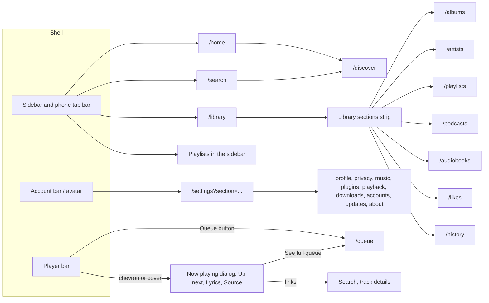
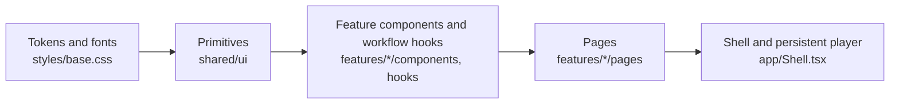

# Design system

**Status.** The web redesign is implemented in `apps/web` for every screen the server can fill: foundation, Settings, Home, Search and Discover, Library, Artist, Album and Playlist, Now playing and Queue, Podcasts and Audiobooks, and first-run setup. Open items are listed under "Still open"; the work that needs new server data or capabilities is tracked in the [TODO](../TODO.md). This is a local development state, not a public release.

| Area | State |
| --- | --- |
| Colour tokens, light and dark | Implemented in `apps/web/src/styles/base.css`; dark follows `prefers-color-scheme`. Old palette variables are aliases of the new tokens. |
| Geist and Geist Mono | Implemented, bundled locally with `@fontsource-variable` (OFL-1.1, see [third-party notices](third-party-notices.md)). No CDN. |
| Primitives in `apps/web/src/shared/ui` | Button, SegmentedControl, FilterPills, Switch, AvailabilityLabel, HealthDot, ListRow, SettingsCard, SectionWarning, FallbackCover, BrandMark. Settings use them (plus SettingRow and Dialog); the other pages keep their class names. |
| Shell | Sidebar with the mark, Home / Search (⌘K on Apple systems, Ctrl+K elsewhere) / Library, playlists, and an account bar (account and settings link, lock, sign-out) that sits at the bottom of the sidebar on desktop and shows only the avatar in the page header on phones. Below 768 px the navigation becomes a three-tab bottom bar. |
| Player bar | Restyled to the prototype: 56 px cover, three columns, flat 4 px seek bar, a chevron to open Now playing, and "Queue · N". Below 768 px it is a dark mini player pill above the tab bar. Playback logic is unchanged. There is no right-hand listening rail any more; Now playing and the queue open from the player. |
| Settings | Implemented: a grouped navigation (Your account: Profile, Privacy & lock; Listening: Music & providers, Plugins, Playback, Downloads & storage; Server: Accounts, Updates, About) with one deep link per section, a section heading, and cards built from SettingsCard, SettingRow, Switch, SegmentedControl, Button, HealthDot and SectionWarning. See "Settings" below. |
| Home | Implemented at `/home` (see "Home, Search and Discover" below). |
| Search | Implemented at `/search` with All / Library / Providers scopes (see below). |
| Discover | Restyled: provider pills, section warning, availability labels. Genres, featured albums and radio are not built (see below). |
| Now playing, Queue, first-run setup | Implemented (phases 5 and 7, see below). |
| Library filter bar, states board, dark-mode screens | Not built. |

**Language.** The prototype labels are Portuguese, but the app stays English for now (Home, Search, Library, "Account and settings"). Translation is a separate i18n item in the [TODO](../TODO.md).

Routes: Home opens `/home`, Search opens `/search` (a real page, not a focus shortcut) and Library opens `/library`; albums, artists, playlists, podcasts, audiobooks, likes and history stay at their routes and are reachable from the "Library sections" strip shown on those pages. `/discover` stays a separate page reached from Home and the Providers scope of Search, and counts as part of the Search destination. Settings open from the avatar. `/` and the post-sign-in landing remain the library: several browser flows assert the library heading after sign-in, so moving the landing to Home is deferred (see the [TODO](../TODO.md)). The ⌘K / Ctrl+K shortcut focuses the field of the current page when it has one (library pages keep their own library filter, Home and Search their own field) and otherwise opens `/search` and focuses its field.

**Fallback cover rule (implemented).** `FallbackCover` takes its colours and shape from a 32-bit FNV-1a hash of the release id (the recording id when there is no release). The hash picks one of eight fixed palette entries (`coverPalette.ts`) and one of three shapes (circle, band, plain), so the same id looks the same on every visit and device. Real artwork always wins; the fallback shows only when no artwork loads.

The prototype with every screen is a private design canvas: https://claude.ai/artifact/HurdZx23txC2chX73MX529. The rows marked **v2** are the agreed direction; earlier rows are explorations kept for history.

## Structure

Navigation and what opens from the player:



Component layers. Each layer imports only from the layers to its left:



Pages own one route. Workflow hooks own async work and cancellation. Playback position reaches the screen only through the small seek and clock components, so pages, tabs and queue rows do not re-render on position ticks.

## Principles

- **Three destinations.** Home, Search (one search across library and providers, ⌘K on desktop) and Library. Artists, albums, playlists, podcasts, audiobooks, likes and history are separate routes reached from a section strip; the prototype's single filter bar is not built. Settings open from the avatar.
- **One shell.** The sidebar, the player bar and the cover are shared components. Every screen uses them unchanged.
- **One action per state.** Each item shows its availability and only the action that state allows.
- **Nothing merges by itself.** Uncertain matches wait for review; the user decides.
- **Suggestions explain themselves.** Each suggestion says why it appears and can be dismissed.
- **Warnings stay local.** A provider or folder failure marks its own section, never the whole page.
- **Own controls.** Switches and segmented controls; no native checkboxes or selects.
- **Technical, but secondary.** Formats, conversions, durations and dates are shown in monospace and never compete with titles.

## Identity

The mark is the three availability states in a row, followed by the word "hito":

- ● filled: in the library
- ○ outlined: available from a provider
- ◌ dashed: catalog only, no audio yet

The same three rings appear wherever availability is shown, so the brand and the core product idea are the same thing.

## Colour

The table lists the base tokens. The app also defines `control-border` and `control-off` (3:1 on the page and surface, for input borders and a switch that is off), and `ink-hover` and `action-hover` for button hover. Cover colours come with an inset edge so dark covers show on a dark page.

| Token | Value | Use |
| --- | --- | --- |
| `bg` | `#fbfbfa` | Page |
| `surface` | `#ffffff` | Cards, player |
| `subtle` | `#eeeeea` | Selection, segmented controls |
| `line` | `#e6e5e1` | Dividers |
| `ink` | `#141414` | Text, primary action |
| `muted` | `#5f5e5a` | Metadata (6.3:1 on `bg`) |
| `action` | `#2f4bff` | Add, available |
| `success` | `#0f7a4f` | Working |
| `warning` | `#9a5b00` | Slow, disconnected |
| `error` | `#b5412b` | Failures, destructive text |

Dark mode uses the same tokens with `bg #111110`, `surface #1b1b19`, `ink #f2f1ed`, `muted #a3a29c` and `action #6f86ff`. All body text meets 4.5:1.

**Cover colour.** Artist, album, podcast and playlist headers use one flat colour taken from the cover, never a gradient. With real artwork, the server computes the dominant colour once when the artwork is stored and keeps it with the artwork. Without artwork, the colour and fallback cover shape come from a stable hash of the release id over a fixed palette, so they never change between visits or devices.

## Typography

Geist for the interface, Geist Mono for technical values.

| Role | Size / weight | Example |
| --- | --- | --- |
| Hero | 64–88 / 800, −0.05em | Artist name |
| Page title | 36 / 800, −0.04em | Definições |
| Section | 22 / 800, −0.02em | Saiu dos teus artistas |
| Item | 15 / 700 | Track title |
| Body | 15 / 400 | Descriptions |
| Label | 12–13 / 700 | Availability, status |
| Technical | Geist Mono 12 | `FLAC 24/384 → 48 kHz · 1,25×` |

## Components

- **Buttons**, 44 px high, radius 10–12: primary (ink), action (blue, add/import), secondary (outline), destructive (outline with red text, never filled), active (outline with a check). One primary per zone.
- **Segmented control** for two to five exclusive options (lock timeout, speed, update channel). **Pills** for filters. **Switch** for on/off settings with immediate effect.
- **Availability label**: ring plus text, using the three states above. **Health dot**: filled dot in success, warning or action colour for services, folders and plugins.
- **List row**: cover (44–64 px), title and subtitle, state, one action. Fixed column widths so states and actions align.
- **Settings card**: header with title and one action, then rows; a shared settings navigation lists Perfil, Privacidade e bloqueio, Música e fornecedores, Plugins, Reprodução, Downloads e espaço, Contas, Atualizações and Sobre.
- **Section warning**: amber or red box inside the affected section, saying what happened, what still works and what to do.
- **Fallback cover**: typographic cover (title, artist, one shape) used only when there is no real artwork.

## Prototype screens

Built: Home, Artist, Album, Library, Playlist (view and edit), Discover, Podcast, Audiobook, Now playing, Queue, Settings (all sections), Sign-in, first-run setup. Built with fewer elements than the prototype: the Library page (no filter bar), the Source tab (no format or alternative source), account management (no invitations).

Not built: invite-link account creation, the states board (loading, provider down, offline, empty library, import problems, unplayable track as one reference), dark-mode screens, and phone versions of screens that have none (the prototype draws phone screens only for Search and Now playing; the `LeitorMobile` file was not in the reference set).

Account creation is never linked from the sign-in screen. On the first start of a server with no accounts the sign-in page shows the administrator setup. A single-use invite link would be the other entry; the server has no invitations yet.

## Still open

- Dark-mode screens and the states board.
- The Library filter bar, and invite-link accounts (needs a server capability).
- The player bar speed control is still a native select.
- The cover colour for headers is deterministic (see `tintFor`), not taken from artwork; that needs server-side extraction.
- No source or provider label is available for the playing track, so the player bar shows none.
- Interface translation (see Language above).
- Follow-ups that need server data are in the "Not built" lists of each section below.

## Settings

Current behavior (apps/web, English labels):

- `/settings?section=<id>` opens a section: `profile`, `privacy`, `music`, `plugins`, `playback`, `downloads`, `accounts`, `updates`, `about`. With no parameter the page opens Music & providers on desktop and the section list on phones. Old links keep working: `library` and `metadata` open Music & providers; an unknown id, or `accounts` for a non-administrator, opens Music & providers. Accounts is hidden from the navigation for non-administrators.
- The navigation is a list of links (`aria-current="page"` marks the open section). Choosing a section moves focus to its heading. Below 768 px the list and the open section are separate views: the list, then the section with an "All settings" link back. The phase 1 account bar is hidden on phone Settings; Profile offers Sign out and, when a PIN is set, Lock now.
- Rows use fixed status and action columns (200 px and 140 px; 160 px and 300 px for rows with several buttons) so status and buttons line up between rows. On phones the columns stack.
- On/off choices are Switches and the idle-lock period is a segmented control. Switches in Privacy keep explicit Save and Cancel, because consent changes must be saved deliberately. Three native selects remain on purpose, for lists whose length depends on the server: the library chooser, the service chooser when connecting a plugin and the metadata provider chooser. The folder picker keeps its own dialog markup and has not moved to the shared Dialog yet.
- Leaving a section with unsaved changes (community choices, source rankings, metadata preferences, a typed PIN or password) asks for confirmation first. A member or alias URL such as `?section=library` is replaced by the resolved section in the address bar.
- On phones, Sign out and Lock now are available only in Profile; the phone header shows only the account avatar.
- Creating an account opens a dialog from the Accounts card. The server has no invitation or public sign-up flow, and the interface offers none.

Not built because the server has no matching capability (see the [TODO](../TODO.md)): display name, avatar photo, language, password change, open-session list, playback-history toggle and deletion, update checks and channels, copy diagnostics, playback and download options.

Where the old pages were: Library settings now live in Music & providers (music folders); Metadata moved into the same section; Privacy keeps community consent and source rankings and gains the screen lock; Plugins and Accounts keep their content.

## Home, Search and Discover

**Home (`/home`).** A greeting with the account name and a search field that sends the query to Search, then only sections the server can fill from data it already has:

- *Quick access*, up to six tiles: the three most recently played albums, Liked tracks (with a count, shown as `1,000+` above 1,000), then the account's own and followed playlists, then any further recent albums. Each tile only opens its page; there is no play control on a tile.
- *Unheard, near what you like*, up to three albums the account has played where other playable tracks have never been started. Tracks are listed in album order (disc, then track number, then title) and only while a playable source exists. Each card says why ("You played 3 tracks from Tide.") and offers Listen, which queues up to 25 of those tracks in that order, and Open album; "N more tracks" counts every unheard playable track (up to 1,000). There is no "Not now" because nothing persists a dismissal.
- An empty library (no music, no playlists) shows folder, playlist-import and service actions; a listener who cannot manage folders is told to ask the administrator.

"New from your artists" is not shown: nothing in the server polls provider discographies. The read model is `Collection::home` in core (recent albums come from the newest 200 progress rows, taken before the album and library-access filter, so an account whose newest plays are all in removed libraries sees fewer albums; the work does not grow with listening history; a SQLite work-budget test covers this). "Has music" ignores podcast-episode recordings, so a podcast-only account sees the empty-state guidance; the podcast-only case is covered by the query, not by a dedicated test and the thin `HomePage` adapter in the server.

**Search (`/search`).** One field and the pills All / Library / Providers. Library results come from the existing catalog search and are grouped as Top result, Tracks (availability label: In library or Catalog only; Play or View), Albums and Artists, at most 8 tracks and 6 albums and artists. The top result is a chosen artist or library credit whose name is exactly the query (ignoring case and accents), else the first track, album or artist. The Artists group lists the server's chosen artists (`artist_groups`, exact names first, linking to the chosen-artist page) followed by library credits that do not repeat a chosen name; the browser does not re-rank them. **Privacy: the typed query is sent to a connected service only in two cases.** When the library has fewer than three matches and "Search connected services automatically" (Settings → Privacy, on by default, stored on the server per account and read when the page opens) is on, the first connected service that can search is queried at once and the results show a muted line saying so, with a link to Settings. Otherwise (including while the choice is unread or unreadable) the "Search your services" action or the Providers scope starts the request. The Library scope never sends the query. Provider results use the same Listen and Add actions as Discover and a section warning when that service fails, while the library results stay. A pill group chooses another service. The scope is client state and is not in the URL.

**Discover (`/discover`).** The provider search page, restyled: provider filter pills, the search field, availability labels (In library, Available, Catalog only), Listen (play) and Add actions and an inline section warning with a service refresh link on a provider failure. By-genre tiles, featured albums per provider and "Radio from…" are not built because no plugin capability supplies them.


## Now playing, Queue and first-run setup (phases 5 and 7)

Current behaviour, covered by `apps/web` unit tests, the browser specs that open the player and the visual capture (`now-playing-*`, `queue`, `setup*`).

**Now playing** is a full-screen modal dialog opened from the player bar chevron or cover. It closes with the chevron button or Escape and focus returns to the opener. The playback hooks are unchanged.

- Left: cover (artwork, else the generated cover), 30/800 title, artist (a link to Search), a 6 px seek bar with mono elapsed and remaining time, shuffle, previous, a 76 px play button, next, repeat, and the player status.
- Right: tabs Up next, Lyrics and Source (arrow keys, Home and End move between tabs).
  - **Up next**: the next four queued tracks, which play when chosen, and "See full queue".
  - **Lyrics**: opening the tab loads the lyrics of the playing track from the account's first lyrics provider, without a click. "Choose another provider" lists the other providers for the track. With no lyrics provider connected the tab says so and links to Settings → Plugins. Leaving the tab or changing the track cancels the request.
  - **Source**: what the player exposes: browser or desktop player, the speed the source plays at, the speeds it supports, and a link to track details where the source is chosen. The speed is a SegmentedControl on the same speed command as the player bar. Choices outside the source's range are hidden. Rapid choices (for example arrow keys) show at once and are sent as one command after 250 ms, or on closing.
- Any link inside the dialog (artist, track details, See full queue) closes it first. After the new page loads, focus moves to its `h1`. The Queue button in the player bar does the same.
- Seek and time are small components that subscribe to position. A test checks that position ticks cause no queue reads.

**Queue (`/queue`)** is a server page with shared props only, reached from the player bar "Queue · N" button and "See full queue".

- Header: 36/800 title, a mono line "N tracks · M up next", and a destructive Clear that asks for confirmation.
- "Now playing": the current entry in a highlighted row with mono position and a Remove button. It is read from the queue itself, so it shows in the desktop player too.
- "Played (N)": a collapsed section shown when earlier entries exist. It lists them with the same row controls (move, drag, remove, play).
- "Up next": the windowed list after the playing entry. Each row has a drag handle, mono position, cover, title, artist, mono length, Move up and Move down buttons (announced to screen readers) and Remove. A queue of 100,000 tracks renders only the visible window. A "N more loading" line shows while a long list is still being added.
- On phones the handle, position and length are hidden; the arrows remain.

**First-run setup** is the sign-in page when the server has no accounts: the same two-column layout as Sign-in with an action-colour brand panel ("Welcome to your server."), a form up to 400 px wide, 48 px fields and button, a lead sentence, password guidance tied to the field with `aria-describedby`, a 12-character minimum and errors in a `role="alert"` box. The server decides the mode (`needs_setup`); there is no toggle and nothing links to or from Sign-in. The button reads "Create administrator".

**Not built**, with the reason:

- Like on Now playing: the player has no like state.
- An artist page link: a track carries only an artist name.
- Source format, sample rate, conversion and an alternative source with "Switch": the player does not carry them.
- Timed (synchronised) lyrics inside Now playing: lines are listed, not highlighted with the position.
- "From <context>", total duration and per-entry preparation state in the queue: the queue stores no origin, only loaded entries have lengths, and the player does not expose preparation per entry.
- "Save as playlist": no queue-to-playlist capability.
- Invite-link account creation and a display-name field: the server has neither.

## Visual fidelity checks

The prototype mockups carry exact sizes, so the built screens are compared with them by eye as well as by DOM tests. Tokens added for this: `--line-soft` (card row dividers) and `--ink-soft` (secondary body text). Known, deliberate differences from the mockups: input and switch borders use the darker `control-border` and `control-off` tokens (3:1 contrast) instead of the mockup's lighter grey, and touch targets stay at 44 px on phones where the mockup draws 36 or 38 px.

**Capture harness.** `apps/web/e2e/visual-capture.spec.ts` is skipped unless `HITO_VISUAL_CAPTURE=1`. It uses the shared administrator session, adds the two fixture music folders through the settings screen, plays a track, creates a playlist, and saves a viewport screenshot (plus a `-full` screenshot when the page scrolls) of Home, Discover, Search with results, Library, the Settings list and every Settings section, at 1440 x 900 and 390 x 844, into `test-results/visual/` (ignored by Git). Run it only against an isolated browser server, for example:

```
HITO_VISUAL_CAPTURE=1 docker compose -p <scratch-project> --profile e2e run --rm -e HITO_VISUAL_CAPTURE=1 browser npx playwright test visual-capture
```

Mounting `apps/web/dist` over `/app/web` in the e2e server (a scratch Compose override) lets a CSS change be checked after `vite build` without rebuilding the server image. Richer music can be mounted at `/music` the same way; the default fixtures hold one track per folder.

## Library, artist, album and playlist pages (phase 4)

Current behaviour, tested in `apps/web` unit tests; the browser flows are covered by the e2e suite and the visual capture (`library-*`, `albums`, `artists`, `playlists`, `likes`, `history`, `artist-credit`, `album`, `playlist`, `playlist-edit`).

- **Tinted headers.** Artist and playlist pages use `CollectionHeader`: a flat colour band with a breadcrumb, eyebrow, name (88/800 for artists, 64/800 for playlists), a mono stats line and Play and Shuffle (and Edit for editable playlists). The colour comes from `tintFor(id)`: the generated-cover palette colour for a stable id (the artist's first release id on the page, else the artist or group id; the playlist id). The server does not extract a dominant colour from artwork, so this stays deterministic and white text keeps its contrast. If a server-side dominant colour is added later, only `tintFor` changes.
- **Album header** is not tinted: 200 px cover, 52/800 title, artist link, mono stats, Play, Shuffle and Edit album details; the edition choice stays in the existing "Complete track list" card.
- **Track table** is one component for Library, Liked tracks, History, Album, Artist and Playlist: mono number and duration, 44 px cover (artwork, else generated cover), title with artist beneath it on narrow widths, album column, a label for tracks that are not stored here, from the server's `plays_from_services`: "Plays from your services" when a connected service can resolve it (hidden while that track is the current one) or a muted "Not playable yet" when none can; local tracks show no label, and grouped row actions (like always visible, details and add-to-playlist on hover, always on touch).
- **Discography** on a chosen artist page: type control with counts (All, Albums, EPs, Singles, Other), "Only what I'm missing", and release cards with a generated cover, one availability state (In library, Partial n of m, Catalog only) and the existing actions.
- **Playlist edit mode** (editable copies and your own playlists, not followed ones): Edit turns on rename, up and down arrows (writes `entry_move`; tied positions are renumbered) and remove (`entry_remove`). Remove is only shown in edit mode.
- **Playlists index**: create row, an import card (Import a copy or Follow as a SegmentedControl, never native radios) and a cover grid with a Following badge. Native radios and checkboxes keep their native size; disabled buttons use the subtle disabled style and never stretch inside a form grid.
- **Not built (no backend or deliberately deferred):** sort control, an "All" library pill, "Follow news" for artists, "Add N missing" on albums, a stepped import dialog, a download button inside the playlist header (Download stays a status card).

## Podcasts and audiobooks (phase 6)

Current behaviour, covered by `apps/web` unit tests and the visual capture (`podcasts-*`, `podcast*`, `audiobooks-*`, `audiobook*`).

- **Index pages** share one layout: a 36/800 title, a mono count and one blue action ("Subscribe", "Add audiobook") that opens a `Dialog`. Errors and the retry controls for an unconfirmed request stay inside the dialog (`role="alert"`). A grid of cards follows (generated cover, one link that covers the whole card, mono status). An empty list shows a dashed card with one sentence of guidance.
- **Podcast page** uses `CollectionHeader` (64/800): breadcrumb, cover, status lines, a primary "Continue · X left" or "Play latest", a "Following ✓" status and "Refresh feed". Episodes are an ordered list with a mono length, title, host, a state label (New, "X left", Played), a 4 px progress bar and round Play and Start over buttons and the existing details, like and add-to-playlist actions (downloads are managed on the details page; the row has no separate download button). Play on a played episode starts from the beginning; Start over shows while an episode is partly heard. A new episode has no progress bar. The side column "For this podcast" holds the unsubscribe note and a destructive "Unsubscribe".
- **Audiobook page** uses the same header at 56/800 with the author (only when all chapters share one), a 6 px position bar with a mono "N% · X left", "Continue ch. N · mm:ss", "Bookmark" (moves focus to the bookmark form) and "Open playlist". Chapters are numbered rows with a mono duration, a "Listening · mm:ss" state on the continuing chapter and a round play button. Bookmarks are cards with mono chapter and time, the label and Play and Remove buttons; the form sits below them.
- **Dialogs** (shared `Dialog`): Escape or Cancel closes and focus returns to the trigger; a closed dialog with an unconfirmed request leaves a status and a "Review … request" button beside the trigger, and the dialog stays open if the draft changed after submitting.
- **Not built** (no server data, see the [TODO](../TODO.md)): podcast artwork and descriptions, episode dates, per-podcast speed and download rules, a "Downloaded" filter, audiobook speed, per-chapter Played, progress and Continue on the audiobook cards.
