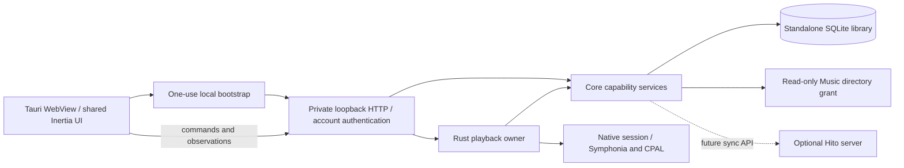
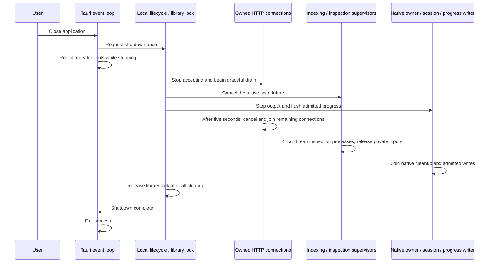

# Standalone desktop host

The first development host runs the shared Hito UI in Tauri with its own Rust backend, SQLite library, and native playback. It does not need a separately running Hito server or `HITO_MUSIC_FOLDER`. The shared player uses authenticated native commands and observations; Rust retains queue, sources, output, and progress ownership. Offline synchronization, downloads, installers, and platform acceptance remain unfinished.



## Ownership

`hito-desktop` owns application paths, the library lock, private window bootstrap, and local backend lifetime. Tauri chooses the application data directory. The operating system's Music directory is the trusted browsing grant, and a user confirms it in Settings before anything is scanned. See [desktop folders](music-folders.md#desktop-music-folder-and-native-chooser) for proposals and the native chooser. Automatic scanning without confirmation is not planned.

`hito-server::serve` takes an already bound listener, composed router, storage capability, and shutdown future. It does not install a global tracing subscriber. Desktop and server startup each configure their own logging. Core retains all SQLite, account, file-authorization, indexing, and collection rules.

The local listener binds only `127.0.0.1` on an operating-system-assigned port. The initial WebView URL contains a random single-use ticket. Claiming it redirects to `/library` and sets an HttpOnly, SameSite=Strict process cookie. Every other route requires that cookie, the exact Host authority, and an absent or matching Origin. Ordinary Hito account authentication still applies. Restarting the backend invalidates the previous process cookie.

The WebView loads the local application and denies navigation to another origin or opening new windows. The configuration grants no native IPC capabilities. Renderer input cannot select a filesystem path or impersonate an account through a native command. The native API preserves those boundaries. Commands carry recording and queue-entry IDs; core chooses and authorizes sources through the local account session.

The [native coordinator](native-coordinator.md) supplies authenticated commands, private paged queues, and separate state/position streams. Its native sessions accept core grants, open owned local/provider input, and supervise the [audio engine](native-audio.md). They stop output on session/source revocation and join cleanup even after an observer disappears. The host retains PlayerOwner alongside HTTP/indexing cleanup and keeps its library claim until both join. The `gui` feature enables native output; headless builds without `device` expose only queue behavior and report native output unavailable.



Dropping the host or canceling a caller waiting for shutdown only sends the stop request. The lifecycle task retains the library lock until cleanup finishes. Core cancels media inspection between transaction boundaries and requeues an interrupted scan. Opening and finishing a write transaction are not canceled halfway through. `LibraryStorage::finish_indexing` then waits for media command supervisors after job and HTTP cleanup. Its command permits cover subprocess kill, wait, and private-input removal.

Existing core cancellation guards also stop snapshot readers and directory walks. A blocked operating-system filesystem call cannot be forcibly interrupted in process. Its read-only helper retains its own handle and permit until that call returns. This host verification does not establish disconnected-drive behavior or synchronously join every filesystem thread.

## System media controls

The desktop host shows the playing track in the operating system's Now Playing surface and accepts its transport buttons. The playback owner supplies the data, as described in [native playback](native-playback.md#system-media-sink). The host adds three pieces.

`SystemMedia` implements the owner's sink. It maps title, artist, album, duration and playing or paused state onto an OS controls interface, and drops empty artist and album strings. Bounded artwork is written to `media-artwork/` in the application data directory, in a directory with mode 0700 and a file with mode 0600, and passed as a `file:` URL. There is one file per track, reused when the same artwork is published again. It is deleted on the next track, on clear and on shutdown, and leftovers are removed at startup. The path goes to the operating system only. It is never logged.

`OsControls` wraps the `souvlaki` crate, which uses MPNowPlayingInfoCenter and MPRemoteCommandCenter on macOS, SystemMediaTransportControls on Windows and MPRIS over D-Bus on Linux. It is compiled only with the `gui` feature. It is created on the sink thread at first use, after the window exists, because Windows needs the window handle. On Windows a missing handle is retried at the next update. Any other failure is final: the host logs one safe warning and playback continues without media keys.

Privacy. On Linux, MPRIS publishes the title, artist, album, duration, position and the `file:` artwork path on the user's D-Bus session bus, and any local client on that bus can read them and send transport commands. The 0700 directory and 0600 file do not hide the path from those clients, and a client running as the same user can read the file. The 0700 and 0600 modes also do nothing on Windows, where the artwork file relies on the ACL of the application data directory. macOS keeps the data in the system's Now Playing store. Do not treat the track metadata as private from other software running as the same user.

Tauri's setup creates the command channel and passes the sink to `LocalHost::start_with_folders`. Hosts without a sink, including every test host, use `LocalHost::start` and behave as before.

Linux Docker builds and unit tests cover the sink, the artwork file handling and the command mapping. Nothing here has run against a real macOS panel, Windows overlay or MPRIS client. The device checklist is in [the backlog](../TODO.md).

## Provider sign-in pages

Settings > Plugins hands a provider's sign-in page to the system browser instead of opening it in the WebView. The local backend exposes a launch route only in the desktop host; core accepts only the exact URL of the caller's live attempt, and `SystemBrowser` passes it to the platform opener. The WebView gets no Tauri permission for this and the opener plugin is not registered. The rules and tests are in [the launcher](plugins.md#desktop-browser-launcher).

The provider returns to a fixed loopback address, not to the private backend. The desktop host binds `127.0.0.1:47321` when a sign-in begins (setting `HITO_DESKTOP_OAUTH_PORT` changes the port), serves only `/api/v1/plugin-authorization/callback` there, and closes it after eleven idle minutes or at shutdown. The system browser needs no window cookie to reach it. The one-time `state` and the PKCE verifier, which never leaves the backend, decide whether an attempt completes. Register `http://127.0.0.1:47321/api/v1/plugin-authorization/callback` once with the provider, for example under Redirect URIs in the Spotify developer dashboard. If the port is taken, Connect says so in plain words and does not pick another port. The rules, threats and tests are in [the loopback return](plugins.md#desktop-loopback-return). Only Linux has run, with stub openers and a fake provider. macOS, Windows and a real provider are untested.

## FFmpeg requirement

Scanning needs the `ffprobe` and `ffmpeg` programs installed on the computer. Hito does not bundle them yet. An app opened from the macOS Finder or a Linux launcher does not see the shell `PATH`, so the host resolves each tool once at startup and gives core absolute paths. The lookup order is:

1. `HITO_FFPROBE` and `HITO_FFMPEG`, used as given when set.
2. The directories in the process `PATH` (absolute entries only).
3. Well-known directories: on macOS `/opt/homebrew/bin`, `/usr/local/bin` and `/opt/local/bin`; on Linux `/usr/bin` and `/usr/local/bin`. Windows has no extra directories, so only `PATH` and the two variables apply.

Only regular files with an execute permission are accepted. Directories and files inside the Music folder are never used. If a tool is not found, the bare name stays and a scan fails with its own message in the folder row: "FFmpeg is not installed. Install it (for example `brew install ffmpeg`) and scan again." A folder or permission failure keeps the separate "Scan failed. Check the folder and try again." message. The job reports the reason as `failure: "media_tools_missing"`. Linux Docker tests cover the lookup order, the failed job and the folder row text. The Finder launch on macOS itself has not been exercised in a test.

Open: bundle FFmpeg with the app, or add a Symphonia-only scan path, so a first run does not depend on a separate install. See [the backlog](../TODO.md).

## Without a server or a network

The desktop app needs no Hito server and no internet connection for its own library. Setup, the owner account, choosing and scanning the Music folder, local playback, History and restart all run against the private loopback backend and the local SQLite file. Nothing in that path talks to a remote Hito server, and the desktop client has no setting for one yet. Synchronization with a server is planned, not built.

Online-only features are the plugin services and providers: installing them, searching their catalogs, resolving their audio and downloading. Without a network they fail with an error message for that action and leave the rest of the app alone. They never block opening the app or playing local files. The "Cannot reach Hito" banner described in [operations](operations.md#when-the-server-cannot-be-reached) appears only if the private local backend itself stops answering.

Tested evidence. The Tauri check runs its WebView smoke in a container started with `network_mode: none` (`scripts/desktop/no-network.compose.yaml`). The smoke asserts that the only network interface is loopback and that a request to a public address fails. It then does everything the normal smoke does: set up the owner, scan the Music folder, play with actual output, navigate, reload, restart and shut down. Before playback it offers a plugin service at an unreachable address and previews it. In the recorded run the offer was accepted and the preview failed in 14 ms with a 502 and a plain error message. The check also requires that the plugin list, the Discover page and the local library keep working and that the banner never appears. Limits: Linux WebView only; macOS and Windows device checks remain open. Provider search and playback were tested only as "unreachable service", not against each real provider offline.

## Development verification

Run both checks from the repository root:

```sh
./scripts/verify.sh
./scripts/check-desktop.sh
```

The desktop profile compiles Tauri only when the `gui` feature is enabled. Ordinary server builds do not need GTK or WebKit. Its Cargo target is `/build/desktop-target`, separate from the ordinary tools target. The source checkout and dependency caches are shared.

The desktop window sets its own User-Agent: a fixed platform part followed by `HitoDesktop/<version>`. The Hito backend uses the token to label desktop sessions "Hito desktop" ([account security](account-security.md#client-label-and-last-seen)). Because Tauri replaces the WebView agent instead of extending it, the platform part is a fixed string per operating system. A host test signs in with that exact string, and the WebView check reads `navigator.userAgent` and the session label. Only the Linux WebView has been run; macOS and Windows still need a device check.

The desktop script verifies protected HTTP controls, observed progress, redacted network logs, and retained library ownership during canceled shutdown. It builds the shared UI and a Linux debug executable, then runs an actual Tauri WebView through `tauri-driver`, WebKitWebDriver, Xvfb, and a window manager. It uses an unprivileged container user, owned temporary application directories, and synthetic audio. The normal server volume and personal Music directory are never mounted into this test. Evidence is written under ignored `test-results/desktop/`.

The WebView check requires zero browser audio elements and monitors actual CPAL output. It checks navigation and reload without changing the selected entry/source, Previous, shuffle/repeat and speed with retained settings after reload, pause/resume, persisted Rust source position and speed, restart, History saved-position loading over a stale rendered cursor with the current speed preference, and silence after joined shutdown.

Before the History click, the fixture arms public state and position observations with the UI's existing lease. Any positive playing position below the saved cursor fails the check, even if playback later reaches that cursor. An isolated wrong-start mutation verifies this assertion. Reloading disposes only the HTTP client; the authenticated Rust session retains playback. Current verification results are in [status](status.md).

The release resource configuration includes the built UI under `web/`. Debug builds can read `apps/web/dist` from the checkout. Packaged release resources, upgrades, macOS and Windows WebViews, physical audio output, signing, and installers still require acceptance. The current PNG icon exports the existing Lucide waveform without changing the brand. The requested logo redesign remains in [the backlog](../TODO.md).

Tauri's [WebDriver guide](https://v2.tauri.app/develop/tests/webdriver/) and [Linux prerequisites](https://v2.tauri.app/start/prerequisites/#linux) describe the platform tooling. Linux Docker evidence is not a substitute for the remaining platform and public-release gates.
