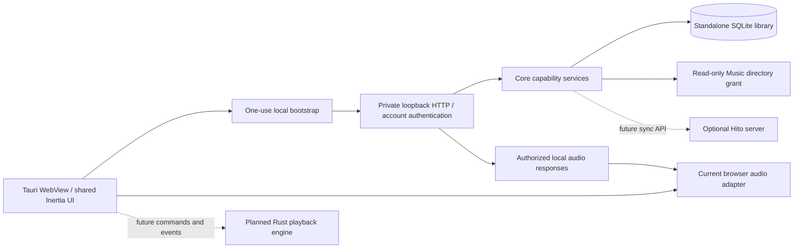
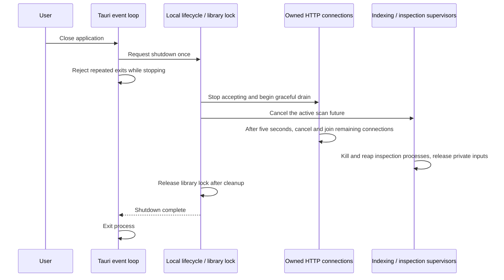

# Standalone desktop host

The first development host runs the shared Hito UI in Tauri with its own Rust backend and SQLite library. It does not need a separately running Hito server or `HITO_MUSIC_FOLDER`. This is an early desktop step. Native playback, offline synchronization, downloads, native folder selection, installers, and platform acceptance remain unfinished.



## Ownership

`hito-desktop` owns application paths, the library lock, private window bootstrap, and local backend lifetime. Tauri chooses the application data directory and the operating system's Music directory. The Music directory is currently a trusted browsing grant. Users still connect it through Settings before scanning. Automatic connection/scanning and selecting additional directories through a native file dialog are separate remaining work.

`hito-server::serve` takes an already bound listener, composed router, storage capability, and shutdown future. It does not install a global tracing subscriber. Desktop and server startup each configure their own logging. Core retains all SQLite, account, file-authorization, indexing, and collection rules.

The local listener binds only `127.0.0.1` on an operating-system-assigned port. The initial WebView URL contains a random single-use ticket. Claiming it redirects to `/library` and sets an HttpOnly, SameSite=Strict process cookie. Every other route requires that cookie, the exact Host authority, and an absent or matching Origin. Ordinary Hito account authentication still applies. Restarting the backend invalidates the previous process cookie.

The WebView loads the local application and denies navigation to another origin or opening new windows. The configuration grants no native IPC capabilities. Renderer input cannot select a filesystem path or impersonate an account through a native command. A future playback adapter must preserve those boundaries and authorize stable source IDs through the local account session.

The separate [native audio engine](native-audio.md) now accepts owned files and controls decoding/output lifetime. It has no renderer routes and is not connected to this host yet. Its device verification is separate from the WebKit workflow below.



Dropping the host or canceling a caller waiting for shutdown only sends the stop request. The lifecycle task retains the library lock until cleanup finishes. Core cancels media inspection between transaction boundaries and requeues an interrupted scan. Opening and finishing a write transaction are not canceled halfway through. `LibraryStorage::finish_indexing` then waits for media command supervisors after job and HTTP cleanup. Its command permits cover subprocess kill, wait, and private-input removal.

Existing core cancellation guards also stop snapshot readers and directory walks. A blocked operating-system filesystem call cannot be forcibly interrupted in process. Its read-only helper retains its own handle and permit until that call returns. This host verification does not establish disconnected-drive behavior or synchronously join every filesystem thread.

## Development verification

Run both checks from the repository root:

```sh
./scripts/verify.sh
./scripts/check-desktop.sh
```

The desktop profile compiles Tauri only when the `gui` feature is enabled. Ordinary server builds do not need GTK or WebKit. Its Cargo target is `/build/desktop-target`, separate from the ordinary tools target. The source checkout and dependency caches are shared.

The desktop script builds the shared UI and a Linux debug executable, then runs an actual Tauri WebView through `tauri-driver`, WebKitWebDriver, Xvfb, and a window manager. It uses an unprivileged container user, owned temporary application directories, and synthetic audio. The normal server volume and personal Music directory are never mounted into this test. Evidence is written under ignored `test-results/desktop/`.

The release resource configuration includes the built UI under `web/`. Debug builds can read `apps/web/dist` from the checkout. Packaged release resources, upgrades, macOS and Windows WebViews, physical audio output, signing, and installers still require acceptance. The current PNG icon exports the existing Lucide waveform without changing the brand. The requested logo redesign remains in [the backlog](../TODO.md).

Tauri's [WebDriver guide](https://v2.tauri.app/develop/tests/webdriver/) and [Linux prerequisites](https://v2.tauri.app/start/prerequisites/#linux) describe the platform tooling. Linux Docker evidence is not a substitute for the remaining platform and public-release gates.
