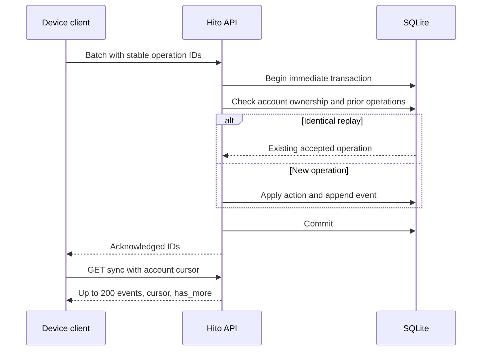
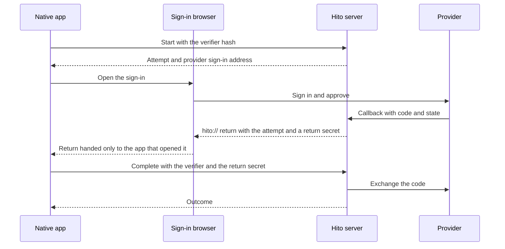

# JSON API

The implemented API uses `/api/v1`. The [OpenAPI document](../openapi.json) is generated from actual route registrations and Rust wire types. The server publishes it at `/api/v1/openapi.json`. Account responses never include password hashes or local filesystem paths. [Development instructions](development.md) cover regeneration and drift checks.

Sign in with `POST /api/v1/login`. Browser clients use an HttpOnly cookie; non-browser clients can use the returned token as `Authorization: Bearer <token>`. Send `X-Hito-Request: 1` with browser mutations. Browser origins must match the configured public origin. A client that keeps account-specific work should send `X-Hito-Account` with the expected user ID so account switching cannot apply it to a different account.

Responses include a generated `X-Request-Id` for correlation. Errors use an `error` string. Malformed JSON and query fields receive static error messages so submitted private values cannot enter extractor rejection logs, including at trace level.

| Operation | Endpoint |
| --- | --- |
| First-run status / create administrator | `GET` / `POST /setup` |
| Sessions | `POST /login`, `POST /logout`, `GET /me` |
| Screen lock and optional PIN ([details](../guide/account.md)) | `GET` / `POST /account/lock`, `POST /account/unlock`, `PUT /account/pin`, `POST /account/pin/remove` |
| Change password, list and revoke the account's own sessions ([details](../guide/account.md)) | `POST /account/password`, `GET` / `DELETE /account/sessions`, `DELETE /account/sessions/{id}` |
| Set or clear the account's own display name ([details](../guide/account.md)) | `PUT /account/display-name` |
| Upload, replace or remove the account's own avatar photo; read it (own account and administrators) ([details](../guide/account.md)) | `PUT` / `DELETE /account/avatar`, `GET /accounts/{id}/avatar` |
| Administrator account management | `GET` / `POST /users`, `DELETE /users/{id}` with `{"username"}` ([account deletion](architecture.md#account-deletion)) |
| Accessible libraries | `GET /libraries` |
| Grant / revoke library membership | `PUT` / `DELETE /libraries/{id}/members/{user}` |
| Schedule scan / inspect progress | `POST /libraries/{id}/scan`, `GET /jobs/{id}` |
| Paginated full-text search | `GET /recordings?q=&offset=&limit=&liked=true` |
| Resolve verified sources | `GET /recordings/{id}/sources` |
| Read the copies of a song, split one off | `GET /recordings/{id}/copies`, `POST /recordings/{id}/copies/split` |
| Authorized embedded or folder artwork | `GET /recordings/{id}/artwork` |
| Original audio with byte ranges | `GET /sources/{id}/audio` |
| Personal playlists | `GET /playlists`, `GET /playlists/{id}` |
| Private recent listening history | `GET /activity` |
| Pause or resume recording history, delete history | `GET`/`PUT /history/preferences`, `DELETE /history` ([listening history](../guide/account.md)) |
| Apply operations / pull accepted events | `POST /sync`, `GET /sync?cursor=0` |

Artwork returns PNG, JPEG, GIF, or WebP bytes with `Cache-Control: private, no-store`. Access follows the recording's library permissions. Missing images and inaccessible recordings return 404. Embedded front covers take priority, followed by other embedded pictures and neighboring `cover`, `folder`, or `front` JPEG/PNG files. The reader accepts regular files only, limits image bodies to 8 MiB and cumulative metadata reads to 16 MiB, and shares four blocking-reader permits across catalog clones. A canceled HTTP request retains its permit until the blocking read finishes. Compressed ID3 parsing is disabled because decompression bypasses the physical-read budget; artwork falls back to neighboring cover files when those tags cannot be read.

## Synchronization

A batch contains a device ID and at most 100 operations. Each operation has a UUID and a typed action. The server applies the entire batch in one transaction. Replaying the same operation acknowledges it without reapplying. Reusing its ID with different contents or a different device returns 409. Operation IDs are scoped to the authenticated account.

```json
{
  "device_id": "desktop-a",
  "operations": [{
    "id": "8c9dfc30-dd85-4bea-aafb-041988a1c909",
    "action": {
      "kind": "playlist_create",
      "playlist_id": "31a45c44-f0d7-48a7-af4a-cbc9697de033",
      "name": "Late evenings"
    }
  }]
}
```

Actions currently include `playlist_create`, `playlist_rename`, `playlist_delete`, `entry_insert`, `entry_move`, `entry_remove`, `like_set`, and `progress_set`. Entry inserts contain stable `entry_id`, `recording_id`, and integer `position`. Equal positions sort by entry ID. Deletes leave tombstones. Later edits to deleted playlists or entries cannot restore them. Conflicting live fields follow server acceptance order.



This is the server synchronization contract. A desktop cache and durable offline outbox are not implemented yet. The browser currently requires its server connection for edits and playback.

## Plugin sign-in from a native app

Current behavior of the server and the iOS app. A plugin that declares an OAuth 2 PKCE sign-in needs the provider to come back to Hito. The web app finishes the sign-in with its session cookie, and the desktop app with its loopback address. A native app signed in with a bearer token has neither, so it finishes the sign-in itself with two one-time secrets.

1. The app creates a random verifier of at least 43 URL-safe characters and keeps it in memory. It starts the sign-in with `POST /plugins/{id}/authorization` and `{"revision", "verifier_hash"}`, where `verifier_hash` is the unpadded base64url SHA-256 of the verifier. A bearer start without a verifier hash is refused with 422, and so is a cookie start with one.
2. The app opens `authorization_url` in `ASWebAuthenticationSession` with the callback scheme `hito`.
3. The provider sends the browser to the server's normal callback. The server keeps the provider's answer encrypted on the attempt and sends the browser to `hito://plugin-authorization/return?attempt=<id>&return=<secret>`. The address never carries the provider code, the state or the verifier. If the provider declines or the attempt can't continue, the browser shows a Hito page instead, and the attempt reads `failed`.
4. The app checks that `attempt` is the attempt it started, then calls `POST /plugins/{id}/authorization/{attempt}/completion` with `{"verifier", "return_secret"}` and the same bearer session. The answer is `{"outcome"}`: `connected`, `denied`, `provider_error`, `exchange_failed`, `expired`, `changed`, `used` or `invalid`.



The server exchanges the code only when both secrets match, the bearer session is the one that started the attempt and is still signed in and unlocked, and the attempt is unexpired and unused. The verifier proves who started the sign-in. The return secret proves that the approval came back to the same app. Without it, a member could send someone else the provider link and connect that person's provider account to their own Hito account. A wrong secret closes the attempt. A missing field is refused with 422 and leaves the attempt as it was. Another account or session gets 404, a signed-out session 401 and a locked one 423, and none of those use the attempt.

`GET /plugins/{id}/authorization/{attempt}` reads `pending` until the provider returns, `returned` while the answer waits for the app, then `exchanging`, `completed` or `failed`. An app that was closed during sign-in can use it to decide whether to finish or start again. The iOS app keeps the attempt, its verifier and, once it arrives, the return secret in the Keychain on this device until the attempt ends, so it can finish a returned attempt after a restart. A server older than this flow answers a start with a verifier hash with 422, and the app then offers to connect on the web. Attempts last ten minutes. The stored answer is deleted when the attempt completes, fails or is disconnected. An expired attempt is refused, and its stored answer is deleted by the completion call or by the expiry sweep that runs whenever a sign-in starts.

## Plugin contract

`hito-plugin-sdk` validates protocol version 1 manifests and the declared capability vocabulary. No plugin installation, plugin HTTP client, or provider service is implemented yet. The full language-neutral data specification and reference services remain release work. Unknown capabilities such as arbitrary code execution are rejected by manifest deserialization.
